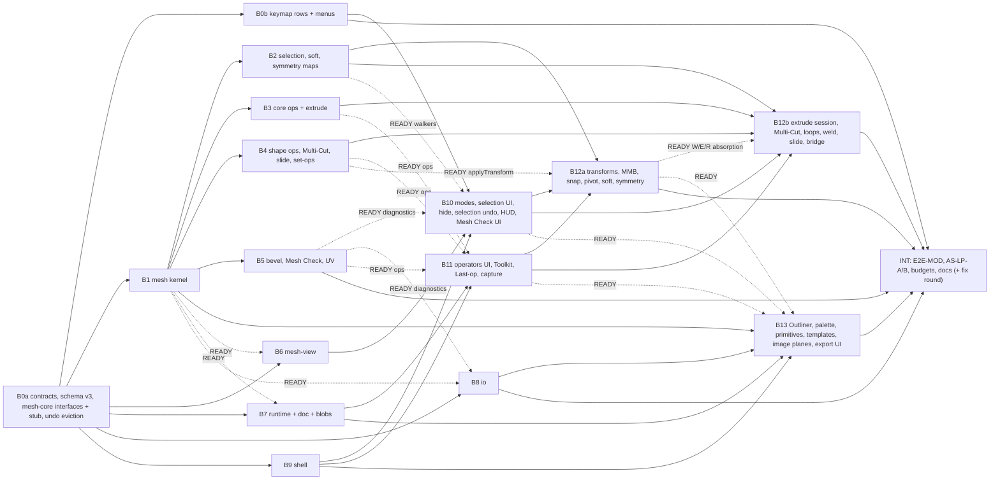

# Ekza Studio — M6a build specification ("modeling base")

Status: v1.1 (2026-10-19; v1.0 plus design-review round 1, recorded in §12.3), the binding build spec for milestone
M6a, derived from
[MODELING-PLAN](MODELING-PLAN.md) v0.2 §2–§4 and its design-review record (§12), research
[10](research/10-dcc-poly-modeling.md)–[16](research/16-model-workspace-ui.md), the owner defaults of
[DECISIONS-OPEN §G](DECISIONS-OPEN.md#g-modeling-iteration-m6am7-defaults-chosen-2026-10-18) and the shipped
architecture ([ARCHITECTURE](../ARCHITECTURE.md), [MVP-SPEC](MVP-SPEC.md) v0.3, [M2A-SPEC](M2A-SPEC.md) v0.3). With
this version ADRs [0014](adr/0014-mesh-kernel.md), [0015](adr/0015-mesh-storage-in-the-document.md) and
[0016](adr/0016-modeling-interaction-paradigm.md) are **Accepted**, and items 7–8 of
[ADR 0017](adr/0017-ai-generation-boundary.md) (provenance record, export block, lints) are accepted with M6a. The
contract freezes when B0a merges; after that a contract change needs a PR that updates this file first.

Audience: the integration agent (B0a, B0b and the final integration INT), the implementation agents of B1…B13 and
reviewers. Read MVP-SPEC (base contract) and M2A-SPEC (its deltas) first. This file lists the **M6a deltas**; where it
disagrees with them, with an ADR sketch or with the plan for M6a work, **this file wins**, and §12.2 lists every
deliberate refinement of the plan.
Requirements: [REQUIREMENTS](REQUIREMENTS.md) FR-MOD-06…30 and FR-SHELL-08, -09, -11 (moved to M6a).

Normative words: **MUST**, **SHOULD**, **MAY**. "Contract" means a type or signature in §4 or a package's *Public
API* block in §9. "Kernel" means `@ekza-studio/mesh-core`. Counts are written **V/E/F** (vertices, edges, faces).
Distances are metres, angles are stored in radians and shown in degrees. Fractions (param kind `fraction`: the
Fraction, Weight, Offset and Strength fields of a leading commercial desktop DCC, "the desktop DCC" below) are stored
0…1 and **shown as fractions** (`0.300`, as the desktop DCC shows them); typed input accepts `0.3` and `30%` for the
same value, and a bare number is always a fraction (`30` is clamped to the field's maximum with a problem string),
§5.10.

Contents: [1 Scope](#1-scope) · [2 Dependencies and toolchain](#2-dependencies-and-toolchain) ·
[3 Conventions](#3-conventions-deltas-to-mvp-spec-3-and-m2a-spec-3) · [4 Contract deltas](#4-contract-deltas) ·
[5 Normative behaviours](#5-normative-behaviours) · [6 Operator table](#6-operator-table) ·
[7 Keymap additions](#7-keymap-additions-preset-dcc) · [8 UI placement](#8-ui-placement) ·
[9 Work packages](#9-work-packages) · [10 Acceptance](#10-acceptance-tests-e2e-scenarios-and-as-lp) ·
[11 Integration and definition of done](#11-integration-plan-and-m6a-definition-of-done) ·
[12 Defaults and refinements](#12-defaults-chosen-and-refinements-of-the-plan)

---

## 1. Scope

### 1.1 In scope (M6a core)

| # | Area | Content | Requirements |
|---|---|---|---|
| 1 | **Shell** | Workspace tabs `Model › Rig & Skin › Animate › Review` with status glyphs (Model and Animate built; Rig & Skin and Review shown disabled with "arrives in v0.4" / "arrives in V1"); per-workspace layout, menu set, status-line groups, default tool and pick mask, key-scope prefix, timeline visibility; generic `MarkingMenu`; command palette (`Mod+K`) with aliases from other DCCs; hierarchical key scopes; viewport Scale tool; shading modes `4`–`7` | FR-SHELL-08, -09, -11, FR-MOD-06 |
| 2 | **Kernel** | `mesh-core`: BMesh-style radial-edge structure of arrays, attribute layers with interpolation and mirror rules, write log + `MeshDelta`, Euler operators, `validateMesh`, `topologyStats`, revision manifest + ~32 KiB chunks, one deterministic triangulation, derived normals with one hard-flag rule, six primitives, refusal policy | FR-MOD-22, -28 |
| 3 | **Storage** | Schema v3 (seven new tables, `CharacterRecord.source`, `AssetRecord.provenance`), `MeshRecord.data` revision refs, `BlobStore` (memory, IndexedDB autosave, `.ekzanim` `blobs/`), derived GC roots, undo byte budget and journal cap, `MeshRuntime` with two-phase commit and `loading` state, `MeshSetOp` runner | FR-MOD-28 |
| 4 | **Selection** | Component modes (`F8`, `F9`/`1`, `F10`/`2`, `3`, RMB menu), hilite (others opaque and unpickable; per-pane "Dim unhilited"), per-mode selection memory, click/marquee with desktop-DCC modifiers, hover pre-selection, camera-based selection, the desktop-DCC loop table, grow/shrink/convert/border/shell, **selection undo in Model**, hide/show/isolate | FR-MOD-07, -08, -09 |
| 5 | **Precision** | Component W/E/R in World/Object/Component space, MMB-drag (desktop-DCC rule; a trackpad stand-in, §5.15), Tweak style (`` ` `` toggles it), snapping `X`/`V`/`J`, pivot editing, soft select (Volume/Surface), symmetry Object/World X/Y/Z remembered per mesh with partner maps, mirrored selection drawn and counted, and **every base tool mirrored** (§5.14) | FR-MOD-10, -11, -13 |
| 6 | **Topology tools** | Extrude (faces, border edges) with the **extrude session** (its own args undo stack) and smart extrude; Inset; Bevel (edges, or the edges of selected faces; 1–3 segments); Insert Edge Loop (relative, equal, multiple); Offset Edge Loop; Multi-Cut (points on edges/vertices, Ctrl loop, snap, RMB/Enter completes); Connect; Slide Edge/Vertex; Average Vertices; Bridge (equal counts, two faces; divisions, twist, offset); Fill Hole; Merge, Merge to Center, Target Weld, Collapse, Merge by Distance; Delete (plain) and Delete Edge/Vertex; Spin Edge, Flip Triangle Edge | FR-MOD-14…20 |
| 7 | **Mesh level** | Combine, Separate, Extract, Duplicate Faces (`MeshSetOp`s); Mirror (cut, merge, reversed winding); Symmetrize; Triangulate, Quadrangulate; Freeze / Reset Transformations; Group, Parent, Unparent, Duplicate | FR-MOD-21 |
| 8 | **Normals and shading** | Per-edge hard flag, faceted new meshes, Soften/Harden, Set Normal Angle (one-shot), Reverse, Conform, WYSIWYG normals and triangulation, overlays (wire on shaded, flat, cull, normals, face orientation, triangulation) | FR-MOD-22 |
| 9 | **Colour and UV** | Per-face palette slot as colour truth, project palettes, Palette panel, Paint Colour tool, fill shell, select by swatch, replace swatch, eyedropper, palette variants; export outputs palette PNG (default) / `COLOR_0` / one material per colour; planar, box and cylindrical UV projections | FR-MOD-23, -24 |
| 10 | **Content** | Primitives with low-poly defaults and live parameters until the first component edit; templates prop, handheld (grip), humanoid guides, humanoid body mesh generator; reference image planes per ortho camera; Outliner for meshes and groups; Model start card and Getting started card | FR-MOD-12, -25 |
| 11 | **Workflow** | Modeling Tools panel with option boxes; RMB, Shift+RMB, Ctrl+RMB and Ctrl+Shift+RMB marking menus; **Adjust Last Operation** (Last-op card + Channels panel INPUTS, `T`); **Repeat Last** (`G`), last tool (`Y`); numeric capture in the narrow window; Poly Count HUD with budget bar; Mesh Check panel and overlay | FR-MOD-26, -27 |
| 12 | **IO** | Make editable (licence-gated, morph-aware weld, layers kept); `meshToPrimitives` with derived morph `NORMAL` deltas; surgeon "replace primitives" with bake marker v2; in-memory container rebuild for edited characters through `ModelLoader`; author GLB writer for static models; palette PNG writer; `ekza/omoba-handheld-v1` profile; `mesh.*`/`ekza.*` lints; `ekza_model_v1` provenance block; lazy glTF-Validator at export | FR-MOD-29, -30 |

### 1.2 M6a-stretch (implement only if time remains; tests `test.fixme` until done)

| Item | Fallback in M6a core |
|---|---|
| Live Mirror (per mesh, evaluated mirror clipped at the seam, baked at export) | Symmetry mode + `mesh.mirror`; **promoted to core** only under the §5.14 overrun rule (owner decision record) |
| Extrude Manifold option; Auto-weld toggle | Extrude + Merge by Distance |
| Select Similar; lasso and paint select; multi-component mode; component pick-walk (arrows in component mode) | Mesh Check "select matching", select by swatch, marquee; arrows poll-fail with "Component pick-walk arrives later" |
| Selection constraints other than Off (Angle, Border, Edge Loop, Edge Ring, Shell) | Toolkit constraint dropdown shows them disabled; Ctrl+RMB convert and the walkers cover the same selections |
| Multi-Cut points inside faces and slice plane; a cut between two clicks on faces that share no face (the desktop DCC cuts through the faces between them along the screen-space line) | Points on edges and vertices only; a click inside a face is ignored with a help-line hint; consecutive points must share a face ("Click on each face the cut crosses") |
| Desktop-DCC-style **Normal** axis orientation (each component moves along its own normal on the N handle); Move tool **Retain component spacing** off (every moved vertex snaps to the grid on its own) | **Component** orientation (one averaged frame, §5.15); snapping moves the pivot and keeps spacing |
| Bridge with unequal counts or curve (Blend) interpolation | Refusal with "Bridge needs the same number of edges on both sides (12 vs 10)"; linear only |
| Poke, Chamfer Vertex, vertex extrude, extrude of interior edges | Menu items present and poll-failing with "not available yet" |
| Edge snapping `C`; interactive primitive placement; `Shift+D` duplicate with transform | Grid and vertex snap; creation at the origin; `Mod+D` then move |
| Ramp swatches and the decal region; palette import/export `.gpl`/`.hex` | Flat swatches; swatches edited in the panel (M6c for ramps and decals) |
| Bridge mode of Mirror (`mergeMode: 'bridge'`) | `merge` and `none` |

Stretch scenarios live in `apps/web/e2e/m6a-stretch.spec.ts` as `test.fixme` with the fallback asserted where one
exists (M2a pattern).

### 1.3 Out of scope (M6a)

NURBS, sculpting, construction history, booleans, subdivision and smooth preview (`Shift+1/2/3` stay reserved), UV
editor, seams/unwrap and packing (M6c), image textures and texture painting, normal/AO bakes, tangents (refused with a
reason, §5.21), LODs, retopology and Quad Draw, decimation and AI intake operators (M7 G-a), skeletons, skinning and
weight tools, the VRM character writer and the Rig & Skin workspace (M6b), per-vertex CRDT and mesh claims (M3), the
alternative keymap preset (open-source-DCC style, V1+), topology symmetry, vertex-face mode, custom normal editing.
Schema v3 already contains the M6b records (`skeletons`, `joints`, `CharacterRecord.source.kind 'model'`) so M6b
starts against fixed records; M6a registers and validates them but creates none.

### 1.4 What M6a is for (say it plainly)

M6a makes the editor a **low-poly box modeller for desktop-DCC hands**: block out a prop or a character body from a
cube against front and side reference images, with the desktop DCC's modes, marking menus and keys, the "adjust the
last operation" and typed numbers of a popular open-source DCC ("the open-source DCC" below), and symmetry that every
tool respects; colour it with a palette; check it with the HUD and Mesh Check; export a static GLB (OMOBA handheld
profile included); and fix meshes of imported avatars without breaking their skin, expressions or MToon outlines. It
does **not** yet rig or skin your own model (M6b, `v0.4.0`), so a character made in M6a is exported as a static mesh.
The release is `v0.3.0` (the tag is the owner's call).

---

## 2. Dependencies and toolchain

New runtime dependencies (checked on the npm registry 2026-10-18; exact pins, `minimumReleaseAge` honoured; landed by
B0a, the integration agent):

| Package | Version | Licence | Used by | Why |
|---|---|---|---|---|
| `earcut` | 3.2.4 | ISC | `mesh-core` | n-gon triangulation on the Newell plane (§5.4) |
| `robust-predicates` | 3.0.3 | **Unlicense** | `mesh-core` | exact `orient2d`/`orient3d` for Multi-Cut chords and concave tests; a reviewed entry in `tooling/license-exceptions.json` (public-domain dedication, OSI-approved; Q-MOD-K-6). Fallback if review fails: port Shewchuk's four predicates into `mesh-core/src/predicates` (~1 agent-day, B1) |
| `three-mesh-bvh` | 0.9.16 | MIT | `mesh-view` | CPU picking, occlusion, `shapecast` marquee (peer `three >= 0.159`; one copy of `three` stays enforced) |

No other new dependency. `fflate` (PNG zlib, already in `io`), `@gltf-transform/*` 4.5.1 (author writer, already in
`io`), `gltf-validator` 2.0.0-dev.3.10 (already a dependency; loaded lazily at export) and `fast-check` 4.10.2
(already a dev dependency of five packages; `mesh-core` adds it) are reused.

New packages (manifests, `transpilePackages` in `apps/web/next.config.ts`, `tooling/check-deps.mjs` allow-lists and
the lockfile are the integration agent's, ARCHITECTURE §3 rule 6):

| Package | Dir | May import | Must not import |
|---|---|---|---|
| `@ekza-studio/mesh-core` | `packages/mesh-core` (subpaths `./descriptors`, `./testing`) | anim-core, `earcut`, `robust-predicates`; dev: `fast-check` | three, React, DOM, doc, editor-core, WASM |
| `@ekza-studio/mesh-view` | `packages/mesh-view` | mesh-core, anim-core, `three`, `three-mesh-bvh` | React, R3F, editor-core, doc |

Dependency edges added: `io → mesh-core` (only from the lazy `io/mesh` and `io/write` entries); `editor-core →
mesh-core` (`./descriptors` statically; the kernel only through dynamic `import()`); `viewport → mesh-view, mesh-core`
(both through dynamic `import()` from `viewport/src/mesh/**`); `editor → mesh-core` (types and the palette PNG preview
only, lazy); `headless-tests → mesh-core, mesh-view`. `mesh-core` is a headless package under ARCHITECTURE §3 rule 2
(Node-safe, no globals).

**Eager/lazy split (binding, §5.27 gates).** `@ekza-studio/mesh-core/descriptors` holds the op **descriptors**
(id, label, kinds, params, flags, symmetry class; no kernel code, no `earcut`, no predicates) and `PRIMITIVE_PARAMS`;
menus, keymap rows, the command palette, option boxes and Last-op cards read only it. The kernel (`mesh-core` root:
`MESH_OPS` with `poll`/`run`, `editMeshFrom`, triangulation, normals, revisions) is a lazy chunk loaded by
`MeshRuntimeRegistry` on first need (a project with mesh records, entering Model, a `mesh.*` run); until it resolves,
runtimes are `loading` and `mesh.*` polls fail with "Mesh tools are loading". mesh-view and `three-mesh-bvh` load the
same way. B0a adds two `check-size` BOUNDARIES (`mesh-kernel`, marker `ekza-mesh-kernel`, a string constant every
kernel entry module references; `mesh-view`, marker `ekza-mesh-view`), so any package that pulls kernel or view code
into the eager route fails the size gate the day it does so.

`package.json` script changes (B0a): `mesh-core` and `mesh-view` get `test`, `typecheck`, `lint` like the other
packages; `mesh-core` adds `bench` (`vitest bench`, report-only); `apps/web` `check:size` gains the eager-delta check
of §5.27 (B9 writes it).

---

## 3. Conventions (deltas to MVP-SPEC §3 and M2A-SPEC §3)

1. **Contract freeze after B0a.** B0a lands every §4 type; every new public function as a stub
   (`EkzaError('not-implemented', '<package>.<symbol>')`); **every kernel op of §6 as a stub object** with its final
   `id`, `label`, `params`, `flags` and `symmetry` class whose `run` returns the refusal `not-implemented` (so B11 can
   generate cards, menus and option boxes before the kernel lands); every §6 operator registered (poll-failing
   "not available yet" until its owner lands it); every §7 keymap row is B0b's; every `data-testid` of §8.10 reserved.
   **Exception (M2A-SPEC §3 rule 1 kept): a function that a shipped code path or another package's baseline calls is
   never a throwing stub.** B0a lists them in §9: the schema v3 migration, `requiredWriterVersion`, `referencesOf`,
   `UndoManager.entries()`/`onEvict`, `EditorHistory` step-drop event and selection parts, `editMeshFrom` (reference
   implementation for static meshes) with reference `triangulate`, `computeNormals`, `validateMesh`, `topologyStats`
   and `primitive('cube' | 'plane' | 'cylinder')`, the memory `BlobStore`, `LastRun` recording (a no-op recorder until
   B11), the workspace registry with the Animate workspace, and the keyboard adapter's scope chain for the `animate`
   workspace (identical to today's).
2. **New files over shared files.** Each package's operators live in new files (§9 names them); B0a creates them
   with stubs and registers them from `operators/builtin/index.ts`, so no two packages edit the index. Each kernel op
   lives in the directory `mesh-core/src/ops/<dir>/` that §6.1's Kernel column names (the binding op-id → directory
   map; related ops such as the merge family share one) with a `descriptor.ts` (eager, §2) and an `index.ts`
   exporting the op objects; the barrels `mesh-core/src/index.ts` and
   `mesh-core/src/descriptors.ts` are created by B0a with stub exports and **only the stub lines change** afterwards.
3. **Deterministic IDs.** New records created by operators get `newId(kind)` (random, seeded in `?e2e=1`), except:
   records created by a `MeshSetOp`, by `mesh.create.*` and by `mesh.create.template` get
   `derivedId(kind, opId, inputIds, stepSeed, n)` = prefix + 16 base62 of
   `sha256(opId + ':' + inputIds.join(',') + ':' + stepSeed + ':' + n)`, where `stepSeed` is the `LastRun` seed of the
   run being adjusted (a fresh `newId('tx')` on a first run), so an adjusted re-run reuses the ids; a mesh record made
   editable from a character's glTF mesh is `derivedId('mesh', 'asset', [characterId], '', meshIndex)` (§5.21); template joints
   (M6b) use `<skeletonId>:<humanBone>`; the default palette is `derivedId('palette', 'palette.default', [], '', 0)` and
   its swatches `derivedId('swatch', 'palette.default', [paletteId], '', slot)`. Prefixes: `msh_`, `grp_`, `pal_`, `sw_`, `img_`, `skl_`, `jnt_`.
4. **Test gates.** M2a pattern: `describe.skipIf(!READY.<id>)` in unit tests (`READY` flags in each package's
   `test/ready.ts`, ids `b0b`, `b1`…`b11`, `b12a`, `b12b`, `b13`), `test.fixme('<ids>')` in e2e with the blocking package ids,
   turned into failures at integration (INT). Every package lands the E2E-MOD scenarios it owns (§10.1) as gated tests.
5. **Files.** E2E specs are `apps/web/e2e/m6a-NN-<slug>.spec.ts` (`NN` = the E2E-MOD number); helpers are
   `apps/web/e2e/helpers/m6a-<package-slug>.ts` plus the shared `helpers/m6a-model.ts` (B0a: enter Model, create
   primitives, screen points of components; closed after B0a; content helpers such as `buildSword` live in the owner's
   `helpers/m6a-<package-slug>.ts`); benches are `apps/web/e2e/bench/m6a-<slug>.bench.ts` (browser) and
   `packages/mesh-core/bench/*.bench.ts` (Node). Kernel goldens are JSON files in `packages/mesh-core/test/goldens/`.
6. **Notes.** Each package records interpretations in `docs/wp-notes/m6a-<slug>.md`; INT copies the decisions into
   a new DECISIONS-OPEN §I "M6a build deviations" (IDs `M6A-<id>-<n>`, e.g. `M6A-B3-4`).
7. **Every rule of MVP-SPEC §3 and M2A-SPEC §3 still holds** (no allocation in per-frame paths, explicit
   registration, Node-safe headless packages, `EkzaError` for caller errors, repair never reject for document
   content, literal updates are not weakening).
8. **Kernel rules** (ADR 0014): typed arrays only, no objects per element; float32 storage through `Math.fround`,
   float64 arithmetic; no `Math.random`, no iteration over float-keyed maps, ties to the smaller index, integer
   spatial hashing; every write through the write log; topology only through Euler operators; an op either returns a
   result that passes `validateMesh` or a `Refusal` (never a throw for valid input, never invalid topology). With the
   kernel debug switch on (`setKernelDebug(true)`: every test setup, and the development and e2e builds of `apps/web`,
   which pass it through `createBrowserServices`; headless packages never read `process`), `validateMesh` runs after
   every commit and a problem throws `EkzaError('invalid-mesh')` with the op id.
9. **Literal updates** expected in shipped tests (each in the commit that changes the contract, naming the test and
   the contract row): `SCHEMA_VERSION` 2 → 3 and `"schemaVersion":2` in snapshot fixtures; the keymap table test (new
   rows, `Mod+Shift+E`); the Animate layout key (`ekza-animator:layout:v<N>:animate` stays; Model adds
   `…:model`); the menu-bar menu list (Model menus appear only in the Model workspace).
10. **The Animate workspace stays byte-for-byte the shipped experience** unless this spec names a change. Named
    changes: `Mod+Shift+E` opens Export everywhere; `R` selects the new viewport Scale tool; `4`–`7` switch the pane's
    shading; plain MMB-drag with W/E/R active and no channel selected in the Channels panel moves/rotates/scales the selected
    controls (it did nothing before, §5.15); the workspace tabs in the menu bar. E2E-00…27 and E2E-M2A-01…25 MUST stay
    green at every merge.

---

## 4. Contract deltas

Blocks below are additions to the named contract files unless marked *changed*. "Additive" means existing callers
compile and behave as before. Contract files keep the header comment "copied verbatim from M6A-SPEC §4.x".

**Where each symbol goes.** `interface`, `type` and literal-union declarations are copied verbatim into the block's
contract file (`doc/src/records.ts`, `ids.ts`, `store.ts`; `mesh-core/src/types.ts`; `mesh-view/src/types.ts`;
`io/src/types.ts`; `editor-core/src/types.ts`; `editor/src/test-api/types.ts`). `function`, `class` and `const` lines
are **signatures of implementation modules**, never copied into a types file: B0a lands each as a stub (or a working
baseline, §3 rule 1) in the module the block's lead sentence or the owner's **Dirs** (§9) name, and re-exports it from
the package root. Two changes are not additive and B0a pays for them: `CharacterRecord.asset` becomes nullable (B0a
narrows every shipped reader: `characters/registry.ts` (≈ 15 reads), `app/deps.ts:144`, `workflows/importModel.ts:209`,
`workflows/export.ts:199`, `editor/src/panels/attributes/AttributesPanel.tsx:82`; each skips or refuses a `null` asset,
which M6a never writes), and `KeymapManager.isTapHoldKey` gains parameters (§5.17).

### 4.1 anim-core — parameter descriptions and hashing

New module `packages/anim-core/src/params/index.ts` (exported from the package root). One `ParamDef` list describes an
operation's arguments for the kernel (JSON args, defaults, validation), the editor (Last-op card, Channels panel
INPUTS, option boxes, command-palette prompts, numeric capture) and, later, scripting and agent schemas
(ADR 0016 D6, plan R34).

```ts
/** Scalar kinds. Compound DCC attributes are flattened per component (`localTranslateX/Y/Z`), so every param is a
 *  scalar and can be the primary field; structured pointer/selection data uses kind 'data'. */
export type ParamKind = 'number' | 'int' | 'distance' | 'angle' | 'fraction' | 'bool' | 'enum' | 'axis' | 'data';
/** 'fraction': stored 0…1, shown as a fraction ('0.300'); typed '30%' and '0.3' are the same value (§1, §5.10). */
/**
 * Where the value comes from (ADR 0016 D6):
 * - 'value': chosen by the user; kept by Adjust Last and Repeat Last.
 * - 'selection': resolved from the current component selection when absent (a loop seed, bridge loops in pick order);
 *   the resolved value is recorded in LastRun so an adjusted re-run is bit-identical; Repeat Last drops it and
 *   re-resolves it from the then-current selection.
 * - 'pointer': supplied by a tool from pointer picks (Multi-Cut points, Target Weld pairs, a slide rail); recorded for
 *   Adjust Last; an operation with a required pointer-bound param is never repeatable (`G` re-activates its tool).
 */
export type ParamBound = 'selection' | 'pointer' | 'value';
export type ParamValue = number | boolean | string | null | JsonValue;
export type JsonValue = null | boolean | number | string | readonly JsonValue[] | { readonly [k: string]: JsonValue };
export interface ParamDef {
  readonly name: string;                       // JSON arg name; desktop-DCC parameter name where one exists
  readonly label: string;                      // UI label, desktop-DCC wording: 'Local Translate Z', 'Divisions'
  readonly kind: ParamKind;
  readonly bound: ParamBound;
  /** Default; null only with `nullable` ("auto", resolved at invoke time, e.g. smoothingAngle). */
  readonly default: ParamValue;
  readonly nullable?: boolean;
  /** Hard limits in stored units (values outside are clamped by `coerceArgs`, with a problem string). */
  readonly min?: number;
  readonly max?: number;
  /** Slider range for the virtual slider and the option box (stored units). */
  readonly softMin?: number;
  readonly softMax?: number;
  /** Arrow and virtual-slider step in stored units (int: 1; angle: 1° = π/180; distance: 0.01). */
  readonly step?: number;
  /** enum and axis: the allowed string values with labels ('x' | 'y' | 'z' for axis). */
  readonly options?: readonly { readonly value: string; readonly label: string }[];
  /** At most one per list: typed digits after a keyboard-invoked run and `T` go here. */
  readonly primary?: boolean;
  /** Not shown in the Last-op card or INPUTS ('data' params are always hidden). */
  readonly hidden?: boolean;
  /** JSON schema of a 'data' param (draft 2020-12 subset: type, properties, items, required, enum, minimum, maximum). */
  readonly schema?: JsonValue;
  /** Card section label ('Offsets', 'Shape'); fields keep list order. */
  readonly group?: string;
  readonly description?: string;
  /** STUDIO-TOUCH-SPEC §10.3 (T10, P-T7-8): an 'int' or 'number' param that is a frame count, stored in frames; a shell
   *  may show it in seconds (Ekza Studio's Settings › Time). Absent: not a time. */
  readonly time?: 'frames';
}
export type ParamValues = Readonly<Record<string, ParamValue>>;
/** Defaults of every param (nullable params: null). */
export function paramDefaults(params: readonly ParamDef[]): ParamValues;
/** JSON schema (draft 2020-12) of the args object: one property per param; required = none (defaults fill). */
export function paramSchema(params: readonly ParamDef[], opts?: { readonly title?: string }): JsonValue;
/**
 * Fills defaults, clamps numbers into [min, max], rounds ints (half away from zero), checks enum/axis membership and
 * 'data' params against their schema. Keys named in `opts.passThrough` (an operator's declared non-param args: the
 * target list `meshes`, the component `kind`, operator-specific ids such as `mesh`, `template`, `bytes`, `palette`)
 * are copied into `args` untouched and unvalidated (the operator validates them); every other unknown key is dropped.
 * Never throws; `problems` lists what was changed or dropped ('divisions clamped to 32'). Pure and deterministic.
 */
export function coerceArgs(params: readonly ParamDef[], raw: unknown,
  opts?: { readonly passThrough?: readonly string[] }): { readonly args: ParamValues; readonly problems: readonly string[] };
/** Copy of `args` without the params of the given bounds (Repeat Last: `['pointer', 'selection']`). */
export function stripBound(params: readonly ParamDef[], args: ParamValues, bounds: readonly ParamBound[]): ParamValues;
/** The primary param, or null. Lists with more than one `primary` are rejected by `assertParams` (tests). */
export function primaryParam(params: readonly ParamDef[]): ParamDef | null;
export function assertParams(params: readonly ParamDef[]): void;   // EkzaError('invalid-params') on duplicates or 2 primaries
```

New module `packages/anim-core/src/hash/sha256.ts` (exported from the root): the in-repo synchronous SHA-256 digest
core (FIPS 180-4) moved down so the kernel can hash chunks without `doc` or `io`. It is **streaming and
non-copying**: it compresses 64-byte blocks straight from the input view and pads only the final partial block in a
fixed 128-byte scratch buffer (the shipped `doc` copy, which allocates a padded copy of the whole input, is replaced).
Throughput ≥ 300 MB/s in Node 25 on the reference machine (a 64 KiB chunk in ≤ 0.25 ms), benchmarked in B0a:

```ts
export function sha256(bytes: Uint8Array): Uint8Array;             // 32 bytes
export function sha256Hex(bytes: Uint8Array): string;              // lowercase hex, synchronous
export function toHex(bytes: Uint8Array): string;
```

**Only the digest core moves; every shipped name keeps its signature.** `io` keeps `sha256HexSync(bytes): string`
(now `toHex(anim-core sha256(bytes))`) and its async `sha256Hex(bytes): Promise<string>` (WebCrypto when present,
else the sync path) exactly as exported today; `doc` keeps `sha256Hex(text: string): string` (UTF-8 encode, then
anim-core) and `digestBase62`. Their callers and tests are unchanged; new vectors assert all three paths agree.

### 4.2 doc — schema v3, new tables, undo eviction

**IDs** (`packages/doc/src/ids.ts`, additive):

```ts
export type MeshId = Brand<string, 'MeshId'>;               // 'msh_' + 16 base62
export type GroupId = Brand<string, 'GroupId'>;             // 'grp_' + 16
export type PaletteId = Brand<string, 'PaletteId'>;         // 'pal_' + 16
export type SwatchId = Brand<string, 'SwatchId'>;           // 'sw_' + 16
export type ImagePlaneId = Brand<string, 'ImagePlaneId'>;   // 'img_' + 16
export type SkeletonId = Brand<string, 'SkeletonId'>;       // 'skl_' + 16 (M6b creates them)
/** Template joints: `${SkeletonId}:${HumanBoneName}` (deterministic); user joints 'jnt_' + 16 (M6b). */
export type JointId = Brand<string, 'JointId'>;
export interface IdOfKind { …M1…; mesh: MeshId; group: GroupId; palette: PaletteId; swatch: SwatchId;
  imagePlane: ImagePlaneId; skeleton: SkeletonId; joint: JointId }                       // changed (additive)
/** M6a §3 rule 3: deterministic ids for records created by MeshSetOps and the default palette. */
export function derivedId<K extends IdKind>(kind: K, opId: string, inputs: readonly string[], seed: string, n: number): IdOfKind[K];
```

**Records** (`packages/doc/src/records.ts`; schema v3). Shapes are normative.

```ts
// ---------- changed ----------
export interface AssetRecord {
  readonly id: AssetId;
  readonly name: string;
  readonly ext: 'glb' | 'vrm' | 'vrma' | 'png' | 'jpg';                          // changed: + png, jpg (image planes; archived under `images/`, §5.20)
  readonly mime: 'model/gltf-binary' | 'image/png' | 'image/jpeg';               // changed
  readonly size: number;
  readonly role: 'model' | 'animation-source' | 'reference-image';               // changed: + reference-image
  /** v3 (ADR 0017 §7): null for assets imported before v3 and for plain imports; set by M7 generation. */
  readonly provenance: AssetProvenance | null;
}
export interface AssetProvenance {
  readonly origin: 'imported' | 'generated' | 'authored';
  readonly derivedFrom: readonly DerivedFrom[];
  readonly redistributable: Redistributable;
  readonly generator: GeneratorProvenance | null;
}
/** Filled by M7; M6a only stores, validates, exports and lints it. */
export interface GeneratorProvenance {
  readonly kind: 'ai';
  readonly digitalSourceType: string;          // IPTC, e.g. 'trainedAlgorithmicMedia'
  readonly service: string;                    // 'tripo' | 'meshy' | 'selfhost' | …
  readonly model: string;                      // pinned model version; never 'latest'
  readonly op: string;                         // 'image-to-3d' | 'text-to-3d' | 'rig' | …
  readonly params: Readonly<Record<string, JsonValue>>;
  readonly inputSha256: readonly string[];
  readonly termsSnapshot: Readonly<Record<string, JsonValue>> | null;
  readonly rawSha256: string;
  readonly postSteps: readonly { readonly op: string; readonly aiMarksMayBeAltered: boolean }[];
  readonly promptSha256: string | null;
  readonly prompt: string | null;              // only on the user's opt-in (Q-GEN-5)
  readonly tier: 'paid' | 'free' | 'unknown';  // the user's attestation (Q-GEN-9)
  readonly taskId: string | null;              // provider task id; document only, never exported
}
export type CharacterSource =
  | { readonly kind: 'asset'; readonly asset: AssetId }
  | { readonly kind: 'model'; readonly skeleton: SkeletonId };                  // M6b
export interface CharacterRecord {
  …M1 fields except `asset`…
  /** v3: kept so that projects without v3-only content stay usable by M2a apps (minWriterVersion 2). Equals
   *  `source.asset` for asset-sourced characters; null exactly when `source.kind === 'model'` (M6b). */
  readonly asset: AssetId | null;                                                // changed: nullable
  readonly source: CharacterSource;                                              // v3
}

// ---------- new tables ----------
export type MeshOwner = { readonly character: CharacterId } | { readonly scene: true };
export type PrimitiveKind = 'cube' | 'sphere' | 'cylinder' | 'cone' | 'plane' | 'torus' | 'humanoidBody';
/** One field value = one merge unit (ADR 0015 §1). */
export interface MeshRef {
  readonly manifest: string;                   // sha256 hex of the revision manifest = the revision id
  readonly rev: number;                        // 1 for the first revision, +1 per commit on this record
  readonly base: string | null;                // parent revision (M3 fork detection); null for the first
  /** Copy of the manifest's skin palette for `skin.skeleton` meshes (M6b), in palette order. [] without a skin **and
   *  [] for an imported skin** (`skin: {asset, skin}`): its palette is the glTF skin's joints, identified only in the
   *  `skin.*` layer meta, never as JointIds (M6a creates no JointRecords, so they would all look dangling). */
  readonly joints: readonly JointId[];
}
export interface AssetMaterialRef { readonly asset: AssetId; readonly material: number }   // glTF material index
export type MeshMaterial =
  | { readonly preset: 'unlit' | 'toon' | 'lit' }                               // authored meshes ('toon' needs M6b)
  | { readonly assetSlots: readonly AssetMaterialRef[] };                       // made editable: face material = slot
export type ColourOutput = 'palette-texture' | 'vertex-colour' | 'material-per-colour';
export type MeshBudget = { readonly preset: BudgetPresetId } | { readonly tris: number } | null;
export type BudgetPresetId = 'hero' | 'npc' | 'boss' | 'handheld' | 'small-prop' | 'medium-prop' | 'building';
export interface HandheldGrip {                // asset.extras.ekza_handheld_v1 (registry handheld-glb-v1)
  readonly bone: 'rightHand' | 'leftHand';
  readonly offset: ReadonlyVec3;               // metres, each |c| ≤ 0.3
  readonly rotationDegrees: ReadonlyVec3;      // each |c| ≤ 360
  readonly scale: number;                      // 0.25…2
}
export interface MeshRecord {
  readonly id: MeshId;
  readonly name: string;                       // ≤ 64 chars, unique per owner (repair appends ' 2')
  readonly owner: MeshOwner;                   // partition: char:<id> | scene
  readonly parent: GroupId | MeshId | null;    // same owner only
  readonly order: string;                      // fractional index among siblings
  readonly placement: ReadonlyXf;              // object transform relative to the parent (character root for owner.character)
  readonly pivot: ReadonlyVec3;                // rotate/scale pivot in object space (D), default [0,0,0]
  readonly source: { readonly asset: AssetId; readonly mesh: number } | null;   // glTF mesh it edits; null = authored
  /** null is reserved (an asset-backed record without a revision): M6a never writes it. A glTF mesh that is not made
   *  editable has **no record**; `mesh.makeEditable` creates the record and its first revision in one transaction. */
  readonly data: MeshRef | null;
  readonly faceted: boolean;                   // true for meshes made in the editor; smoothingAngle default 0° (§5.3)
  readonly generator: { readonly kind: PrimitiveKind; readonly params: Readonly<Record<string, number | boolean | string>>;
    readonly version: 1 } | null;              // live primitive parameters; null after the first component edit
  readonly palette: PaletteId | null;
  readonly material: MeshMaterial;
  readonly colourOutput: ColourOutput;         // default 'palette-texture'
  readonly skin: { readonly skeleton: SkeletonId; readonly bind: Readonly<Record<string, JsonValue>> | null }   // M6b
              | { readonly asset: AssetId; readonly skin: number } | null;  // imported skin (glTF skin index)
  readonly budget: MeshBudget;                 // null = the export profile's default
  readonly handheld: HandheldGrip | null;      // only meaningful on an export root (§5.22)
  readonly deleted: Tombstone;
}
export interface GroupRecord {                 // Ctrl+G transform nodes
  readonly id: GroupId;
  readonly name: string;
  readonly owner: MeshOwner;
  readonly parent: GroupId | null;
  readonly order: string;
  readonly placement: ReadonlyXf;
  readonly pivot: ReadonlyVec3;
  readonly template: { readonly kind: 'prop' | 'handheld' | 'humanoid'; readonly params: Readonly<Record<string, number | string | boolean>> } | null;
  readonly budget: MeshBudget;
  readonly handheld: HandheldGrip | null;
  readonly deleted: Tombstone;
}
export interface PaletteRecord {
  readonly id: PaletteId;
  readonly name: string;                       // 'Ekza Default 16'
  readonly order: string;
  readonly deleted: Tombstone;
}
export interface SwatchRecord {
  readonly id: SwatchId;
  readonly palette: PaletteId;
  /** u16 0…65534, unique among the palette's swatches including deleted ones, never reused; faces store it. */
  readonly slot: number;
  readonly order: string;                      // display order in the panel
  readonly name: string;
  readonly srgb: readonly [number, number, number];   // 8-bit sRGB integers 0…255
  readonly kind: 'flat' | 'ramp';              // 'ramp' is M6a-stretch (validation accepts it; M6a renders it flat)
  readonly ramp: readonly [readonly [number, number, number], readonly [number, number, number]] | null;
  readonly deleted: Tombstone;
}
export type OrthoCamera = 'front' | 'side' | 'top';
export interface ImagePlaneRecord {            // scene partition; never picked, never exported
  readonly id: ImagePlaneId;
  readonly name: string;
  readonly camera: OrthoCamera;                // front = looking along −Z, side = along −X, top = along −Y
  readonly asset: AssetId;                     // AssetRecord role 'reference-image'
  readonly offset: readonly [number, number];  // metres, in the camera plane (right, up)
  readonly size: number;                       // displayed image height in metres (default 2)
  readonly opacity: number;                    // 0…1 (default 0.5)
  readonly depth: 'behind' | 'front';          // default 'behind'
  readonly locked: boolean;
  readonly visible: boolean;
  readonly order: string;
  readonly deleted: Tombstone;
}
export interface SkeletonRecord {              // M6b creates them; M6a validates and preserves
  readonly id: SkeletonId;
  readonly character: CharacterId;
  readonly template: 'vrm-humanoid' | 'generic';
  readonly templateVersion: string;
  readonly preset: 'lite17' | 'core21' | 'standard33' | 'full52' | 'custom';
  readonly symmetry: boolean;
  readonly deleted: Tombstone;
}
export interface JointRecord {                 // M6b creates them; M6a validates and preserves
  readonly id: JointId;
  readonly skeleton: SkeletonId;
  readonly parent: JointId | null;
  readonly order: string;
  readonly name: string;
  readonly humanBone: HumanBoneName | null;
  readonly restPosition: ReadonlyVec3;         // character space, metres
  readonly restRotation: ReadonlyQuat;         // identity by default
  readonly tail: ReadonlyVec3 | null;
  readonly side: Side;
  readonly mirror: JointId | null;
  readonly deleted: Tombstone;
}
export interface Tables { …M1…; meshes: MeshRecord; groups: GroupRecord; palettes: PaletteRecord;
  swatches: SwatchRecord; imagePlanes: ImagePlaneRecord; skeletons: SkeletonRecord; joints: JointRecord }  // changed
export const BUILTIN_TABLES = [ …M1…, 'meshes', 'groups', 'palettes', 'swatches', 'imagePlanes', 'skeletons',
  'joints' ] as const;                                                          // changed (appended, order fixed)
export const MERGE_UNIT = { …M1…, meshes: 'field', groups: 'field', palettes: 'field', swatches: 'field',
  imagePlanes: 'field', skeletons: 'field', joints: 'field' } as const;         // changed
export type SoftDeletableTable = Exclude<TableName, 'project' | 'assets' | 'keys'>;   // unchanged: new tables soft-delete
export interface PartitionLookup { …M1…; skeletonCharacter(skeleton: SkeletonId): CharacterId | undefined }  // additive
```

Rules for the new tables (`doc/src/tables/**`, `doc/src/records/validate.ts`; B0a writes all of them):

| Table | Partition | Validation (repair, never reject, MVP-SPEC §3) | `referencesOf` |
|---|---|---|---|
| `meshes` | `owner.character` → `char:<id>`, else `scene` | name non-empty (repair `Mesh`); `parent` same owner and acyclic (repair: null); `data.manifest` 64-hex, `rev` ≥ 1 integer, `base` 64-hex or null, `joints` strings; `generator.kind` known (repair: null); `palette` id or null; `material.assetSlots[].material` ≥ 0; `budget.tris` ≥ 1; `handheld` bounds of §4.2 (repair: clamped); `colourOutput` known (repair: `palette-texture`) | characters (owner), groups/meshes (parent), assets (source, material slots, skin.asset), palettes, skeletons (skin.skeleton), joints (`data.joints`) |
| `groups` | as meshes | as meshes; `template.kind` known (repair: null) | characters, groups |
| `palettes` | `scene` | name non-empty | — |
| `swatches` | `scene` | `slot` integer 0…65534; `srgb` three integers 0…255 (repair: clamped, rounded); duplicate live `slot` in one palette is a **problem** (the reader uses the swatch with the smaller `SwatchId`; Mesh Check lists it) | palettes |
| `imagePlanes` | `scene` | `camera` known; `size` > 0 (repair 2); `opacity` clamped 0…1 | assets |
| `skeletons` | `char:<character>` | preset known (repair `custom`) | characters |
| `joints` | `char:<skeletonCharacter(skeleton)>` | `humanBone` known or null; vectors finite | skeletons, joints (parent, mirror) |
| `characters` (changed) | unchanged | `source` present (repair: `{kind:'asset', asset}` from `asset`); `asset === source.asset` for kind `asset`; `asset === null` for kind `model` | + skeletons (`source.skeleton`); assets only when non-null |

**Write checks and load repairs** (B0a, M6A-B0A-6). A local write runs the **per-record** rules of this table and
rejects a record that breaks one (`EkzaError('invalid-record')`: an empty name, a self-parent, a malformed `data`
ref); remote batches are applied as received (ADR 0011). The **cross-record** rules (a `parent` of the same owner
that exists, is a group for a group, and closes no cycle; unique live mesh names per owner) are not write checks:
the operators that write parents and names keep them (`scene.*` and the `mesh.create.*` names, B13/B7: unique names on
create, rename and duplicate, a reparent that would close a cycle is refused), queries read a parent that breaks them
as a root, and `migrateSnapshot` repairs them on load (parent → null, a cycle broken at its smallest id, a duplicate
name gets the ` 2` suffix), so a reload never has to repair what M6a's own operators wrote.

`DocQueries` additions (`doc/src/store.ts`, B0a implements them in the memory store and `doc-yjs`):

```ts
export interface DocQueries {
  …M1/M2a…
  meshesOfOwner(owner: CharacterId | 'scene'): readonly MeshRecord[];          // by order
  childrenOf(parent: GroupId | MeshId | null, owner: CharacterId | 'scene'): readonly (MeshRecord | GroupRecord)[];
  swatchesOfPalette(palette: PaletteId): readonly SwatchRecord[];              // by order; live only
  swatchBySlot(palette: PaletteId, slot: number): SwatchRecord | undefined;    // smallest SwatchId on a duplicate
  imagePlanesOf(camera: OrthoCamera): readonly ImagePlaneRecord[];             // by order
  jointsOfSkeleton(skeleton: SkeletonId): readonly JointRecord[];              // parents first, then order
}
```

**Schema v3** (`doc/src/snapshot/version.ts`, `doc/src/migrations/migrate.ts`; one atomic B0a commit):

- `SCHEMA_VERSION = 3`. `CORE_MIGRATIONS[1]` (2 → 3) is pure and idempotent: every `characters` record without
  `source` gets `source: { kind: 'asset', asset: <asset> }`; every `assets` record without `provenance` gets
  `provenance: null`; nothing else changes. New tables start at `TableDef.version` 1.
- `requiredWriterVersion(tables)` returns **3** when any live record exists in `meshes`, `groups`, `imagePlanes`,
  `skeletons` or `joints`, any asset has `ext` `png`/`jpg` (an M2a validator rejects those values), or any live
  character has `source.kind === 'model'`; otherwise the M2a rule (2 with a live enabled `ik2` solver, else 1).
  Palettes, swatches and asset provenance alone do not raise it: older apps preserve them as unknown tables and
  fields (FR-EXT-02) and evaluate the animation correctly. Importing or animating a character writes **no** `meshes`
  record (records exist only after Make editable or for authored meshes, §5.21), so an animation-only project written
  by M6a stays `minWriterVersion` ≤ 2 and opens writable in M2a, while a modeling project opens read-only there. This
  holds for the archive too: the M2a `.ekzanim` reader accepts only `glb`/`vrm`/`vrma` entries in `manifest.assets`,
  so M6a writes reference images under a separate manifest key (`images`, §5.20) that M2a ignores; mesh revisions go
  to `blobs/`, which it ignores as well.
- `ProjectRecord.schemaVersion` is written as 3 by the M6a app; `.ekzanim` `project.json` carries `schemaVersion: 3`
  and the `blobs/` entries of §5.20.

**Undo eviction** (`doc/src/store.ts` `UndoManager`, additive; `PatchUndoManager` and the `doc-yjs` store implement
it; the conformance suite covers it):

```ts
export type UndoEvictReason = 'limit' | 'clear' | 'budget' | 'redo-cleared' | 'load';
export interface UndoManager {
  …M1…
  /** M6a: every entry, oldest undo entry first, and the redo entries from the next redo to the last. Frozen views,
   *  valid until the next store write and the same object until the stacks change: the first read after a change
   *  builds them (O(n), n ≤ limit), every further read is O(1). A coalesced transaction replaces the top entry by a
   *  merged one (same txId) or pops it when its edits cancel out; entries() shows that, onEvict does not report it
   *  (transactions that write `meshes.data` never set a coalesceKey, §5.20). */
  entries(): { readonly undo: readonly UndoEntry[]; readonly redo: readonly UndoEntry[] };
  /** M6a: entries leaving the manager for good (the 500 limit, clear(), evictOldest, a new transaction clearing
   *  redo, load()). Called synchronously after the change, in eviction order. Coalescing is not an eviction. */
  onEvict(listener: (entries: readonly UndoEntry[], reason: UndoEvictReason) => void): () => void;
  /** M6a: drops the n oldest undo entries (the BlobStore byte budget, §5.20); fires onEvict(…, 'budget'). */
  evictOldest(n: number): void;
  /** M6a: drops every redo entry (a selection-only step in Model clears redo like a transaction does, §5.6); fires
   *  onEvict(…, 'redo-cleared') when there was any. */
  clearRedo(): void;
}
```

### 4.3 mesh-core — the kernel's public API

`packages/mesh-core/src/index.ts` (barrel; B0a writes it with stub exports, owners replace only their stubs). Every
name below is exported from the package root (the lazy kernel chunk, §2) except the block marked
*descriptors*, which `./descriptors` exports (eager; the root re-exports it too); `./testing` exports the fast-check
arbitraries, fixtures and the golden runner.

```ts
import type { ParamDef, ParamValues, ReadonlyVec3, ReadonlyQuat, ReadonlyXf, Vec3, AnimCurve, CurveEngine } from '@ekza-studio/anim-core';

// ---------- counts, domains, layers ----------
export interface MeshCounts { readonly points: number; readonly edges: number; readonly faces: number; readonly corners: number }
export type Domain = 'point' | 'edge' | 'face' | 'corner';
export type LayerType = 'f32' | 'u8' | 'u16' | 'u32';
export type LayerInterp = 'linear' | 'copy' | 'skin' | 'unit' | 'or' | 'clear';
export type LayerMirror = 'none' | 'negate-axis' | 'swap-side' | 'flip-u';
export interface LayerDef {
  readonly name: string;                       // built-ins below; 'morph:<name>', 'group:<name>', 'vendor.name'
  readonly domain: Domain;
  readonly type: LayerType;
  readonly comps: 1 | 2 | 3 | 4;
  readonly interp: LayerInterp;
  readonly mirror: LayerMirror;
  readonly default: readonly number[];         // length comps; the implicit tail value (§5.20)
  /** Layer metadata, serialized in the manifest (skin palette: { joints: [{ id, parent }] }). */
  readonly meta?: Readonly<Record<string, unknown>>;
}
export const BUILTIN_LAYERS: {
  readonly uv0: LayerDef;          // corner f32×2, linear, flip-u
  readonly uv1: LayerDef;          // corner f32×2, linear, flip-u
  readonly color0: LayerDef;       // corner f32×4 (linear RGBA), linear, none
  readonly normalCustom: LayerDef; // 'normal.custom', corner f32×3, clear, negate-axis
  readonly skinJoints: LayerDef;   // 'skin.joints', point u16×4, skin, swap-side
  readonly skinWeights: LayerDef;  // 'skin.weights', point f32×4, skin, swap-side
  readonly paint: LayerDef;        // face u16×1, copy, none
  readonly crease: LayerDef;       // edge f32×1, copy, none (reserved)
};
export function morphLayer(name: string): LayerDef;                // point f32×3, linear, negate-axis (+ L/R swap by name)
export function groupLayer(name: string, domain: Domain, kind: 'bit' | 'weight'): LayerDef;   // u8 'or' | f32 'linear'
/** A layer's values; writes go through the owning mesh's log. Index = element index in the layer's domain. */
export interface AttrLayer {
  readonly def: LayerDef;
  get(index: number, comp?: number): number;
  set(index: number, comp: number, value: number): void;           // logged; float layers through Math.fround
  read(index: number, out: Float64Array, offset?: number): void;   // all comps
  /** Direct read access. The view may be longer than count × comps (capacity growth, research 13 K-1); only the
   *  first count × comps values are meaningful, and a view taken before a write may be stale after it. */
  readonly data: Readonly<Float32Array | Uint8Array | Uint16Array | Uint32Array>;
}

// ---------- stored form ----------
export const EDGE_HARD = 1, EDGE_SEAM = 2, EDGE_CREASE = 4;       // edgeFlags bits
export const FACE_FLIP_DIAGONAL = 1;                               // faceFlags bit0
/** Immutable stored form of a revision: dense, exact-length arrays. */
export interface MeshData {
  readonly counts: MeshCounts;
  readonly position: Float32Array;     // 3P, mesh-local metres
  readonly edgeVerts: Uint32Array;     // 2E, unordered endpoints (stored order defines t = 0 at index 0)
  readonly edgeFlags: Uint8Array;      // E
  readonly cornerVert: Uint32Array;    // C, vertex at the corner (face winding order, CCW seen from the front)
  readonly cornerNext: Uint32Array;    // C, next corner of the same face
  readonly faceCorner: Uint32Array;    // F, first corner
  readonly faceMaterial: Uint16Array;  // F, material slot
  readonly faceFlags: Uint8Array;      // F
  readonly layers: ReadonlyMap<string, { readonly def: LayerDef; readonly data: Float32Array | Uint8Array | Uint16Array | Uint32Array }>;
}

// ---------- edit form ----------
export interface EditMesh {
  readonly counts: MeshCounts;
  readonly position: Readonly<Float32Array>;   // read access; writes via setPosition
  // traversal (allocation-free; −1 = none)
  cornerVert(c: number): number; cornerNext(c: number): number; cornerPrev(c: number): number;
  cornerEdge(c: number): number; cornerFace(c: number): number; cornerRadialNext(c: number): number;
  edgeVert(e: number, end: 0 | 1): number; edgeCorner(e: number): number; edgeDiskNext(e: number, v: number): number;
  edgeOther(e: number, v: number): number; findEdge(a: number, b: number): number;
  vertEdge(v: number): number; faceCorner(f: number): number; faceLen(f: number): number;
  edgeFaceCount(e: number): number; vertValence(v: number): number; isManifoldVert(v: number): boolean;
  edgeFlags(e: number): number; faceFlags(f: number): number; faceMaterial(f: number): number;
  // Euler operators (logged; the only topology API)
  makeVert(x: number, y: number, z: number): number; killVert(v: number): void;
  makeEdge(a: number, b: number): number; killEdge(e: number): void;
  makeFace(verts: ArrayLike<number>, opts?: { readonly material?: number; readonly example?: number }): number;
  killFace(f: number): void;
  splitEdgeMakeVert(e: number, t: number): number;   // t from edgeVert(e, 0); layers interpolated by their rules
  joinEdgeKillVert(v: number): number;               // dissolve a valence-2 vertex; returns the joined edge
  splitFaceMakeEdge(f: number, cA: number, cB: number): number;   // caller guarantees the chord is inside (§5.11)
  joinFaceKillEdge(e: number): number;               // refuses non-manifold or same-face edges (EkzaError)
  reverseFace(f: number): void;
  // value writes (logged)
  setPosition(v: number, x: number, y: number, z: number): void;
  setEdgeFlags(e: number, flags: number): void; setFaceFlags(f: number, flags: number): void;
  setFaceMaterial(f: number, slot: number): void;
  layer(name: string): AttrLayer | undefined;
  addLayer(def: LayerDef): AttrLayer;                // logged; an existing name returns the existing layer
  removeLayer(name: string): void;                   // logged
  layers(): readonly AttrLayer[];
  // transactions (write log, ADR 0014 §5)
  begin(opId: string): void;
  end(): MeshDelta;                                  // coalesced log = exact undo patch
  abort(): void;                                     // restores the exact pre-begin state
  readonly inTransaction: boolean;
  apply(delta: MeshDelta, dir: 'forward' | 'backward'): void;   // O(|delta|), exact for stored and edit arrays
  snapshot(): MeshData;                              // dense copy of the stored subset
}
/** Builds edit links (disk, radial, loop cycles). ≤ 40 ms at 50k triangles incl. caches (budget §5.27). */
export function editMeshFrom(data: MeshData): EditMesh;
export function emptyMesh(): EditMesh;
/** §3 rule 8: validate after every commit (tests, development and e2e builds). Default off. */
export function setKernelDebug(on: boolean): void;

// ---------- write log ----------
export interface DomainRemap {
  /** Index after the op for every index before it (−1 = removed); null when no index of the domain moved. */
  readonly forward: Int32Array | null;
  /** Elements with index ≥ createdFrom in the after state were created by the op. */
  readonly createdFrom: number;
}
export type ElementRemap = Readonly<Record<Domain, DomainRemap>>;
export interface DirtySet {
  readonly topology: boolean;                        // any count or connectivity change
  readonly points: Uint32Array | 'all';              // sorted; position or point-layer writes
  readonly edges: Uint32Array | 'all';
  readonly faces: Uint32Array | 'all';
  readonly corners: Uint32Array | 'all';
  readonly layers: readonly string[];                // layers written, added or removed
}
export interface MeshDelta {
  readonly opId: string;
  readonly countsBefore: MeshCounts;
  readonly countsAfter: MeshCounts;
  readonly remap: ElementRemap;
  readonly dirty: DirtySet;
  readonly bytes: number;                            // retained size (journal cap accounting)
  /** Opaque; only `EditMesh.apply` reads it. Large ops switch to copy-on-write array snapshots (> P/4 slots). */
  readonly writes: unknown;
}

// ---------- components, selection, hiding ----------
export type ComponentKind = 'vertex' | 'edge' | 'face';
export class BitSet {
  constructor(size?: number);
  readonly size: number;
  has(i: number): boolean; add(i: number): void; delete(i: number): void; toggle(i: number): void;
  clear(): void; count(): number; isEmpty(): boolean; resize(size: number): void;
  forEach(fn: (i: number) => void): void;            // ascending
  toArray(): Uint32Array;
  equals(other: BitSet): boolean; clone(): BitSet;
  /** The smaller of two encodings, element 0 the tag: 0 = run-length (start, length) pairs ascending, 1 = the raw
   *  words. Scattered selections on large meshes therefore never cost more than size / 8 bytes (+4). */
  encode(): Uint32Array;
  static decode(encoded: Uint32Array, size: number): BitSet;
  readonly words: Uint32Array;
}
/** Kernel value object: the selection an op runs on. Bitsets per kind are kept for every kind (per-mode memory). */
export interface ComponentSelection {
  readonly kind: ComponentKind;
  readonly verts: BitSet; readonly edges: BitSet; readonly faces: BitSet;
  readonly order: Uint32Array | null;                // pick order in `kind`'s domain (Bridge, Target Weld, partial loops)
  readonly active: number;                           // lead component of `kind`, −1 = none
}
export function selectionOf(kind: ComponentKind, indices: ArrayLike<number>, counts: MeshCounts): ComponentSelection;
export interface HiddenSet { readonly verts: BitSet; readonly edges: BitSet; readonly faces: BitSet }

// ---------- operations ----------
export interface Refusal { readonly refused: true; readonly code: string; readonly reason: string }
export function refuse(code: string, reason: string): Refusal;
export function isRefusal(x: unknown): x is Refusal;
/** Codes include `symmetry.unmatched-partner` (§5.14): components without a mirror partner were processed on their
 *  own side only; `count` = how many. */
export interface OpWarning { readonly code: string; readonly message: string; readonly count?: number; readonly elements?: Uint32Array }
export interface OpFrame { readonly pivot: Vec3; readonly axes: readonly [Vec3, Vec3, Vec3] }   // manipulator placement (mesh-local)
export interface SymmetryContext {
  readonly map: SymmetryMap;                         // built by buildSymmetryMap (§5.14) for the current revision
  readonly preserveSeam: boolean;
}
export interface SoftContext { readonly radius: number; readonly falloff: 'volume' | 'surface'; readonly curve: FalloffCurve }
export interface OpContext {
  readonly symmetry: SymmetryContext | null;
  readonly hidden: HiddenSet | null;
  /** Placement of the mesh (world from local), for world-space args and world-space soft radii. */
  readonly placement: ReadonlyXf;
  readonly faceted: boolean;                         // resolves nullable smoothingAngle (§5.3)
  readonly soft: SoftContext | null;
  readonly curves: CurveEngine;                      // anim-core engine for custom falloff curves
  /** Scale-relative epsilon: 1e-6 × bounding-box diagonal (min 1e-9 m). */
  readonly epsilon: number;
}
export interface OpResult {
  readonly selection: ComponentSelection;            // the new selection (common DCC behaviour)
  readonly warnings: readonly OpWarning[];
  readonly frame?: OpFrame;                          // extrude cap frame, bevel handle frame …
  /** Fast path for continuous value args during a live preview; false → caller reverts and re-runs. */
  readonly adjust?: (patch: ParamValues) => boolean;
  readonly resolvedArgs: ParamValues;                // args after defaults, coercion and selection-bound resolution
}
export interface OpFlags {
  readonly adjustable: boolean;                      // Last-op card / edit.adjustLast
  readonly repeatable: boolean;                      // edit.repeatLast (G); false for pointer-only targets
  readonly topology: boolean;                        // false = positions/flags/layers only (refit, not rebuild)
  readonly manifoldPreserving: boolean;              // P3 class (§5.29)
  readonly whole?: boolean;                          // acts on the whole mesh (object mode), ignores selection
}
/** *descriptors* (eager, `./descriptors`): everything menus, keymap, palette, option boxes and cards need. */
export interface MeshOpDescriptor {
  readonly id: `mesh.${string}`;
  readonly label: string;                            // desktop-DCC name
  readonly kinds: readonly ComponentKind[] | 'object';
  readonly params: readonly ParamDef[];
  readonly flags: OpFlags;
  readonly symmetry: 'expand' | 'pointer' | 'none';  // §5.14 class
}
export interface MeshSetOpDescriptor {
  readonly id: `mesh.${string}`;
  readonly label: string;
  readonly arity: 'one' | 'many';
  readonly params: readonly ParamDef[];
  readonly flags: OpFlags;
}
export const MESH_OP_DESCRIPTORS: Readonly<Record<string, MeshOpDescriptor>>;          // every §6.1 MeshOp row
export const MESH_SET_OP_DESCRIPTORS: Readonly<Record<string, MeshSetOpDescriptor>>;   // every §6.1 set-op row
/** One-mesh operation (ADR 0014 D7). Pure and deterministic; writes only through `m` inside begin/end, which the
 *  caller (MeshRuntime or a test) opens and closes. A refusal after writes is allowed: the caller aborts the log. */
export interface MeshOp<A extends ParamValues = ParamValues> extends MeshOpDescriptor {
  poll(m: EditMesh, sel: ComponentSelection | null, ctx: OpContext): true | Refusal;
  run(m: EditMesh, sel: ComponentSelection | null, args: A, ctx: OpContext): OpResult | Refusal;
}

// ---------- mesh set operations ----------
export interface MeshSetInput {
  readonly key: string;                              // the MeshId
  readonly mesh: EditMesh;
  readonly selection: ComponentSelection | null;
  readonly placement: ReadonlyXf;                    // world from local
  readonly palette: string | null;                   // PaletteId
  readonly skeleton: string | null;                  // SkeletonId of a model skin, or 'asset:<id>:<skin>'
  readonly assetBacked: boolean;                     // record has `source`
  readonly materials: readonly string[];             // identity key per material slot ('preset:unlit', 'asset:<id>:<n>')
}
export interface MeshSetOutput {
  readonly key: string;                              // an input key (record updated) or 'new:<n>' (record created)
  readonly data: MeshData;
  readonly placement: ReadonlyXf;
  readonly materials: readonly string[];
  readonly from: readonly string[];                  // input keys the output's geometry came from
  readonly selection: ComponentSelection | null;
  readonly name: string;                             // proposed name ('Hero_body 2', 'Extracted 1')
}
export interface MeshSetResult {
  readonly outputs: readonly MeshSetOutput[];
  readonly removed: readonly string[];               // input keys whose records are soft-deleted
  readonly warnings: readonly OpWarning[];
}
/** arity: Separate/Extract/Duplicate Faces 'one'; Combine 'many' (≥ 2). flags.adjustable holds only while the re-run
 *  yields the same record set. */
export interface MeshSetOp<A extends ParamValues = ParamValues> extends MeshSetOpDescriptor {
  poll(inputs: readonly MeshSetInput[], args: A): true | Refusal;
  run(inputs: readonly MeshSetInput[], args: A, ctx: Omit<OpContext, 'placement' | 'symmetry' | 'soft'>): MeshSetResult | Refusal;
}
/** Remap helpers shared by MeshSetOps (B4). */
export interface SubsetResult {
  readonly data: MeshData;
  readonly remap: { readonly points: Int32Array; readonly edges: Int32Array; readonly faces: Int32Array; readonly corners: Int32Array };
}
export function copySubset(m: EditMesh, faces: BitSet, opts?: { readonly layers?: 'all' | readonly string[] }): SubsetResult;
export interface AppendResult {
  readonly materialSlots: Int32Array;                // b's slot → a's slot
  readonly paintSlots: Int32Array | null;            // b's palette slot → a's (identity when palettes match)
  readonly morphLayers: readonly string[];           // union, a's manifest order first
  readonly jointPalette: readonly string[] | null;   // union, a's order first; b's joint indices remapped
}
/** Appends b (transformed by `xf`, b-local → a-local) into a inside a's open transaction. When det(xf) < 0 (a
 *  mirrored duplicate: Mod+D, scale X −1, Combine) every appended face's corner order is reversed together with its
 *  corner layers, and custom normals go through the inverse transpose, so the result is outward-facing (as Freeze). */
export function appendMesh(a: EditMesh, b: MeshData, xf: ReadonlyXf, opts: { readonly materials: readonly [readonly string[], readonly string[]] }): AppendResult;

// ---------- validation, stats ----------
export interface MeshProblem { readonly code: string; readonly message: string; readonly elements?: Uint32Array; readonly domain?: Domain }
export function validateMesh(m: MeshData | EditMesh): readonly MeshProblem[];   // §5.1 invariants
export interface TopologyStats {
  readonly shells: number; readonly boundaryLoops: number; readonly euler: number;   // χ = V − E + F
  readonly nonManifoldEdges: number; readonly nonManifoldVerts: number; readonly genus: number | null;
  readonly triangles: number; readonly ngons: number;
}
export function topologyStats(m: MeshData | EditMesh): TopologyStats;

// ---------- revisions ----------
export interface RevisionManifest {
  readonly format: 'ekza-mesh';
  readonly version: 1;
  readonly counts: MeshCounts;
  readonly bounds: readonly [ReadonlyVec3, ReadonlyVec3] | null;
  readonly layers: readonly {
    readonly name: string;                           // stored arrays use reserved names '$position', '$edgeVerts', …
    readonly domain: Domain; readonly type: LayerType; readonly comps: number;
    readonly interp: LayerInterp; readonly mirror: LayerMirror; readonly default: readonly number[];
    readonly meta?: Readonly<Record<string, unknown>>;
    readonly chunkElems: number;
    readonly chunks: readonly string[];              // sha256 hex; may end before the element count (implicit default tail)
  }[];
}
export interface RevisionOutput {
  readonly manifestBytes: Uint8Array;                // canonical JSON (sorted keys, shortest round-trip numbers)
  readonly manifestId: string;                       // sha256 hex of manifestBytes
  readonly manifest: RevisionManifest;
  readonly newChunks: ReadonlyMap<string, Uint8Array>;   // chunks not present in `previous`
}
/** Writes a revision; with `previous` and `dirty`, clean chunks keep their hashes and are not re-hashed. */
export function writeRevision(m: MeshData | EditMesh, opts?: { readonly previous?: RevisionManifest; readonly dirty?: DirtySet }): RevisionOutput;
export function parseManifest(bytes: Uint8Array): RevisionManifest;   // EkzaError('mesh-manifest-version') on a newer version
export function manifestChunkIds(manifest: RevisionManifest): readonly string[];
export function readRevision(manifest: RevisionManifest, chunk: (id: string) => Uint8Array): MeshData;

// ---------- derived data (one function each, shared by viewport, picking, HUD and export) ----------
export interface Triangulation {
  readonly tris: Uint32Array;                        // corner indices × 3, CCW
  readonly triFace: Uint32Array;                     // face of each triangle
  readonly faceTriStart: Uint32Array;                // F + 1 prefix offsets into triFace
}
export function triangulate(m: MeshData | EditMesh, cache?: Triangulation, dirtyFaces?: Uint32Array | 'all'): Triangulation;
export interface Normals { readonly face: Float32Array /* 3F */; readonly corner: Float32Array /* 3C */ }
export function computeNormals(m: MeshData | EditMesh, cache?: Normals, dirty?: DirtySet): Normals;
/** Resolves a nullable smoothingAngle arg (§5.3). */
export function resolveSmoothingAngle(value: number | null, faceted: boolean): number;

// ---------- selection walkers, soft selection, symmetry (B2) ----------
export function edgeLoop(m: EditMesh, e: number, hidden?: HiddenSet | null): Uint32Array;             // ordered
export function edgeRing(m: EditMesh, e: number, hidden?: HiddenSet | null): Uint32Array;
export function partialLoop(m: EditMesh, a: number, b: number, kind: ComponentKind, hidden?: HiddenSet | null): Uint32Array | null;
export function vertexLoop(m: EditMesh, v: number, along: number, hidden?: HiddenSet | null): Uint32Array;  // along = edge at v
export function faceLoop(m: EditMesh, f: number, across: number, hidden?: HiddenSet | null): Uint32Array;   // across = shared edge
export function growSelection(m: EditMesh, sel: ComponentSelection, hidden?: HiddenSet | null): ComponentSelection;
export function shrinkSelection(m: EditMesh, sel: ComponentSelection, hidden?: HiddenSet | null): ComponentSelection;
export type ConvertMode = 'touching' | 'contained' | 'perimeter' | 'border' | 'shell' | 'loop' | 'ring';
export function convertSelection(m: EditMesh, sel: ComponentSelection, to: ComponentKind, mode: ConvertMode, hidden?: HiddenSet | null): ComponentSelection;
export type FalloffCurve = 'smooth' | 'linear' | 'sharp' | 'root' | 'sphere' | 'constant' | AnimCurve;
export function softWeights(m: EditMesh, seeds: BitSet, ctx: SoftContext & { readonly placement: ReadonlyXf; readonly hidden?: HiddenSet | null }, out?: Float32Array): Float32Array;
export type SymmetryAxis = 'x' | 'y' | 'z';
export interface SymmetryMap {
  readonly axis: SymmetryAxis;
  readonly space: 'object' | 'world';
  readonly plane: number;                            // plane offset along the axis in mesh-local units (world: transformed)
  readonly tolerance: number;                        // metres
  readonly vertex: Int32Array;                       // partner; −1 none; self = on the seam
  readonly edge: Int32Array;                         // partner edge; −1 none
  readonly edgeReversed: Uint8Array;                 // 1 when the partner runs the opposite direction (t ↦ 1 − t)
  /** Edges that are their own partner: 1 = **crossing** (endpoints are each other's partners, edgeReversed 1),
   *  2 = **in-seam** (both endpoints on the seam), 0 = otherwise (§5.14 pointer rule). */
  readonly edgeSelf: Uint8Array;
  readonly face: Int32Array;                         // partner face; −1 none
  readonly unmatched: number;                        // off-seam vertices without a partner
}
export function buildSymmetryMap(m: EditMesh, opts: { readonly axis: SymmetryAxis; readonly space: 'object' | 'world';
  readonly placement: ReadonlyXf; readonly tolerance: number }): SymmetryMap;
/** Adds every matched partner; components with partner −1 stay as they are (one side only, §5.14). */
export function expandSelection(sel: ComponentSelection, map: SymmetryMap): ComponentSelection;
/** §5.14 pointer rule. `self: true` = the mapped point is the same point (an in-seam edge, or a crossing edge whose
 *  point lies within tolerance of the plane; then `t` is the crossing parameter, snapped onto the plane). null = the
 *  edge has no partner. */
export function mirrorEdgePoint(m: EditMesh, map: SymmetryMap, p: { readonly edge: number; readonly t: number }):
  { readonly edge: number; readonly t: number; readonly self: boolean } | null;

// ---------- loop gestures (B2), Mesh Check (B5), region frames (B3) ----------
export type LoopGesture = 'double' | 'shift-double' | 'mod-double';   // mod = Cmd on macOS, Ctrl elsewhere (§5.6)
/** The desktop-DCC loop table (§5.6) as a pure function: the selection after the gesture on `component` of `kind`. */
export function loopGesture(m: EditMesh, sel: ComponentSelection, kind: ComponentKind, component: number,
  gesture: LoopGesture, hidden?: HiddenSet | null): ComponentSelection;
export type CheckCode = 'non-manifold-edge' | 'non-manifold-vertex' | 'lamina' | 'zero-length-edge' | 'zero-area-face'
  | 'inconsistent-winding' | 'nonplanar-ngon' | 'concave-ngon' | 'ngon-degenerate' | 'stray-vertex' | 'loose-geometry'
  | 'open-border' | 'duplicate-slot';
/** §5.25 diagnostics; problems carry `code: CheckCode` and the matching elements. Visible elements only. */
export function checkMesh(m: EditMesh | MeshData, opts?: { readonly hidden?: HiddenSet | null; readonly closedExpected?: boolean;
  readonly duplicateSlots?: ReadonlySet<number> }): readonly MeshProblem[];
/** §5.8 region frame of a face set (mesh-local), shared by extrude, inset and the extrude manipulator. */
export function regionFrame(m: EditMesh, faces: ArrayLike<number>): OpFrame;
/** INT (B12b, M6A-B12B-5): the frame of the border chain holding the lowest-index border edge (null without one). */
export function borderChainFrame(m: EditMesh, edges: ArrayLike<number>): OpFrame | null;
/** INT (B12b, M6A-B12B-5): the frame the extrude kernel applies to the picked group under symmetry: its own frame, a
 *  self-mirrored group's, or a picked mirror partner's (`S·F`, improper; `mirror`, typed in
 *  `ops/extrude/sessionFrame.ts`, says how drags convert). */
export interface ExtrudeGroupFrame { readonly frame: OpFrame; readonly role: 'own' | 'self' | 'source' | 'partner';
  readonly mirror: ExtrudeMirror | null }
export function extrudeGroupFrame(m: EditMesh, kind: 'face' | 'edge', picks: ArrayLike<number>, opts?: {
  readonly keepFacesTogether?: boolean; readonly symmetry?: SymmetryContext | null; readonly placement?: ReadonlyXf }):
  ExtrudeGroupFrame | null;

// ---------- primitives, templates (B1, B13) ----------
export type PrimitiveKind = 'cube' | 'sphere' | 'cylinder' | 'cone' | 'plane' | 'torus' | 'humanoidBody';
export function primitive(kind: PrimitiveKind, params: Readonly<Record<string, number | boolean | string>>): MeshData;
export const PRIMITIVE_PARAMS: Readonly<Record<PrimitiveKind, readonly ParamDef[]>>;   // §6.3; *descriptors*
export const DCC_PRIMITIVE_DEFAULTS: Readonly<Record<PrimitiveKind, ParamValues>>;    // *descriptors*
export function humanoidBody(params: { readonly style: 'smooth' | 'segmented'; readonly height: number }): MeshData;

// ---------- the operation registry (every op of §6, stubs until its owner lands it) ----------
export const MESH_OPS: Readonly<Record<string, MeshOp>>;            // kernel chunk; same keys as MESH_OP_DESCRIPTORS
export const MESH_SET_OPS: Readonly<Record<string, MeshSetOp>>;
/** `check-size` marker of the kernel chunk (§2); referenced by every kernel entry module. */
export const KERNEL_MARKER: 'ekza-mesh-kernel';
```

`PrimitiveKind` is redeclared in mesh-core (string union identical to doc's; a type test asserts equality, since
mesh-core must not import doc).

### 4.4 mesh-view — overlays and picking

`packages/mesh-view/src/index.ts` (B0a skeleton, B6 body). Imperative three.js objects; no React, no editor-core. A
lazy chunk (§2): `viewport/src/mesh/**` imports it dynamically; its entry references the marker `ekza-mesh-view`.

```ts
import type { Camera, Object3D, Ray } from 'three';
import type { ComponentKind, ComponentSelection, DirtySet, EditMesh, HiddenSet, MeshData, MeshProblem, Normals,
  Triangulation } from '@ekza-studio/mesh-core';

/** Colours resolved from the design tokens (§8.9), never literals. */
export interface MeshViewTheme {
  readonly halo: number; readonly vertex: number; readonly selected: number; readonly hover: number;
  readonly wire: number; readonly wireMode: number; readonly hardEdge: number;
  readonly normalFace: number; readonly normalVertex: number; readonly faceFront: number; readonly faceBack: number;
  readonly symPlane: number; readonly lintNgon: number; readonly lintError: number;
  readonly soft: readonly [number, number, number, number];
}
/** Per-pane display state the viewport applies before it renders a pane (one scene, N cameras). */
export interface MeshPaneDisplay {
  readonly shading: 'wire' | 'shaded' | 'colours' | 'lit';
  readonly wireOnShaded: boolean; readonly flat: boolean; readonly cull: boolean; readonly xray: boolean;
  readonly components: boolean; readonly normals: 'off' | 'face' | 'vertex' | 'both'; readonly faceOrientation: boolean;
  readonly triangulation: boolean; readonly hardEdges: boolean; readonly meshCheck: boolean;
  readonly symmetryPlane: boolean; readonly dimmed: boolean;   // dimmed = not hilited and the pane's Dim unhilited is on
}
export interface MeshViewLayers { readonly surface: number; readonly components: number; readonly normals: number;
  readonly lint: number; readonly helpers: number }   // viewport LAYER values (§4.7)
/** Edit-mode overlays of one mesh in component mode (draw list of research 13 §7.1). */
export class EditMeshView {
  constructor(opts: { readonly theme: MeshViewTheme; readonly layers: MeshViewLayers });
  readonly root: Object3D;
  setMesh(mesh: EditMesh, tri: Triangulation, normals: Normals): void;          // full rebuild (topology commit)
  update(mesh: EditMesh, dirty: DirtySet, tri: Triangulation, normals: Normals): void;   // incremental ranges
  setWorld(matrix: Float64Array): void;                                         // column-major world-from-local
  /** `mirrored`: the partners the symmetry expansion adds (expanded minus stored, §5.6), drawn `--comp-selected` at
   *  60 %; `hover.partner` is the hovered component's partner (−1 none), pre-highlighted with it. */
  setState(sel: ComponentSelection, hidden: HiddenSet | null,
    hover: { readonly kind: ComponentKind; readonly index: number; readonly partner: number } | null,
    mirrored: ComponentSelection | null): void;
  setSoftWeights(weights: Float32Array | null): void;
  setPaint(colours: ReadonlyMap<number, readonly [number, number, number]> | null): void;   // slot → sRGB 8-bit
  setLints(problems: readonly MeshProblem[]): void;
  setSymmetryPlane(plane: { readonly axis: 'x' | 'y' | 'z'; readonly offset: number } | null): void;
  applyPane(display: MeshPaneDisplay): void;
  dispose(): void;
}
/** Static display of a mesh outside component mode (props in every workspace): no edit links needed. */
export class MeshSurface {
  constructor(opts: { readonly theme: MeshViewTheme; readonly layers: MeshViewLayers });
  readonly root: Object3D;
  setData(data: MeshData, tri: Triangulation, normals: Normals, paint: ReadonlyMap<number, readonly [number, number, number]> | null): void;
  setWorld(matrix: Float64Array): void;
  applyPane(display: MeshPaneDisplay): void;
  dispose(): void;
}
export interface PickHit {
  readonly kind: ComponentKind;
  readonly index: number;
  readonly t: number | null;                 // edge parameter from edgeVert(e, 0) (edges only)
  readonly point: readonly [number, number, number];   // world
  readonly distancePx: number;
}
export interface PickOptions {
  readonly cameraBased: boolean;             // occlusion test on
  readonly backfaces: boolean;
  readonly hidden: HiddenSet | null;
  readonly radiusPx?: number;                // vertex 8, edge 6 (defaults)
  readonly wire?: boolean;                   // the pane draws no surface: faces pick by their dot only (§5.6; INT, M6A-B6-1)
}
/** CPU picking with a three-mesh-bvh BVH (refit after position commits, rebuild after topology commits, deferred to
 *  the first pick or idle) and a screen-space grid for vertices and edges. */
export class ComponentPicker {
  setMesh(mesh: EditMesh, tri: Triangulation, world: Float64Array, topologyChanged: boolean): void;
  hover(camera: Camera, ndc: readonly [number, number], viewport: { readonly w: number; readonly h: number }, kind: ComponentKind, opts: PickOptions): PickHit | null;
  /** Faces under the ray (first hit), for camera-based tests and Tweak. */
  raycastFace(ray: Ray, opts: PickOptions): { readonly face: number; readonly point: readonly [number, number, number] } | null;
  marquee(camera: Camera, rect: { readonly x0: number; readonly y0: number; readonly x1: number; readonly y1: number },
    viewport: { readonly w: number; readonly h: number }, kind: ComponentKind, opts: PickOptions): Uint32Array;
  dispose(): void;
}
```

### 4.5 io — mesh bridge, writers, marker v2, profiles

`packages/io/src/types.ts` additions (B0a) and the B8 modules. Every mesh function lives in a **lazy** entry:
`io/mesh` (make editable, `meshToPrimitives`, the palette writer; it imports the mesh-core kernel) or `/write` (M2a
rule: glTF Transform loads only when an export runs). The io main entry gains types only, so the eager route never
pulls mesh-core through io (§2).

```ts
import type { AssetId, AssetMaterialRef, AssetRecord, ColourOutput, DerivedFrom, DocSnapshot, GeneratorProvenance,
  HandheldGrip } from '@ekza-studio/doc';
import type { MeshData } from '@ekza-studio/mesh-core';

export const BUILTIN_EXPORT_KINDS = ['bake-into-model', 'animation-glb', 'vrma', 'static-glb'] as const;   // changed

// ---------- project archive (changed: mesh blobs and reference images, §5.20) ----------
export interface ProjectArchive {
  …M1/M2a…
  /** Every `blobs/<sha256>` entry, hash-verified; a corrupt or missing blob is absent here (its mesh goes `error`). */
  readonly blobs: ReadonlyMap<string, Uint8Array>;                                // changed (additive)
}
/** changed (additive): `assets` may now hold reference images (ext png/jpg), written under `images/` and the
 *  manifest key `images`; `blobs` = the closure of mesh manifests and chunks to store under `blobs/`. */
export function writeProjectArchive(snapshot: DocSnapshot, assets: ReadonlyMap<AssetId, { readonly record: AssetRecord;
  readonly bytes: Uint8Array }>, app: { readonly version: string }, blobs?: ReadonlyMap<string, Uint8Array>): Uint8Array;

// ---------- make editable (io/mesh, lazy) ----------
export interface MakeEditableReport {
  readonly triangles: number;
  readonly pointsBefore: number; readonly pointsAfter: number;   // glTF vertices → welded points
  readonly degenerateDropped: number;
  readonly hardEdges: number;
  readonly layers: readonly string[];                            // 'uv0', 'skin.joints', 'morph:Blink', …
  readonly morphNormals: readonly string[];                      // targets whose primitives carried NORMAL deltas
  readonly hadTangents: boolean;
  readonly warnings: readonly string[];
}
export type MakeEditableRefusal = { readonly refused: true; readonly code: 'licence' | 'too-large' | 'compressed' | 'unsupported'; readonly reason: string };
/** Decodes the glTF mesh's primitives (Draco/meshopt through `decode`, injected in the browser), concatenates them
 *  (face material = primitive index → slot), welds (§5.21), recovers hard edges, keeps custom normals and layers. */
export function meshFromGltf(container: GlbContainer, meshIndex: number, opts?: {
  readonly decode?: (container: GlbContainer, meshIndex: number) => Promise<GlbContainer>;   // returns a decoded copy
  readonly maxTriangles?: number;                                                            // default 200_000
}): Promise<{ readonly data: MeshData; readonly slots: readonly AssetMaterialRef[]; readonly report: MakeEditableReport } | MakeEditableRefusal>;
/** VRM meta gate (Q-SKIN-2): `modification: 'prohibited'` (VRM 1.0) or the VRM 0.x equivalent refuses. */
export function editLicence(container: GlbContainer): { readonly ok: true } | { readonly ok: false; readonly reason: string };

// ---------- primitives out (io/mesh; the writers below call them from io/write) ----------
export interface PaletteTexture {
  readonly png: Uint8Array;                    // ekza-palette-v1 (§5.19), deterministic bytes
  readonly width: number; readonly height: number;
  readonly cols: number; readonly rows: number;
  uvOf(slot: number): readonly [number, number];   // cell centre; v from the top (glTF)
}
export interface PrimitiveOut {
  readonly material: number;                   // slot index into the caller's material list
  readonly attributes: Readonly<Record<string, Float32Array | Uint16Array | Uint8Array>>;   // POSITION, NORMAL, TEXCOORD_0, COLOR_0, JOINTS_0, WEIGHTS_0
  readonly indices: Uint16Array | Uint32Array;
  readonly targets: readonly Readonly<Record<'POSITION' | 'NORMAL', Float32Array>>[];      // manifest morph order
}
export function meshToPrimitives(data: MeshData, opts: {
  readonly colourOutput: ColourOutput | 'asset';  // 'asset': keep uv0/color0 as they are (made-editable meshes)
  readonly palette: PaletteTexture | null;
  readonly paint: ReadonlyMap<number, readonly [number, number, number]> | null;   // slot → sRGB (vertex-colour, per-colour)
  readonly morphNormals: ReadonlySet<string>;
  readonly hadTangents: boolean; readonly dropTangents: boolean;
}): { readonly primitives: readonly PrimitiveOut[]; readonly materialsUsed: readonly number[] } | { readonly refused: true; readonly code: 'tangents'; readonly reason: string };
export function writePaletteTexture(swatches: readonly { readonly slot: number; readonly srgb: readonly [number, number, number] }[]): PaletteTexture;

// ---------- surgeon "replace primitives" and bake marker v2 (io/write) ----------
export interface PrimitiveEdit { readonly meshIndex: number; readonly data: MeshData; readonly morphNormals: ReadonlySet<string>;
  readonly hadTangents: boolean; readonly dropTangents: boolean }
/** Appends accessors and re-points `meshes[i].primitives` of edited meshes only (§5.22); with `marker`, writes or
 *  extends `ekza_animator_bake_v2`. Untouched JSON values and the BIN prefix stay byte-identical. */
export function replacePrimitives(source: Uint8Array, edits: readonly PrimitiveEdit[], opts: { readonly marker: boolean }): Promise<Uint8Array>;
/** In-memory container for the display of edited characters (§5.23): replacePrimitives without a marker, parsed. */
export function rebuildContainer(container: GlbContainer, edits: readonly PrimitiveEdit[]): Promise<GlbContainer>;
/** asset.extras.ekza_animator_bake_v2 (written instead of v1 when a geometry step was applied). */
export interface EkzaBakeMarkerV2 {
  readonly version: 2;
  readonly baseAnimations: number; readonly baseAccessors: number; readonly baseBufferViews: number;
  readonly baseBinLength: number; readonly baseBinSha256: string; readonly baseSha256: string;
  readonly replaced: Readonly<Record<string, unknown>>;              // animations, as v1
  readonly replacedPrimitives: Readonly<Record<string, unknown>>;    // mesh index → original `primitives` JSON array
  readonly originalExtensions: { readonly used: readonly string[] | null; readonly required: readonly string[] | null } | null;
  readonly generatorAdded?: true;
}

// ---------- author writer for static models (io/write) ----------
export interface StaticNode {
  readonly id: string;                         // MeshId | GroupId
  readonly name: string;
  readonly placement: ReadonlyXf;              // TRS; scales must be positive and uniform (lint)
  readonly mesh: { readonly data: MeshData; readonly materials: readonly StaticMaterial[]; readonly colourOutput: ColourOutput;
    readonly paletteId: string | null } | null;
  readonly children: readonly StaticNode[];
}
export type StaticMaterial = { readonly preset: 'unlit' | 'lit'; readonly name: string };
export interface StaticScene {
  readonly roots: readonly StaticNode[];
  readonly palettes: ReadonlyMap<string, readonly { readonly slot: number; readonly srgb: readonly [number, number, number] }[]>;
  readonly handheld: HandheldGrip | null;
  readonly model: EkzaModelV1;
}
export function writeStaticGlb(scene: StaticScene, opts: { readonly generator: string }): Promise<Uint8Array>;
/** asset.extras.ekza_model_v1 (research 14 §9.5, ADR 0017 §7); hashed with the bytes, no key named `uri`. */
export interface EkzaModelV1 {
  readonly schema: 1;
  readonly rig: 'none' | 'vrm-humanoid' | 'generic';
  readonly skeletonTemplate: string | null;
  readonly provenance: {
    readonly tool: 'ekza-animator'; readonly toolVersion: string; readonly projectSha256: string | null;
    readonly derivedFrom: readonly DerivedFrom[];
    readonly generator: { readonly kind: 'manual' } | ({ readonly kind: 'ai' } & Omit<GeneratorProvenance, 'kind' | 'taskId' | 'prompt'>
      & { readonly prompt?: string });
  };
}
export const PROFILE_OMOBA_HANDHELD: ExportProfileDef;   // id 'ekza/omoba-handheld-v1', kind 'static-glb' (§5.22)
/** `file.exportModel` request (§6.2). */
export interface StaticExportRequest {
  readonly objects: readonly string[];         // export roots (MeshId | GroupId); [] = selected objects, else every scene mesh
  readonly fileName: string;
  readonly profile: string | null;             // 'ekza/omoba-handheld-v1' | 'local/generic' | null
  readonly colourOutput?: ColourOutput;        // default: each mesh's own
  readonly materialPreset?: 'unlit' | 'lit';   // default: each mesh's own
  readonly dropTangents?: boolean;             // default false (§5.21)
  readonly validate?: boolean;                 // default true: lazy glTF-Validator
}
// The shipped 'local/generic' profile (kind '*') also applies to static exports: generic lints only.
```

Lint codes (`io/src/lint/rules.ts`, ADR 0010 table shape; severities `local / Ekza profile`; B8):

| Code | Rule | Severity |
|---|---|---|
| `mesh.budget.tris` / `.materials` / `.textures` / `.joints` | triangles, materials, textures, joints over the mesh's or root's budget (§5.24 presets) | info / warning |
| `mesh.non-manifold`, `mesh.zero-area-face`, `mesh.loose-geometry`, `mesh.inconsistent-winding` | Mesh Check diagnostics (§5.25) | warning / warning |
| `mesh.nonplanar-faceted`, `mesh.ngon-concave` | non-planar n-gon on a hard-edged region; concave n-gon | info / warning |
| `mesh.influences` | > 4 influences (never produced by the kernel; imports) | warning / error |
| `mesh.weights-unnormalized`, `mesh.unweighted-vertex` | skin sums off by > 1e-6; a skinned vertex without weight | error / error |
| `mesh.skinned-node-transform` | a skinned mesh's node transform is not identity | warning / warning |
| `mesh.tangents-dropped` | an edited primitive lost its `TANGENT` by the user's choice | info / warning |
| `palette.missing-swatch` | a face paints a slot with no live swatch (exported with slot 0's colour) | warning / warning |
| `ekza.positive-uniform-scale`, `ekza.no-matrix-node` | node scales positive and uniform; TRS only | error / error |
| `tex.size` | ≤ 4096² per image, ≤ 32 MP total | warning / warning (error for the handheld profile) |
| `ekza.handheld.static`, `.extensions`, `.grip`, `.limits` | handheld rows of §5.22 | — / error |
| `bevy.max-joints` | > 256 joints in a skin | error / error |
| `ekza.provenance-ai-undisclosed` | AI-generated geometry without the provenance block | error / error |
| `ekza.provenance-attribution` | derived-from entries lacking author or licence | warning / error |
| `ekza.provenance-territory` | provider territory clause recorded | warning / error |
| `ekza.provenance-free-tier` | generation not attested as paid tier | warning / warning (error for a T3 publish, M4a) |

### 4.6 editor-core — workspaces, session, operators, history, services, runtime

`packages/editor-core/src/types.ts` additions and changes (B0a; shapes normative):

```ts
import type { ParamDef, ParamValues, Quat, Vec3 } from '@ekza-studio/anim-core';
import type { GroupId, MeshId, MeshRef } from '@ekza-studio/doc';
import type { ComponentKind, ComponentSelection, DirtySet, EditMesh, ElementRemap, FalloffCurve, HiddenSet, MeshData,
  MeshOp, MeshOpDescriptor, MeshSetOp, MeshSetOpDescriptor, Normals, OpFrame, OpResult, OpWarning, Refusal,
  SymmetryAxis, SymmetryMap, Triangulation } from '@ekza-studio/mesh-core';   // type-only: no kernel code is bundled

// ---------- workspaces ----------
export type WorkspaceId = 'model' | 'rig' | 'animate' | 'review' | (string & {});
export const WORKSPACE = { model: 'model', rig: 'rig', animate: 'animate', review: 'review' } as const;
export interface WorkspaceStatus { readonly glyph: 'done' | 'attention' | 'todo' | 'none'; readonly reasons: readonly string[] }
export interface WorkspaceDef {
  readonly id: WorkspaceId;
  readonly label: string;                      // 'Model', 'Rig & Skin', 'Animate', 'Review'
  readonly shortLabel: string;                 // below 1280 px: 'Mdl', 'Rig', 'Anim', 'Rev'
  readonly order: number;
  readonly enabled: boolean;
  readonly disabledReason?: string;            // tooltip of a disabled tab
  readonly keyScope: string | null;            // 'model'; null for Animate (today's scopes unchanged)
  readonly menus: readonly string[];           // menu-bar menu ids in order
  readonly statusGroups: readonly string[];    // status-line group ids in order
  readonly defaultTool: ToolId;
  readonly pickMask: SelectionMask;
  readonly timeline: boolean;
  readonly layout: string;                     // layout preset id ('animate', 'model-quad')
  status?(app: EditorApp): WorkspaceStatus;    // derived, cheap; read on human-speed changes only
}

// ---------- selection and session (U state) ----------
export type SceneObjectId = MeshId | GroupId;
export interface Selection { …M1…; readonly objects: readonly SceneObjectId[] }   // changed (additive): lead = last
export interface SelectionMask { …M1…; readonly groups: boolean }                   // changed (additive)
export type ComponentMode = 'object' | ComponentKind;
export type SymmetryMode = 'off' | `${'object' | 'world'}-${SymmetryAxis}`;
export interface SymmetrySettings { readonly mode: SymmetryMode; readonly tolerance: number; readonly preserveSeam: boolean }
export interface SoftSelectSettings {
  readonly on: boolean; readonly radius: number;                 // metres (world)
  readonly falloff: 'volume' | 'surface';
  readonly curve: Exclude<FalloffCurve, object>;                 // preset name; custom curves are M6a-stretch
}
export type SelectionStyle = 'marquee' | 'drag' | 'tweak';       // 'drag' (paint select) is M6a-stretch
export type SelectionConstraint = 'off' | 'angle' | 'border' | 'loop' | 'ring' | 'shell';   // only 'off' in core
export type RunSource = 'keyboard' | 'menu' | 'marking-menu' | 'toolkit' | 'palette' | 'tool' | 'card' | 'api';
export interface RunContext { readonly panel?: PanelKind; readonly paneId?: string; readonly source?: RunSource;
  readonly repeat?: boolean }   // changed (additive); repeat: the run comes from an auto-repeated keydown (§5.6 coalescing)
export interface OperatorContext { …M1…; readonly source?: RunSource; readonly repeat?: boolean }   // changed (additive): the run context's source and repeat flag (LastRun, §5.6)
export interface ComponentCounts { readonly vertex: number; readonly edge: number; readonly face: number }
/** The last undoable run of an operator that declares `params` (`[]` allowed) or is flagged adjustable or repeatable
 *  (ADR 0016 D6; §5.7). */
export interface LastRun {
  readonly id: OperatorId;
  readonly label: string;
  readonly params: readonly ParamDef[];
  readonly args: ParamValues;                  // resolved: defaults, coercion, selection-bound values, nullables
  /** Component kind the run read its selection in (null: object-level). Adjust Last re-runs on the restored
   *  selection of this kind whatever the current mode (§5.7). */
  readonly kind: ComponentKind | null;
  readonly stepId: number;                     // the EditorHistory step the run recorded
  readonly docSeqAfter: number;                // store.version right after the run
  readonly paneId: string | null;
  readonly source: RunSource;
  readonly adjustable: boolean;
  readonly repeatable: boolean;
  readonly tool: ToolId | null;                // re-activated by G after a tool run or when not repeatable (and by Y)
  readonly targets: readonly MeshId[];
  readonly seed: string;                       // stepSeed for derived MeshSetOp ids (§3 rule 3)
  readonly context: { readonly symmetry: Readonly<Record<string, SymmetrySettings>>; readonly soft: SoftSelectSettings | null };
  readonly closed: string | null;              // why the card closed; null = live (§5.7)
}
export interface ExtrudeSessionState {
  readonly stepId: number;
  readonly meshes: readonly MeshId[];
  readonly frame: OpFrame;                     // world frame of the first region
  /** The session's args undo stack (§5.8): stack[0] = the extrude's first args; `index` = the args now applied. */
  readonly stack: readonly ParamValues[];
  readonly index: number;
  readonly manipSpace: 'local' | 'world';      // the extrude manipulator's local/world toggle
}
export interface NumericCaptureState {
  readonly armed: 'drag' | 'keyboard-op' | null;
  readonly field: string | null;               // param being edited
  readonly text: string | null;                // entry buffer; null = not typing
}
export interface ModelSessionState {
  readonly componentMode: ComponentMode;                 // 'object'
  readonly lastComponentMode: ComponentKind;             // F8 target; 'vertex'
  /** Hilited meshes; kept (not drawn) while in object mode so the Last-op card can compare them at the next
   *  component entry (§5.6). */
  readonly hilite: readonly MeshId[];
  readonly components: { readonly version: number; readonly selected: ComponentCounts; readonly mirrored: ComponentCounts;
    readonly hidden: ComponentCounts };                  // mirrored = partners the symmetry expansion adds (HUD "+40 sym")
  readonly symmetry: ReadonlyMap<MeshId, SymmetrySettings>;   // remembered per mesh (absent = prefs default, 'off')
  readonly softSelect: SoftSelectSettings;               // { on: false, radius: 0.5, falloff: 'volume', curve: 'smooth' }
  readonly constraint: SelectionConstraint;              // 'off'
  readonly selectionStyle: SelectionStyle;               // 'marquee'
  readonly cameraBased: 'auto' | 'on' | 'off';           // 'auto' = on in shaded, off in wire and x-ray
  readonly backfaces: boolean;                           // false
  readonly snap: { readonly grid: boolean; readonly vertex: boolean; readonly increment: boolean };   // sticky toggles, all false
  readonly pivotEdit: boolean;
  readonly componentPivot: Vec3 | null;                  // pinned component pivot (world); null = selection centre
  readonly hiddenObjects: ReadonlySet<SceneObjectId>;
  readonly isolate: Readonly<Record<string, readonly SceneObjectId[] | null>>;   // per pane id
  readonly extrudeSession: ExtrudeSessionState | null;
  readonly capture: NumericCaptureState;
  readonly lastTool: ToolId | null;                      // Y
  readonly activeSwatch: string | null;                  // SwatchId (Palette panel, Paint Colour)
  readonly tweakHandle: ManipHandle | null;              // last-picked handle of the W/E/R tool (MMB rule, §5.15)
}
export interface SessionState { …M1/M2a…; readonly workspace: WorkspaceId; readonly lastRun: LastRun | null;
  readonly model: ModelSessionState;
  /** Per-workspace viewport layout: `workspace.set` stores the leaving workspace's `viewportLayout`/`maximizedPane`
   *  here and restores the entered one's (Model default: quad, `pane-persp` maximized), so Animate's are untouched. */
  readonly workspaceViews: Readonly<Record<string, { readonly layout: ViewportLayout; readonly maximizedPane: string | null }>>;
}                                                        // changed (additive)
export type UiDialog = …M2a… | 'makeEditableReport' | 'imagePlaneImport';   // changed (additive)

// ---------- preferences (P) ----------
export interface Prefs {
  …M1/M2a… (version stays 1; missing fields take defaults on load)
  readonly lastWorkspace: WorkspaceId;                   // 'animate'
  readonly modeling: {
    readonly primitiveDefaults: 'low-poly' | 'dcc';      // 'low-poly'
    readonly numericCapture: 'auto' | 'explicit';        // 'auto'
    readonly undoSelection: Readonly<Record<string, boolean>>;   // { model: true, animate: false }
    readonly undoBudgetMB: number;                       // 256
    readonly journalBudgetMB: number;                    // 64
    readonly symmetryTolerance: number;                  // 0.001 (m)
    readonly gridStep: number;                           // 0.1 (m)
    readonly increments: { readonly move: number; readonly rotate: number; readonly scale: number };   // 0.1, π/12, 0.1
    readonly vertexSnapRadiusPx: number;                 // 12
    readonly multiCutSnapStep: number;                   // 0.25
    readonly optionDefaults: Readonly<Record<string, ParamValues>>;   // option boxes, per operator id
    readonly toolkitCollapsed: readonly string[];
    readonly paletteRecents: readonly string[];
    readonly convertOnModeSwitch: boolean;               // false
  };
}

// ---------- panes and display (changed) ----------
export type Shading = 'wire' | 'shaded' | 'colours' | 'lit';
/** Per-pane flags are remembered **per workspace** (B9: the ViewportManager's pane memory is keyed
 *  `<workspace>:<paneId>`), so Model's 'colours' shading never shows in Animate's `pane-persp`. Defaults below. */
export interface DisplayFlags {
  …M1…
  readonly shading: Shading;          // Animate 'lit' (= today's look), Model 'colours'
  readonly wireOnShaded: boolean;     // Animate false, Model true
  readonly flat: boolean;             // Animate false, Model true (display only; hard edges are mesh data)
  readonly cull: boolean;             // false
  readonly components: boolean;       // true
  readonly normals: 'off' | 'face' | 'vertex' | 'both';   // 'off'
  readonly faceOrientation: boolean;  // false
  readonly triangulation: boolean;    // false
  readonly hardEdges: boolean;        // Model true
  readonly polyCount: boolean;        // Model true
  readonly meshCheck: boolean;        // true while the Mesh Check panel is visible
  readonly symmetryPlane: boolean;    // true
  readonly dimUnhilited: boolean;     // false
  readonly imagePlanes: boolean;      // true
}
export type ManipHandle = …M1… | 'sx' | 'sy' | 'sz' | 'suniform' | 'pivot';   // changed: Scale tool, pivot handle

// ---------- operators (changed, additive) ----------
export interface OperatorDef<A = void, R = void, P = void> {
  …M1…
  readonly flags?: { …M1…; readonly adjustable?: boolean; readonly repeatable?: boolean;
    /** A selection gesture: in workspaces with undoSelection it records a selection part (§5.6), never a doc step. */
    readonly selection?: boolean };
  /** ADR 0016 D6: one source for the Last-op card, INPUTS, option boxes, palette prompts and the JSON schema. */
  readonly params?: readonly ParamDef[];
  /** Declared non-param arg keys the runner passes through `coerceArgs` untouched (`meshOperator` adds `meshes` and
   *  `kind`; `mesh.primitive.set` declares `mesh`; `imagePlane.import` declares `bytes`, …). Other unknown keys drop. */
  readonly extraArgs?: readonly string[];
  readonly tool?: ToolId;                      // G (non-repeatable) and Y re-activate it
  readonly workspaces?: readonly WorkspaceId[];   // menus and palette list it only there; poll is unaffected
  readonly aliases?: readonly string[];        // command-palette aliases (other DCCs' names: 'Loop Cut', 'Knife', …)
}
export interface MenuItemDef { …M1…; readonly workspaces?: readonly WorkspaceId[]; readonly modes?: readonly ComponentMode[] }   // changed
export type CompassSlot = 'N' | 'NE' | 'E' | 'SE' | 'S' | 'SW' | 'W' | 'NW';
export interface MarkingMenuItem {
  readonly label?: string;                     // default: operator label
  readonly op?: OperatorId;
  readonly args?: unknown;
  readonly submenu?: readonly MarkingMenuItem[];
  readonly checked?: (app: EditorApp) => boolean;
  readonly disabledReason?: string;            // static "arrives later" items
}
export interface MarkingMenuDef {
  readonly id: string;                         // 'model.modes', 'model.tools', 'model.convert', 'model.options', 'model.merge', 'model.primitives'
  readonly trigger: { readonly button: 'rmb' | 'lmb'; readonly mods: 'none' | 'shift' | 'ctrl' | 'ctrl+shift'; readonly holdKey?: string } | { readonly key: string };
  readonly workspaces: readonly WorkspaceId[];
  readonly when: { readonly modes?: readonly ComponentMode[]; readonly over?: 'mesh' | 'empty' | 'any' };
  readonly slots: Partial<Record<CompassSlot, MarkingMenuItem>>;
  readonly list: readonly MarkingMenuItem[];
}
export type Contribution = …M1… | { readonly kind: 'workspace'; readonly def: WorkspaceDef }
  | { readonly kind: 'markingMenu'; readonly def: MarkingMenuDef };   // changed

// ---------- tools (changed, additive) ----------
export type ToolPhase = 'idle' | 'hover' | 'placing' | 'dragging';
/** What a modal tool exposes to the numeric capture (§5.10). */
export interface NumericTarget {
  readonly fields: readonly ParamDef[];        // Tab order; `active` first by default
  readonly active: string;
  value(field: string): number;
  set(field: string, value: number): void;     // live preview, no document writes
  confirm(): void;                             // = LMB release / Enter
  cancel(): void;                              // = Esc
}
export interface ToolInstance { …M1…; phase?(): ToolPhase; numeric?(): NumericTarget | null }
export interface ToolKeyEvent { …M1…; readonly ctrl: boolean; readonly repeat: boolean }   // changed (additive): literal Ctrl
export interface ToolDef<Host = unknown> {
  …M1…
  readonly workspaces?: readonly WorkspaceId[];
  /** Metadata only (where menus and the Toolkit offer the tool). One ToolDef per id: the shipped `move`/`rotate` and
   *  the new `scale` branch on the component mode inside (B12a), never a second registration of the same id. */
  readonly modes?: readonly ComponentMode[];
  /** `KeyboardEvent.code`s the tool always receives first, idle or not (§5.17): transform tools X, V, J, D, B;
   *  Paint Colour KeyI, Enter. Placing/dragging tools also receive the reserved modal keys. */
  readonly keys?: readonly string[];
}
export const VIEWPORT_TOOL = { …M1…, scale: 'scale', multiCut: 'multiCut', insertLoop: 'insertLoop',
  targetWeld: 'targetWeld', slide: 'slide', paint: 'paint', extrude: 'extrude' } as const;   // changed

// ---------- editor history (changed, additive; ADR 0013 extended by ADR 0016 D12) ----------
export interface MeshSelectionSnapshot {
  readonly manifest: string | null;            // revision the indices belong to
  readonly kind: ComponentKind;
  readonly verts: Uint32Array; readonly edges: Uint32Array; readonly faces: Uint32Array;   // BitSet.encode() (tagged)
  readonly order: Uint32Array | null; readonly active: number;
}
export interface SelectionSnapshot {            // also the value of TxMeta.selectionBefore/After from M6a on
  readonly controls: readonly ControlId[];
  readonly objects: readonly SceneObjectId[];
  readonly componentMode: ComponentMode;
  readonly hilite: readonly MeshId[];
  readonly meshes: Readonly<Record<string, MeshSelectionSnapshot>>;   // hilited meshes only
}
export interface HideSnapshot {
  readonly objects: readonly SceneObjectId[];
  readonly meshes: Readonly<Record<string, { readonly manifest: string | null; readonly verts: Uint32Array;
    readonly edges: Uint32Array; readonly faces: Uint32Array }>>;
}
export type SelectionGesture = 'replace' | 'additive' | 'clear' | 'marquee' | 'loop' | 'convert' | 'grow' | 'shrink' | 'objects';
export type SelectionPart =
  | { readonly kind: 'select'; readonly gesture: SelectionGesture; readonly before: SelectionSnapshot; readonly after: SelectionSnapshot }
  | { readonly kind: 'hide'; readonly before: HideSnapshot; readonly after: HideSnapshot };
export interface HistoryStep { …M1…; readonly selection?: SelectionPart | null }   // changed (additive)
export type HistoryDropReason = 'limit' | 'clear' | 'budget' | 'redo-cleared';
export interface EditorHistory {
  …M1…
  /** Records a selection-only step ('Select', 'Hide', 'Show'), coalescing by §5.6; clears redo in both EditorHistory
   *  and the doc (`UndoManager.clearRedo()`). A step with only a selection part is not empty: `isEmpty` and pruning
   *  keep it. Dropping a step that owns a doc entry (the 500-step limit included) evicts the doc entries up to it
   *  (`evictOldest`), so no doc entry outlives its step. `opts.repeat`: the part continues the previous gesture (an
   *  auto-repeated grow/shrink key, a continuous drag) and merges into the top step when it is the selection-only step
   *  the previous call created, with the same kind and gesture, nothing recorded or navigated since. */
  recordSelection(part: SelectionPart, label: 'Select' | 'Hide' | 'Show', opts?: { readonly repeat?: boolean }): void;
  /** Steps leaving the history for good, oldest first. */
  onDrop(listener: (steps: readonly HistoryStep[], reason: HistoryDropReason) => void): Disposer;
  /** Drops the n oldest steps and their doc entries (UndoManager.evictOldest); fires onDrop(…, 'budget'). */
  dropOldest(n: number): void;
}

// ---------- services ----------
export type BlobId = string;                    // lowercase sha256 hex
/** Content-addressed mesh chunks and manifests (ADR 0015 §3). Not AssetRecords. */
export interface BlobStore {
  put(bytes: Uint8Array): BlobId;              // sync: hashes, dedupes, keeps bytes resident
  get(id: BlobId): Promise<Uint8Array>;        // hash-verified; EkzaError('blob-missing' | 'blob-corrupt'); a copy the caller owns
  peek(id: BlobId): Uint8Array | undefined;    // the resident bytes, lent read-only (never mutate them; copy first)
  has(id: BlobId): boolean;                    // resident (the store has no other backing; autosave owns IndexedDB)
  /** Frees resident blobs not in `reachable` (mark-and-sweep, §5.20). Never call it inside a transaction or an
   *  emit loop (§5.20 sweep rule). */
  sweep(reachable: ReadonlySet<BlobId>): { readonly freed: number; readonly bytes: number };
  readonly residentBytes: number;
  ids(): readonly BlobId[];
  /** Blobs `put` since the last completed sweep: roots until the next completed batch (§5.20). */
  readonly fresh: ReadonlySet<BlobId>;
  /** Chunk closure of revisions (manifests + their chunks), from resident manifests; editor-core computes it so the
   *  browser autosave store never parses manifests. */
  closure(manifests: readonly BlobId[]): readonly BlobId[];
}
export interface EditorServices { …M1/M2a…; readonly blobs?: BlobStore | null;   // absent: an in-memory store
  readonly kernelDebug?: boolean }   // §3 rule 8: on in development and e2e builds; applied (setKernelDebug) when the kernel chunk loads; absent = off
export interface AutosaveStore {                // changed: slots carry their mesh blob closure (§5.20)
  open(): Promise<string>;
  /** The autosave store is the **single owner** of the IndexedDB `blobs` object store: it writes the blobs of
   *  `blobs` that are missing, records them as the slot's set, and deletes blobs no slot lists in an idle pass. */
  write(slot: string, data: { readonly snapshotJson: string; readonly assets: readonly AssetRecord[];
    readonly info: Omit<AutosaveSlotInfo, 'id' | 'bytes'>; readonly blobs: readonly BlobId[] },
    readAsset: (id: AssetId) => Promise<Uint8Array>, readBlob: (id: BlobId) => Promise<Uint8Array>): Promise<{ readonly bytes: number }>;
  listOrphans(): Promise<readonly AutosaveSlotInfo[]>;
  read(slot: string): Promise<{ readonly snapshot: unknown;
    readonly assets: ReadonlyMap<AssetId, { readonly record: AssetRecord; readonly bytes: Uint8Array }>;
    readonly blob: (id: BlobId) => Promise<Uint8Array | undefined> } | null>;
  remove(slot: string): Promise<void>;
}

// ---------- mesh runtime (B7; ADR 0015 §5–§6) ----------
export type MeshRuntimeState = 'asset' | 'loading' | 'ready' | 'error';
export type MeshRuntimeEvent =
  | { readonly type: 'changed'; readonly dirty: DirtySet; readonly preview: boolean }
  | { readonly type: 'state'; readonly state: MeshRuntimeState }
  | { readonly type: 'rebuilt' };
/** The registry keeps one runtime for **every live mesh record with `data`** (§5.5 lifecycle). */
export interface MeshRuntime {
  readonly id: MeshId;
  /** 'asset' = data null (reserved, never written in M6a); 'loading' while the kernel chunk or non-resident blobs
   *  resolve; 'ready' = the revision's MeshData is resident; 'error' = a blob is missing or corrupt. */
  readonly state: MeshRuntimeState;
  readonly error: string | null;
  readonly ref: MeshRef | null;                // revision the mesh equals when no session is open
  /** Stored form of the current revision in 'ready' (open or closed): MeshSurface, export, HUD of closed meshes. */
  data(): MeshData | null;
  readonly isOpen: boolean;                    // edit links exist (open() … close())
  readonly mesh: EditMesh | null;              // non-null only while 'ready' and open
  readonly version: number;                    // bumps on every content change, previews included
  triangulation(): Triangulation;              // cached; incremental by dirty faces; works open or closed
  normals(): Normals;
  symmetry(): SymmetryMap | null;              // for the mesh's current SymmetrySettings; rebuilt after topology commits
  subscribe(listener: (e: MeshRuntimeEvent) => void): Disposer;
}
export interface MeshOpSession {
  readonly opId: string;
  readonly meshes: readonly MeshId[];
  readonly args: ParamValues;
  readonly results: ReadonlyMap<MeshId, OpResult | Refusal>;
  readonly active: boolean;
  update(args: ParamValues): void;             // OpResult.adjust fast path, else revert + re-run; no doc writes
  cancel(): void;                              // reverts every mesh; nothing written; no history step
}
export interface MeshCommitResult {
  readonly refs: ReadonlyMap<MeshId, MeshRef>;
  readonly selection: ReadonlyMap<MeshId, ComponentSelection>;
  readonly warnings: readonly OpWarning[];
  readonly resolvedArgs: ParamValues;
}
export interface MeshSetCommitResult {
  readonly created: readonly MeshId[]; readonly updated: readonly MeshId[]; readonly removed: readonly MeshId[];
  readonly warnings: readonly OpWarning[];
}
export interface MeshRuntimeRegistry {
  get(id: MeshId): MeshRuntime | undefined;
  /** Idempotent; builds edit links. From resident chunks (`BlobStore.peek`) it is synchronous; 'loading' only when
   *  chunks are not resident. Callers: B10 (entering a component mode, hilite changes), B7 (commitOp/commitSetOp open
   *  their targets for the run and close the ones that were closed before). */
  open(id: MeshId): MeshRuntime;
  /** Drops edit links and their caches only. The runtime, its MeshData, its journal and the last-op edge survive, so
   *  `edit.adjustLast` after leaving component mode stays synchronous. Callers: B10 (leaving component mode,
   *  un-hiliting). */
  close(id: MeshId): void;
  list(): readonly MeshRuntime[];
  /** Preview session (tools, card drags). `base: 'before-last'` previews an adjust-last re-run from the pre-op mesh. */
  beginOp(op: MeshOp, targets: readonly MeshId[], args: ParamValues, opts?: { readonly base?: 'current' | 'before-last';
    readonly selection?: ReadonlyMap<MeshId, ComponentSelection> }): MeshOpSession;
  readonly session: MeshOpSession | null;
  /** Inside an operator's apply (one transaction): commits the matching open session, else reverts it and runs the
   *  op; hashes dirty chunks (BlobStore.put), patches every target's `data` (two-phase, §5.5). Throws
   *  EkzaError('op-refused', reason) on a refusal (the runner reports 'failed', no step). */
  commitOp(tx: Tx, op: MeshOp, targets: readonly MeshId[], args: ParamValues, ctx: { readonly seed: string }): MeshCommitResult;
  /** MeshSetOp runner (§5.13): N ref patches, record creations and soft deletions in the same transaction. */
  commitSetOp(tx: Tx, op: MeshSetOp, inputs: readonly MeshId[], args: ParamValues, ctx: { readonly seed: string }): MeshSetCommitResult;
  /** A whole new revision for a record (create, Make editable, primitive regeneration, Freeze). */
  writeData(tx: Tx, id: MeshId, data: MeshData): MeshRef;
  readonly journalBytes: number;
  subscribe(listener: (id: MeshId, e: MeshRuntimeEvent) => void): Disposer;
}
/** Wraps a kernel op as a registry operator from its **descriptor** (eager; menus, cards and the palette need no
 *  kernel). poll: the kernel op's poll once the kernel chunk is loaded (else "Mesh tools are loading") and the
 *  runtime's 'loading' state; apply through MeshRuntimeRegistry.commitOp; params, JSON schema and defaults derive
 *  from `desc.params` (ADR 0016 D6); `extraArgs` = ['meshes', 'kind']. */
export function meshOperator(desc: MeshOpDescriptor, opts?: { readonly category?: string; readonly scope?: KeyScope;
  readonly tool?: ToolId; readonly aliases?: readonly string[] }): OperatorDef<MeshOpArgs, MeshOpOutcome, void>;
export function meshSetOperator(desc: MeshSetOpDescriptor, opts?: { readonly category?: string }): OperatorDef<MeshOpArgs, MeshSetCommitResult, void>;
/** Default targets: the hilited meshes with a selection of `kind`. `kind` defaults to the current component mode's
 *  kind; Adjust Last passes the recorded one (§5.7), so a re-run in object mode reads the restored face selection. */
export type MeshOpArgs = ParamValues & { readonly meshes?: readonly MeshId[]; readonly kind?: ComponentKind };
export interface MeshOpOutcome { readonly meshes: readonly MeshId[]; readonly warnings: readonly OpWarning[] }

// ---------- component selection service (B10) ----------
export interface ComponentSelectionService {
  readonly version: number;
  get(mesh: MeshId, kind?: ComponentKind): ComponentSelection;     // the mode's kind by default; empty when unknown
  set(mesh: MeshId, sel: ComponentSelection): void;                // no history (callers record)
  apply(mesh: MeshId, kind: ComponentKind, indices: ArrayLike<number>, mode: SelectMode): void;
  clear(mesh?: MeshId): void;
  hidden(mesh: MeshId): HiddenSet;
  setHidden(mesh: MeshId, hidden: HiddenSet): void;
  snapshot(meshes?: readonly MeshId[]): SelectionSnapshot;
  /** Restores; a mesh whose current revision differs from the snapshot's is skipped (and reported). */
  restore(snapshot: SelectionSnapshot): { readonly skipped: readonly MeshId[] };
  restoreHidden(snapshot: HideSnapshot): { readonly skipped: readonly MeshId[] };
  remap(mesh: MeshId, remap: ElementRemap): void;                 // after topology commits that return no selection
  subscribe(listener: (version: number) => void): Disposer;
}

// ---------- extrude session and numeric capture (B12b, B11) ----------
export interface AbsorbGesture {
  /** World-space delta about the session frame's pivot since the gesture began. */
  update(delta: { readonly translate?: Vec3; readonly rotate?: Quat; readonly scale?: Vec3 }): void;
  commit(): void;                              // one edit.adjustLast run
  cancel(): void;
}
export interface ExtrudeSessionApi {
  readonly state: ExtrudeSessionState | null;
  /** W/E/R and MMB drags on the cap call this first; null = no session (transform the components normally). The
   *  gesture converts from the tool's space for translate and rotate, and always from the session frame for scale
   *  (§5.8). */
  beginAbsorb(tool: 'move' | 'rotate' | 'scale' | 'mmb', space: 'world' | 'object' | 'component'): AbsorbGesture | null;
  /** Ends the session before the ending gesture reads the mesh (§5.8); `drop` applies the zero-drop rule. */
  end(reason: string, opts: { readonly drop: boolean }): void;
  /** `edit.undo`/`edit.redo` call these first while a session is open (§5.8 args stack): true = handled (one step
   *  back/forward through `stack` by `edit.adjustLast`), false = at the stack's end (undo then removes the extrude). */
  stepBack(): boolean;
  stepForward(): boolean;
  /** `T` (§5.7): reopens a session when `lastRun` is a live `mesh.extrude` whose result is still the selection. */
  reopen(): boolean;
  setManipSpace(space: 'local' | 'world'): void;
}
export interface NumericCaptureApi {
  readonly state: NumericCaptureState;
  arm(reason: 'drag' | 'keyboard-op', target: NumericTarget | 'last-run'): void;
  disarm(): void;
  /** Keyboard adapter hook (§5.10): true = consumed (the keymap is not consulted). */
  key(e: { readonly code: string; readonly key: string; readonly shift: boolean; readonly mod: boolean; readonly alt: boolean }): boolean;
  /** `T`: opens the Last-op card with the primary field focused. */
  openCard(): void;
}

// ---------- the kernel object (changed, additive) ----------
export interface EditorApp {
  …M1/M2a…
  readonly workspaces: Registry<WorkspaceDef>;
  readonly markingMenus: Registry<MarkingMenuDef>;
  readonly meshes: MeshRuntimeRegistry;
  readonly components: ComponentSelectionService;
  readonly extrude: ExtrudeSessionApi;
  readonly capture: NumericCaptureApi;
  readonly blobs: BlobStore;
}
```

`meshOperator` and `meshSetOperator` are functions, not types: they are exported from the package root and implemented
in `editor-core/src/mesh/operator.ts` (B7; B0a lands them as working wrappers over the stub runtime). `OperatorMap`
additions (`operators/args.ts`; B0a). Kernel ops (`mesh.*` of §6.1) are typed `MeshOpArgs` and return
`MeshOpOutcome` (MeshSetOps return `MeshSetCommitResult`); the editor operators of §6.2 are typed individually there.
`ParamValues` args are validated by `coerceArgs(def.params, raw, { passThrough: def.extraArgs })` in the runner
before `poll`, so a script, a palette prompt and the card all pass the same checks while target lists and
operator-specific ids survive (a runner test asserts `meshes` and `kind` reach `apply` unchanged). Operators without
`params` are not coerced (shipped behaviour).

### 4.7 viewport

- `LAYER` (`viewport/src/layers.ts`) gains `meshComponents: 6`, `meshNormals: 7`, `meshLint: 8`, `helpers: 9`
  (symmetry plane, soft ramp ring, pivot handle, image planes in their ortho pane only, humanoid guides); B9 owns the
  file and `applyMainLayers` enables them per `DisplayFlags`.
- `ViewportManager` (B9) gains `addMeshLayer(host: MeshLayerHost): Disposer` (`MeshLayerHost { readonly root:
  Object3D; applyPane(display: MeshPaneDisplay, paneId: string): void; dispose(): void }`), through which B6's per-mesh
  views register; it calls `applyPane(display)` on every registered view before each pane render, so one scene serves N
  panes with different shading. Shading `colours` uses the mesh's palette colours under a soft clay light rig, `lit`
  the model's own materials (today's look), `shaded` a neutral clay, `wire` edges only.
- New viewport tools (`ToolDef`s): `scale` (B9), the Model selection tool behaviour of `select` (B10), the
  component transform tools behind `move`/`rotate`/`scale` in component mode (B12a), `multiCut`, `insertLoop`,
  `targetWeld`, `slide`, the extrude manipulator (B12b), `paint` (B13).
- `screenOfManipulator(paneId, handle)` covers the new handles (`sx`, `sy`, `sz`, `suniform`, `pivot`) and the
  extrude manipulator's handles (the same ids while a session is open).

### 4.8 editor — shell, panels, test API

- Workspace registry wiring (`editor/src/shell/workspace.ts`, B9): one dockview; the layout JSON swaps per workspace
  under `ekza-animator:layout:v<N>:<workspace>` (Animate keeps its key and layout v2; Model starts at v1); the active
  workspace is `session.workspace`, restored from `prefs.lastWorkspace`. URL parameter `ws=<id>` (any build) opens a
  workspace directly (e2e and deep links); `platform=mac | other` (e2e builds, B0a) overrides `KeymapManager.platform`
  for labels and the `Mod` key.
- New panels (registered by their owners through `registerBuiltinPanels`, lazy chunks): `toolkit` (B11), `palette`
  (B13), `meshCheck` (B10), `imagePlanes` (Attributes section, B13); `PANEL` gains `toolkit`, `palette`, `meshCheck`.
  The Model layout of §8.2 is B9's (with placeholders until the owners land).
- Overlays (`editor/src/overlays/`, B9): `MarkingMenu` (generic; data from `app.markingMenus`), `CommandPalette`
  (`Mod+K`; list UI lazy), `OptionBoxPopover` (B11 fills it), `ModalReadout` slot (B12a), `LastOpCard` slot (B11),
  HUD slot (B10), `ModelEmptyState` and `GettingStarted` slots (B13). B9 creates the slots in `PaneView.tsx` /
  `ViewportPanel.tsx`; owners register components into them (`registerPaneOverlay(id, component)`). Key hints in
  every overlay, card, help line and the Getting started card are rendered through `KeymapManager.label` (`⌘E` on
  macOS, `Ctrl+E` elsewhere), never hard-coded.

Test API additions (`packages/editor/src/test-api/types.ts`; B0a writes the types, `createTestApi.ts` and one stub
file per owner, `editor/src/test-api/m6a/<package-slug>.ts`, which `createTestApi.ts` spreads in; each owner fills only
its own file, named by the comment above each group):

```ts
export interface EkzaStudioTestApi {
  …M1/M2a…
  state(): { …M1/M2a…; workspace: string; mode: string; hilite: string[]; capture: { armed: string | null;
    field: string | null; text: string | null }; extrudeSession: boolean };            // changed (additive)
  /** B9 (`m6a/shell-workspaces.ts`) */
  workspaces(): { id: string; label: string; enabled: boolean; active: boolean; glyph: string; reasons: string[] }[];
  pixel(paneId: string, x: number, y: number): [number, number, number, number];   // page CSS px, after a render
  resolveKey(chord: { code: string; mod?: boolean; shift?: boolean; alt?: boolean; ctrl?: boolean },
    at: { panel: string; paneId?: string }): { op: string; args: unknown; scope: string } | null;
  markingMenu(): { id: string; slots: Record<string, { label: string; op: string | null; enabled: boolean }>;
    list: { label: string; op: string | null; enabled: boolean }[]; screenOfSlot: Record<string, { x: number; y: number }> } | null;
  commandPalette(): { open: boolean; query: string; items: { op: string; label: string; enabled: boolean }[] } | null;
  /** B7 (`m6a/mesh-runtime-doc.ts`; counts, stats and normals through the kernel). `meshes()` lists the records plus
   *  one virtual row per loaded character glTF mesh without a record: badge 'asset', id = its derived MeshId (§5.21),
   *  manifest null, runtime 'none'. */
  meshes(): { id: string; name: string; owner: string; parent: string | null; badge: 'prim' | 'edit' | 'asset';
    manifest: string | null; rev: number; faceted: boolean; generator: string | null; palette: string | null;
    counts: { v: number; e: number; f: number; c: number; tris: number } | null; runtime: string }[];
  meshNormals(mesh: string): { face: number[][]; corner: number[][] } | null;   // computeNormals of the current revision
  meshInfo(mesh: string): { counts: { v: number; e: number; f: number; c: number; tris: number };
    stats: { shells: number; boundaryLoops: number; euler: number; nonManifoldEdges: number; nonManifoldVerts: number };
    problems: number; bounds: [number[], number[]]; manifest: string; layers: string[] } | null;
  meshPositions(mesh: string, verts?: number[], space?: 'local' | 'world'): number[][];
  meshFaces(mesh: string): number[][];                 // vertex indices per face, winding order
  meshEdges(mesh: string): { v: [number, number]; hard: boolean; seam: boolean; faces: number }[];
  meshLayer(mesh: string, layer: string, indices?: number[]): number[][];
  shading(mesh: string): { hardEdges: number; softEdges: number; borderEdges: number };
  /** B10 (`m6a/model-select-ui.ts`). `expanded` = the stored selection plus its symmetry partners (what ops run on). */
  model(): { mode: string; hilite: string[]; selected: Record<string, { vertex: number[]; edge: number[]; face: number[];
    active: number; order: number[] }>; expanded: Record<string, { vertex: number[]; edge: number[]; face: number[] }>;
    hidden: Record<string, { vertex: number[]; edge: number[]; face: number[] }>;
    hiddenObjects: string[]; isolate: Record<string, string[] | null>; style: string; cameraBased: string };
  screenOfVertex(mesh: string, v: number, paneId: string): { x: number; y: number } | null;   // null when occluded/off-screen
  screenOfEdge(mesh: string, e: number, paneId: string, t?: number): { x: number; y: number } | null;
  screenOfFace(mesh: string, f: number, paneId: string): { x: number; y: number } | null;     // a visible interior point
  hud(paneId: string): { mode: string; scene: Record<string, number>; object: Record<string, number>;
    selected: Record<string, number>; selectedSym: Record<string, number>;   // "40 (+40 sym)": 40 and 40
    budget: { tris: number; limit: number | null; state: 'ok' | 'warn' | 'danger' } } | null;
  meshCheck(mesh: string): { code: string; count: number; elements: number[] }[];
  paneObjects(paneId: string): string[];               // objects drawn in the pane (isolate, hide)
  /** B12a (`m6a/model-transform-tools.ts`; B2 maps) */
  symmetry(mesh: string): { mode: string; tolerance: number; preserveSeam: boolean; unmatched: number;
    vertexPartners: number[] } | null;
  softWeights(mesh: string): number[] | null;
  /** B11 (`m6a/model-ops-ui.ts`) */
  lastOp(): { id: string; label: string; args: Record<string, unknown>; adjustable: boolean; repeatable: boolean;
    closed: string | null; source: string; kind: string | null; targets: string[];
    warnings: { code: string; count: number | null }[] } | null;
  helpLine(): string;                                  // the help line's current text (B9 renders, every owner writes)
  lastOpCard(paneId?: string): { title: string; expanded: boolean; fields: { name: string; label: string;
    text: string; value: number | boolean | string }[]; focused: string | null } | null;
  history(): { undo: string[]; redo: string[] };       // labels, oldest first (B0a: kernel-level)
  /** B13 (`m6a/model-content.ts`) */
  palettes(): { id: string; name: string; swatches: { id: string; slot: number; srgb: [number, number, number];
    name: string }[] }[];
  activeSwatch(): string | null;
  imagePlanes(): { id: string; camera: string; asset: string; offset: [number, number]; size: number; opacity: number;
    depth: string; locked: boolean; visible: boolean }[];
  /** B7 */
  blobs(): { resident: number; residentBytes: number; historyBytes: number; journalBytes: number };
  /** INT (`m6a/integration.ts`; E2E-MOD-30) */
  setExpression(character: string, name: string, weight: number): void;
  /** INT (additive at INT, M6A-INT-17; E2E-MOD-30): a page rectangle's RGBA rows after a render; a display-model
   *  node's world position as drawn (spring bones included) */
  pixels(paneId: string, x: number, y: number, w: number, h: number): { width: number; height: number;
    data: number[] } | null;
  displayNodeWorld(character: string, node: string): [number, number, number] | null;
  displayModel(character: string): { meshes: number; vertices: number } | null;   // as drawn (a rebuild shows)
}
```

`lastExport()` also reports static-model exports (`file.exportModel`). E2E builds expose `window.__ekza` as today.

---

## 5. Normative behaviours

### 5.1 Kernel invariants and the refusal policy (B1; every op package)

`validateMesh` checks, and every op MUST keep (research 13 §3.5):

1. Array lengths equal the counts; every index is in range.
2. Each face's `cornerNext` cycle has ≥ 3 corners, all with `cornerFace = f`; no two consecutive corners share a
   vertex.
3. `cornerEdge[c]` connects `cornerVert[c]` and `cornerVert[cornerNext[c]]`.
4. At most one edge per unordered vertex pair; each edge's radial cycle holds exactly the corners that use it.
5. Each vertex's disk cycle holds exactly its incident edges; `vertEdge = −1` iff it has none.
6. Corner layer values on both sides of a non-seam edge are bit-equal where the attribute is continuous (ops write
   identical values; seams are derived from inequality and from `EDGE_SEAM`).
7. Skin weights sum to 1 ± 1e-6 with at most 4 non-zero influences; every float is finite.

Policy: an op MUST return either an `OpResult` whose mesh passes `validateMesh` or a `Refusal` with a human sentence
("Bridge needs the same number of edges on both sides (12 vs 10)"). It MUST NOT throw on valid input and MUST NOT
leave invalid topology. Non-manifold results are allowed only where the op says so (weld/merge, reported as an
`OpWarning` `merge.non-manifold`). Faces with < 3 distinct vertices produced by merges are killed, then edges and
vertices left unused (orphan cleanup is part of every op; research 10 §4.0). The runtime aborts the log on a
refusal, so the mesh is bit-identical to before. Refusal codes are `<op>.<reason>` (`bridge.unequal-counts`,
`bevel.non-manifold`, `extrude.interior-edge`, …), listed per op in §6.1.

### 5.2 Attribute propagation (B1 helpers; every op)

Every Euler operator applies the layer rules; ops never write layers by hand except `paint` (palette ops), the
normals ops (`normal.custom`) and the UV projections (`uv0`).

| New element arises by | Positions | Corner layers (uv, color0) | `skin.*` | `morph:*` | `group:*` | `paint` | `normal.custom` |
|---|---|---|---|---|---|---|---|
| duplicating a vertex (extrude, extract, mirror copy) | copy, then offset | copy the source corner; side faces of extrude take the adjacent region face's corner values | copy | copy | copy | copy (side faces: the adjacent region face's slot) | cleared on touched corners |
| splitting an edge at `t` (cut, loop, bevel, connect) | lerp | lerp along the edge, per face side (keeps seams) | `skin`: lerp, union of joints, top 4, renormalize | lerp | `or` / lerp | both halves of a split face keep it | cleared |
| merging vertices (weld, collapse, merge) | target or centroid | each face keeps its own corners (seams survive) | target's (weld) or average (merge, collapse), top 4, renormalize | target's or average | `or` / max | the surviving face's | cleared |
| mirroring | reflect | copy; U flip when `flipUVs` | joints swapped through the mirror pairs of the joint palette's names (`L`/`R`, VRM `left*`/`right*`); unknown pairs keep the joint | negate the axis component; `_L`/`_R` targets swap by name | swap by `.L`/`.R` name | copy | negate axis |
| new face from a fill/bridge | — | linear between the bounding corners; fill: average of the loop | — | — | — | the first adjacent face's slot (lowest face index) | — |

Ops that do not preserve correspondence (none in M6a core) transfer layers by closest point (M7). Unknown layers
survive load and save; an op that cannot propagate an unknown layer's rule (`interp` unknown) copies it.

### 5.3 Hard-flag propagation and faceted meshes (B1 helpers; B3, B4, B5)

- **Faceted default.** Every mesh created in the editor (primitives, templates, MeshSetOp outputs of faceted inputs)
  has `MeshRecord.faceted = true` and **all edges hard**. Made-editable meshes have `faceted = false` and their hard
  edges recovered from split normals (§5.21). `faceted` changes only through `mesh.setAttributes {mesh, patch:
  {faceted}}` (Attributes, Mesh Display › Faceted).
- **`smoothingAngle`** is a nullable `angle` param of every op that creates side or strip edges; `null` resolves at
  invoke time to **0 on faceted meshes and 30° (π/6) otherwise** (`resolveSmoothingAngle`), and LastRun records the
  resolved value, so an adjusted re-run uses the same angle.
- **H1 — edges inside a former face** (Multi-Cut chords, Connect, Insert/Offset Edge Loop cross edges, Triangulate,
  bevel corner fans, Fill Hole fans): hard iff **every** edge of that face was hard before the op.
- **H2 — side and strip edges** (extrude walls and the edges where walls meet the cap and the mesh, bevel strip
  edges, bridge strip edges, inset rim edges, Mirror's bridge mode): hard iff `smoothingAngle === 0` **or** the
  dihedral angle between the edge's two faces after the op exceeds `smoothingAngle`.
- **H3 — merged edges** (weld, merge, collapse, mirror seam, Delete Edge/Vertex joining two edges at a valence-2
  vertex): hard iff either merged edge was hard. Seam flags merge the same way.
- **H4 — split edges** keep their flags on both halves.
- **H5 — kept edges** never change their flags except through `mesh.harden`, `mesh.soften`, `mesh.setNormalAngle`
  and `mesh.flipTriangleEdge`/`mesh.spinEdge` (the spun edge keeps its own flag).
- Property **P7-hard**: an all-hard mesh stays all-hard through every op of §6.1 except Soften and Set Normal Angle
  with an angle > 0 (§5.29). E2E-MOD-32 checks it through the UI.

### 5.4 Normals and triangulation — one function each (B1)

- **Face normal**: Newell's method over the face's corners (robust for non-planar n-gons), normalized; a zero
  normal (degenerate face) is `[0, 1, 0]` and Mesh Check reports the face.
- **Corner normal**: angle-weighted average of the face normals in the corner's **smooth fan**: the run of faces
  around the vertex bounded by hard edges, border edges and non-manifold edges (bow-tie fans stay separate). A corner
  whose `normal.custom` value exists and was not cleared uses it.
- **Triangulation**: triangles as they are; **quads** split along the shorter diagonal (lengths in float64; a tie
  within 1e-12 × the longer length goes to the diagonal containing the smaller vertex index), inverted by
  `FACE_FLIP_DIAGONAL`; a concave quad (the chosen diagonal's triangles disagree in orientation with the face normal)
  always uses the other diagonal; **n-gons** by `earcut` on the projection that drops the largest component of the
  Newell normal (winding preserved); if earcut returns fewer than n − 2 triangles the face falls back to a fan from
  its first corner and Mesh Check reports `mesh.ngon-degenerate`. Triangles are emitted in face order, CCW.
- The same `triangulate` and `computeNormals` serve the viewport, picking, the HUD's triangle counts, Mesh Check and
  export: **what you see is what ships**. Caches update only dirty faces (and the one-ring of dirty vertices for
  normals).

### 5.5 Commit, undo and the runtime (B7)

1. **Gesture**: a tool or card drag mutates the `EditMesh` in place through an open `MeshOpSession`; nothing is
   written to the document while dragging (no `PreviewSession`). Overlays read `MeshRuntime.version`.
2. **Commit** (inside the operator's single transaction, `commitOp`): if the open session's op and resolved args
   equal the operator's, its delta is kept; otherwise the session is reverted and the op runs. Then
   `writeRevision` with `previous` and `dirty` hashes only dirty chunks, `BlobStore.put` stores the new chunks and
   the manifest, and `tx.patch('meshes', id, { data: { manifest, rev: rev + 1, base: <previous manifest>, joints } })`
   writes the ref; `TxMeta.selectionBefore/After` carry `SelectionSnapshot`s. The runtime keeps a **journal edge**
   `previous → new` holding the delta.
3. **Two-phase**: if `apply` throws or the transaction aborts after the mesh changed, the runtime applies the delta
   backward before rethrowing; the runtime never diverges from the committed ref.
4. **Undo/redo**: `PatchUndoManager` restores `data` (compare-before-restore). The runtime's batch listener follows
   the ref: through its journal (`apply(delta, 'backward' | 'forward')`, ≤ 5 ms) when it holds the edge, otherwise by
   loading chunks and rebuilding (≤ 40 ms at 50k triangles). While chunks load (`BlobStore.get` is async) the runtime
   is `loading`: every `mesh.*` poll on that mesh fails with "Mesh is loading", overlays show the last state dimmed.
   A missing chunk puts the runtime in `error` ("Mesh data is missing (blob …)") and offers File › Open recovery.
5. **The journal edge to the last op is never evicted** (not by the journal cap, not by `close`), so `edit.adjustLast`
   always takes the synchronous path. For a MeshSetOp the runner keeps the pre-op `MeshData` of every input of the
   last op instead (set-ops produce whole outputs, no `MeshDelta`).
6. Remote and import batches that change `data` close any open session on that mesh ("Changed by another user") and
   are followed like undo.
7. `validateMesh` runs after every commit in debug builds and tests (§3 rule 8).
8. **Lifecycle.** The registry holds one runtime per live mesh record with `data` (created when the record appears,
   disposed when it is deleted), in every workspace: closed runtimes serve `data()`, triangulation and normals to
   `MeshSurface`, the HUD, export and the display rebuild. `open` builds edit links (B10 calls it on entering a
   component mode and on hilite changes, and `close` on leaving); `commitOp`/`commitSetOp` open their targets for the
   run and close the ones that were closed before (object-mode ops such as Mirror, Combine, Freeze). Closing never
   drops the journal; reopening from resident chunks is synchronous.
9. **Component edit** (the primitive freeze rule of §5.16, the Outliner `prim` → `✎` badge): any commit through
   `commitOp`/`commitSetOp` of a `MESH_OPS`/`MESH_SET_OPS` entry, `mesh.applyTransform` (Freeze, Bake Pivot) included.
   Editor operators that only patch records (`mesh.setAttributes`, `mesh.pivot.set`, `mesh.resetTransforms`, renames,
   `palette.*`, `scene.*`) are not component edits, whatever their id prefix.

### 5.6 Selection (B2 walkers; B10 UI and history)

**Modes and hilite.**

- `select.mode {mode}`: `'vertex' | 'edge' | 'face'` enters that mode on the **hilite set**; pressing the active
  mode's **digit** again (`1`, `2`, `3`, the Industry Compatible habit) returns to object mode, while `F9` and `F10`
  are idempotent (desktop-DCC convention: tapping `F9` again keeps vertex mode); `'toggle'` (`F8`) switches between
  object mode and `lastComponentMode`; `'object'` returns to object mode. Mode switches are U state and **not** undo
  steps.
- Entering a component mode hilites the selected mesh objects; with none selected it hilites the mesh under the
  pointer, else the help line says "Select a mesh first". RMB on another mesh in component mode opens the mode menu
  for that mesh and adds it to the hilite set; clicking a mesh row in the Outliner adds it too.
- **Returning to object mode** (`F8`): the hilited meshes become the object selection; if that changes the object
  selection it is recorded as an `objects` selection step (and closes the Last-op card, §5.7), otherwise nothing is
  recorded. `session.model.hilite` keeps the list while in object mode (not drawn); the next component entry
  recomputes it from the object selection, and the Last-op card compares the two lists (§5.7).
- **Component tools in object mode**: activating Multi-Cut, Insert Edge Loop, Target Weld, Slide or Paint Colour
  while in object mode hilites the selected mesh objects (else the mesh under the pointer at the first pointer-down)
  without changing the mode badge (desktop-DCC convention); the tool works on the hilited meshes' components and the
  hilite ends with the tool.
- Meshes outside the hilite set are drawn **opaque** and are not pickable for components; a pane's "Dim unhilited"
  flag fades them to 35 % (Q-MOD-UI-15). A character's glTF mesh that is not made editable (no record, §5.21) cannot
  be hilited: "Make editable first" with the Outliner action.
- **Per-mode memory**: each mesh keeps its vertex, edge and face bitsets across mode switches; conversion is explicit
  (Ctrl+RMB, `Mod+F9/F10/F11`, Select › Convert), unless `prefs.modeling.convertOnModeSwitch`.
- Leaving Model drops to object mode, keeps the bitsets in memory and cancels a running modal tool (Esc semantics).

**Picking** (B6 picker, B10 wiring): vertex = nearest projected vertex within 8 CSS px; edge = nearest projected
segment within 6 px (with its parameter `t`); face = BVH ray hit (wireframe: the face-centre dot within 8 px). Hover
pre-selection highlights the candidate (`--comp-hover`) and, under symmetry, its partner. **Camera-based selection**
(`auto`): on in shaded/colours/lit shading, off in wire shading and x-ray; back faces are not pickable unless x-ray or
`backfaces`. Hidden components are never pickable.

**Click and marquee modifiers** (09 §6.1, unchanged from Animate): click replaces; `Shift` toggles; `Mod` removes;
`Mod+Shift` adds; a click on empty space clears the current mode's selection on the hilited meshes. Marquee uses the
same modifiers and selects every visible candidate inside the rectangle: vertices and face dots by their projected
point, edges when **both projected endpoints are inside** (desktop-DCC rule; E2E-MOD-25 asserts an edge with one endpoint
outside is not selected).

**Mirrored selection** (symmetry on; research 16 §12.1). The stored selection holds what the user picked; ops,
walkers and the HUD use the **expanded** set (`expandSelection`: the picks plus their partners). The partners the
expansion adds are drawn `--comp-selected` at **60 %** (`EditMeshView.setState(…, mirrored)`), and the HUD's
Selected column reads `40 (+40 sym)`. A removal gesture (`Mod`-click, `Mod`-marquee, a `Shift` toggle that turns a
component off) on **either** side removes the pick and its partner; additive gestures store the picked side only (the
partner is derived). Grow, shrink, convert, loop, ring, border and shell read the expanded set and store their result.
Components without a partner (`unmatched`, or a deliberately one-sided part) are selected and drawn on their own side
only.

**The desktop-DCC loop table** (research 10 §4.1, the desktop DCC's help; B2 walkers, B10 gestures). "The reference"
is the active component of the current mode (last picked).

| Gesture | Vertex mode | Edge mode | Face mode |
|---|---|---|---|
| double-click | select the vertex (no loop) | **edge loop** through the edge (replaces) | select the face (no loop) |
| `Shift`+double-click on a component **adjacent** to the reference | **full vertex loop** along the edge joining them | **full edge loop** when the clicked edge continues the reference's loop | **full face loop** across the shared edge |
| `Shift`+double-click on a **non-adjacent** component on the same loop | **partial vertex loop** (shorter arc between them) | **partial edge loop** (shorter arc) | **partial face loop** (shorter arc) |
| `Shift`+double-click on a **parallel** edge (same ring as the reference) | — | **edge ring** (full) | — |
| `Mod`+double-click (Cmd on macOS, Ctrl elsewhere; consistent with `Mod`-click remove) | deselect the contiguous selected run along the loop through the clicked vertex | the same for edges (a full selected loop is removed entirely, a partial one up to its ends) | the same for faces |

Loops follow research 10 §4.1: an edge loop continues through interior valence-4 vertices whose four faces are quads,
follows the border through vertices with exactly two border edges, stops at poles, triangles, n-gons, non-manifold
edges, hidden components or the start. A ring steps across quads to the opposite edge. When no common loop exists for
a `Shift`+double-click, the click acts as a plain `Shift` toggle. Ties between two equal arcs go to the arc starting in
the direction of the reference edge's `edgeVert(e, 1)`.

**Grow/shrink/convert**: grow adds every component sharing a vertex with the selection; shrink removes those touching
an unselected neighbour; convert "To X" selects touching components (default), "contained" only those fully inside;
perimeter = boundary of the selected region; border = edges with one face; shell = flood fill over shared vertices.
All honour hidden components.

**Selection undo in Model (ADR 0016 D12; Q-MOD-UI-13).** With `prefs.modeling.undoSelection[workspace]` true (Model
default) every selection change of components or objects records a `SelectionPart` through
`history.recordSelection` (label "Select"); operators with `flags.selection` do this instead of a doc step. Hide and
show record `kind: 'hide'` parts ("Hide", "Show"). **Every discrete gesture is its own step** (the desktop DCC records
each selection click): a click, a `Shift`/`Mod`/`Mod+Shift` click, a marquee, a loop or ring pick, a convert, an
object selection. **Coalescing** applies only to **auto-repeated** grow/shrink keys (`KeyboardEvent.repeat`, the same
gesture, nothing recorded in between) and to continuous drags (a paint-select stroke, stretch): they merge into one
step. So "build a loop, click empty space, `Mod+Z`" restores the loop, and three quick `Shift`-clicks followed by
`Mod+Z` remove only the last one (E2E-MOD-26). A selection step clears redo in EditorHistory and the doc
(`UndoManager.clearRedo()`). Undo restores `before`; redo restores `after`; restoring **never changes
`componentMode` or the hilite set** (mode is U state; the bitsets of every kind are restored per mesh); a mesh whose
revision changed since the snapshot is skipped with the warning "Selection of <mesh> no longer matches its
topology". Nothing enters the document or the CRDT. In Animate (default off) selection stays as shipped: snapshots
ride only on doc steps. Snapshot bytes (tagged `BitSet.encode`, never more than size / 8 bytes per bitset) count
against the undo byte budget (§5.20).

**Hide, show, isolate** (Q-MOD-UI-16): `view.hide {target: 'selected' | 'unselected'}` hides selected (or unselected)
components of hilited meshes in component mode, objects in object mode; `view.showAll` clears both on the targets.
Hidden components are not drawn, not pickable, get no soft weight, stop loop and ring walkers and are never op targets;
**global ops** (Merge by Distance, Conform, Mirror, Symmetrize, Triangulate in object mode, Average Vertices on a whole
mesh) act on visible elements only; edits to visible neighbours may move shared vertices. Hiding is per-user session
state, cleared on `file.open`/`file.new`, never saved or exported. `view.isolate` (`Shift+L`) toggles a per-pane
isolate set: in object mode the selected objects, in face mode the hilited meshes with only the selected faces drawn.

### 5.7 Adjust Last Operation, Repeat Last, last tool (B11; B7 hooks)

**LastRun recording** (the operator runner, `operators/runner.ts`): after an undoable run that finishes, of an
operator that declares `params` (`[]` allowed) **or** whose flags mark it `adjustable` or `repeatable` (so the
paramless Delete, Fill Hole, Merge to Center, Collapse, Triangulate, Harden/Soften, Reverse, Spin … are repeatable by
`G`; a paramless run shows no card), the runner stores `session.lastRun` with the **resolved** args
(`OpResult.resolvedArgs` for kernel ops, `coerceArgs` output otherwise), the component `kind` it read (null for
object-level runs), the history step id, `store.version`, the pane, the run source, the flags, the target meshes,
the step seed and the symmetry/soft context. A run that is not undoable, fails or is cancelled leaves `lastRun`
unchanged. Selection-only operators never become `lastRun`.

**When the card closes** (`lastRun.closed` gets the reason; the Last-op card and INPUTS entry disappear):

| Event | Closes? |
|---|---|
| another undoable operator runs, or any store write by this user | yes ("Another operation ran") |
| a selection change of components or objects (any gesture, including through undo of a selection step) | yes ("Selection changed") |
| undo or redo of any step | yes ("Undone") |
| workspace switch | yes |
| a remote or import batch touching a target mesh | yes ("Changed by another user") |
| symmetry or soft-select settings change for a target mesh | yes ("Settings changed") |
| a **component-mode switch** with the same hilited meshes (`1`/`2`/`3`, `F8`, RMB menu; returning to object mode keeps the hilite list for this comparison, §5.6) | **no**: the desktop DCC's INPUTS stay with the object (E2E-MOD-19) |
| shading (`4`–`7`), display toggles, camera navigation, panel changes, `T`, opening menus | no |

**`edit.adjustLast {args}`** (dispatcher, no `flags.undo`; its `prepare` does the work, ADR 0008 §1):
- poll: `lastRun` live, `adjustable`, `history.peekUndo()?.id === lastRun.stepId`, `store.version ===
  lastRun.docSeqAfter`, no target runtime `loading`;
- prepare: `edit.undo`, then `app.run(lastRun.id, { ...lastRun.args, ...coerce(args), meshes: lastRun.targets, kind:
  lastRun.kind }, { source: 'card', paneId })` with the recorded context: the re-run targets the recorded meshes and
  reads the selection of the recorded kind that the undo just restored, **whatever the current mode** (after `3` back
  to object mode it still re-runs on the restored face selection; the undo's selection restore changes neither the
  mode nor the hilite set, §5.6). The new run's label is "<label> (adjusted)"; history length is unchanged (undo moved
  the step to redo, the re-run cleared redo; ADR 0013 holds as written). A refusal of the re-run redoes the original
  step and reports the reason ("Bevel: the width overlaps (clamped)" style messages come back as warnings, not
  refusals). B11 unit test: adjust after `3` re-runs on the face selection with the same targets.
- **Card drags**: dragging a card field's virtual slider or a manipulator that edits args opens
  `meshes.beginOp(op, targets, args', { base: 'before-last' })`, which previews from the pre-op mesh through the
  journal (no doc writes, ≤ 1 re-run per frame; above 50 ms per re-run the card switches to "update on release");
  release runs `edit.adjustLast` once, which finds and commits the matching session.

**`edit.repeatLast`** (`G`, dispatcher) decides by the **run source**, as the desktop DCC's `G` does:
1. `lastRun.source === 'tool'` and `lastRun.tool` set (a Multi-Cut cut, an Insert Edge Loop placed by its tool, a
   Target Weld, a Slide, a Paint Colour stroke): `G` **activates that tool**, like `Y` (the desktop DCC re-enters
   the tool; a re-run would seed from the new loop's own edges and cut a perpendicular loop). Smart extrude and
   extrude-session runs record `source: 'tool'` but `mesh.extrude` declares no `tool`, so rule 2 applies.
2. Otherwise, if `lastRun.repeatable`: `app.run(lastRun.id, stripBound(params, lastRun.args, ['pointer',
   'selection']))` on the current selection (selection-bound args re-resolve: a menu-run Insert Edge Loop seeds from
   the selected edge with the same mode, divisions and weight). A repeated `mesh.extrude` opens a new session (§5.8).
3. Otherwise, when `lastRun.tool` is set (an operator with a required pointer-bound param run through `app.run`),
   `G` activates the tool.
Poll: `lastRun` exists (closed or not) and, for rule 2, its operator still polls true on the current selection.
File, view, UI and selection operators are never repeatable.

**`tool.last`** (`Y`): activates `session.model.lastTool` (the last non-Select tool used in the Model viewport).

**`view.lastOpCard {expand?, focusPrimary?}`** (`T`): expands the card of the pane where `lastRun` ran (or the
pane under the pointer) and focuses the primary field; when `lastRun` is a live `mesh.extrude` and the current
selection still equals its result, `T` also **reopens the extrude session and its manipulator** (`app.extrude.reopen`,
the desktop DCC's `T` on the extrude node). With no live `lastRun` the help line says "No operation to adjust".

### 5.8 Extrude and the extrude session (B3 geometry; B12b session and manipulator)

**Geometry** (`mesh.extrude`, research 10 §4.2, 13 §5.1):

1. **Regions**: with `keepFacesTogether` (default) a region is a connected set of selected faces (connected through
   shared edges); otherwise each face is its own region. Region boundary = edges with exactly one face in the region
   (mesh-border edges of region faces included).
2. Duplicate every boundary vertex (`v → v′`; a bow-tie vertex touching the region in two separate fans is duplicated
   once per fan); rewire the region's corners to the duplicates. The **cap keeps the original face indices**
   (materials, paint, selection survive); interior vertices of the region move with the cap without duplication.
3. For each boundary edge `(a → b)` as traversed by its region face, add the side quad `(b, a, a′, b′)`; with
   `divisions = n` add `n − 1` intermediate rings at `i/n` between the original boundary positions and the final cap
   boundary positions (linear) and `n` quads per boundary edge.
4. **Region frame** (mesh-local): pivot `c` = area-weighted centroid of the region's faces before offsets; `Z` =
   normalized area-weighted sum of the region's Newell normals; `X` = normalized `U − (U·Z)Z` with `U` = `+Y`, or
   `+Z` when `|Z·Y| > 0.9`; `Y = Z × X`. Under symmetry the partner region uses the reflected frame `S·X, S·Y, S·Z`
   of the source region, so identical numbers give an exact mirror (§5.14).
5. **Cap transform, in this order**: (a) `offset` insets the cap boundary inside the region surface (each boundary
   vertex along the in-plane bisector of its two boundary edges by `offset / sin(θ/2)`, clamped at 0.5 × the shortest
   adjacent inner edge with a warning `extrude.offset-clamped`); (b) `thickness` moves each cap vertex along its
   even-thickness normal (angle-weighted average of its region-face normals scaled by `1 / max(0.25, min_f n_v·n_f)`);
   (c) `localScaleX/Y/Z` about `c` along the frame axes; (d) `localRotateX/Y/Z` about `c` (rotate order xyz: `R =
   Rz·Ry·Rx` in the frame); (e) `localTranslateX/Y/Z` along the frame axes (`localTranslateZ` = along the normal).
   With `space: 'world'` steps (c)–(e) use world axes (still about `c`).
6. `selection′` = the cap faces (face mode). Side and wall edges follow H2 with `smoothingAngle`.
7. **Edges** (border edges only; an interior edge refuses with `extrude.interior-edge` "Extruding an interior edge
   makes a fin; it arrives later"): connected selected border edges share their new vertices; each edge gets a quad
   `(a, b, b′, a′)`; frame per connected chain: `X` along the chain, `Z` = average of the adjacent face normals, `Y`
   in-plane pointing away from the adjacent faces; the same local args apply; `selection′` = the new outer edges.
8. Counts: one cube face 12/20/10; two adjacent faces together 14/24/12, individually 16/28/14; divisions 2 on one
   face 16/28/14; divisions 3: 20/36/18 (§5.29).

**Extrude session** (ADR 0016 D7, Q-MOD-UI-7):

- Opens after a finished `mesh.extrude` run from any source except Multi-Cut and the card (keyboard `Mod+E`,
  menus, marking menus, Toolkit, smart extrude, `G`), and again on `T` (§5.7):
  `session.model.extrudeSession = { stepId, meshes, frame, stack: [args], index: 0, manipSpace: 'local' }` (world
  frame of the first region), and the **extrude manipulator** (translate arrows X/Y/Z, rotate rings, scale handles,
  a centre handle and a **local/world toggle**) is shown on the cap; the Last-op card is live.
- While the session is open, every drag on the extrude manipulator **and every `W`/`E`/`R` or MMB drag on the cap**
  goes through `app.extrude.beginAbsorb(tool, space)`: the drag delta (about the frame pivot) is converted into the
  extrude's `local*` args and committed with **one `edit.adjustLast` per drag** (one history step for the whole
  session, Divisions still editable). Conversion uses the args frame `A` (the session frame `F` when the op's `space`
  arg is `local`, world axes when it is `world`): `localTranslate += Aᵀ·Δt_world`, `localRotate` = Euler xyz of
  `Aᵀ·ΔR_world·A·R(localRotate)` — both exact from **any** manipulator space, so `W` and `E` (and the extrude
  manipulator's translate/rotate handles) **honour World/Object/Component as the tool's space setting says**: a leg
  extruded from a tilted hip face is pulled straight down world Y with `W` in World. **Scale** (`R`, the scale handles)
  always uses the session frame (a world-axis scale of a rotated cap is a shear the args cannot represent);
  `localScale *= ` the frame-aligned factors. The status line shows "Extrude · W World" etc.; the manipulator's
  local/world toggle sets `manipSpace` for its own translate/rotate handles.
- **Args undo stack** (desktop-DCC convention: each manipulator drag on `polyExtrudeFace` is its own undo chunk).
  Every absorbed drag, typed value and card edit pushes its args onto `stack` (dropping entries above `index`, like
  redo). While the session is open, `edit.undo` and `edit.redo` first ask `app.extrude.stepBack()` /
  `stepForward()`: they move `index` and re-run through `edit.adjustLast` with `stack[index]`, the session stays open
  and the history length is unchanged. Only `edit.undo` at `index` 0 undoes the extrude itself (and ends the
  session; no zero-drop is needed, the step is gone).
- The session survives the `edit.adjustLast` re-runs it causes (typed values, card edits, absorbed drags, stack
  steps): its `stepId` follows each re-run's step, and the undo inside `edit.adjustLast` does not end it.
- **What ends the session** — at the **start** of the ending gesture (pointer-down of a selection click, keydown of a
  mode key, invocation of the other operator), before that gesture reads the mesh:

  | Event | Ends? | Zero-drop? |
  |---|---|---|
  | `Esc` with no drag active; `Esc` during the first drag after `Mod+E` (cancels that drag, then ends) | yes | yes |
  | a selection change in the same component mode | yes | yes |
  | any other undoable operator (another extrude, `G`, Bevel, Inset, Delete …), except `edit.adjustLast` and the absorb path | yes | yes |
  | `Shift` held at the start of a W/E/R handle drag (smart extrude: the old session ends, a new extrude runs) | yes | yes |
  | workspace switch; a remote change hitting a target mesh | yes | yes |
  | a **component-mode switch** (`1`/`2`/`3`, `F8`, `F9`/`F10`, RMB mode menu) | yes | **no**: desktop-DCC users press `1` to pull single cap vertices; Mesh Check still reports zero-area faces |
  | a pivot edit starts | yes | no |
  | `edit.undo` at stack index 0 | yes (the extrude is undone) | — |
  | `view.*`, `ui.*`, camera navigation, shading `4`–`7`, tool switches (`Q`/`W`/`E`/`R`/`Y`), `T`, typed values, card edits, `edit.undo`/`edit.redo` inside the stack | **no** | — |

- **Zero-drop**: when a session ends by a dropping event with every `local*`, `offset` and `thickness` arg at its
  identity value (0, 0, 1), the extrude step is undone (`edit.undo`, leaving a redo entry that the next recorded step
  clears) — no coincident duplicate faces are left (research 10 §4.2) — and a **toast** says "Extrude removed: it did
  not move" with an **Undo** action that runs `edit.redo` while that redo entry still exists (the help line mirrors
  it). The cap keeps the original face indices, so the ending gesture (another op on the same faces) reads the same
  selection after the drop. A zero extrude is **not** dropped while the session is open (Divisions may still change).
- **Smart extrude**: `Shift` held **at the start** of a drag on a W/E/R handle with faces (or border edges) selected
  always ends the current session (if any) and runs a **new** `mesh.extrude` with the drag recorded as
  `localTranslate`/`localRotate`/`localScale` (one step, card titled "Extrude", Divisions editable), opening a new
  session — so Shift+drag, Shift+drag, Shift+drag builds a three-segment chain (spine, tail, sword fuller) in three
  steps. `Shift` pressed **after** a drag has started is the fine adjustment (×0.1, §7). In object mode `Shift`+drag
  is reserved (smart duplicate, M6a-stretch; it moves normally).

### 5.9 Inset and Bevel (B3 inset; B5 bevel)

**Inset** (`mesh.inset`): per region (or per face with `individual`), the region boundary is inset inside the region
surface by `offset` (even offset `1 / sin(α/2)` per vertex; `clamp` limits each vertex to 0.5 × its shortest inner
edge and warns `inset.clamped` with the clamped distance), then moved along normals by `depth`. Topology: as an
extrude with zero thickness (rim quads between the old boundary and the inset boundary). Rim edges follow H2
(coplanar rim edges on a faceted mesh are hard because `smoothingAngle` resolves to 0). `selection′` = the inner
faces. Requires a manifold region boundary (`inset.non-manifold`).

**Bevel** (`mesh.bevel`; research 10 §4.3, 13 §5.3 bounded to M6a): edge mode bevels the selected edges; **face
mode bevels every edge of the selected faces** (desktop-DCC behaviour; the selection is converted to the faces'
edges inside the op, so the card, `G` and symmetry are the same).

- Width (desktop-DCC semantics): `offsetAsFraction` (default) → each new vertex slides along its adjacent unselected
  edge by `fraction × ½ × L`, where `L` is the shortest edge adjacent to that end, so `fraction` 1 means bevels from
  both ends of an edge meet; the default 0.5 is a quarter of `L` and never meets. Where both ends of an adjacent edge
  are bevelled, the effective fraction is clamped to 0.98 with the warning `bevel.clamped` (no coincident points, no
  zero-width strips); absolute → `offset` metres, clamped to the same distance with the same warning.
- **Endpoint valence** (selected edges meeting at an endpoint `v`):
  - 1: `v` splits into two vertices on the two neighbouring edges; the face opposite the strip gains a corner
    (quad → pentagon). One cube edge, 1 segment: 10/15/7; 2 segments: 12/18/8; 3 segments: 14/21/9.
  - 2: new vertices follow the bisector between the two strips (miter along the centre).
  - ≥ 3: `segments = 1` → one polygon whose corners are the new vertices (all 12 cube edges: 24/48/26);
    `segments > 1` → a fan from a new centre vertex (the average of the corner's boundary points pushed along the
    vertex normal by the profile) with the warning `bevel.fan-corner` naming the vertex.
- `segments` 1…3: `segments − 1` intermediate rows between the two offset lines `A` and `B`. With `chamfer` (desktop-DCC
  default, on) the rows lie on the straight chord `A → B` (a subdivided flat chamfer); with `chamfer` off they lie on
  the quadratic Bézier `A → C′ → B` at `s = i / segments`, where `C` is the original edge position and
  `C′ = M + 2·roundness·(C − M)` with `M` the chord midpoint (`roundness` 0 flat, 0.5 rounded, 1 sharp corner;
  the desktop DCC's `depth`).
- Hardness: strip interior edges follow H2; with `hardenBorders` (default on) the strip's border edges are hard.
- Refusals: non-manifold or border edges (`bevel.non-manifold`, `bevel.border-edge` "Bevel needs edges with two
  faces"; in face mode a selected face's border edge refuses the same way); an empty result after clamping
  (`bevel.zero-width`, unreachable through the fraction path).
- `selection′` = the new bevel faces (face mode: the bevel faces plus the shrunk original faces, as in the desktop DCC).

### 5.10 Numeric capture and the modal tool contract (B11 capture; B12a/B12b tools)

**Modal tool contract** (ADR 0016 D8): `idle → hover → placing | dragging → confirm | cancel`. Preview goes through
`MeshOpSession`; confirm is one `app.run(op, finalArgs, { source: 'tool' })`; `Esc` cancels with **no history step**;
**RMB never cancels** — it is ignored during a drag, completes Multi-Cut, and opens marking menus otherwise (the keymap
conformance test and each tool's unit test assert it); the wheel stays dolly; `PageUp`/`PageDown` step counts
(divisions, segments) of the active tool. A drag starts after 3 CSS px. **Keys reach the tool before the keymap**
(§5.17 order): while the tool is `placing` or `dragging` it receives `Backspace`, `Enter`, `NumpadEnter`, `PageUp`,
`PageDown` and `Escape` first (these are **reserved**: a Multi-Cut `Backspace` removes a point and can never run
`mesh.delete` on the selection), plus its declared `ToolDef.keys` in any phase.

**Capture window** (Q-MOD-UI-8; `prefs.modeling.numericCapture: 'auto'`):

- **Armed** (a) during an active drag of a tool, manipulator or card virtual slider (target: the tool's
  `NumericTarget`, active field = the dragged field), and (b) right after an operator invoked **from the keyboard**
  (`RunContext.source === 'keyboard'`) finishes with a `lastRun` that has a primary param (target: the Last-op card,
  active field = the primary). Case (b) disarms at the first pointer move beyond 3 CSS px, any click, or any
  non-numeric key that is not part of an entry.
- **While armed**, the keyboard adapter offers keys to `app.capture.key` before anything else: a digit, `.` or `-`
  starts an entry for the active field (from then on the pointer no longer changes that field); a digit consumed this
  way **does not also** switch mode or shading; `Backspace` edits; `Tab`/`Shift+Tab` apply the entry and move between
  the target's fields; `Enter` applies (case (a): confirms the drag with the typed value; case (b):
  `edit.adjustLast {[field]: value}`); `Esc` cancels the entry (case (a): cancels the drag).
- **An entry applies only on `Enter` or `Tab`.** When case (b) disarms with an unfinished entry (pointer move, click,
  another key), the entry is **discarded** and the help line says "Entry discarded". `Enter` with no entry is a no-op
  that disarms case (b): the extrude session stays open and nothing is dropped. The readout chip appears with the
  first typed digit.
- Grammar and units are research 09 §6.4 via the shipped `parseNumericInput` (`0.5`, `50cm`, `+=0.1`, `30deg`,
  `=2*0.25`), wrapped by B11's `parseParamInput(text, current, def)`, which adds the `fraction` rule (§1: `30%` and
  `0.3` are 0.3; a bare number is a fraction) and leaves the shipped parser and its callers unchanged.
- **Outside the window** digits keep their meanings (`1`–`3` modes, `4`–`7` shading) and `-`/`=` keep manipulator
  size. `T` is the explicit opener at any time (§5.7). With `numericCapture: 'explicit'` only `T` and card fields
  take numbers. Case (b) takes a digit pressed right after `Mod+E` (a mode key for a desktop-DCC hand): "`Ctrl+E`,
  then `2`" is on the B12a owner feel-check script, and INT records the owner's choice (keep, or exempt `1`–`7` from
  case (b)) in DECISIONS-OPEN §I.
- The modal readout chip (B12a) shows the active field, the entry text and the keys ("Enter ✓ · Esc ✕ · Tab next");
  the help line mirrors it; a polite live region announces committed values ("Extrude local translate Z 0.5 metres").

### 5.11 Insert Edge Loop, Offset Edge Loop, Connect, Multi-Cut (B3 loops and connect; B4 cut; B12b tools)

**Insert Edge Loop** (`mesh.insertLoop`, research 10 §4.7):
- From the seed edge `e₀` walk the ring both ways through quads (enter quad `(a, b, c, d)` across `a → b`, the
  opposite edge is `d → c`; `t` measured from `a` maps to `t` measured from `d`, so the loop stays straight).
- Termination: border edge, closed ring, hidden face, or a non-quad face — the shared edge is split and the new vertex
  joins that face (triangle → quad, n-gon → (n+1)-gon); no Fix Quads in M6a.
- Placement: `relative` = the same `weight` (from `edgeVert(e₀, 0)`) on every ring edge; `equal` = the distance
  `weight × length(e₀)` from the same side, clamped to each edge; `multiple` = `divisions` loops at `i / (divisions +
  1)`. `selection′` = the new loop edges. Cross edges follow H1.
- Entry points: **Edit Mesh › Insert Edge Loop** (and `run`) inserts on the selected edge's ring at once (seed = the
  lowest-index selected edge; `source: 'menu'`, so `G` repeats it on the next selected edge); **Mesh Tools › Insert
  Edge Loop**, Shift+RMB edge `N` and the Toolkit button activate the **tool** (hover previews the whole loop, click
  places it; `source: 'tool'`, so `G` re-activates the tool, §5.7).
- Counts: around a cube's four sides 12/20/10; on an 8-sided cylinder with `multiple`, 3 loops: 40/72/34.

**Offset Edge Loop** (`mesh.offsetLoop`): for each selected edge loop, insert two loops on the two adjacent rings at
`offset` × the crossing edge length from the loop; open loops ending at an interior vertex produce end triangles,
which `deleteEnds` (default on) converts to quads by removing the end edges (desktop DCC:
`polyDuplicateEdge -deleteEdge`).

**Connect** (`mesh.connect`, research 10 §4.9): vertices — in every face with ≥ 2 selected non-adjacent vertices,
split by chords between consecutive selected vertices in boundary order; two selected vertices without a common face
do nothing ("No face joins the selected vertices"). Edges — in every face with exactly two selected edges, split
between the points at `weight` on each (a selected ring becomes a loop); faces with three or more selected edges are
skipped with a warning.

**Multi-Cut** (`mesh.cut` + the Multi-Cut tool, research 10 §4.6, 13 §5.5):
- Points are `{kind: 'edge', edge, t}` or `{kind: 'vertex', vertex}` (pointer-bound `points`). Clicking near an edge
  places a point at the projected `t`; `Shift` snaps `t` to multiples of `prefs.modeling.multiCutSnapStep` (25 %);
  within 8 px of a vertex the point snaps to the vertex. Points inside faces are M6a-stretch (ignored with a hint).
- Consecutive points must share a face (a click on a face that shares none with the previous point is not added and
  the help line says "Click on each face the cut crosses"; the desktop DCC's cut through the faces in between is
  M6a-stretch, §1.2); the face is split along the chord: split the edges, then `splitFaceMakeEdge`. A chord in an
  n-gon is valid when it lies inside the polygon: projected to the Newell plane, the open segment crosses no face edge
  (`orient2d`, exact) and its midpoint is inside (exact point-in-polygon); an invalid chord is refused with "That cut
  would leave the face" and the point is not added.
- Splitting an edge inserts the vertex into both adjacent faces (a neighbour of the cut becomes an n+1-gon; no
  automatic fix).
- Gestures: LMB places points; **RMB (pointer-down button 2) or `Enter` completes** (one `mesh.cut` run);
  `Backspace` removes the last point; `Esc` cancels (no step); `Ctrl`-click on an edge = `mesh.insertLoop {seedEdge,
  weight: t}` at the cursor (one step, tool stays active); `Ctrl`+MMB on an edge (trackpad: `Ctrl` + the MMB stand-in,
  §5.17) = loop at `t = 0.5`; `Ctrl+Shift`-click = loop at the nearest snap step. `Ctrl` is literal Ctrl on every
  platform: on macOS a Ctrl-click arrives as pointer-down button 0 with `ctrlKey` and is a Ctrl-click; its
  `contextmenu` event is suppressed and never completes the cut (§5.17).
- `selection′` = the new edges. Cut edges follow H1. `G` after a cut re-activates the Multi-Cut tool (§5.7 rule 1).

### 5.12 Slide, Average, Bridge, Fill Hole, Merge, Delete, Spin (B3, B4; tools B12b)

**Slide Edge/Vertex** (`mesh.slide`, desktop-DCC Slide Edge Tool): selected edges (edge mode) or vertices (vertex mode)
slide along their **rails** — for an edge-loop vertex, the two non-selected edges of the adjacent quads on either
side; `percent` in −1…1 moves each vertex toward the rail's far end on one side (positive = the side of the
pointer-bound `reference` rail picked by the tool's first drag direction, negative = the other side), clamped to the
rail; vertices with no rail on a side stay. Positions stay on the pre-slide surface (silhouette kept: every moved
vertex lies on its rail segment). Symmetric: partner vertices slide by the same percent along their mirrored rails;
seam vertices slide only along rails that lie in the plane. Not repeatable (pointer-bound `reference`).

**Average Vertices** (`mesh.averageVertices`): `iterations` Laplacian steps: each selected (or, in object mode,
every visible) vertex moves toward the average of its edge neighbours by `strength`; border vertices, non-manifold
vertices and (under symmetry with Preserve Seam) seam vertices are pinned; symmetric selections stay symmetric
(partners averaged then re-mirrored).

**Bridge** (`mesh.bridge`, research 10 §4.4, 13 §5.6): inputs are two border-edge chains (open or closed) **on one
mesh** (Combine first), resolved from the selection (`loops`, selection-bound: the two chains in pick order), or two
selected faces (deleted first, their boundaries bridged). Counts must be equal (`bridge.unequal-counts`). Pairing:
for closed loops, the start offset and direction minimizing the summed squared distances over all cyclic shifts and
both directions, then the direction that makes each new face traverse the border edge opposite to its existing face;
`twist` shifts the pairing by whole steps (direction sign as the loop order); `offset` (desktop DCC: `bridgeOffset`)
shifts the start; `taper` scales the intermediate rings about the interpolated centroid. Rows = `divisions + 1`,
linear interpolation (curve/blend is stretch). Strip edges follow H2. Two closed open-ended 8-sided cylinders bridged
with divisions 2: 32/48/18 → 48/88/42 (§5.29). `selection′` = the new faces.

**Fill Hole** (`mesh.fillHole`): every border loop touched by the selection (any mode) gets one n-gon with the loop's
vertices in the order opposite to the existing faces' traversal (consistent winding). Open 8-sided cylinder (no
caps) → 16/24/8 → two fills → 16/24/10.

**Merge family** (research 10 §4.10):
- `mesh.merge {distance, alwaysMergeTwo}`: the selection's touched vertices are clustered (union-find over an integer
  spatial hash, cell = `distance`; `distance` 0 = coincident only); each cluster becomes its **first-selected** vertex
  (pick order, else the smallest index) at the cluster centroid; with exactly two selected vertices and
  `alwaysMergeTwo`, they merge regardless of distance.
- `mesh.mergeToCenter`: every selected vertex → one vertex at the selection's centroid (cube top face → 5/8/5).
- `mesh.mergeByDistance {distance}`: all **visible** vertices of the targets (the open-source DCC's name; the
  desktop DCC's "Merge" on the whole mesh) — two coplanar planes side by side after Combine: 8/8/2 → 6/7/2.
- `mesh.targetWeld {pairs, mode}`: each pair `{source, target}` (pointer-bound, vertices; edges weld endpoint to
  endpoint by proximity) merges `source` into `target` at the target (`mode: 'target'`, default) or at their midpoint
  (`'center'`: an MMB drag (desktop-DCC convention), the MMB stand-in on a trackpad, or the Toolkit's Active tool
  mode). Same mesh only. A cube's adjacent pair → 7/11/6.
- `mesh.collapse`: each selected edge → its midpoint; each selected face → its centroid (one cube edge → 7/11/6).
- After any merge: drop repeated consecutive corners, kill faces with < 3 distinct corners, kill unused edges and
  vertices, merge exactly coincident duplicate faces (lamina: the face with the larger index is killed), report
  non-manifold results (`merge.non-manifold`), merged edges by H3. Symmetry: §5.14.

**Delete family** (research 10 §4.11; Q-MOD-UI-6):
- `mesh.delete` — vertex mode (**plain Delete**, desktop-DCC behaviour): only **winged** vertices (valence 2) are
  deleted, each dissolved into the edge joining its two neighbours; a selection with any vertex of valence > 2 refuses
  with `delete.not-winged` "Use Delete Edge/Vertex (Mod+Delete)" (a cube corner would otherwise become a non-planar
  hexagon); edge mode: each selected edge is removed and its two faces merge into one polygon; end vertices stay (cube
  edge → 8/11/5); a border edge goes with its face; face mode: the faces are removed with their now-unused edges and
  vertices.
- `mesh.deleteEdgeVertex` (`Mod+Delete`, "Delete Edge/Vertex"): edge mode as plain Delete, then every vertex left
  with valence 2 by this deletion is dissolved (cube edge → 6/9/5; the shape changes, a prism); vertex mode: each
  selected vertex is removed with its edges and its incident faces merge into one n-gon (a border vertex with two
  edges joins them; the desktop DCC's `polyDelVertex`). Border edges refuse (`delete.border-edge`).
- Stray-vertex lint: valence-2 vertices whose edges are collinear within 1° are flagged by Mesh Check with a
  one-click fix (`mesh.cleanup {fix: 'stray-vertices'}`).

**Spin Edge / Flip Triangle Edge** (research 10 §4.12): `mesh.spinEdge {direction}` detaches an edge shared by two
faces and reattaches each end one vertex further along the joined polygon's winding (`forward`) or back; refuses
edges with < 2 faces and selections with two edges in one face. `mesh.flipTriangleEdge` on an edge between two
triangles = one spin; on a selected quad face it toggles `FACE_FLIP_DIAGONAL`. Counts never change.

### 5.13 Mesh-level operations (B4 kernel; B7 MeshSetOp runner; B11/B13 UI)

**MeshSetOps** (ADR 0014 D7): Combine, Separate, Extract, Duplicate Faces.

- The runner (`commitSetOp`) opens every input runtime, runs the op, then in **one transaction**: writes new
  revisions for updated inputs, creates `MeshRecord`s for `new:<n>` outputs with ids `derivedId('mesh', op.id,
  inputIds, lastRun.seed, n)`, soft-deletes `removed` inputs, and records one history step. Adjust-last over a
  MeshSetOp is allowed only while the re-run yields the same output keys (else the card closes with "Adjust would
  change which meshes exist").
- **Combine** (`arity: 'many'`, ≥ 2 authored meshes of one owner): `appendMesh` into the first-selected mesh (lead =
  first in selection order); `pivot: 'first' | 'center' | 'origin'` sets the result's placement (the first mesh's —
  the default since acceptance fix round 1, so the lead's object origin and its Object-mode symmetry plane stay put —
  the centre of the combined bounds, or identity); material slots unified by identity key; palettes must match or
  one input has none (else refusal "Combine needs one palette: assign it first" with the action `palette.assign`);
  morph layers united in the first mesh's manifest order, missing deltas zero; skin layers need the same skeleton
  (`combine.skeleton-mismatch`), joint palettes united and remapped. Inputs other than the first are removed.
  `faceted` = true only if every input is faceted. An input whose world transform relative to the first has
  `det < 0` (the desktop-DCC mirror route: `Mod+D`, scale X −1, Combine) is appended with reversed winding
  (`appendMesh`), so the combined half faces outward; golden: a half cube duplicated with scale X −1 and combined is
  12/20/10 after Merge by Distance, closed, with consistent winding.
- **Separate**: one output per shell (flood fill over shared vertices), each keeping the original placement; the
  first shell (lowest face index) stays in the input record, the others become new records named "<name> 2", "3"…
- **Extract** (`separate`, default true; `offset`): detaches the selected faces (duplicating boundary vertices so they
  form their own shell); with `separate` they become a new record, else they stay in the mesh as a shell. `offset`
  insets the extracted faces' boundary (as extrude `offset`).
- **Duplicate Faces** (`separate`, `offset`): copies the selected faces (`copySubset`) as a new record (or a new shell
  in the same mesh).
- Refusals: different skeletons; mixed asset-backed and authored inputs; **any MeshSetOp on an asset-backed mesh in
  M6a** except Duplicate Faces, which makes an authored static copy and drops skin and morph layers with the warning
  `duplicate.static-copy`.
- Symmetry: not mirrored (object level); symmetry is re-detected on the outputs.

**Mirror** (`mesh.mirror`, research 10 §4.14; the desktop DCC's `polyMirror` semantics): `axis` (x), `keep: 'positive' |
'negative'` (the source half; positive = +X, the character's left), `position: 'object' | 'world'` (plane through the
object origin or the world origin), `cutMesh` (default true: faces crossing the plane are clipped and the other half
deleted first), vertices within `mergeThreshold` (default 0.001 m) of the plane snap onto it, the source half is
copied with positions reflected and **corner order reversed**, then `mergeMode: 'merge'` welds seam vertex pairs (H3
on seam edges) or `'none'` keeps them apart. Layers follow their mirror rules (§5.2); `flipUVs` flips U on the copy.
Half cube (−X half deleted after a centre loop) 8/12/5 → 12/20/10.

**Symmetrize** (`mesh.symmetrize {axis, keep}`): moves each partner vertex (by the current symmetry map, or a map
built with `prefs.modeling.symmetryTolerance` when symmetry is off) to the mirror of its source-side partner; layers
by rule; vertices without partners are reported (`symmetrize.unmatched` with the count and a selection action).

**Triangulate / Quadrangulate** (§5.4): Triangulate writes the shared triangulation of the selected (or all visible)
faces as faces (cube → 8/18/12); new edges follow H1. Quadrangulate pairs triangles greedily by a deterministic score
(the pair's dihedral angle < `angle`, default 30°; not across hard edges, seams or material/paint borders unless the
`keep*` options are off; best rectangularity; ties to the smaller face index) and removes the shared edge.

**Freeze / Reset Transformations** (research 10 §4.19). A `MeshOp` cannot patch records, so Freeze is an **editor
operator** `mesh.freezeTransforms {ids?, translate, rotate, scale}` (B12a, with Bake Pivot in `pivot.ts`) over the
kernel op `mesh.applyTransform {matrix}` (B4; object-level, internal, not in menus): in **one transaction** it runs
`commitOp(mesh.applyTransform)` on each target mesh — positions `p ← M·p`, custom normals by the inverse transpose,
every face reversed when `det(M) < 0` — then patches `pivot` (transformed by `M`) and sets the frozen parts of
`placement` to identity. Refuses for meshes with a skin layer (`freeze.skinned`, "Freezing would move a skinned mesh
off its bones"). Groups: freezing a group applies to its child meshes. Freeze is a component edit (§5.5 rule 9). `mesh.resetTransforms` sets `placement` to identity without
touching positions (an ordinary record patch).

**Group / Parent / Unparent / Duplicate / Delete objects** (`scene.*`, B13): `scene.group` (`Mod+G`) creates a group
at the selection's bounding-box centre and reparents the objects keeping their world transforms; `scene.parent` (`P`)
parents the selection to the last-selected object (same owner only); `scene.unparent` (`Shift+P`) moves to the owner
root keeping world transforms; `scene.duplicate` (`Mod+D`) copies records (meshes share the revision ref — no chunk
copy; generator copied) with new ids, placed at the same transform; `scene.delete` soft-deletes objects and their
children.

### 5.14 Symmetry — partner maps and the per-tool table (B2 maps; B3/B4/B5 kernel side; B12a/B12b tools)

Symmetry (`off`, Object or World X/Y/Z) is a mode **remembered per mesh** (`session.model.symmetry`, default from
`prefs` = off; templates set Object X). Tolerance is in **metres** (default 0.001 m, shown in scene units); Preserve
Seam is on by default (MODELING-PLAN §3.14, ADR 0016 D13; this section is the normative copy).

**Partner maps** (`buildSymmetryMap`, rebuilt after each topology commit and on placement changes in World mode):
- Vertex partner: reflect each vertex across the plane (Object: the mesh-local plane through the object origin; World:
  the world plane mapped into mesh-local space), find the nearest vertex within `tolerance` in an integer spatial hash
  (cell = tolerance; ties to the smaller index). A pair is accepted only when the match is **mutual**; otherwise both
  get −1. Coincident vertices (DECISIONS-OPEN §K M6A-INT-49): the vertices still unmatched then pair with the
  nearest still unmatched candidate within `tolerance` (mutual), and two pairs of a coincident group swap when that
  pairs more of their neighbours. A vertex within `tolerance` of the plane is its own partner (on the seam).
  `unmatched` counts off-seam vertices with −1.
- Edge partner: the edge joining the partners of the endpoints (−1 if absent); `edgeReversed` = 1 when the partner's
  `edgeVert(…, 0)` is the partner of this edge's `edgeVert(…, 1)`.
- Face partner: the face over the partner vertex set (matched by sorted vertex tuple); −1 if absent.
- An edge or face that is its own partner lies on or across the seam.

**Pointer arguments** (`mirrorEdgePoint`): a point `{edge, t}` on an ordinary edge maps to `{p(edge), t}` (same
orientation) or `{p(edge), 1 − t}` (reversed). Self-partner edges split in two kinds (`edgeSelf`):
- a **crossing** edge (its endpoints are each other's partners, `edgeReversed` 1) maps `t ↦ 1 − t`; a point within
  `tolerance` of the plane is **one** point, snapped onto the plane at the edge's **crossing parameter** `t*` (where the
  plane cuts the edge; `t* = 0.5` only when the plane bisects it);
- an **in-seam** edge (both endpoints on the seam) maps `t ↦ t`: every point on it is already on the plane, so it is
  one point and is **never** snapped.
Vertex picks map to partner vertices. B2's walker goldens cover both kinds (a cube X-ring edge; a centre-line edge of
the humanoid body).

**Unmatched partners.** A picked or selected component whose partner is −1 (`unmatched` > 0, or a deliberately
one-sided part such as an arm cylinder Combined onto one side) is processed **on its own side only**: the run carries
the warning `symmetry.unmatched-partner` with the count, and the help line says "No mirror partner: applied to one
side". This holds for every row below (an unpaired Bridge loop bridges once, an unpaired Target Weld pair welds once,
a cut point without a partner edge is not mirrored). Seam refusals (`symmetry.seam`) stay refusals.

**Seam rules**: one symmetric result, never two overlapping ones; with Preserve Seam, seam vertices stay on the plane
(their delta's normal-to-plane component is zeroed); an op that would move a seam vertex off the plane under Preserve
Seam refuses with `symmetry.seam` ("This would pull the centre line off the mirror plane").

**Source side**: where a rule needs one, the source of a mirrored pair is the element whose centroid lies on the
positive side of the plane (`keep: 'positive'` convention); its partner uses the reflected frame `S·F`.

| Tool / op | What is mirrored | Seam rule |
|---|---|---|
| W/E/R, MMB-drag, Tweak (`mesh.transformComponents`) | partner vertices get the mirrored delta (`S·Δ`; rotations and scales about `S·pivot` with `S·R·S`) | seam vertices take the in-plane part (the average of the delta and its mirror); projected onto the plane with Preserve Seam |
| Soft select | weights computed from the **expanded** selection; each vertex takes its own side's delta scaled by its weight | vertices within tolerance of the plane: in-plane part only |
| Extrude, Inset, Bevel, Offset Edge Loop, Delete, Delete Edge/Vertex, Merge, Merge to Center, Collapse, Soften/Harden, Average Vertices, Paint Colour, Connect, Fill Hole, Triangulate | run on the **expanded selection**; scalar args apply to both halves; extrude `local*` args act in mirror-consistent frames (`S·F`), so the numbers are identical | a region or merge group that is its own mirror is processed **once** with its own frame, then its vertices are symmetrized (each vertex and its partner set to the mean of `p` and `S·p(partner)`); its merge centre is snapped onto the plane; Average keeps seam vertices on the plane |
| Multi-Cut | every cut point mapped as above; the mirrored path is a second cut in the same run | a path that crosses the seam is clipped at the first crossing, the crossing point snaps onto the plane, and the kept half (from the first point) is mirrored: **one symmetric cut** |
| Insert Edge Loop | the seed's loops (one for `relative`/`equal`, `divisions` for `multiple`) **and their mirror images**: the seed point `{e₀, t}` is mapped by the pointer rule and the partner ring's loops are placed at the mapped weights | decided per loop by the **mapped seed point**: when the mapped point lies on the **same loop** (a waist ring whose partner edges are in the ring with the same walked weight; or a crossing ring with the weight within tolerance of `t*`, then snapped onto the plane) that loop is inserted **once**; otherwise both loops are inserted. Cube, Object X, an X-ring at weight 0.3: two loops at x = ±0.2, 16/28/14; at 0.5: one loop at x = 0, 12/20/10. Every new vertex gets a partner (the map is rebuilt after the commit and checked: `unmatched` must not grow) |
| Slide Edge/Vertex | partner edges slide by the same percent along mirrored rails | seam vertices slide only along rails in the plane |
| Target Weld | `s → g` also welds `p(s) → p(g)` | `g` on the seam: both `s` and `p(s)` weld onto `g`; `g = p(s)`: Merge to Center onto the plane; `s` on the seam and `g` off it: refused with Preserve Seam; `p(s)` or `p(g)` = −1: one weld, `symmetry.unmatched-partner` |
| Bridge | the picked pair and its mirrored pair; `twist` and `offset` mirrored (sign flipped) | a pair of loops that is its own mirror (a neck) bridges once; a pair with an unpaired loop (a one-sided arm) bridges once, `symmetry.unmatched-partner` |
| Mirror, Symmetrize | not affected by the mode (they are the explicit symmetry ops) | — |
| Combine/Separate/Extract/Duplicate (`MeshSetOp`) | not mirrored (object level); symmetry re-detected on the result | — |

Property **P9**: the vertex map is an involution (`p(p(v)) = v` for matched vertices). Property **P10**: for every op
in the table, a symmetric mesh with a symmetric selection and symmetric pointer args yields a symmetric mesh
(positions within 1e-6 m, partners found for every new vertex).

**Overrun rule** (Q-MOD-UI-9): at B12b's midpoint review (day 3 of 6), if the table is projected to overrun B12b by
more than two agent-days, INT records an owner decision: Live Mirror (one half plus an evaluated mirror clipped at the
seam, baked at export) moves from stretch to core as the character path, and Symmetry mode narrows to transforms and
soft select; E2E-MOD-20/21/22 are rewritten for Live Mirror in the same decision.

### 5.15 Component transforms, MMB-drag, Tweak, snapping, pivots, soft select (B12a; B2 kernel)

- **Component W/E/R** (`move`, `rotate`, `scale` tools in component mode): pivot = the bounding-box centre of the
  selected vertices in world space (desktop-DCC convention), or the pinned `componentPivot`; orientation World /
  Object / **Component** (the desktop DCC's name for one averaged frame: Z = the area-weighted average of the selected
  faces' normals, or of the selected vertices' corner normals; X/Y by the region-frame rule of §5.8). The desktop
  DCC's **Normal** orientation, where each component moves along its own normal on the N handle, is M6a-stretch
  (§1.2); the B12a feel check compares Component against the desktop DCC (2026 release). A drag previews through a
  `MeshOpSession` of `mesh.transformComponents` and commits one step labelled "Move", "Rotate" or "Scale".
  `mesh.transformComponents` args: `translateX/Y/Z`, `rotateX/Y/Z`, `scaleX/Y/Z`, `pivot` and `orientation`
  (selection-bound, 'data'); soft and symmetry come from the recorded context.
- **Scale tool** (B9, `R`, all workspaces): in object mode it scales mesh objects (placement scale) and, in Animate,
  controls with keyable scale; axis handles `sx`/`sy`/`sz` and the centre handle `suniform`.
- **MMB-drag** (desktop-DCC rule, Q-MOD-UI-14), with W, E or R active in a viewport pane: if channels in the Channels panel or an
  INPUTS field are selected, MMB-drag runs the virtual slider (the shipped M2a behaviour); otherwise it transforms the
  selection — along/about/along the **last-picked handle axis** (`session.model.tweakHandle`, set by a LMB press on a
  handle, cleared on tool switch), or in the view plane through the pivot / about the view axis / uniformly when the
  last pick was the centre handle or none. It works in object and component mode, in Model and **in Animate**
  (controls move through the channel-edit gesture; additive: MMB without channels did nothing before). On a trackpad
  every MMB gesture of the Model viewport goes through the **MMB stand-in** (§5.17).
- **Tweak** (`selectionStyle: 'tweak'`, a Move tool option, off by default; a tap of `` ` ``
  (`Backquote`) toggles it, the desktop DCC's key): LMB-drag that starts on an unselected component replaces the
  selection with it and moves it in the view plane in one gesture (one step "Move" whose `selectionBefore/After` carry
  the change; no separate "Select" step).
- **Snapping** (holds and sticky toggles): `X` — the moved pivot snaps per moved axis to the grid
  (`prefs.modeling.gridStep`, 0.1 m); `V` — the pivot snaps to the nearest **visible** vertex within 12 px on **any**
  visible, unlocked mesh (its own moved vertices excluded), so a separate arm or head can be aligned before Combine;
  `J` — increments (0.1 m, 15°, 0.1). A ring marks the candidate and the readout names it ("→ vertex 128 · Torso").
  Snapping moves the pivot and the selection keeps its spacing (the desktop DCC's **Retain component spacing** on);
  turning it off, so that every moved vertex snaps on its own (many vertices onto one grid line), is M6a-stretch. Edge
  snap `C` is stretch.
- **Pivot editing**: `D` held, or `Insert` / `Home` (both on every platform; `Home` shadows `time.goToStart` only in
  `model.viewport`) toggles pivot edit: the manipulator draws dashed and drags move the pivot (`X`/`V` snap it). In
  object mode it writes `MeshRecord.pivot`/`GroupRecord.pivot` (`mesh.pivot.set`, undoable); in component mode it pins
  `componentPivot` (U). Menu Modify › Pivot: Center Pivot (bounds centre), Pivot to Bottom Center (bounds bottom
  centre: props stand on the ground), Reset Pivot (origin), Bake Pivot (moves the geometry so the pivot becomes the
  object origin and compensates `placement`; one step).
- **Soft select** (`B` tap toggles; `B`+LMB drag scales the radius relative to its value, `B`+MMB drag (trackpad:
  `B` + the MMB stand-in) sets it from zero; a pointer-down while `B` is held makes the release not a tap): weights `w = f(d / r)` with `d` the world-space Euclidean distance to the nearest (expanded) selected vertex
  (Volume) or the geodesic distance along visible edges, Dijkstra cut at `r` (Surface); presets `smooth` (default,
  `1 − (3x² − 2x³)`), `linear` (`1 − x`), `sharp` (`(1 − x)²`), `root` (`√(1 − x)`), `sphere` (`√(1 − x²)`), `constant`
  (1); `x` clamped to [0, 1]; hidden vertices weigh 0. The overlay tints by weight (`--soft-1…4`) and shows the radius
  ring at the pointer while `B` is held.

### 5.16 Primitives and templates (B1 primitives; B13 UI, templates, generator)

- `mesh.create.<kind>` (B7: the operator and record creation; B13: menus, start card, Attributes) creates an
  authored scene mesh (`owner: { scene: true }`, `faceted: true`, all edges hard, default palette assigned when the
  project has one, id `derivedId('mesh', 'mesh.create.<kind>', [], seed, 0)` so an adjusted re-run keeps the id)
  **at the world origin, centred** (desktop-DCC convention), selected, in object mode; its parameters are the §6.3
  table with the `prefs.modeling.primitiveDefaults` set (`low-poly` or `dcc`). The Last-op card shows the parameters;
  `G` creates another. **Into a template group**: when exactly one group with a non-null `template` is the selected
  object (or the lead of the selection), the new mesh is created as its child (same owner) at the group's origin,
  centred, and takes the template's symmetry (humanoid: Object X), so the template's budget and export root apply
  (AS-LP-A).
- Winding CCW seen from outside; UVs generated per primitive (cube: per-face 0–1; sphere/cylinder/cone: cylindrical
  with the seam on −Z, split corners at the wrap; plane: 0–1; torus: two angles); `paint` = slot 0 everywhere.
- **Live parameters** (Q-MOD-UI-17): while `generator` is non-null, Attributes › Primitive, the Channels panel
  **INPUTS primitive entry** (§8.6) and `mesh.primitive.set {mesh, params}` regenerate the whole mesh (one step,
  `rev + 1`; selection cleared). The **first component edit of any kind** — any commit through
  `commitOp`/`commitSetOp` of a kernel op (§5.5 rule 9), `mesh.transformComponents`, `mesh.paint` and Freeze included —
  sets `generator: null` in the same transaction; the Outliner badge turns `prim` → `✎`. Object transforms, renames,
  palette and material changes (`mesh.setAttributes`, `scene.*`, `mesh.pivot.*`) keep the parameters.
- **Templates** (`mesh.create.template {template, …}`, B13 in `mesh-core/src/templates`):
  - `prop`: a group "Prop" (`template.kind 'prop'`, budget `small-prop`) with a cube child whose pivot is at its
    bottom centre on the ground.
  - `handheld`: a group "Handheld" with `handheld` grip defaults `{ bone: 'rightHand', offset: [0,0,0],
    rotationDegrees: [0,0,0], scale: 1 }`, budget `handheld`, the group origin = the grip, a grip gizmo (helpers
    layer: a ring at the origin and a +Y arrow for the shaft, +Z for the fingertips), and a cube child 0.04 × 0.3 ×
    0.04 m above the grip; export defaults to the `ekza/omoba-handheld-v1` profile.
  - `humanoid` guides: a group "Humanoid" (`template.kind 'humanoid'`, params `height` 1.6 m, `preset`
    `stylized | chibi | blocky`), budget `hero`, symmetry Object X on the meshes created into it (above), and
    **proportion guides** drawn on the helpers layer (never picked or exported): ground line, height line,
    head/chin/shoulder/hip/knee/ankle lines and the +Z facing arrow, from the preset's proportions. No mesh: AS-LP-A
    selects the group and creates its cube into it.
  - `humanoidBody` (`style: 'smooth' | 'segmented'`, `height`): one mesh generated by `humanoidBody()`: T-pose, facing
    +Z, grounded at Y = 0, X-symmetric topology with seam vertices exactly on x = 0, 6–8-sided limbs, ≥ 2 loops at
    elbows and knees, shoulder ring and armpit loop, 400–900 triangles, closed and manifold; each hand and foot ends
    in **one n-gon cap with the limb's side count** (tests compute extrude growth from `faceLen`, never assume quads);
    `segmented` produces separate closed shells per body part (rigid-island style) in the same mesh.

### 5.17 Workspaces, key scopes and the shell (B9; B0b scopes)

- Tabs `Model › Rig & Skin › Animate › Review` in the menu bar (`role="tablist"`, 26 px). Glyphs (text tooltips,
  never colour alone): **Model** ● when every editable mesh passes Mesh Check (§5.25) and is within its budget, ◐ with
  the failing reasons, ○ with no editable mesh; **Animate** ● when a clip has keys, ○ otherwise; Rig & Skin and Review
  are disabled tabs ("Arrives with characters from your own models (v0.4)", "Arrives in V1").
- Switching keeps the document, the object selection, the scene time and each pane's camera; layout, maximized pane
  and per-pane display flags are **per workspace** (`session.workspaceViews`, the ViewportManager's pane memory keyed
  by workspace), so Animate's `pane-persp` keeps `lit` shading and its split layout whatever Model does; **leaving
  Model** ends the extrude session, cancels a running modal tool, closes the Last-op card, drops to object mode
  (bitsets kept) and schedules the character display rebuild (§5.23); **entering Model** shows skinned meshes in bind
  pose with the `BIND POSE` badge. No default switch hotkey; the command palette lists "Workspace: Model" etc.
- The Model workspace's layout, menus (§8.3), status-line groups, default tool `select`, pick mask `{controls: false,
  joints: false, meshes: true, groups: true}`, key scope `model` and hidden timeline are its `WorkspaceDef`.
- **Key scopes** (B0b, `editor/src/input/keyboard.ts` `scopeChain()`): in Model, with the pointer over a viewport pane
  the chain is `model.viewport.<mode>` (component modes) → `model.viewport.component` (component modes) →
  `model.viewport` → `viewport` → `model` → `global`; over another panel `model.<panel>` → `<panel>` → `model` →
  `global`. In Animate the chain is today's (`<panel>` → `global`). `KeymapManager.resolve` is unchanged (first match
  in chain order); a deeper scope shadows a shallower one; the help line shows the resolved meaning under the pointer.
  `KeymapManager.preset` widens from `'dcc'` to `string` (registered preset id; only `dcc` ships).
- **Animate-only rows are shadowed in Model.** Shipped `viewport`-scope rows that would act on controls the modeler
  cannot see resolve in `model.viewport` to `model.animateOnly` (poll-fails "Keys and poses are set in Animate"): `S`,
  `Shift+W/E/R`, `Alt+S` (`key.set`), `Alt+M` (`pose.mirror`), `Mod+C`, `Mod+V`, `Mod+Shift+V` (pose copy/paste).
  `Mod+A` resolves to `select.mesh.all` in `mvc` and to `select.objects {all meshes}` in `mv`. Time keys (`,`/`.`,
  `Alt+V`, `Home`/`End` outside the pivot rows) keep their global meaning.
- **Keyboard adapter order** (B0b, `editor/src/input/keyboard.ts`), normative for every keydown and keyup:
  1. `app.capture.key` — only while the capture window is armed (§5.10); consumed = stop.
  2. The **active viewport tool's `key()`** (a `ToolKeyEvent` with `ctrl` and `repeat`), when the pointer is over a
     viewport pane and either the tool's `phase()` is `placing` or `dragging` (it then gets the reserved modal keys
     `Backspace`, `Enter`, `NumpadEnter`, `PageUp`, `PageDown`, `Escape` first) or the code is in its `ToolDef.keys`
     (any phase); consumed = stop. A tool returns true only when it acted on the key; observing a hold (`X`, `V`,
     `J`, `D`, `B`, `I`) returns false, so step 3 still runs.
  3. The keymap: tap/hold deferral, then `resolve` over the scope chain.
- **Tap/hold contract** (changed): `KeymapManager.isTapHoldKey(code, scopes, mods)`. `Space` stays exactly as shipped
  (every scope, any modifiers); `KeyB` is tap/hold **only with no modifiers and only when `scopes` contains
  `model.viewport`** (tap → `model.softSelect.toggle`; a pointer-down while it is held makes the release no tap, the
  tool used it for the radius drag). Every other code — `X`, `V`, `J`, `D`, `I` included — is never deferred: tools see
  them as plain `ToolKeyEvent` down/up holds (step 2), and the keymap resolves them as `press` as today. So `Mod+V`
  paste, `Mod+I` import, `Mod+D` duplicate, `Mod+B` bevel, `Alt+V` play, `Alt+X` x-ray, `Alt+J` skeleton and the Graph
  Editor's `B` (tangent break) and `I` (insert tool) resolve exactly as on M2a. B0b's DOM-adapter test asserts this
  through the real `keydown` path, not only through `resolve()`.
- **Pointer platform rules** (B9, viewport pointer routing; research 09 §5.1). (a) In a viewport pane the browser
  `contextmenu` event is always suppressed and **never** treated as RMB: marking menus, Multi-Cut completion and the
  RMB mode menu trigger on pointer-down with `button === 2` only. On macOS a Ctrl-click arrives as `button 0` +
  `ctrlKey` and is a Ctrl-click (Multi-Cut loop, E2E-MOD-05 `platform=mac` case). (b) **MMB stand-in**: in the
  `trackpad` and `oneButton` navigation profiles, an `Alt+Shift`+LMB drag in a **Model** viewport pane is delivered
  to tools as an MMB drag (`button 1`, `Alt`/`Shift` cleared), so the MMB rule, `B`+MMB radius, Target Weld centre,
  Slide Edge, `Ctrl`+MMB centred loop (`Ctrl+Alt+Shift`+LMB) and the INPUTS virtual slider are all reachable without a
  middle button; Animate and the `dcc` profile are unchanged (`Alt`+LMB stays tumble everywhere).

### 5.18 Marking menus, Toolkit and the command palette (B9 generic; B10, B11, B12a data)

- **Generic `MarkingMenu`** (FR-SHELL-09; research 09 §7.4 geometry): opens at the pointer on press of its trigger;
  eight compass slots at 80 px radius plus a list below; **flick** — releasing within 250 ms after moving > 20 px
  toward a slot runs it without drawing; press-drag-release selects the slot under the pointer; click-release leaves
  the menu open for a click. **Key-triggered menus** (`M` → `model.merge`) follow the same rules with the key as the
  button: a tap of the key leaves the menu open for a click; holding the key, moving toward a slot and releasing the
  key runs the slot under the pointer (or the flicked slot); `Esc` closes it. Slots are fixed per menu id and never
  move between modes (an inapplicable item is drawn disabled with its poll reason). Every item also exists in a menu-bar menu and the command palette (ADR 0016 D10).
  `prefers-reduced-motion`: no animation.
- Menu data (provisional compass positions until the owner's calibration, Q-MOD-UI-1) is §8.4.
- **Command palette** (`Mod+K`, FR-SHELL-08): fuzzy search over every registered operator visible in the current
  workspace (labels, ids, `aliases`), with key labels and poll reasons; Enter runs it (`source: 'palette'`);
  operators with `params` prompt for the primary field inline (Tab for others). The list UI is a lazy chunk.
- **Modeling Tools** (B11): §8.5. Option boxes (`⋯`) edit `prefs.modeling.optionDefaults[op]` (P), the defaults of
  the next run.

### 5.19 Colour model and palette export (B13 data and ops; B8 writers)

- **Truth**: the face layer `paint` (u16 swatch **slot**) per mesh, pointing into `MeshRecord.palette`'s swatches.
  Recolouring = editing a `SwatchRecord.srgb` (one record patch recolours every face using it). A palette variant
  (team colours) is `palette.duplicate` (same slots, new colours) assigned to the mesh or chosen at export.
- **Default palette** "Ekza Default 16" (`palette.ensureDefault`, created on the first modeling action of a project;
  slots 0–15, deterministic ids §3 rule 3): `#f4f4f4`, `#c2c3c7`, `#6e7179`, `#2b2d33`, `#e04646`, `#f08a3c`, `#f2c84b`,
  `#8bc34a`, `#3b9b5a`, `#3fa7c9`, `#3d6fd8`, `#7b4fc9`, `#e07bb5`, `#c98b5b`, `#8a5a3b`, `#4a3426`.
- **Painting** (`mesh.paint {slot, faces?}`; Paint Colour tool): click a face paints it; drag paints across faces;
  `Shift`+click fills the connected shell (`mesh.paint.fillShell`); `I` held picks the slot under the pointer
  (eyedropper → active swatch); `Enter` with the tool active applies the active swatch to the selected faces (the tool
  declares `KeyI` and `Enter` in `ToolDef.keys`, §5.17). Select › By Swatch selects faces using the active swatch.
  **Replace swatch** has one name, `palette.replaceSwatch {palette, from, to, meshes?}` (editor operator, B13): its
  targets are `meshes`, default every live authored mesh whose `palette` is `palette`; in one transaction it commits
  the kernel op `mesh.paint.remap {from, to}` (whole mesh, slot `from` → `to`) on each target. Painting is refused on
  asset-backed (made-editable) meshes in M6a ("Painting imported meshes arrives later") — they keep their materials.
- **Exports** (derived, never stored; `MeshRecord.colourOutput`, overridable in the Export dialog):
  - **A palette texture** (default): one material, one PNG `ekza-palette-v1`: cells 8 × 8 px in a grid of 8 columns;
    64 × 64 px for ≤ 64 swatches, 128 × 64 for ≤ 128, 128 × 128 for ≤ 256 (more refuses with a reason); the cell of a
    swatch = its rank among the palette's live swatches in ascending slot order, row-major from the top-left; unused
    cells `#000000`; 8-bit RGB, chunks exactly IHDR, sRGB (intent 0), one IDAT (zlib by `fflate` level 9, filter 0 on
    every row), IEND — deterministic bytes. Every corner of a painted face gets the UV of its cell centre
    `((i + 0.5)/cols, (j + 0.5)/rows)` (exact colour at any distance: all corners of a triangle share one UV).
    Sampler: `magFilter` NEAREST 9728, `minFilter` LINEAR 9729, `wrapS/T` CLAMP_TO_EDGE 33071. Faces split vertices
    at colour borders (a UV seam).
  - **C `COLOR_0`**: VEC3 float32 **linear** per corner from the swatch's sRGB through the exact sRGB EOTF; the
    material's base colour white, no texture. Plain GLB props only (MToon ignores vertex colours; VRM exports force A
    in M6b).
  - **D one material per colour**: one material per used swatch (`baseColorFactor` = linear colour, alpha 1);
    primitives grouped by (material slot, swatch).
  - Materials: preset `unlit` (default; `KHR_materials_unlit` in `extensionsUsed`, never in `extensionsRequired`;
    metallic 0, roughness 1) or `lit` (no unlit extension); `toon` poll-fails with "Toon palette arrives with the VRM
    writer (v0.4)".
- Round-trip gate (E2E-MOD-11): export → re-import → each face's sampled colour equals its swatch within 1/255.
- `uv0` from projections is written only for `vertex-colour` and `material-per-colour` outputs; the palette output
  overrides UVs of painted faces.

### 5.20 Storage: revisions, chunks, BlobStore, GC, undo budget, autosave, `.ekzanim` (B1 revisions; B7 the rest)

- **Revision**: the manifest of §4.3 (`format: 'ekza-mesh'`, `version: 1`); canonical JSON (sorted keys, shortest
  round-trip numbers, no whitespace); its SHA-256 is the revision id. Stored arrays use reserved layer names
  (`$position`, `$edgeVerts`, `$edgeFlags`, `$cornerVert`, `$cornerNext`, `$faceCorner`, `$faceMaterial`,
  `$faceFlags`). Each array/layer is cut into chunks of `chunkElems` elements, the largest power of two whose bytes fit
  32 KiB (positions: 2,048 points = 24 KiB; `u32` corner arrays: 8,192; `u8` flags: 32,768); chunk bytes are raw
  little-endian slices. A layer's chunk list **may stop before its element count**: the missing tail reads as
  `def.default` (a morph layer that is zero for appended points needs no new tail chunk). **Canonical tails
  (normative):** a trailing chunk whose every element equals the default is **never stored**, in full and incremental
  writes alike — the writer re-checks the last stored chunks of every layer whose count or tail changed and trims
  them — so the same geometry always has the same manifest id (P6, P8: a full write and an incremental write of
  identical content hash identically). Readers refuse a newer manifest `version` (read-only, "Update the app to edit
  this mesh") and keep unknown layers.
- **Incremental writes**: `writeRevision` with `previous` and `dirty` re-hashes only chunks spanned by dirty indices
  (and changed tails); the commit budget is ≤ 3 ms for a typical op.
- **BlobStore** (memory first; IndexedDB backing in the browser): `put` is synchronous and dedupes; chunks are not
  `AssetRecord`s.
- **GC from derived roots** (never pins): the reachable set = manifests (and their chunks) referenced by (1) live
  `meshes.data` values, (2) every `meshes.data` value in the before/after records of every doc undo and redo entry
  (`UndoManager.entries()`), (3) revisions held by runtimes and journals (and the pre-op MeshData of the last
  MeshSetOp), (4) the current autosave slot's blobs **and the blobs of an autosave write in flight** (from the moment
  it takes its snapshot until `write` resolves), (5) `BlobStore.fresh`: blobs `put` since the last completed sweep,
  roots until the next completed batch. **Sweep rule (normative):** a sweep never runs inside a transaction, a batch
  or an event-emit loop; `onEvict`, `EditorHistory.onDrop` and commit completion only **schedule** one (a microtask
  after the current batch completes, or idle, ≤ 1 per 5 s), so a budget eviction fired inside `commitOp` can never
  free the chunks that commit just put. B7 keeps chunk reference counts incrementally (on commit, undo-entry eviction
  and runtime disposal), so the budget check and a sweep are O(changed chunks), never a set difference over all of
  history. A transaction that writes `meshes.data` **never sets a `coalesceKey`** (one commit per op): coalescing
  replaces or pops the top doc entry without `onEvict` (§4.2), so a coalesced mesh commit would drop a ref unreported
  (the conformance case "coalescing is not an eviction" pins that behaviour). Fuzz case (B7): "budget eviction during
  commit" never leaves a ref to a missing blob.
- **Undo byte budget** (Q-MOD-K-12): bytes of blobs reachable **only** from history (set (2) minus sets (1), (3),
  (4), (5)) plus journal bytes plus selection-snapshot bytes count against `prefs.modeling.undoBudgetMB` (256 MB);
  journals alone against `journalBudgetMB` (64 MB: the oldest journal edges are dropped first, except the edge to the
  last op; a step whose journal was dropped undoes through the chunk rebuild). Above the budget, `history.dropOldest(n)`
  drops the oldest steps until under it (from the deferred check, never inside the commit's transaction), with one
  toast per session: "Older undo steps were released to save memory". B7's bench: 50 morph layers × 200 commits on a
  10k-vertex mesh stays within the budget and frees evicted chunks.
- **Autosave** (M2a store extended; B7 owns the store, the controller `editor-core/src/app/autosave.ts` and the
  recovery operator `operators/builtin/autosave.ts`): the IndexedDB database version upgrades and adds a `blobs`
  object store keyed by sha256, **owned by the autosave store alone** (`BlobStore` has no persistence of its own); the
  controller passes `blobs` = `BlobStore.closure(live manifests)` (manifests and chunks; the browser store never parses
  a manifest); a slot record lists its blobs; `write` stores only blobs missing from the store; on slot removal or
  overwrite, blobs listed by no slot are deleted in an idle pass. Recovery reads the snapshot, then loads manifests and
  chunks lazily through `read(slot).blob` into the `BlobStore`. Multi-tab: a second tab recovering the same slot sees
  the same mesh (E2E-MOD-14).
- **`.ekzanim`** (ADR 0011 extended under `schemaVersion` 3; B7 owns `io/src/project/**` and the save/open workflow
  `editor-core/src/workflows/project.ts`): every manifest and chunk reachable from live mesh records is stored as
  `blobs/<sha256>` (deflate level 6, like `project.json`); reference images (assets with ext `png`/`jpg`) are stored
  as `images/<sha256>.<ext>` and listed under the manifest key `images` (same entry shape as `assets`), **not** under
  `assets`, because the M2a reader rejects any `assets` entry that is not `glb`/`vrm`/`vrma`; entries sorted by name;
  the archive stays deterministic. `PROJECT_LIMITS` gains `maxBlobBytes` (4 MiB per entry) and `maxImageBytes`
  (32 MiB per entry), inside the unchanged total. Opening verifies each blob's hash (a missing or corrupt blob makes
  that mesh `error`; the project still opens) and accepts `images` entries with the mime of their ext and role
  `reference-image` when the snapshot does not describe them. An M2a reader opens such a project read-only and never
  sees `images/` or `blobs/` (unknown entries are not inflated); B7's M2a-reader-double test opens a project with a
  mesh and an image plane through the shipped M2a `readProjectArchive`. The `.ekzanim.json` debug variant carries no
  blob or image bytes (as it carries no model bytes): saving it warns "Mesh data and reference images are not
  included", and on open meshes whose chunks are not resident go `error` ("Mesh data is missing").
- Partitions: meshes live in their owner's partition (`char:<id>` / `scene`); collaboration claims and the
  `data.base` fork handling are M3 (ADR 0015 §10); M6a writes `base` correctly on every commit.

### 5.21 Make editable and mesh export (B8; B13 UI)

**Make editable** (`mesh.makeEditable {character, meshIndex}`, explicit, per glTF mesh; B8 owns the operator, B13
the Outliner button and the report dialog). **Record rule (normative):** importing or animating a character creates
no `meshes` record (rule 10: Animate's import is unchanged, and `requiredWriterVersion` stays ≤ 2 for animation-only
projects). The Model Outliner lists a character's glTF meshes from its loaded container; one without a record shows
`⊘ asset` with the inline button. `mesh.makeEditable` creates the record **lazily** in its own transaction with id
`derivedId('mesh', 'asset', [characterId], '', meshIndex)` (deterministic, so M3 peers and a re-run never duplicate
it), `owner: {character}`, `source: {asset, mesh: meshIndex}`, `skin: {asset, skin}` when the glTF mesh is skinned,
and its first revision as `data`. Steps:
1. Licence gate (Q-SKIN-2): `editLicence(container)` refuses VRMs whose meta forbids modification, with the reason
   and a link to the licence badge. Animation-only exports of that character stay allowed.
2. Above 200,000 triangles: refused ("read-only until decimated; Reduce arrives in M7").
3. Decode: uncompressed accessors directly; Draco/meshopt through the browser's decoders (`opts.decode`); quantized
   accessors dequantized; in Node only uncompressed fixtures are supported.
4. Concatenate the glTF mesh's primitives (face material = primitive index → `material.assetSlots`).
5. **Weld** glTF vertices into points when positions are bit-equal **and** skin joints/weights are equal **and**
   every morph target's `POSITION` delta is equal (coincident lip or eyelid vertices that separate in a target stay
   apart; a disagreement means "do not weld", nothing to report).
6. Per-corner layers from the split vertices: `TEXCOORD_0/1` → `uv0/uv1`, `COLOR_0` → `color0` (linear RGBA),
   `NORMAL` → `normal.custom`; `JOINTS_0`/`WEIGHTS_0` → `skin.*` (palette = the glTF skin's joints, stored as layer
   meta with each joint's parent; `data.joints` stays `[]` for this imported skin, §4.2, and the dangling-joint fold
   rule of ADR 0015 §8 applies only to `skin.skeleton` meshes); morph targets → `morph:<name>` in glTF order (names
   from `extras.targetNames` or `target_<i>`); hard edges where the two faces' corner normals differ at either
   endpoint.
7. Faces with < 3 distinct points are dropped and counted. The record gets `data` (its first revision), `faceted:
   false`; the report dialog lists counts, layers and warnings (`hadTangents`: "Tangents will be refused at export
   unless you drop them").

**`meshToPrimitives`** (export of an edited mesh): per material slot, the shared triangulation (§5.4); corner keys
`(point, normal, uv0, uv1, color0)` deduplicated in first-use order; `NORMAL` always written; uint16 indices below
65,536 vertices, else uint32; `JOINTS_0` u8 (u16 when the palette has > 255 joints) + `WEIGHTS_0` float32
renormalized after float32 rounding; morph targets in manifest order with `POSITION` deltas, and **`NORMAL` deltas
derived** for every target whose original primitive carried them (corner normals of base + delta positions minus the
base corner normals, the same function; finite) — targets without them stay without. **`TANGENT`**: an edited
primitive whose original had `TANGENT` is refused with "Tangent generation arrives with mesh-wasm in M7" unless the
export request sets `dropTangents` (lint `mesh.tangents-dropped`).

### 5.22 Surgeon "replace primitives", bake marker v2, handheld profile (B8)

- `replacePrimitives(source, edits, {marker})`: appends one bufferView + accessor per new attribute/index/target array
  after the existing ones, re-points `meshes[i].primitives` of **edited meshes only** (the array is replaced: one
  primitive per used material slot; `mode`, `material`, `extras` copied from the original primitive of that slot);
  nodes, skins, materials, textures and VRM extensions keep their indices; **untouched JSON values and the BIN
  prefix stay byte-identical**. The original accessors and bufferViews of replaced primitives are **kept** (unused,
  reported by the validator as `UNUSED_OBJECT` infos, an allowed diff), because marker v2's rollback re-points the
  original primitives at them. A replaced primitive loses `KHR_draco_mesh_compression` (its data is written as plain
  accessors); quantized inputs are written as float/normalized accessors; `extensionsUsed`/`extensionsRequired` lose an
  extension when its last user is replaced (allowed diffs).
- **Marker v2**: when any geometry step is applied with `marker`, the surgeon writes
  `asset.extras.ekza_animator_bake_v2` (§4.5) instead of v1: baseline counts taken **before any geometry step**, the
  original `primitives` JSON per replaced mesh and the original extension lists. A re-bake (export → re-import →
  bake again, M4a "open from Ekza") rolls back geometry and clips together — restores the primitives JSON and the
  extension lists, truncates accessors, bufferViews and BIN to the baseline, restores replaced animations — then
  re-applies both. Readers accept v1 (rollback as in M1) and v2. Animation-only bakes still write v1 and stay
  byte-identical to M2a outputs.
- **`ekza/omoba-handheld-v1`** (`desktop / handheld-glb-v1`, from the registry's documented contract, re-implemented):
  GLB ≤ 8 MiB; static (no skins, no animations); one scene; ≤ 64 nodes; ≤ 16 meshes; ≤ 512 primitives; ≤ 1 M
  vertices; decoded geometry ≤ 64 MiB; every `extensions` key, `extensionsUsed` and `extensionsRequired` ⊆
  {`KHR_materials_unlit`, `KHR_texture_transform`}; `POSITION` float VEC3; images ≤ 4096² (error); the hashed
  `asset.extras.ekza_handheld_v1 { bone, offset, rotation_degrees, scale }` grip block from the export root's
  `handheld` (bounds of §4.2); origin at the grip, +Y along the shaft, +Z towards the fingertips, metres. Violations are
  `ekza.handheld.*` errors.

### 5.23 Character display after mesh edits (B8; INT verifies)

Characters outside Model are displayed through **one path**: the shipped `ModelLoader.load(container, skeleton)` on a
container rebuilt **in memory** by `rebuildContainer` from the latest revisions of the character's edited meshes
(never a geometry swap inside the loaded scene: three-vrm 3.5.5's MToon outline pass replaces `mesh.material` with
`[surface, outline]` and adds two geometry groups, `GLTFLoader` makes one `Mesh` per primitive, and Make editable can
change the primitive count). The rebuild runs when leaving Model and on idle after commits (debounced 500 ms,
`requestIdleCallback` with a 2 s timeout); the previous display stays until the new one is ready; budget ≤ 300 ms for
Seed-san. MToon per-frame updates, expressions and spring bones stay registered (E2E-MOD-30). In Model, skinned
meshes render in bind pose through mesh-view; props (scene meshes) display through `MeshSurface` in every workspace.

### 5.24 Budgets and the Poly Count HUD (B10; presets B8)

Budget presets (advisory warnings, never export blockers; research 12 §2.2): `hero` 3,000 (warn above 5,000),
`npc` 1,000 (1,500), `boss` 6,000 (8,000), `handheld` 600 (1,500), `small-prop` 300 (800), `medium-prop` 1,500
(3,000), `building` 5,000 (8,000) triangles, plus materials ≤ 1 (warn > 2), textures one palette ≤ 128² (warn >
256²). The budget of a mesh is its `budget`, else its export root's, else the export profile's default (handheld:
`handheld`), else none. HUD (top-left of each pane, DOM): mode badge line (`FACE · SYM X · SOFT 0.50 m`), columns
Scene / Object / Selected × rows Verts, Edges, Faces, Tris (UVs when present), and a budget bar on triangles
(`ok` < 90 %, `warn` 90–100 %, `danger` > 100 %, text + bar). It updates on mesh or selection version changes, never
per frame.

### 5.25 Mesh Check (B5 diagnostics; B10 panel and overlay; B8 lints)

`checkMesh(m, opts) → MeshProblem[]` (B5, `mesh-core/src/check`) codes and their fix operators (`mesh.cleanup {fix}`
or an existing op; "select matching" is the default action; fixes are explicit, undoable ops):

| Code | Detection | Fix |
|---|---|---|
| `non-manifold-edge` / `non-manifold-vertex` | edge with > 2 faces; vertex whose fan is not one disc | select |
| `lamina` | two faces with the same vertex set | delete the face with the larger index |
| `zero-length-edge` / `zero-area-face` | below 1e-6 × bounds diagonal | collapse |
| `inconsistent-winding` | neighbours traverse a shared edge the same way | Conform |
| `nonplanar-ngon` | n-gon with max distance to its Newell plane > 1 % of its size | Triangulate selected |
| `concave-ngon` | a reflex corner on the face plane | Triangulate selected |
| `ngon-degenerate` | earcut fallback used | select |
| `stray-vertex` | valence-2 vertex with collinear edges (≤ 1°) | dissolve |
| `loose-geometry` | vertices without edges, edges without faces | delete |
| `open-border` | border edges on a mesh flagged closed by its template/AS-LP check | select border |
| `duplicate-slot` | two live swatches share a slot in the mesh's palette | select swatch |

The panel (bottom dock tab) lists codes with counts and a severity glyph; clicking selects the matching components;
the overlay (`DisplayFlags.meshCheck`) draws n-gon ◇ (amber) and error ✕ (red) markers. The Model tab glyph and the
Toolkit footer read the same results. "Clean" = no code except `open-border` on open meshes.

### 5.26 Reference image planes (B13; B9 helpers layer)

`imagePlane.import {camera, name, bytes}` stores the PNG/JPG as an `AssetRecord` (role `reference-image`, by hash)
and creates an `ImagePlaneRecord`; decoded with `createImageBitmap`, drawn only in panes whose camera is that ortho
view (front/side/top presets), on layer 9, centred at `offset` in the camera plane, `size` metres high, with
`opacity`; `depth: 'behind'` draws before geometry with depth writes off (geometry occludes it), `'front'` after
geometry without depth test. Planes are **never** in the pick pass (clicks go through to geometry), never exported,
saved in `.ekzanim` (the image as an asset under `images/`, §5.20). `locked` prevents Attributes and viewport edits; `imagePlane.set` edits
fields (undoable); `imagePlane.delete` soft-deletes.

### 5.27 Performance budgets (reference machine; report-only except the gates)

| Scenario | Budget | Measured by |
|---|---|---|
| Idle editor in the Model workspace (20k-tri mesh in face mode) | **0 WebGL frames over 2 s (gate, E2E-MOD-16)** | INT |
| Enter component mode on 50k tris (edit links, caches, overlays, BVH) | ≤ 40 ms | B6 bench |
| Hover pick (vertex/edge/face) at 50k tris | ≤ 0.5 ms | B6 bench |
| Marquee 10k vertices with occlusion | ≤ 16 ms | B6 bench |
| Drag 1,000 vertices (positions, dirty normals, GPU upload) | ≤ 4 ms per frame | B12a bench |
| Soft-selection drag over 10k vertices | ≤ 8 ms per frame | B12a bench |
| Typical topology op (extrude 100 faces; loop on a 200-quad ring): op + caches + GPU | ≤ 16 ms | B3 bench (kernel), INT (end to end) |
| Commit (hash dirty chunks + write the ref) / undo through the journal / undo by rebuild | ≤ 3 / ≤ 5 / ≤ 40 ms | B7 bench |
| Make editable from GLB / export one edited mesh | ≤ 150 / ≤ 50 ms | B8 bench |
| Leaving Model with an edited character (rebuild + `ModelLoader`, Seed-san) | ≤ 300 ms | B8 bench, INT |
| Memory per edited 50k-tri mesh (current state) | ≤ 40 MB | B7 bench |
| Undo-retained chunks and journals | ≤ 256 MB (pref), journals ≤ 64 MB; bench 50 morph layers × 200 commits | B7 bench |
| Model workspace chunk (gzip, excluding WASM) | ≤ 250 kB (warning in `check:size`) | B9 |
| Editor route (first visit) | **`check:size` 900,000 B gate unchanged** | B9, INT |
| Eager additions to the Animate route by every M6a package | **≤ +20,480 B gzip over the recorded M2a baseline (gate in `check:size`, baseline in `apps/web/scripts/size-baseline.json`)**; the eager side holds only descriptors, registrations, keymap rows and shell code (§2) | B9 writes the gate; every package keeps it green |
| Kernel and mesh-view in the eager route | **never** (the `mesh-kernel` and `mesh-view` BOUNDARIES, landed by B0a, fail `check:size` when their markers appear in the initial chunks) | B0a; every package |

Benches: `packages/mesh-core/bench/*.bench.ts` (Node), `apps/web/e2e/bench/m6a-*.bench.ts` (Chrome);
`apps/web/e2e/bench/m6a-budgets.bench.ts` (INT) re-measures the whole table at the end. Reference figures (Node 25,
Apple M4 Pro, 50k tris): adjacency 1.8 ms, normals 2.9 ms, BVH build 6.3 ms / refit 0.9 ms / 1,000 raycasts 1.0 ms.

### 5.28 UV projections (B5)

`mesh.uv.planar {axis: 'x' | 'y' | 'z' | 'camera', fit}`, `mesh.uv.box {fit}` (each face to the most aligned of the
six axis planes; charts = connected faces with the same plane), `mesh.uv.cylindrical {axis, fit}` (seam at the angle
wrap on −Z; corners split at the wrap so no face spans it). They write `uv0` for the selected faces (all faces in
object mode), set `EDGE_SEAM` on chart borders, and with `fit` (default) scale charts uniformly into 0–1 keeping
aspect. `camera` uses the pane camera of the run (recorded as a 'data' arg). Every op propagates `uv0` by §5.2 rules.

### 5.29 Kernel gates: property tests and count oracles

Property tests (fast-check 4.10.2, model-based `fc.commands` sequences of 50–500 ops on arbitraries: primitives with
random divisions, random op sequences, synthetic non-manifold soups):

| Property | Statement | Ops |
|---|---|---|
| P1 validity | valid input → a valid mesh or a refusal with a reason; never a throw, never invalid topology | all |
| P2 Euler | `χ = V − E + F` per research 13 §12: unchanged by extrude, inset, insert/offset loop, cuts, bevel (manifold cases), triangulate/quadrangulate, dissolve of a manifold edge or valence-2 vertex; bridge lowers the boundary-loop count by 2; fill hole χ + 1; delete face χ − 1 plus removed loose elements; weld/merge checked against a recount | all |
| P3 manifoldness | closed 2-manifold in → closed 2-manifold out for `manifoldPreserving` ops (extrude region/individual, inset, insert loop, bevel, bridge of two holes, cut, mirror with merge, triangulate, quadrangulate) | flagged ops |
| P4 orientation | shared edges traversed oppositely; closed outward meshes keep positive signed volume; corner normals unit length | all |
| P5 exact undo | `apply(delta, 'backward')` after an op is bit-identical (stored and edit arrays, counts, layers) and redo re-yields the after-state; manifest hashes match | all |
| P6 determinism | same input + args ⇒ same manifest hash, in Node and in Chromium (Vitest browser mode) | goldens |
| P7 propagation | ≤ 4 normalized influences; split values between endpoints; seams kept; mirror swaps sides; **P7-hard: an all-hard mesh stays all-hard** (§5.3) | all |
| P8 serialization | `readRevision(writeRevision(m))` bit-identical; unchanged chunks keep their hashes after local edits; implicit tails read as defaults; a full write and an incremental write (`previous` + `dirty`) of the same content give the same manifest id (canonical tails, §5.20) | B1 |
| P9 involution | the symmetry vertex map is an involution | B2 |
| P10 symmetric tools | symmetric input + symmetric args → symmetric output for every row of §5.14 | B2…B5 |

Count oracles (V/E/F after; research 10 §9; JSON goldens in `mesh-core/test/goldens/`):

| Case | V/E/F |
|---|---|
| Cube | 8/12/6 |
| Extrude one cube face (together) / divisions 2 / divisions 3 | 12/20/10 · 16/28/14 · 20/36/18 |
| Extrude two adjacent faces together / individually | 14/24/12 · 16/28/14 |
| Insert edge loop around the four sides | 12/20/10 |
| Insert edge loop, Object X symmetry, on an X-ring (crossing edges): weight 0.3 / weight 0.5 | 16/28/14 (loops at x = ±0.2) · 12/20/10 (one loop at x = 0) |
| Half cube duplicated with scale X −1, Combined (reversed winding), Merge by Distance | 16/24/10 → 12/20/10, consistent winding |
| Bevel one edge, 1 / 2 / 3 segments | 10/15/7 · 12/18/8 · 14/21/9 |
| Bevel all 12 edges, 1 segment | 24/48/26 |
| Delete one edge (plain / Delete Edge/Vertex) | 8/11/5 · 6/9/5 |
| Delete a cube corner vertex (plain: refused `delete.not-winged` / Delete Edge/Vertex) | 8/12/6 · 7/9/4 |
| Merge to Center on the top face | 5/8/5 |
| Collapse one edge; Target Weld two adjacent vertices | 7/11/6 · 7/11/6 |
| Triangulate cube | 8/18/12 |
| Half cube (centre loop, −X faces deleted) → Mirror with merge | 8/12/5 → 12/20/10 |
| Open 8-sided cylinder → Fill Hole ×2 | 16/24/8 → 16/24/10 |
| 8-sided cylinder (caps), Insert Edge Loop multiple 3 | 16/24/10 → 40/72/34 |
| Two open-ended 8-sided cylinders combined → Bridge divisions 2 | 32/48/18 → 48/88/42 |
| Two side-by-side planes combined → Merge by Distance | 8/8/2 → 6/7/2 |
| Primitives (low-poly defaults) | cube 8/12/6 (12 tris); sphere 12×8: 86/180/96 (168 tris); cylinder 8: 16/24/10 (28 tris); cone 8: 9/16/9 (14 tris); plane 1×1: 4/4/1 (2 tris); torus 12×6: 72/144/72 (144 tris) |
| Spin any edge | counts unchanged |

---

## 6. Operator table

`U` = undoable (one transaction, one history step). **A** = `adjustable`, **R** = `repeatable` (§5.7). Params:
`name: kind = default` with `*` on the primary field; `(sel)` / `(ptr)` mark `selection`- and `pointer`-bound params,
every other param is value-bound; `null` defaults are nullable "auto". Symmetry class (§5.14): `exp` = runs on the
expanded selection, `ptr` = maps pointer/selection args, `—` = not mirrored. "Kernel" owns the `MeshOp` and names its
directory `mesh-core/src/ops/<dir>/` (the binding op-id → directory map; related ops share a directory, each op's
descriptor and object exported from it); "UI" owns the tool, menus and card wiring (B11 registers every `mesh.*`
operator through `meshOperator`, §9; ops marked *internal* are registered `flags.internal` and run by the named
editor operator). B0a lands every row as a stub. Labels follow the desktop DCC; names used by other DCCs are palette
aliases. Every op honours the unmatched-partner rule of §5.14.

### 6.1 Kernel operations (`mesh.*`; `MeshOp` unless marked set-op)

| ID (label) | Modes | Params | A | R | Sym | Kernel (`ops/<dir>/`) / UI | Notes (selection′, refusals) |
|---|---|---|---|---|---|---|---|
| `mesh.transformComponents` (Move / Rotate / Scale) | v e f | `translateX/Y/Z: distance = 0`, `rotateX/Y/Z: angle = 0`, `scaleX/Y/Z: number = 1`, `pivot: data (sel)`, `orientation: data (sel)`, `space: enum world/object/component = world` | ✓ | ✓ | exp + soft | B2 `transform` / B12a | label by the dominant part ("Move"); positions only (`topology: false`); first component edit freezes primitives |
| `mesh.extrude` (Extrude) | f e | `localTranslateX/Y: distance = 0`, `localTranslateZ*: distance = 0`, `localRotateX/Y/Z: angle = 0`, `localScaleX/Y/Z: number = 1 (min 0)`, `offset: distance = 0 (min 0)`, `thickness: distance = 0`, `divisions: int = 1 (1–32)`, `keepFacesTogether: bool = true`, `space: enum local/world = local`, `smoothingAngle: angle = null` | ✓ | ✓ | exp | B3 `extrude` / B12b | §5.8; cap faces / outer edges; `extrude.interior-edge`, vertex mode poll "not available yet" |
| `mesh.inset` (Inset) | f | `offset*: distance = 0.05 (min 0)`, `depth: distance = 0`, `individual: bool = false`, `evenOffset: bool = true`, `clamp: bool = true`, `smoothingAngle: angle = null` | ✓ | ✓ | exp | B3 `inset` / B12b (handle) | §5.9; inner faces; `inset.non-manifold` |
| `mesh.bevel` (Bevel) | e f | `fraction*: fraction = 0.5 (0–1; × ½ the shortest adjacent edge)`, `offsetAsFraction: bool = true`, `offset: distance = 0.05`, `segments: int = 1 (1–3)`, `chamfer: bool = true`, `roundness: number = 0.5 (0–1)`, `clamp: bool = true`, `hardenBorders: bool = true`, `smoothingAngle: angle = null` | ✓ | ✓ | exp | B5 `bevel` / B12b (handle) | §5.9 (face mode: the faces' edges); bevel faces; `bevel.non-manifold`, `bevel.border-edge`, `bevel.zero-width`; warnings `bevel.fan-corner`, `bevel.clamped` |
| `mesh.insertLoop` (Insert Edge Loop) | e (tool: any) | `seedEdge: int (sel)`, `mode: enum relative/equal/multiple = relative`, `weight*: fraction = 0.5`, `divisions: int = 2 (1–16)` | ✓ | ✓ | ptr | B3 `loop` / B12b | §5.11; new loop edges; seed from the selected edge (the lowest-index selected edge when several); `G` re-runs a menu run and re-activates the tool after a tool run (§5.7); `insertLoop.no-ring` |
| `mesh.offsetLoop` (Offset Edge Loop) | e | `offset*: fraction = 0.25 (0.01–0.49)`, `deleteEnds: bool = true` | ✓ | ✓ | exp | B3 `offsetLoop` / B11 | §5.11; new edges |
| `mesh.connect` (Connect) | v e | `weight*: fraction = 0.5` | ✓ | ✓ | exp | B3 `connect` / B11 | §5.11; new edges |
| `mesh.cut` (Multi-Cut) | v e f (tool) | `points: data (ptr)` (`{kind:'edge', edge, t} \| {kind:'vertex', vertex}`[]) | — | — | ptr | B4 `cut` / B12b | §5.11; tool `multiCut` (`G` re-activates it); new edges; `cut.outside-face`, `cut.no-common-face` |
| `mesh.slide` (Slide Edge) | v e | `percent*: number = 0 (−1…1)`, `reference: data (ptr)` | ✓ | — | ptr | B4 `slide` / B12b | §5.12; tool `slide`; selection kept |
| `mesh.averageVertices` (Average Vertices) | v e f, object | `iterations*: int = 1 (1–20)`, `strength: fraction = 0.5` | ✓ | ✓ | exp | B4 `average` / B11 | §5.12; selection kept; positions only |
| `mesh.bridge` (Bridge) | e f | `divisions*: int = 0 (0–32)`, `twist: int = 0`, `offset: int = 0`, `taper: number = 1 (0.01–10)`, `loops: data (sel)` | ✓ | ✓ | ptr | B3 `bridge` / B11 | §5.12; new faces; `bridge.unequal-counts`, `bridge.one-mesh`, `bridge.needs-two` |
| `mesh.fillHole` (Fill Hole) | v e f | — | — | ✓ | exp | B3 `fill` / B11 | §5.12; new faces; `fillHole.no-border` |
| `mesh.merge` (Merge) | v e f | `distance*: distance = 0.001 (min 0)`, `alwaysMergeTwo: bool = true` | ✓ | ✓ | exp | B3 `merge` / B11 | §5.12; merged vertices |
| `mesh.mergeToCenter` (Merge to Center) | v e f | — | — | ✓ | exp | B3 `merge` / B11 | §5.12; the new vertex |
| `mesh.mergeByDistance` (Merge by Distance; alias of the desktop DCC's Merge on a whole mesh) | object, any | `distance*: distance = 0.0001 (min 0)` | ✓ | ✓ | — | B3 `merge` / B11 | visible vertices of the whole mesh; warning with the merged count |
| `mesh.targetWeld` (Target Weld) | v e (tool) | `pairs: data (ptr)`, `mode: enum target/center = target` | ✓ | — | ptr | B3 `targetWeld` / B12b | §5.12; tool `targetWeld`; the target vertex |
| `mesh.collapse` (Collapse) | e f | — | — | ✓ | exp | B3 `collapse` / B11 | §5.12; resulting vertices |
| `mesh.delete` (Delete) | v e f | — | — | ✓ | exp | B3 `delete` / B11 | §5.12 (plain Delete; vertices: winged only); empty selection; `delete.not-winged` |
| `mesh.deleteEdgeVertex` (Delete Edge/Vertex) | v e | — | — | ✓ | exp | B3 `delete` / B11 | §5.12; `delete.border-edge` |
| `mesh.spinEdge` (Spin Edge Forward / Backward) | e | `direction: enum forward/back = forward` | — | ✓ | exp | B4 `spin` / B11 | §5.12; `spin.border-edge`, `spin.same-face` |
| `mesh.flipTriangleEdge` (Flip Triangle Edge) | e f | — | — | ✓ | exp | B4 `flip` / B11 | §5.12 |
| `mesh.triangulate` (Triangulate) | f, object | — | — | ✓ | exp | B4 `triangulate` / B11 | §5.13; new faces |
| `mesh.quadrangulate` (Quadrangulate) | f, object | `angle*: angle = 30°`, `keepHardEdges: bool = true`, `keepSeams: bool = true`, `keepMaterials: bool = true` | ✓ | ✓ | exp | B4 `quadrangulate` / B11 | §5.13 |
| `mesh.harden` (Harden Edge) | e, object | — | — | ✓ | exp | B4 `normals` / B11 | H5 |
| `mesh.soften` (Soften Edge) | e, object | — | — | ✓ | exp | B4 `normals` / B11 | H5 |
| `mesh.setNormalAngle` (Set Normal Angle) | e, object | `angle*: angle = 30° (0–180°)` | ✓ | ✓ | exp | B4 `normals` / B11 | hard iff dihedral > angle, on selected (or all) edges |
| `mesh.reverse` (Reverse) | f, object | — | — | ✓ | exp | B4 `normals` / B11 | reverses winding and corner layers |
| `mesh.conform` (Conform) | f, object | — | — | ✓ | — | B4 `normals` / B11 | BFS over manifold edges, then flip closed shells with negative signed volume (open shells: majority vote of normals vs centroid) |
| `mesh.mirror` (Mirror) | object | `axis: axis = x`, `keep: enum positive/negative = positive`, `position: enum object/world = object`, `cutMesh: bool = true`, `mergeMode: enum merge/none = merge`, `mergeThreshold*: distance = 0.001`, `flipUVs: bool = false`, `smoothingAngle: angle = null` | ✓ | ✓ | — | B4 `mirror` / B11 | §5.13; whole mesh selected in face memory |
| `mesh.symmetrize` (Symmetrize) | object, v | `axis: axis = x`, `keep: enum positive/negative = positive`, `tolerance: distance = null` | ✓ | ✓ | — | B4 `symmetrize` / B11 | §5.13; warning `symmetrize.unmatched` |
| `mesh.applyTransform` (internal: Freeze, Bake Pivot) | object | `matrix: data` (column-major 4×4, mesh-local) | — | — | — | B4 `freeze` / B12a | §5.13; positions, custom normals (inverse transpose), winding reversed when det < 0; `freeze.skinned`; not in menus (the editor operator `mesh.freezeTransforms`, §6.2, runs it) |
| `mesh.uv.planar` (Planar Mapping) | f, object | `axis: enum x/y/z/camera = y`, `fit: bool = true`, `camera: data = null` | ✓ | ✓ | exp | B5 `uv` / B11 | §5.28 |
| `mesh.uv.box` (Automatic Mapping) | f, object | `fit: bool = true` | ✓ | ✓ | exp | B5 `uv` / B11 | §5.28 |
| `mesh.uv.cylindrical` (Cylindrical Mapping) | f, object | `axis: axis = y`, `fit: bool = true` | ✓ | ✓ | exp | B5 `uv` / B11 | §5.28 |
| `mesh.cleanup` (Cleanup) | object | `fix*: enum <Mesh Check fix codes> = select`, `selectOnly: bool = true` | — | ✓ | — | B5 `cleanup` / B10 | §5.25 |
| `mesh.paint` (Paint Colour / Assign Colour) | f | `slot*: int = 0`, `faces: data (ptr) = null` (null = the selection) | — | ✓ | exp | B13 `paint` / B13 | §5.19; UI passes the active swatch's slot; a Paint Colour tool stroke records `source: 'tool'` (`G` re-activates the tool), Assign Colour from a menu repeats; refused on asset-backed meshes |
| `mesh.paint.fillShell` (Fill Shell) | f (tool) | `slot: int = 0`, `face: data (ptr)` | — | — | ptr | B13 `paint` / B13 | connected faces of the clicked face |
| `mesh.paint.remap` (internal: Replace Swatch) | object | `from: int`, `to: int` | — | — | — | B13 `paint` / B13 | every face of slot `from` → `to` on one mesh; `palette.replaceSwatch` (§6.2) runs it on its targets |
| `mesh.combine` (Combine) — set-op | object (≥ 2) | `pivot: enum center/first/origin = center` | ✓ | — | — | B4 `combine` / B11 | §5.13 |
| `mesh.separate` (Separate) — set-op | object | — | — | ✓ | — | B4 `separate` / B11 | §5.13 |
| `mesh.extract` (Extract) — set-op | f | `separate: bool = true`, `offset*: distance = 0` | ✓ | ✓ | — | B4 `extract` / B11 | §5.13 |
| `mesh.duplicateFaces` (Duplicate Face) — set-op | f | `separate: bool = true`, `offset*: distance = 0` | ✓ | ✓ | — | B4 `duplicate` / B11 | §5.13 |

### 6.2 Editor operators (M6a)

| ID | U | Owner | Behaviour |
|---|---|---|---|
| `workspace.set {workspace}` | — | B9 | §5.17; poll fails for disabled workspaces with their reason |
| `view.shading {mode, paneId?}` | — | B9 | pane `DisplayFlags.shading` (`4` wire, `5` shaded, `6` colours, `7` lit) |
| `view.display.set {patch, paneId?}` | — | B9 | any `DisplayFlags` field (enums too); `view.display.toggle` keeps booleans |
| `view.tool` (changed) | — | B9 | accepts the new viewport tools of §4.6; records `session.model.lastTool` in Model |
| `ui.commandPalette` | — | B9 | opens the palette (`Mod+K`) |
| `ui.markingMenu {menu}` | — | B9 | opens a registered marking menu at the pointer (`M` → `model.merge`) |
| `select.mode {mode}` | — | B10 | §5.6 (`'object' \| 'vertex' \| 'edge' \| 'face' \| 'toggle'`; the active **digit** again → object; `F9`/`F10` idempotent) |
| `model.hilite {meshes, mode}` | — | B10 | `'add' \| 'replace' \| 'remove'`; refuses a glTF mesh without a record ("Make editable first") |
| `select.components {mesh, kind, indices, mode}` | sel | B10 | flags.selection; the picker's click/marquee path |
| `select.mesh.loop {mesh, kind, component, gesture}` | sel | B10 (B2 walkers) | §5.6 loop table; `gesture: 'double' \| 'shift-double' \| 'mod-double'` |
| `select.mesh.ring`, `.grow`, `.shrink`, `.border`, `.shell`, `.all`, `.invert`, `.none` | sel | B10 | §5.6 |
| `select.mesh.convert {to, mode}` | sel | B10 | `mode: 'touching' \| 'contained' \| 'perimeter' \| 'border' \| 'shell' \| 'loop' \| 'ring'` |
| `select.mesh.matching {mesh, code}` | sel | B10 | Mesh Check "select matching" |
| `select.mesh.bySwatch {slot?}` | sel | B13 | faces using the slot (default: the active swatch) |
| `select.objects {ids?, all?: 'meshes', mode}` | sel | B10 | object selection in Model (Outliner, viewport; `Mod+A` in `mv` = `{all: 'meshes'}`) |
| `select.mesh.pickWalk {direction}` | — | B10 | stretch: poll "Component pick-walk arrives later" |
| `view.hide {target}`, `view.showAll`, `view.isolate {paneId?}` | sel (hide part) | B10 | §5.6 |
| `model.symmetry.set {meshes?, mode?, tolerance?, preserveSeam?}` | — | B12a | §5.14; default targets: hilited/selected meshes |
| `model.softSelect.set {on?, radius?, falloff?, curve?}`, `model.softSelect.toggle` | — | B12a | §5.15 |
| `model.selectionStyle.set {style}`, `model.cameraBased.set {value}`, `model.backfaces.toggle`, `model.constraint.set {constraint}` | — | B12a | U state; `style: 'toggle'` (`` ` `` tap) switches Marquee ↔ Tweak; non-`off` constraints and `drag` style are stretch (poll) |
| `model.snap.toggle {kind}` | — | B12a | sticky grid/vertex/increment |
| `model.pivot.editToggle` | — | B12a | §5.15 |
| `mesh.pivot.set {id, pivot}`, `mesh.pivot.center`, `.bottomCenter`, `.reset`, `.bake` | U | B12a | §5.15 (records: meshes and groups) |
| `mesh.resetTransforms {ids?}` | U | B12a | §5.13 |
| `mesh.freezeTransforms {ids?, translate, rotate, scale}` (Freeze Transformations) | U, A, R | B12a (B4 kernel `mesh.applyTransform`) | §5.13: `commitOp(mesh.applyTransform)` per mesh plus the `placement`/`pivot` patch in one transaction; groups → child meshes; `freeze.skinned` |
| `scene.object.transform {ids, placements}` | U | B12a | object W/E/R and MMB commits in Model ("Move" etc.) |
| `edit.adjustLast {args}`, `edit.repeatLast` | (dispatch) | B11 | §5.7 |
| `edit.undo`, `edit.redo` (changed) | (dispatch) | B11 | while an extrude session is open they step its args stack first (§5.8, `app.extrude.stepBack/stepForward`) |
| `model.animateOnly` | — | B0b | always poll-fails "Keys and poses are set in Animate"; the target of the Animate rows shadowed in `model.viewport` (§5.17) |
| `tool.last` | — | B11 | `Y`, §5.7 |
| `view.lastOpCard {expand?, focusPrimary?}` | — | B11 | `T`, §5.7 |
| `mesh.create.cube` / `.sphere` / `.cylinder` / `.cone` / `.plane` / `.torus {…§6.3 params}` | U, A, R | **B7** (B1 kernel; B0a reference cube/plane/cylinder until `READY.b1`); menus and start card B13 | §5.16; derived id; created into a selected template group |
| `mesh.create.template {template: 'prop' \| 'handheld' \| 'humanoid' \| 'humanoidBody', …}` | U, A | B13 | §5.16 |
| `mesh.primitive.set {mesh, params}` | U, A | B13 | §5.16; poll fails after freezing ("Primitive parameters were frozen by a component edit") |
| `mesh.makeEditable {character, meshIndex}` | U | **B8** (Outliner button and report dialog B13) | §5.21: creates the record lazily (derived id) with its first revision |
| `mesh.setAttributes {mesh, patch}` | U | B13 | `name`, `faceted`, `colourOutput`, `material`, `budget`, `handheld`, `palette` |
| `palette.ensureDefault`, `palette.create {name}`, `palette.duplicate {palette}`, `palette.rename {palette, name}` | U | B13 | §5.19 |
| `palette.addSwatch {palette, srgb, name?}`, `palette.setSwatch {swatch, srgb?, name?}`, `palette.removeSwatch {swatch}` | U | B13 | slots never reused |
| `palette.assign {meshes?, palette}` | U | B13 | |
| `palette.replaceSwatch {palette, from, to, meshes?}` | U | B13 | §5.19: `mesh.paint.remap` on every target (default: live authored meshes using `palette`) |
| `palette.setActive {swatch}` | — | B13 | U state |
| `imagePlane.import {camera, name, bytes}`, `imagePlane.set {id, patch}`, `imagePlane.delete {id}` | U | B13 | §5.26 |
| `scene.group`, `scene.parent`, `scene.unparent`, `scene.duplicate`, `scene.delete`, `scene.rename {id, name}` | U | B13 | §5.13 |
| `file.exportModel {StaticExportRequest}` | — | B8 | author writer, profile lints, validator, read-back; `lastExport()` |

`StaticExportRequest` is defined in §4.5 (`io/src/types.ts`).

### 6.3 Primitive parameters

Distances in metres; `low-poly` defaults first, `dcc` defaults second (`prefs.modeling.primitiveDefaults`). Every
param is `value`-bound; the primary field is the first subdivision count.

| Kind | Params (low-poly / dcc) |
|---|---|
| cube | `width` 1/1, `height` 1/1, `depth` 1/1, `subdivisionsWidth*` 1/1, `subdivisionsHeight` 1/1, `subdivisionsDepth` 1/1 (ints 1–64) |
| sphere | `radius` 0.5/0.5, `subdivisionsAxis*` 12/20 (3–128), `subdivisionsHeight` 8/20 (2–128) |
| cylinder | `radius` 0.5/1, `height` 1/2, `subdivisionsAxis*` 8/20 (3–128), `subdivisionsHeight` 1/1, `subdivisionsCaps` 0/0 (0 = one n-gon cap; 0–16) |
| cone | `radius` 0.5/1, `height` 1/2, `subdivisionsAxis*` 8/20, `subdivisionsHeight` 1/1, `subdivisionsCaps` 0/0 |
| plane | `width` 1/1, `height` 1/1, `subdivisionsWidth*` 1/10, `subdivisionsHeight` 1/10 (1–256) |
| torus | `radius` 0.5/1, `sectionRadius` 0.2/0.5, `subdivisionsAxis*` 12/20, `subdivisionsHeight` 6/20 (3–128) |
| humanoidBody | `height*` 1.6 (0.5–3), `style` smooth/segmented (enum, `smooth`) |

Plane lies in XZ facing +Y; cylinder, cone and torus axes along +Y; all centred at the origin.

---

## 7. Keymap additions (preset `dcc`)

Scopes: `m` = `model` (the whole Model workspace), `mv` = `model.viewport`, `mvc` = `model.viewport.component`,
`mvv`/`mve`/`mvf` = `model.viewport.vertex / .edge / .face`, `V` = `viewport` (both workspaces), `G` = `global`, `mo` =
`model.outliner`. Chords use
`KeyboardEvent.code`; `Mod` = Cmd on macOS, Ctrl elsewhere; `Ctrl` is literal Ctrl on every platform. B0b lands every
row (bound to stub operators that poll-fail until their owners land); later rows come through contract PRs to this
table. Origin: **M** desktop-DCC default, **M~** desktop-DCC-inspired, **E** Ekza, **E-B** Industry Compatible habit of
the open-source DCC.

| Chord | Operator (args) | Scope | Origin | Notes |
|---|---|---|---|---|
| `F8` | `select.mode {mode: 'toggle'}` | mv | M | object ↔ last component mode |
| `F9`, `Digit1` | `select.mode {mode: 'vertex'}` | mv | M, E-B | `1` again returns to object mode; `F9` is idempotent |
| `F10`, `Digit2` | `select.mode {mode: 'edge'}` | mv | M, E-B | `2` again → object; `F10` idempotent; `preventDefault`; F10 in the QA matrix |
| `Digit3` | `select.mode {mode: 'face'}` | mv | E-B | `3` again → object; **F11 and F12 are never bound** |
| `Mod+F9` / `Mod+F10` / `Mod+F11` | `select.mesh.convert {to: 'vertex' / 'edge' / 'face', mode: 'touching'}` | mvc | M | also Ctrl+RMB |
| `Digit4` … `Digit7` | `view.shading {mode: 'wire' / 'shaded' / 'colours' / 'lit'}` | V | M | Animate and Model; Graph/Dope Sheet/time slider digits unchanged (other scopes) |
| `Mod+KeyE` | `mesh.extrude` | m | M | the whole Model workspace, as the default was presented to the owner ("Ctrl+E in the Model tab is Extrude; Export moves to Ctrl+Shift+E there"; §12.2 S17); in object mode or over other panels it poll-fails "Select faces or border edges" (E2E-MOD-03) |
| `Mod+KeyE` | `ui.open {dialog: 'export'}` | G | shipped | unchanged; reached in Animate (and every non-Model workspace) |
| `Mod+Shift+KeyE` | `ui.open {dialog: 'export'}` | G | E | new universal Export chord, the Export key in Model (changelog); QA: Firefox Network Monitor |
| `Mod+KeyB` | `mesh.bevel` | mvc | E-B | `preventDefault` (Firefox bookmarks); QA |
| `KeyK` | `view.tool {panel: 'viewport', tool: 'multiCut'}` | mv | E-B | Animate's `K`+drag time scrub (M2c) stays separate |
| `KeyM` | `ui.markingMenu {menu: 'model.merge'}` | mvc | E-B | N Merge to Center · E Target Weld · S Merge · W Collapse; `Alt+M` stays Mirror Pose |
| `KeyG` | `edit.repeatLast` | mv | M | |
| `KeyT` | `view.lastOpCard {expand: true, focusPrimary: true}` | mv | M~ | The desktop DCC's `T` brings back its In-View Editor |
| `KeyY` | `tool.last` | mv | M | |
| `KeyR` | `view.tool {panel: 'viewport', tool: 'scale'}` | V | M | new viewport Scale tool (both workspaces) |
| `Delete`, `Backspace` | `mesh.delete` | mvc | M | plain Delete (desktop-DCC behaviour) |
| `Delete`, `Backspace` | `scene.delete` | mv | M | objects in object mode |
| `Mod+Delete`, `Mod+Backspace` | `mesh.deleteEdgeVertex` | mvc | M | Delete Edge/Vertex |
| `Shift+Period` / `Shift+Comma` | `select.mesh.grow` / `select.mesh.shrink` | mvc | M | unshifted `,`/`.` stay prev/next key |
| `KeyH` | `view.hide {target: 'selected'}` | mv, mo | M~ | components or objects |
| `Shift+KeyH` | `view.showAll` | mv, mo | M~ | |
| `Alt+KeyH` | `view.hide {target: 'unselected'}` | mv, mo | M~ | |
| `Shift+KeyL` | `view.isolate` | mv | M | per pane |
| `Ctrl+Alt+ArrowRight` / `Ctrl+Alt+ArrowLeft` | `mesh.spinEdge {direction: 'forward' / 'back'}` | mve | M | QA: some Windows drivers rotate the screen; menu fallback |
| `ArrowUp/Down/Left/Right` | `select.mesh.pickWalk {direction}` | mvc | M | stretch (poll); shadows control pick-walk in component modes |
| `Mod+KeyD` | `scene.duplicate` | mv, mo | M | `preventDefault` (bookmark) |
| `Mod+KeyD` | `mesh.duplicateFaces` | mvf | M~ | |
| `Mod+KeyG` | `scene.group` | mv, mo | M | `preventDefault` (find next) |
| `KeyP` / `Shift+KeyP` | `scene.parent` / `scene.unparent` | mv, mo | M | |
| `Insert`, `Home` | `model.pivot.editToggle` | mv | M | both on every platform (desktop-DCC convention: `Insert`, `Home` on macOS keyboards without `Insert`); `Home` keeps `time.goToStart` outside the Model viewport |
| `KeyB` (tap) | `model.softSelect.toggle` | mv | M | tap/hold only here and only without modifiers (§5.17); `B`+drag radius is a tool modifier |
| `Backquote` | `model.selectionStyle.set {style: 'toggle'}` | mv | M | Tweak ↔ Marquee (the desktop DCC's `` ` ``) |
| `KeyS`, `Shift+KeyW/E/R`, `Alt+KeyS`, `Alt+KeyM`, `Mod+KeyC`, `Mod+KeyV`, `Mod+Shift+KeyV` | `model.animateOnly` | mv | E | shadow the Animate `viewport` rows (key.set, pose.mirror, pose copy/paste) so control selection carried over from Animate is never keyed or pasted unseen (§5.17) |
| `Mod+KeyA` | `select.mesh.all` | mvc | M | components of the hilited meshes |
| `Mod+KeyA` | `select.objects {all: 'meshes'}` | mv | M | every visible mesh object |
| `Mod+KeyK` | `ui.commandPalette` | G | E | |

**Tool modifiers** (read by tools through `ToolKeyEvent` in step 2 of the adapter order, §5.17, not keymap rows; B0b
documents them in the cheat sheet and the conformance test reserves them in `mv`): `X` grid snap, `V` vertex snap, `J`
increment snap (holds; the sticky toggles are status-line buttons); `D` pivot edit while held; `B`+LMB drag soft radius
(relative), `B`+MMB drag (from zero); `I` eyedropper (Paint Colour); `Shift` **held at drag start** = smart extrude
(§5.8); **drag speed** (one rule everywhere, the shipped M2a virtual-slider rule): `Shift` pressed during a drag = fine
×0.1, `Mod` = coarse ×10 — viewport manipulator drags, the Channels panel, INPUTS and Last-op card virtual sliders alike;
Multi-Cut: `Ctrl`-click loop, `Ctrl`+MMB centred loop, `Shift` snap step, `Backspace` remove point, `Enter`/RMB
complete; `PageUp`/`PageDown` step counts of the active tool; `Enter` (Paint Colour) applies the active swatch.
`Backspace`, `Enter`, `NumpadEnter`, `PageUp`, `PageDown` and `Escape` are reserved for a tool that is placing or
dragging (§5.10).

**Modal / capture keys** (§5.10, only while armed): digits, `.`, `-` start entry; `Tab`/`Shift+Tab`; `Enter`; `Esc`;
`Backspace`. Outside the window none of these is captured.

**Pointer gestures (Model viewport)**: RMB (pointer-down button 2; `contextmenu` is suppressed and never counts, §5.17)
on a mesh → mode menu; Shift+RMB → tools menu (by mode; nothing selected → primitives); Ctrl+RMB → convert;
Ctrl+Shift+RMB and `Q`+LMB → selection options; `W`/`E`/`R`+LMB → space menus (Move and Rotate gain **Component**);
`Space` hold → camera radial (shipped); double-click / `Shift`/`Mod`+double-click → loop table; MMB-drag → §5.15;
trackpad and one-button profiles: `Alt+Shift`+LMB drag = the MMB stand-in (§5.17). **RMB never maps to cancel**.

**Never bound** (conformance list, extended): `Mod+R`, `Ctrl+N`, `Ctrl+Tab`, `Mod+Shift+I`, `Mod+1…9`, `Ctrl+H`,
`Ctrl+1`, `F11`, `F12`, `Tab` outside modal tools, `Alt+E`/`Alt+F` on Windows, `Ctrl+PageUp/PageDown`.

**Conformance test** (B0b, `editor-core/test/keymap.conformance.test.ts`): every binding names a registered operator;
no two bindings with the same chord, trigger and scope; no binding uses a never-bound chord; no binding, marking-menu
item or pointer map entry runs `edit.escape` or a cancel from RMB; every M6a operator with a menu item is reachable
from a menu bar menu or the command palette; `Mod+E` resolves to `mesh.extrude` everywhere in Model and to Export in
Animate (E2E-MOD-03); **through the DOM adapter** (real `keydown`/`keyup`, not only `resolve()`): `Mod+V`, `Mod+I`,
`Mod+D`, `Alt+V`, `Alt+X`, `Alt+J` and the Graph Editor's `B`/`I` resolve exactly as on M2a, and with a fake viewport
tool in phase `placing` that consumes `Backspace`, a face selection and `mvc` active, `Backspace` never runs
`mesh.delete`.

---

## 8. UI placement

### 8.1 Menu bar and workspace tabs

```
◆ File Edit Create Select Modify Display Mesh EditMesh MeshTools MeshDisplay UV Windows Help ┃ Model ● › Rig & Skin ○ › Animate ◐ › Review ┃ Project ✱ [Export]
```

Model shows File, Edit, Create, Select, Modify, Display, Mesh, Edit Mesh, Mesh Tools, Mesh Display, UV, Windows, Help
(the same list as §8.3 and the `WorkspaceDef.menus` of Model);
Animate keeps its shipped menus (Key, Pose, Clip, Graph, Rig, …). The tab strip sits right of the menus (research 16
§3.1; `ws-tab-<id>`); below 1280 px labels shorten.

### 8.2 Model layout (default `model-quad`)

```
┌ Menu bar + workspace tabs ───────────────────────────────────────────────────────────────────────────────┐ 28
├ Status: [Q][W][E][R] │ Mode [Obj|Vtx|Edg|Face] │ Sym [Object X▾] │ Soft ○ 0.50 m │ Snap #X .V ~J │ Piv D │ Space ▾ │ Layout ▾ ┤ 32
├──────────────┬─────────────────────────────────────────────────────────────┬────────────────────────────┤
│ Outliner     │ [Panel▾] persp▾ │ Shading▾ Show▾ │ Wire Flat Xray Cull │ ⤢  │ Toolkit │ Channels │     │
│ (240 px)     │ FACE · SYM X · SOFT 0.50 m            ← HUD (top-left)        │ Attributes │ Palette      │
│ ▾ Scene      │        Scene  Object  Selected                               │ (300 px, min 260)          │
│   ▾ Prop ⊞   │ Tris    816     412       40                                 │                            │
│     crate ✎  │ Budget [██████░░] 816 / 1 500 tris · Small prop               │                            │
│ ▾ Hero ☺     │                                                              │                            │
│   Hero_body ✎│            (viewport panes: top | persp / front | side,      │                            │
│   Hero_hair ⊘│             persp maximized at start; Space toggles)         │                            │
│ ▸ Reference  │                                                              │                            │
│              │ ┌ ⟲ Extrude ── ⌄ ✕ ┐  ← Last-op card (bottom-left)           │                            │
│              │ └──────────────────┘                    BIND POSE (if skinned)│                            │
├──────────────┴─────────────────────────────────────────────────────────────┴────────────────────────────┤
│ Mesh Check │ (bottom dock, collapsed to its tab strip)                                                    │ 26
├──────────────────────────────────────────────────────────────────────────────────────────────────────────┤
│ Help line: Face mode · ⌘E/Ctrl+E extrude · Shift+drag extrude · Shift+RMB tools · B soft select · 816 tris│ 22
└──────────────────────────────────────────────────────────────────────────────────────────────────────────┘
```

Left dock Outliner (240 px); centre the Viewport panel with the M-Quad preset (`top | persp` / `front | side`, persp
maximized); right dock tabs Toolkit (default), Channels, Attributes, Palette; bottom dock Mesh Check, collapsed; the
timeline row hidden (Windows › Timeline shows it). Presets: M-Single, M-Quad, M-Side (`front | persp`).

### 8.3 Model menus (each item an operator with `workspaces: ['model']`)

| Menu | Items |
|---|---|
| Edit | Adjust Last Operation `T` · Repeat Last `G` · Last Tool `Y` · Duplicate `Mod+D` · Group `Mod+G` · Parent `P` · Unparent `Shift+P` · Delete |
| Create | Polygon Primitives ▸ Cube, Sphere, Cylinder, Cone, Plane, Torus · Templates ▸ Prop, Handheld, Humanoid Guides, Humanoid Body ▸ (Smooth, Segmented) · Reference Image ▸ Front, Side, Top… · Empty Group |
| Select | Object Mode `F8` · Vertex `F9`/`1` · Edge `F10`/`2` · Face `3` · Convert Selection ▸ · Grow `>` · Shrink `<` · Edge Loop · Edge Ring · Border · Shell · All · Invert · None · By Swatch |
| Modify | Center Pivot · Pivot ▸ (Bottom Center, Reset, Bake, Edit Pivot `D`) · Freeze Transformations · Reset Transformations · Snap ▸ (Grid `X`, Vertex `V`, Increment `J`) |
| Display | Hide Selected `H` · Show All `Shift+H` · Hide Unselected `Alt+H` · Isolate `Shift+L` · Shading ▸ `4`–`7` |
| Mesh | Combine · Separate · Fill Hole · Mirror · Symmetrize · Triangulate · Quadrangulate · Cleanup… · Mesh Check · Make Editable |
| Edit Mesh | Extrude `Mod+E` · Inset · Bevel `Mod+B` · Bridge · Merge ▸ (Merge, Merge to Center, Merge by Distance, Collapse) `M` · Connect · Insert Edge Loop (on the selected edge; Ekza) · Average Vertices · Extract · Duplicate Face · Delete Edge/Vertex `Mod+Delete` · Spin Edge ▸ · Flip Triangle Edge · Assign Colour ▸ |
| Mesh Tools | Multi-Cut `K` · Insert Edge Loop (tool) · Offset Edge Loop · Slide Edge · Target Weld · Paint Colour |
| Mesh Display | Soften Edge · Harden Edge · Set Normal Angle · Reverse · Conform · Faceted ✓ · Show ▸ (Normals, Face Orientation, Triangulation, Hard Edges, Wire on Shaded, Backface Culling, Dim Unhilited) |
| UV | Planar · Automatic · Cylindrical |

### 8.4 Marking menus (data; positions provisional until Q-MOD-UI-1)

| Menu id (trigger) | Slots | List |
|---|---|---|
| `model.modes` (RMB on a mesh) | N Edge · W Vertex · S Face · NE Object Mode · E UV (disabled, "UV editor arrives later") · NW Multi (disabled, stretch) · SE Select ▸ (All, Shell, Border, Invert) · SW — (Vertex Face, not offered) | Select All · Select Shell · Hide Selected · Show All · Isolate · Assign Colour ▸ · Pivot ▸ · Rename… · Attributes |
| `model.primitives` (Shift+RMB, nothing selected or over empty space) | N Cube · NE Cylinder · E Sphere · SE Plane · S Cone · SW Torus · W Humanoid Body… · NW Primitive Options… | Templates ▸ · Reference Image ▸ · Import mesh… |
| `model.tools.object` (Shift+RMB, mesh object) | N Insert Edge Loop · NE Mirror · E Combine · SE Separate · S Center Pivot · SW Delete · W Multi-Cut · NW Mesh Check | Freeze · Reset · Triangulate · Conform · Cleanup… · Make Editable |
| `model.tools.vertex` (Shift+RMB, vertex mode) | N Merge to Center · NE Target Weld · E Connect · SE Chamfer Vertex (disabled, stretch) · **S Extrude** (poll: vertex extrude arrives later) · **SW Delete** · **W Multi-Cut** · NW Average Vertices | Delete Edge/Vertex · Merge · Slide · Snap to Grid |
| `model.tools.edge` (Shift+RMB, edge mode) | N Insert Edge Loop · NE Bevel · E Bridge · SE Collapse · **S Extrude** · **SW Delete** · **W Multi-Cut** · NW Soften/Harden ▸ | Delete Edge/Vertex · Fill Hole · Offset Edge Loop · Slide Edge · Connect · Spin ▸ · Flip Triangle Edge · Select Loop / Ring |
| `model.tools.face` (Shift+RMB, face mode) | N Inset · NE Bevel (the faces' edges, §5.9) · E Duplicate Face · SE Extract · **S Extrude** · **SW Delete** · **W Multi-Cut** · NW Poke (disabled, stretch) | Bridge · Triangulate · Quadrangulate · Reverse · Assign Colour ▸ · Mirror |
| `model.convert` (Ctrl+RMB) | N To Edges · W To Vertices · S To Faces · E To UVs (disabled) · NE To Edge Loop · NW To Edge Ring · SE To Shell · SW To Border | Contained Edges · Contained Faces · Edge Perimeter · Vertex Perimeter · Grow · Shrink |
| `model.options` (Ctrl+Shift+RMB, `Q`+LMB) | N Symmetry: Object X · NE Symmetry: Off · E Soft Select ✓ · SE Camera-based ✓ · S Constraint ▸ (stretch items disabled) · SW Backfaces ✓ · W Selection Style ▸ (Marquee, Tweak; Drag disabled) · NW Symmetry ▸ (World X/Y/Z, Object Y/Z) | Tolerance… · Preserve Seam ✓ |
| `model.merge` (`M`) | N Merge to Center · E Target Weld · S Merge · W Collapse | Merge by Distance |

The S/W/SW slots are the same family in every component menu (S Extrude, W Multi-Cut, SW Delete — the desktop DCC's
plain Delete). Owners: `model.modes` and `model.convert` B10; `model.tools.*`, `model.primitives` and `model.merge` B11;
`model.options` B12a; the generic component B9.

### 8.5 Modeling Tools panel (right dock, first tab; B11)

Sections, top to bottom (collapse state in P): **header** (target meshes · hilite count · triangles) · **mode
switcher** (radiogroup Obj/Vtx/Edg/Face; UV disabled) · **Selection** (Style Marquee/Tweak, Camera-based, Backfaces,
Highlight nearest, Constraint (Off; others disabled), buttons Grow, Shrink, Loop, Ring, Shell) · **Symmetry** (mode
dropdown, Tolerance in scene units, Preserve Seam) · **Soft Selection** (On (B), Radius, Volume/Surface, falloff preset
with a preview) · **Components** (Extrude ⋯, Bevel ⋯, Bridge ⋯, Inset ⋯, Merge ⋯, Target Weld, Connect, Collapse, Fill
Hole, Triangulate, Flip, Average ⋯) · **Tools** (Multi-Cut, Insert Edge Loop, Slide Edge, Paint Colour) · **Mesh**
(Combine, Separate, Mirror ⋯, Cleanup ⋯) · **Active tool** (the tool's settings: Multi-Cut snap step, Insert Edge Loop
mode, Target Weld mode) · **Next** footer (Mesh Check ✓/count, triangles / budget, Export model…; "Rig & Skin ▸"
disabled with "arrives in v0.4"). Buttons run operators (`source: 'toolkit'`); disabled buttons show the poll reason;
`⋯` opens the option box (`OptionBoxPopover`) generated from `params` (defaults for the next run, P). Narrow (≤ 260
px): icon-only, two columns. Empty state: "Select a mesh, or create one" + primitive buttons.

### 8.6 Last-op card and Channels panel INPUTS (B11)

- **Card**: bottom-left of the pane where `lastRun` ran, 8 px above the axis triad; collapsed pill
  (`⟲ Extrude · 0.500 m ▸`) that expands on click or `T`; fields generated from `params` (hidden and `data` params
  omitted; primary first; groups as sections); number fields accept the §5.10 grammar; `fraction` fields show
  fractions (`0.300`); labels are virtual sliders (MMB or LMB-drag on the label; `Shift` ×0.1 slower, `Mod` ×10 faster:
  the shipped M2a rule, the same everywhere, §7); bool → checkbox; enum/axis → segmented control;
  `Reset ⟲` restores defaults; `✕` closes the card but keeps `lastRun` for `G`. Operations without params show no
  card. A closed card shows its reason in a tooltip of the pill for 3 s, then disappears.
- **Channels panel › INPUTS**: under the selected mesh object's Translate/Rotate/Scale rows (B11 adds object TRS rows for
  meshes and groups, editing `placement` through `scene.object.transform`) and SHAPES, up to two entries:
  - the **primitive entry** while the mesh's `generator` is non-null ("cylinder (primitive)", the desktop DCC's
    `polyCylinder1`): the §6.3 fields of its kind, persistent across selection changes, driving `mesh.primitive.set`
    (an edit right after the creation run is an `edit.adjustLast` of `mesh.create.<kind>`, so the id and the step
    stay), with MMB virtual sliders like any channel; `cb-prim-field-<param>`, `cb-prim-name-<param>`;
  - the **last-op entry** ("extrude (last operation)") with the Last-op card's fields while `lastRun` is live and
    targets this mesh; `cb-inputs-field-<param>`, `cb-inputs-name-<param>`. When the last op is this mesh's own
    creation or `mesh.primitive.set`, only the primitive entry is shown.
  Selecting a field name makes the viewport MMB-drag run its virtual slider (§5.15).

### 8.7 HUD, readout, badges (B10, B12a)

Pane HUD top-left (§5.24; under symmetry the Selected column reads `40 (+40 sym)`, §5.6); mode badge line above it; `BIND POSE` bottom-right for skinned meshes; modal readout chip
16 px right/below the pointer (B12a; flips at pane edges; z-order 20) during drags and captures; snap candidate chip.

### 8.8 Outliner, Palette, Attributes, Model start card, Export dialog (B13)

- **Outliner** (Model variant): Scene › groups and meshes (props), characters › Meshes (each glTF mesh of the loaded
  container: `⊘ asset` with an inline **Make editable** button while it has no record, §5.21, or `✎`), Reference
  (image planes). Badges with text and tooltip: triangles,
  `prim` / `✎` / `⊘ asset`, `⇋X` (symmetry), lint dot, `skin` for skinned. Drag to reparent is allowed in Model
  (`scene.parent`), disabled in Animate. Clicking a mesh row in component mode adds it to the hilite set. RMB: Make
  editable · Rename (`F2`/`Enter`) · Duplicate · Group · Isolate · Center Pivot · Mesh Check · Export Selected….
- **Palette** tab: project palette dropdown, 8 swatches per row (20 px, check glyph on the active one), active swatch
  name + hex field (sRGB) with a colour popover on double-click, Apply, Pick from mesh (`I`), Add, Recents, "Used on
  mesh: 9 of 16 · Select faces", "Export colours as" radio (Palette texture / Vertex colours / One material per
  colour), Duplicate palette (variant). Empty state: "No palette in this project" → "Use Ekza Default 16".
- **Attributes** (mesh object): Mesh section (name, faceted, material preset, colour output, budget preset/target),
  **Primitive** section while live (`attr-prim-<param>` fields), Pivot section, Handheld grip section on handheld
  roots, Image plane section for a selected plane (camera, offset, size, opacity, depth, lock, visible).
- **Model start card** (empty scene in Model, or Create › New model): primitive buttons (Cube, Cylinder 8, Sphere
  12×8, Plane, Cone 8), templates (Humanoid guides, Humanoid body ▾, Handheld, Prop), Import mesh…, "Edit a sample:
  Polybot (CC0)", "Generate with AI… · Coming later" (disabled), key hints.
- **Getting started** (dismissible, top-right of the pane): ① Create a primitive ② Face mode (`3`) ③ Extrude
  (the `mesh.extrude` key label: `⌘E` on macOS, `Ctrl+E` elsewhere) and type a value ④ Symmetry › Object X ⑤ Colour
  faces ⑥ Export model. Every key in it comes from `KeymapManager.label`.
- **Export dialog**: a "Static model (GLB)" section (default in Model): roots, profile (`local/generic`,
  `ekza/omoba-handheld-v1`), colour output, material preset, Drop tangents (only when needed), lints, validator
  result, file size; runs `file.exportModel`. First-run dialog adds "What do you want to do first? (•) Animate an
  avatar ( ) Model something new" (sets the start workspace and `prefs.lastWorkspace`).

### 8.9 Tokens (B0a, `packages/ui/css/tokens.css`; research 16 §10.3, WCAG 3:1 through the halo)

`--comp-halo #14151a`, `--comp-vertex #d17bff`, `--comp-selected #ffa31a`, `--comp-hover #ffe58a`, `--wire #14151a`,
`--wire-wiremode #c8ccd4`, `--hard-edge #14151a` (2 px), `--normal-face #3fd1d9`, `--normal-vertex #b18cff`,
`--face-front #56b4e9`, `--face-back #e69f00`, `--sym-plane #5cc8ff`, `--lint-ngon #e3b34a`, `--lint-error #ef6b6b`,
`--soft-1 #ffd84d`, `--soft-2 #ff8a3d`, `--soft-3 #d9363e`, `--soft-4 #4a1a1e`, `--clay #6e7179`. Every component
glyph and overlay line draws a 1 px `--comp-halo` outline; the tokens CI contrast check gains these rows.

### 8.10 `data-testid` additions (owners in brackets)

| Element | `data-testid` | Owner |
|---|---|---|
| Workspace tabs | `ws-tab-<id>`, `ws-glyph-<id>` | B9 |
| Marking menu | `mm-<menuId>`, `mm-slot-<N…NW>`, `mm-item-<n>` | B9 |
| Command palette | `cmdk`, `cmdk-input`, `cmdk-item-<operatorId>` | B9 |
| Pane header shading / show | `pane-shading-<paneId>`, `pane-show-<paneId>-<flag>` | B9 |
| Status line Model groups | `status-mode-<object…face>`, `status-sym`, `status-soft`, `status-snap-<grid or vertex or increment>`, `status-pivot` | B9 (slots), B10/B12a (bodies) |
| HUD | `hud-<paneId>`, `hud-budget-<paneId>` | B10 |
| Mesh Check | `meshcheck-panel`, `meshcheck-row-<code>`, `meshcheck-select-<code>`, `meshcheck-fix-<code>` | B10 |
| Toolkit | `mtk-panel`, `mtk-mode-<mode>`, `mtk-btn-<operatorId>`, `mtk-opt-<operatorId>`, `mtk-sym-mode`, `mtk-sym-tol`, `mtk-soft-on`, `mtk-soft-radius` | B11 |
| Option box | `optbox-<operatorId>`, `optbox-field-<param>`, `optbox-apply` | B11 |
| Last-op card | `lastop-card-<paneId>`, `lastop-title`, `lastop-field-<param>`, `lastop-name-<param>`, `lastop-reset`, `lastop-close` | B11 |
| Channels panel INPUTS | `cb-inputs`, `cb-inputs-field-<param>`, `cb-inputs-name-<param>` (last-op entry), `cb-prim-field-<param>`, `cb-prim-name-<param>` (primitive entry) | B11 |
| Modal readout | `modal-readout` | B12a |
| Outliner (Model) | `outliner-row-<id>`, `outliner-badge-<id>`, `outliner-make-editable-<meshId>` (the derived id the record will get, §5.21) | B13 |
| Palette | `palette-panel`, `palette-select`, `palette-swatch-<slot>`, `palette-hex`, `palette-apply`, `palette-pick`, `palette-add`, `palette-output-<palette-texture or vertex-colour or material-per-colour>` | B13 |
| Attributes | `attr-mesh-<field>`, `attr-prim-<param>`, `attr-pivot-<x or y or z>`, `attr-grip-<field>`, `attr-plane-<field>` | B13 |
| Start card | `model-start-<cube…torus>`, `model-start-template-<id>`, `model-start-import`, `model-start-sample` | B13 |
| Export dialog | `export-static`, `export-static-profile`, `export-static-colour`, `export-static-drop-tangents` | B13 |

---

## 9. Work packages

Parallel build in separate git worktrees (branches `m6a/<slug>` from `dev`), the M2a pattern: B0a lands contracts,
stubs, the schema change and the shared foundation first — including **mesh-core's public interfaces and a reference
`editMeshFrom` for static meshes, with reference triangulation, normals, validation, stats and the cube/plane/cylinder
primitives**, so B6, B7 and B8 do real work right after B0a instead of waiting for the kernel. Every
package starts when its **dependsOn** packages have merged into `dev`; everything else it needs from unmerged
packages goes through `READY` / `test.fixme` gates (§3 rule 4) that INT turns into failures. Package owners write and
land the E2E-MOD scenarios of their scope (§10.1). Sizes are agent-days. "Dirs" are binding: every path belongs to
exactly one package at a time, shared files follow §9.1.



| ID | Slug (`m6a/<slug>`) | Owner | Size | dependsOn (start after merge of) | Unit `READY` gates (E2E gates: §10.1 **Gates** column) |
|---|---|---|---|---|---|
| B0a | `contracts-foundation` | Integration agent | 4.5 | — (M2a released) | — |
| B0b | `keymap-menus` | Agent K | 2.5 | B0a | every operator's behaviour (rows bind to stubs) |
| B1 | `mesh-kernel` | Agent 1 | 7 | B0a | — |
| B2 | `mesh-select` | Agent 2 | 4.5 | B1 | — |
| B3 | `mesh-ops-core` | Agent 3 | 8.5 | B1 | B2 (symmetric expansion tests, P10) |
| B4 | `mesh-ops-shape` | Agent 4 | 10 | B1 | B2 (symmetric cut/slide tests, P10), B3 (Combine + Merge by Distance oracle) |
| B5 | `mesh-bevel-check-uv` | Agent 5 | 9 | B1 | B2 (symmetric bevel, P10) |
| B6 | `mesh-view` | Agent 6 | 7 | B0a | B1 (real kernel instead of the reference) |
| B7 | `mesh-runtime-doc` | Agent 7 | 8.5 | B0a | B1 (topology ops in runtime tests and the sphere/cone/torus primitives; the reference serves until then) |
| B8 | `mesh-io` | Agent 8 | 10.5 | B0a | B1 (topology edits before export), B5 (diagnostics for lints) |
| B9 | `shell-workspaces` | Agent 9 | 6.5 | B0a | — |
| B10 | `model-select-ui` | Agent 10 | 7 | B9, B6, B0b | B2 (loop table, grow/shrink/convert, partner maps), B5 (Mesh Check panel and overlay), B7 (selection snapshots across commits) |
| B11 | `model-ops-ui` | Agent 11 | 6.5 | B9, B7 | B3, B4, B5 (each op's behaviour in UI tests), B10 (component selection) |
| B12a | `model-transform-tools` | Agent 12 | 5.5 | B10, B11, B2 | B12b (extrude-session absorption of W/E/R), B4 (`mesh.applyTransform` behind Freeze) |
| B12b | `model-topology-tools` | Agent 13 | 6 | B10, B11, B2, B3, B4 | B12a (W/E/R absorption), B5 (bevel handle), B13 (humanoid body template) |
| B13 | `model-content` | Agent 14 | 7 | B1, B7, B8, B9 | B10 (Outliner hilite, select by swatch), B11 (Last-op card and INPUTS primitive entry) |
| INT | `integration` | Integration agent | 6 (+ fix round ≈ 4) | B0b, B1…B13 (all) | turns every gate into a failure |

**Total ≈ 116.5 agent-days** plus the budgeted fix round (≈ 4); review round 1 added ≈ 8.5 (§12.3: reference
derived-data baselines and the descriptor split in B0a, the tool-key route in B0b, primitive creation and archive
images in B7, symmetric loop and unmatched-partner rules in B2/B3, face bevel in B5, the extrude-session args stack
in B12b, per-workspace pane state and pointer rules in B9). About six agents run right after B0a (B0b, B1, B6, B7, B8,
B9), up to ten once B1 merges. **Schedule** (working days from the start of B0a, one agent per package): B0a 0–4.5;
B0b 4.5–7, B9 4.5–11, B6 4.5–11.5, B1 4.5–11.5, B7 4.5–13, B8 4.5–15; B2 11.5–16, B3 11.5–20, B5 11.5–20.5, B4
11.5–21.5; B10 11.5–18.5, B11 13–19.5, B13 15–22; B12a 19.5–25; B12b 21.5–27.5; INT 27.5–33.5; fix round ≈ 37.5.
**Critical path**: B0a → B1 → B4 → B12b → INT ≈ 33.5 working days (≈ 37.5 with the fix round). This is six days
longer than the plan's 27.5 because B12b waits for B3 and B4 (its symmetric pointer tools are built and tested against
the real Multi-Cut, Slide, Bridge and Target Weld ops instead of READY gates) and B0a grew by one day. If B4 slips, the
coordinator MAY start B12b after B10 and B11 with its kernel cases behind READY gates (plan v0.2 behaviour); the next
path is B0a → B7 → B11 → B12a → INT ≈ 31.

### 9.1 Shared files (binding)

One owner per file at a time; B0a first (it merges before anyone else starts), then the listed owner. Another package
that needs a change sends a contract PR to this table or asks the owner. Every other path belongs to exactly one
package's **Dirs** below; where two globs could overlap, the narrower one in this table wins.

| File or tree | B0a lands | Then owned by | Others |
|---|---|---|---|
| `doc/src/{records.ts,ids.ts,store.ts}`, `doc/src/records/**`, `doc/src/tables/**`, `doc/src/snapshot/**`, `doc/src/migrations/**`, `doc/src/store/{references.ts,memory.ts,…}`, `doc/src/undo/**`, `doc/src/queries/**` | schema v3, new tables with validation and queries, `entries()`/`onEvict`/`evictOldest`/`clearRedo` | **closed** after B0a | contract PRs reviewed by the integration agent |
| `doc-yjs/src/**` | `entries()`/`onEvict`/`evictOldest`/`clearRedo` and the new tables on the Yjs store | closed after B0a | B7 adds conformance cases that keep `data` opaque through `doc/src/testing/mesh*` |
| `anim-core/src/params/**`, `anim-core/src/hash/**`, `anim-core/src/index.ts`; `io/src/hash/**`, `doc/src/migrations/sha256.ts` (wrappers, §4.1) | `ParamDef` helpers, streaming SHA-256 and the unchanged io/doc wrappers | closed after B0a | — |
| `editor-core/src/types.ts`, `editor-core/src/operators/args.ts`, `editor-core/src/history/**` | §4.6 types, `OperatorMap` rows, selection parts, `onDrop`, `dropOldest`, `recordSelection` (per-gesture steps, repeat coalescing, selection-aware `isEmpty`/pruning, limit drops paired with `evictOldest`, `clearRedo`) | closed after B0a | B10 calls `recordSelection` |
| `mesh-core/src/{index.ts,descriptors.ts}` (barrels), `mesh-core/src/ops/*/{index.ts,descriptor.ts}` stubs, `mesh-core/src/registry.ts` (`MESH_OPS`), `mesh-core/src/kernel.ts` (`KERNEL_MARKER`) | stub exports, every op stub and descriptor with final params | barrels: only stub lines change; each `ops/<dir>/` belongs to its kernel owner (§6.1 Kernel column) | — |
| `mesh-core/src/reference/**` | reference `editMeshFrom`, revision codec, `triangulate` (§5.4: quads by the diagonal rule, n-gons by earcut, a fan only when earcut returns fewer than n − 2 triangles), `computeNormals` (face + angle-weighted corner normals split at hard edges), `validateMesh` (invariants 1–5), `topologyStats`, `primitive('cube' \| 'plane' \| 'cylinder')` — static meshes, no Euler ops | B1 (switches the barrel lines to its modules and deletes the directory) | B6, B7, B8 build on it until `READY.b1` |
| `editor-core/src/keymap/**`, `editor-core/src/operators/builtin/{menus.ts,keymapShadows.ts}`, `editor/src/shell/{menuItems.ts,menus.ts}` | `keymapShadows.ts` stub (`model.animateOnly`) | **B0b**, then **B9** after B0b merges | B10…B13 add rows and menu items through contract PRs to §7/§8.3 |
| `editor/src/input/keyboard.ts` | — | B0b (scope chain, capture hook, active-tool key route, tap/hold contract), then B9 | B11 registers the capture handler through the hook |
| `editor-core/src/operators/builtin/index.ts`, `edit.ts`, `operators/runner.ts`, `operators/registry.ts` | registration of every new operator file; stubs of `edit.adjustLast`/`edit.repeatLast`; a no-op `LastRun` recorder | **B11** (incl. the `edit.undo`/`edit.redo` session hook) | B7 provides `MeshRuntime` hooks; B12b provides `app.extrude.stepBack/stepForward` |
| `editor-core/src/session/**` | defaults for `workspace`, `workspaceViews`, `lastRun`, `model` | B10 | other packages write their `session.model` fields only through their own operators (no edits in this tree) |
| `editor-core/src/app/{createEditorApp.ts,kernel.ts,deps.ts}` | wiring of `workspaces`, `markingMenus`, `meshes`, `components`, `extrude`, `capture`, `blobs` through one factory file each, `editor-core/src/app/factories/{meshes,components,capture,extrude}.ts` (stubs); the nullable-asset narrowing in `deps.ts` | **closed** after B0a; each factory file belongs to its owner: B7 `meshes` (and `blobs`), B10 `components`, B11 `capture`, B12b `extrude` | — |
| `editor-core/src/app/autosave.ts`, `editor-core/src/operators/builtin/autosave.ts`, `editor-core/src/workflows/project.ts` | — | **B7** (blob closure, recovery, `.ekzanim` blobs and images) | — |
| `editor-core/src/characters/registry.ts`, `editor-core/src/workflows/{importModel.ts,export.ts}` | skips `source.kind === 'model'` characters; narrows the nullable `asset` reads (§4) | B8 (display rebuild hook in `registry.ts`); the workflows return to their M2a owners' rules | — |
| `viewport/src/layers.ts`, `viewport/src/manager/**`, `viewport/src/navigation/**` (pointer platform rules), `editor/src/shell/**` (except the menu files), `editor/src/overlays/{MarkingMenu,CommandPalette,slots}/**` | layer constants | B9 | B6 registers mesh layers through `addMeshLayer`; B10–B13 register overlays through slots; menu data lives in `editor/src/overlays/menus/<file>` of its owner (§8.4; B11's option box is `overlays/menus/optionBox.tsx`) |
| `viewport/src/manipulators/{ManipulatorKit.ts,drag.ts,scale/**}` | — | B9 | B12a owns `manipulators/component/**`, B12b `manipulators/extrude/**` |
| `editor/src/panels/viewport/{PaneView,ViewportPanel,PaneMenu}.tsx` | — | B9 (overlay slots) | B10 HUD, B11 Last-op card, B12a readout, B13 empty state and getting started register into slots |
| `viewport/src/tools/{transformTool.ts,virtualSliderDrag.ts,selectTool.ts,host.ts}` | — | B12a (`transformTool`, `virtualSliderDrag`: MMB rule), B10 (`selectTool` component picking), `host.ts` B9 | — |
| `editor/src/panels/channels/**` | — | B11 (INPUTS entries and mesh object rows) | — |
| `editor/src/panels/outliner/**`, `editor/src/panels/attributes/**`, `editor/src/dialogs/{ExportDialog.tsx,FirstRunDialog.tsx}` | the nullable-asset narrowing in `AttributesPanel.tsx` | B13 | — |
| `editor/src/test-api/{index.ts,createTestApi.ts,types.ts}` | types, the spread of the owner files, kernel-level functions over stubs | **closed** after B0a | each owner fills only `editor/src/test-api/m6a/<package-slug>.ts` (§4.8 group comments) |
| `apps/web/e2e/helpers/m6a-model.ts` | enter Model, create primitives, screen points of components | closed after B0a | content helpers (`buildSword`) live in `helpers/m6a-model-content.ts` (B13) |
| `io/src/types.ts` | §4.5 types (`ProjectArchive.blobs`, the writer's `blobs` parameter) | closed after B0a | — |
| `io/src/{lint,surgeon,profiles,mesh}/**`, `io/src/project/**` | — | B8 (`lint`, `surgeon`, `profiles`, the lazy `mesh` entry); B7 (`project`: `.ekzanim` blobs, `images`, limits) | B5 supplies diagnostics through `mesh-core/src/check` |
| `editor/src/services/{autosave.ts,browser.ts,blobs.ts}` | `blobs` option in `createBrowserServices` | B7 | — |
| `packages/ui/css/tokens.css` | §8.9 tokens | closed after B0a | — |
| package manifests, `pnpm-lock.yaml`, `apps/web/next.config.ts`, `tooling/{check-deps.mjs,license-exceptions.json}` | new packages, subpath exports, dependencies, exception entry | **integration agent** (B0a, INT) | packages request entries |
| `apps/web/scripts/{check-size.mjs,size-baseline.json,attribute-chunks.mjs}` | the `mesh-kernel` and `mesh-view` BOUNDARIES (§2) | B9 | INT re-records the baseline only with an owner decision |
| `docs/{ROADMAP,REQUIREMENTS,DECISIONS-OPEN}.md`, `README.md`, this spec | — | INT (status), contract PRs (this spec) | packages write only `docs/wp-notes/m6a-<slug>.md` |

### B0a — Contracts, schema v3, mesh-core interfaces + reference, undo eviction (integration agent; first)

- **Dirs**: every file of §9.1 in its B0a role; `packages/mesh-core/{package.json,src/index.ts,src/descriptors.ts,
  src/registry.ts,src/kernel.ts,src/ops/*/{index.ts,descriptor.ts} (stubs),src/reference/**}`;
  `packages/mesh-view/{package.json,src/index.ts}` (skeleton); `editor-core/src/operators/builtin/{mesh/**,
  selectMesh.ts,hide.ts,mode.ts,softSelect.ts,symmetry.ts,pivot.ts,snap.ts,extrudeSession.ts,lastop.ts,palette.ts,
  imagePlane.ts,create.ts,templates.ts,scene.ts,makeEditable.ts,exportModel.ts,workspace.ts,keymapShadows.ts}` as
  **stub files** handed to their owners (§9 per package); `editor-core/src/{mesh,selection,services/blobs}/index.ts`
  and `editor-core/src/app/factories/*.ts` stubs; `editor/src/test-api/{index.ts,createTestApi.ts,types.ts}` and the
  owner stub files `editor/src/test-api/m6a/*.ts`; `apps/web/e2e/helpers/m6a-model.ts`,
  `apps/web/e2e/m6a-00-foundation.spec.ts`; the two `check-size` BOUNDARIES; `tooling/**` entries;
  `docs/wp-notes/m6a-contracts-foundation.md`.
- **Responsibilities**: (1) every §4 type verbatim and a stub for every new symbol, each in the file §4's placement
  rule names; (2) schema v3 atomically (§4.2: ids, records, seven tables with partition, merge unit, validation,
  `referencesOf`, queries, migration 2 → 3, `requiredWriterVersion`, `minWriterVersion` written by the stores, the
  `characters` change with every shipped `asset` read narrowed (§4), and the `skeletonCharacter` lookup) on the memory
  store **and** `doc-yjs`; (3) `UndoManager.entries()`/`onEvict`/`evictOldest`/`clearRedo` on `PatchUndoManager` and
  the Yjs store; `EditorHistory` selection parts, `recordSelection` with the §5.6 rules (one step per gesture, repeat
  coalescing, doc redo cleared), selection-aware `isEmpty` and pruning, limit drops paired with `evictOldest`,
  `onDrop`, `dropOldest`; `TxMeta.selectionBefore/After` as `SelectionSnapshot` (the shipped snapshot shape is a
  subset: `controls` only, read compatibly); (4) `ParamDef` helpers (with `passThrough`) and the streaming SHA-256 in
  anim-core, io/doc wrappers keeping their signatures; (5) mesh-core: the public types of §4.3, `BitSet` (complete,
  tagged encoding), `selectionOf`, `refuse`/`isRefusal`, **a working reference** `editMeshFrom`/`emptyMesh` for static
  meshes (traversal, value writes, layers, write log with exact `apply`; Euler operators throw `not-implemented`),
  `writeRevision`/`readRevision`/`parseManifest` with canonical tails, reference `triangulate` (§5.4: n-gons by
  earcut, a fan from the first corner only when earcut returns fewer than n − 2 triangles), `computeNormals` (face normals by Newell, angle-weighted corner normals split at hard, border and
  non-manifold edges), `validateMesh` (invariants 1–5), `topologyStats`, `primitive('cube' | 'plane' | 'cylinder')`
  (§6.3 parameters, faceted, all hard; no UVs needed); the descriptors barrel with every §6.1 descriptor (final `id`,
  `label`, `kinds`, `params`, `flags`, `symmetry`) and `PRIMITIVE_PARAMS`, and the `MESH_OPS` registry with every op
  as a stub object (`poll` true, `run` → `refuse('not-implemented', …)`), behind the lazy kernel entry with
  `KERNEL_MARKER`; (6) editor-core: workspace registry with the Animate workspace (Model registered by B9),
  `markingMenus` registry, `meshes` registry stub over the reference (runtimes reach `ready` for revisions it can
  read), `components` stub, memory `BlobStore` (complete, with `fresh` and `closure`), `LastRun` no-op recorder,
  `extrude`/`capture` stubs, `RunContext.source` set by the keyboard adapter, menus and palette; one factory file per
  editor service (§9.1); (7) every §6 operator registered from its stub file, poll-failing "not available yet"; (8)
  test API types, the owner stub files, the kernel-level functions (`meshes`, `meshInfo` and `meshNormals` via the
  reference, `history`, `blobs`, `workspaces`, `resolveKey`), `ws=` and `platform=` URL parameters; (9) dependencies,
  the `./descriptors` subpath export and the licence exception (§2); tokens (§8.9); the `mesh-kernel` and `mesh-view`
  size BOUNDARIES.
- **Working baselines (never throwing stubs)**: the migration and `requiredWriterVersion`; `referencesOf`; queries;
  `entries()`/`onEvict`/`clearRedo`; history selection parts; the reference `editMeshFrom`, revision codec,
  triangulation, normals, `validateMesh`, `topologyStats` and three primitives (so `setKernelDebug(true)` in every test
  setup runs a real validator, and B6/B7/B8 have real derived data from day one); memory `BlobStore`; the Animate
  workspace definition; the keyboard scope chain for Animate (B0b extends it); `LastRun` recording as a no-op;
  `CharacterRegistry` ignoring model characters.
- **Tests**: schema: a v2 snapshot migrates (characters gain `source`, assets `provenance: null`), reopens writable,
  saves with `schemaVersion: 3` and `minWriterVersion` 2 when it has no v3-only records and 3 with a mesh record;
  importing a character writes no `meshes` record (`minWriterVersion` stays ≤ 2); an M2a reader double opens a mesh
  project read-only; migration idempotent; validation repairs (each table row of §4.2); conformance suite green on
  memory and `doc-yjs` with the new tables; `entries()` order and `onEvict` reasons (`limit`, `clear`,
  `redo-cleared`, `budget`, `load`) and `clearRedo` on both stores; history: one step per selection gesture,
  auto-repeat coalescing, a selection step clears the doc redo, selection-only steps survive pruning, `onDrop`,
  `dropOldest` and limit drops pairing with `evictOldest`; ParamDef helpers (defaults, schema, coercion, `passThrough`,
  strip, primary); SHA-256 vectors (anim-core, io sync and async, doc text agree) and the throughput bench (report);
  mesh-core reference (write log exact undo P5 on value writes, revision round trip P8 with implicit and canonical
  tails, reference triangulation/normals goldens on the three primitives, `validateMesh` on a broken fixture);
  `BitSet.encode` picks the smaller encoding; every descriptor passes `assertParams` and its params match §6.1 (a
  table-driven test reads §6.1's names from a fixture); E2E-00…27 and E2E-M2A-01…25 unchanged except §3 rule 9
  literals; `check:size` fails on a fixture that imports the kernel eagerly; `m6a-00-foundation.spec.ts`: Model tab
  present, every new operator resolves and poll-fails cleanly.
- **DoD**: `pnpm run ci` green; the §4 blocks compile together; an M2a project opens writable and round-trips; the eager
  route grows by ≤ its share of the +20 kB budget and holds no kernel or view code (recorded in the notes);
  `docs/wp-notes/m6a-contracts-foundation.md` lists every baseline and deviation.

### B0b — Keymap rows, scope chain, menus

- **Dirs**: `editor-core/src/keymap/**`, `editor-core/src/operators/builtin/{menus.ts,keymapShadows.ts}`,
  `editor/src/shell/{menuItems.ts,menus.ts}`, `editor/src/input/keyboard.ts`, `editor-core/test/keymap*.test.ts`,
  `editor/test/input/**`, `apps/web/e2e/m6a-03-mod-e-scopes.spec.ts`, `docs/wp-notes/m6a-keymap-menus.md`.
- **Responsibilities**: hierarchical scope chain (§5.17) in `scopeChain()`; the **adapter order** (capture hook →
  active viewport tool `key()` → keymap, §5.17) with the reserved modal keys and `ToolDef.keys`, i.e. the
  viewport tool-key bridge (`ToolKeyEvent` with `ctrl` and `repeat`, keydown and keyup); the tap/hold contract
  `isTapHoldKey(code, scopes, mods)` (`Space` unchanged, `KeyB` only unmodified in `model.viewport`);
  `KeymapManager.preset: string`; **every §7 row** (the Animate shadows through `model.animateOnly`) and the
  tool-modifier documentation in the cheat sheet; every §8.3 menu item with `workspaces`/`modes`; menu-bar menu sets
  per workspace (data for B9's shell); the help-line resolution under the pointer (labels through
  `KeymapManager.label`); `preventDefault` for the QA-matrix chords; the conformance test of §7.
- **Tests**: keymap table test with every §7 row; conformance (§7), including the **DOM-adapter** cases (`Mod+V`,
  `Mod+I`, `Mod+D`, `Alt+V`, `Alt+X`, `Alt+J`, Graph `B`/`I` resolve as on M2a through real key events; a fake tool in
  `placing` consumes `Backspace` and `mesh.delete` never runs; a `B` tap toggles soft select, `B` with a pointer-down in
  between does not; `X` held reaches the tool as down/up); scope-chain unit tests (Model face mode over a pane, Model
  over the Outliner, Animate unchanged); the cheat sheet lists every new binding; E2E-MOD-03.
- **DoD**: CI green; Animate's shipped bindings resolve exactly as before (snapshot of `resolve` over the M2a table
  **and** the DOM-adapter cases); hands `keymap/**`, the menu files and `keyboard.ts` to B9 (noted in the wp-notes).

### B1 — Mesh kernel

- **Dirs**: `packages/mesh-core/src/{core,layers,log,euler,validate,revision,triangulate,normals,primitives,
  predicates,testing}/**`, `packages/mesh-core/test/{core,euler,log,revision,triangulate,normals,primitives,
  properties}/**`, `packages/mesh-core/test/goldens/primitives*`, `packages/mesh-core/bench/kernel.bench.ts`,
  `docs/wp-notes/m6a-mesh-kernel.md`.
- **Responsibilities**: research 13 K-1: SoA arrays with capacity growth (amortized doubling, `Math.fround` writes),
  edit links, attribute layers with the §5.2 rules applied inside Euler operators, the write log and `MeshDelta`
  (coalesced per slot; copy-on-write snapshots above P/4 slots; exact `apply` both ways), Euler operators,
  `validateMesh` (§5.1), `topologyStats`, revision writer/reader with implicit default tails, canonical tail trimming
  and incremental re-hashing (§5.20), the one triangulation and normals (§5.4), the hard-flag helpers and `resolveSmoothingAngle`
  (§5.3), the six primitives with both default sets (§6.3) and UVs (§5.16), fast-check arbitraries and the golden
  runner (`mesh-core/testing`), the `robust-predicates` wrapper (or the port); first benches. Replaces B0a's reference
  (`editMeshFrom`, codec, triangulation, normals, validation, stats, three primitives; same contracts) and its stub
  lines in the barrel. Every kernel entry module references `KERNEL_MARKER`.
- **Tests**: P1, P4, P5, P6 (Node + Vitest browser mode, Chromium), P7 propagation per Euler operator, P8 (incl. full
  vs incremental write of identical content → same manifest id); primitive
  goldens (§5.29 row); triangulation goldens (quad diagonal ties, concave quad, earcut n-gon, flip flag); normals
  (smooth fans bounded by hard/border/non-manifold edges; faceted cube = face normals); invariants on a synthetic
  non-manifold corpus (bow-tie, 3-face edge, flipped face, duplicate faces, zero-area).
- **Public API**: §4.3 (core, revision, derived data, primitives).
- **DoD**: CI green; benches recorded (derive edit links 50k tris, normals, triangulation, revision write/read); every
  B0a stub of B1's symbols replaced; downstream READY flag `b1` set.

### B2 — Selection walkers, soft selection, symmetry maps, component transforms

- **Dirs**: `mesh-core/src/{select,soft,symmetry}/**`, `mesh-core/src/ops/transform/**`, matching tests,
  `docs/wp-notes/m6a-mesh-select.md`.
- **Responsibilities**: research 13 K-3 and §5.6: edge/vertex/face loops, partial loops, rings, the loop-table
  semantics as pure functions (`loopGesture(m, sel, kind, component, gesture) → ComponentSelection`), grow/shrink,
  convert (touching/contained/perimeter/border/shell/loop/ring), hidden components honoured everywhere; soft weights
  (Volume, Surface Dijkstra, presets) from the expanded selection (§5.15); symmetry: vertex/edge/face partner maps with
  mutual matching and orientation, `edgeSelf` (crossing vs in-seam), the pointer rule `mirrorEdgePoint` (`t`/`1 − t`;
  crossing edges snap a near-plane point to `t*`; in-seam edges map `t ↦ t` and never snap), `expandSelection` (one
  side for unmatched components), an unmatched-partner helper that every op uses to emit
  `symmetry.unmatched-partner`, seam helpers (in-plane projection, symmetrize-a-region helper used by B3/B4/B5);
  `mesh.transformComponents` with soft weights and symmetry (§5.14 first row; `space` world/object/component).
- **Tests**: walker goldens (cube, cylinder with loops, torus loops and rings, partial loops on vertices/edges/faces,
  pole and border stops, hidden stops); `Mod`-double gesture; symmetry map goldens: a cube X-ring edge (crossing:
  `t ↦ 1 − t`, a point near x = 0 snaps to `t*`), an off-centre plane cut so the plane does not bisect a crossing
  edge (`t* ≠ 0.5`), a centre-line edge of the humanoid body (in-seam: `t ↦ t`, no snap), an unmatched vertex; P9;
  P10 for transforms and soft; soft weights match the presets at sample distances (1e-9); bench: soft weights over 10k
  vertices ≤ 2 ms.
- **DoD**: CI green; READY flag `b2`.

### B3 — Core topology ops and extrude

- **Dirs**: `mesh-core/src/ops/{extrude,inset,loop,offsetLoop,connect,merge,targetWeld,collapse,delete,fill,bridge}/**`
  (implementations behind B0a's stub objects), matching tests and goldens, `mesh-core/bench/ops-core.bench.ts`,
  `docs/wp-notes/m6a-mesh-ops-core.md`.
- **Responsibilities**: research 13 K-4 with the normative rules of §5.8 (geometry, region frame, arg order, edges,
  zero args left in — the zero-drop is the session's), §5.9 (inset), §5.11 (insert/offset loop, connect), §5.12
  (bridge, fill hole, merge family, delete family); hard-flag rule per op (§5.3); §5.14 behaviour for these ops
  (expanded selections, self-mirrored regions, Insert Edge Loop decided by the mapped seed point, Target Weld seam
  cases, Bridge mirrored pairs, unmatched partners processed on one side with the warning); `OpResult.frame` for
  extrude/inset; `OpResult.adjust` fast paths for extrude
  offsets (positions only, no topology change) and loop weight.
- **Tests**: P1–P7 and P10 on every op; the §5.29 count oracles of these ops; extrude: typed 0.5 moves the cap along
  the normal with unchanged area (1e-6); arg order; individual vs together; border-edge extrude; refusals; symmetric
  Insert Edge Loop goldens: a symmetric arm (two loops), a waist ring (one loop, partners for all), a cube X-ring at
  weight 0.3 (two loops at x = ±0.2, 16/28/14) and 0.5 (one loop at x = 0, 12/20/10), `multiple` on an X-ring (the
  mirrored set coincides: inserted once); Target Weld seam table and an unpaired weld (`symmetry.unmatched-partner`);
  plain Delete on a corner vertex refuses `delete.not-winged`, Delete Edge/Vertex gives 7/9/4;
  bench: extrude 100 faces and a loop on a 200-quad ring ≤ 16 ms incl. caches (Node share recorded).
- **DoD**: CI green; READY flag `b3`.

### B4 — Shape ops, Multi-Cut, Slide, Average, MeshSetOps

- **Dirs**: `mesh-core/src/ops/{mirror,symmetrize,normals,triangulate,quadrangulate,spin,flip,freeze,cut,slide,average,
  combine,separate,extract,duplicate}/**`, `mesh-core/src/subset/**` (`copySubset`, `appendMesh`), matching tests,
  `docs/wp-notes/m6a-mesh-ops-shape.md`.
- **Responsibilities**: research 13 K-5/K-6 base with §5.12 (spin/flip, slide, average), §5.13 (MeshSetOps with
  remaps and refusals, `appendMesh` reversing winding for `det < 0`, Mirror, Symmetrize, Triangulate/Quadrangulate,
  the kernel op `mesh.applyTransform` behind Freeze and Bake Pivot), normals ops (harden/soften/set angle/
  reverse/conform), §5.11 Multi-Cut (exact chord tests with `robust-predicates`, vertex points, seam-crossing clip),
  §5.14 rows for these ops (unmatched partners included).
- **Tests**: P1–P7, P10; oracles (half cube mirror, the mirrored-duplicate Combine golden with reversed winding,
  triangulate, spin, combine + merge by distance through B3 when `READY.b3`, separate shells); `mesh.applyTransform`
  with a negative determinant keeps outward winding; Multi-Cut fuzz: random edge/vertex paths on random meshes never produce invalid
  topology; chord tests on concave n-gons (L-shape); slide keeps every vertex on its rail (1e-9) and on the
  pre-slide surface (1e-4 m); average pins borders and seam; MeshSetOp remaps (materials by identity, palettes,
  morph union, joint palettes, refusals).
- **DoD**: CI green; READY flag `b4`.

### B5 — Bevel, Mesh Check, UV projections

- **Dirs**: `mesh-core/src/ops/{bevel,cleanup,uv}/**`, `mesh-core/src/check/**`, `mesh-core/src/uv/project/**`,
  matching tests, `docs/wp-notes/m6a-mesh-bevel-check-uv.md`.
- **Responsibilities**: §5.9 bevel (desktop-DCC fraction semantics, absolute, 1–3 segments, chamfer/roundness, clamp,
  harden borders, fan corners, face mode through the faces' edges, refusals), §5.25 `checkMesh` with every code and
  the `mesh.cleanup` fixes, §5.28 projections.
- **Tests**: bevel oracles (one edge 1/2/3 segments, all edges at the default fraction 0.5 → 24/48/26 with no
  coincident vertices, one cube face in face mode = its four edges), fraction 0.3 on a 1 m cube edge puts the new
  vertices 0.15 m along the adjacent edges, clamp property (no inverted faces and no coincident points for any
  fraction in 0…1),
  P1–P7, P10; Mesh Check on the synthetic corpus (one fixture per code); projections: planar/box/cylindrical UV
  goldens, seam flags, `fit` in 0–1, deterministic.
- **DoD**: CI green; READY flag `b5`.

### B6 — mesh-view: overlays and picking

- **Dirs**: `packages/mesh-view/src/**` (not `package.json`), `packages/mesh-view/test/**`, `viewport/src/mesh/**`
  (hosting through `addMeshLayer`), `apps/web/e2e/bench/m6a-mesh-view.bench.ts`, `docs/wp-notes/m6a-mesh-view.md`.
- **Responsibilities**: research 13 K-8: `EditMeshView` draw list (surface with per-corner layout and `state`
  attribute, edges, fat selected/hover edges, vertex points with constant pixel size, face dots, normals, face
  orientation, triangulation, hard edges, lint markers, symmetry plane, soft ramp), x-ray two-pass, halo rule,
  incremental uploads (`addUpdateRange`), per-pane `applyPane`, hidden and isolated elements skipped, "Dim
  unhilited"; `MeshSurface` for props and non-component display; `ComponentPicker` (hover, click, marquee with
  occlusion, back faces, BVH refit/rebuild deferred), tokens → theme; mirrored partners at 60 % of `--comp-selected`
  and the hover partner (§5.6); the lazy loading of mesh-view and `three-mesh-bvh` from `viewport/src/mesh/**` with the
  `ekza-mesh-view` marker (§2). Built on B0a's reference mesh and derived data, switched to B1 by `READY.b1`.
- **Tests** (Vitest browser mode, Chromium): pixel probes (selected vertex colour with halo, a mirrored partner at
  60 %, x-ray pass, hidden faces absent), picking on fixed cameras (vertex/edge/face, occlusion, back faces), marquee counts; benches: enter component
  mode 50k ≤ 40 ms, hover ≤ 0.5 ms, marquee 10k ≤ 16 ms, idle 0 frames.
- **DoD**: CI green; budgets recorded; READY flag `b6`.

### B7 — Mesh runtime, document tables in use, BlobStore, undo budget, autosave, `.ekzanim`

- **Dirs**: `editor-core/src/mesh/**` (`MeshRuntimeRegistry`, `meshOperator`, `meshSetOperator`, the MeshSetOp runner,
  journal, budget, refcounts, kernel loader), `editor-core/src/app/factories/meshes.ts`,
  `editor-core/src/services/blobs/**`, `editor-core/src/app/autosave.ts`,
  `editor-core/src/operators/builtin/{autosave.ts,create.ts}`, `editor-core/src/workflows/project.ts`,
  `editor-core/test/mesh/**`, `editor/src/services/{blobs.ts,autosave.ts,browser.ts}`, `io/src/project/**`,
  `doc/src/testing/mesh*`, `editor/src/test-api/m6a/mesh-runtime-doc.ts`,
  `apps/web/e2e/m6a-14-autosave-mesh.spec.ts`, `packages/editor-core/bench/mesh-runtime.bench.ts`,
  `docs/wp-notes/m6a-mesh-runtime-doc.md`.
- **Responsibilities**: §5.5 (sessions, commit, two-phase, journal fast path, rebuild fallback, `loading`/`error`,
  remote changes, the **lifecycle** of rule 8 with `data()` for closed meshes, the component-edit rule 9), the lazy
  kernel load (§2), §5.13 runner (N refs, creations, deletions, derived ids, pre-op MeshData of the last set-op,
  adjust-last record-set rule), §5.20 (GC roots incl. `fresh` and in-flight autosave blobs, **deferred sweeps**,
  incremental chunk refcounts, undo byte budget with selection-snapshot bytes, journal cap, IndexedDB upgrade with the
  autosave-owned `blobs` store and per-slot blob sets from `BlobStore.closure`, recovery, `.ekzanim` `blobs/` and
  `images/`, `PROJECT_LIMITS`, the JSON variant warning), the **`mesh.create.<kind>` operators** (§5.16: B1's
  primitives, B0a's reference cube/plane/cylinder until `READY.b1`; derived ids; creation into a selected template
  group), hooks for B11 (`base: 'before-last'` preview across the undo of its own step) and B12b (session hooks),
  symmetry-expanded runs (context from the recorded `LastRun.context`), selection snapshots through `components`
  (B10) with a local fallback until `READY.b10`.
- **Tests**: conformance additions on memory and `doc-yjs` (`doc/src/testing/mesh*`, `data` opaque): mesh-ref undo
  with compare-before-restore, unknown fields survive, the `data.base` fork case (two peers commit offline on the same
  base: both refs carry the same `base`; detection helper reports the fork); editor-core (`editor-core/test/mesh/**`,
  where manifests can be read): the dangling-joint fold reader rule for `skin.skeleton` meshes only (a peer undoes "add
  joint" after another wrote weights on it: weights fold to the nearest ancestor from the manifest,
  `skin.dangling-joint`; an imported skin with `data.joints: []` never folds), morph names from the manifest only,
  unknown layers survive; runtime: undo ≤ 5 ms (journal) and rebuild ≤ 40 ms at 50k, two-phase on an aborting
  transaction, `loading` poll failures, `close` keeps the journal and adjust-last stays synchronous, `data()` of a
  closed mesh; GC: evicted steps free their chunks, nothing reachable is freed (fuzz), **budget eviction during
  commit** never leaves a ref to a missing blob, an autosave write in flight keeps its blobs; budget bench 50 morph
  layers × 200 commits within 256 MB; autosave store against real IndexedDB (namespaced), multi-tab recovery;
  `.ekzanim` round trip byte-identical twice; an M2a-reader double (the shipped `readProjectArchive`) opens a project
  with a mesh and an image plane read-only; runner: `meshes` and `kind` survive `coerceArgs`.
- **DoD**: CI green; E2E-MOD-14 green; READY flag `b7`.

### B8 — Mesh IO: make editable, writers, surgeon step, marker v2, display rebuild, lints

- **Dirs**: `io/src/{mesh,png,provenance}/**`, `io/src/export/author/**`, `io/src/surgeon/{replacePrimitives.ts,
  bakeIntoModel.ts,marker.ts}`, `io/src/lint/**`, `io/src/profiles/**`, `editor-core/src/workflows/{exportModel.ts,
  meshDisplay.ts}`, `editor-core/src/operators/builtin/{exportModel.ts,makeEditable.ts}` (`file.exportModel`,
  `mesh.makeEditable`), `editor-core/src/characters/registry.ts` (display hook), `packages/headless-tests/test/mesh.io.*`, `fixtures/synthetic/prohibited-modification.vrm` (generated
  by an extension of `tooling/make-synthetic-fixtures.mjs`, handed through the integration agent),
  `apps/web/e2e/m6a-12-make-editable-polybot.spec.ts`, `docs/wp-notes/m6a-mesh-io.md`.
- **Responsibilities**: research 13 K-2 + 12 §10: §5.21 make editable (the `mesh.makeEditable {character,
  meshIndex}` operator creating the record lazily with its derived id, licence gate, weld key, layers, hard edges,
  report, size limit, decode hook; all in the lazy `io/mesh` entry), `meshToPrimitives` with derived morph `NORMAL` deltas and the tangent refusal,
  §5.19 palette PNG writer and colour outputs A/C/D, §5.22 surgeon step + marker v2 + re-bake, §5.23 in-memory rebuild
  and the display hook, author static writer, handheld profile, lints of §4.5, `ekza_model_v1`, `file.exportModel`
  with the lazy validator and read-back (three `GLTFLoader` in the browser, the `io/testing` harness in Node); the
  handheld profile joins `BUILTIN_EXPORT_PROFILES` (`io/src/profiles/builtin.ts`), which `registerBuiltins` already
  registers.
- **Tests**: authored GLBs 0 validator errors; surgeon keeps every untouched JSON value and the BIN prefix
  byte-identical (Polybot, Seed-san, UAL); export → re-import → re-bake keeps 0 errors and every primitive resolving;
  morph targets keep `NORMAL` (count = primitive vertex count, finite); palette round trip within 1/255; `COLOR_0`
  linear within 1e-6 of the EOTF; deterministic bytes (export twice, after reopening `.ekzanim`); handheld profile
  violations each raise their code; weld keeps lip/eyelid vertices apart in a synthetic morph fixture; benches make
  editable ≤ 150 ms, export ≤ 50 ms, rebuild ≤ 300 ms.
- **DoD**: CI green; E2E-MOD-12 landed (green, or `test.fixme('b3')` on its loop-and-export part until B3 merges; the
  licence refusal part is green); READY flag `b8`.

### B9 — Shell: workspaces, marking menus, command palette, Scale tool, shading, overlay slots, size gate

- **Dirs**: `editor/src/shell/**` (incl. `workspace.ts`, `layout.ts`, status-line group registry; the menu files after
  B0b), `editor/src/overlays/{MarkingMenu,CommandPalette,slots}/**`, `editor/src/panels/viewport/
  {PaneView,ViewportPanel,PaneMenu}.tsx`, `viewport/src/{tools/scaleTool.ts,manipulators/{ManipulatorKit.ts,drag.ts,
  scale/**},layers.ts,manager/**,navigation/**,tools/host.ts}`, `editor-core/src/operators/builtin/{view.ts,
  workspace.ts}`, `editor/src/test-api/m6a/shell-workspaces.ts`, `editor-core/src/keymap/**` and
  `editor/src/input/keyboard.ts` after B0b, `apps/web/scripts/{check-size.mjs,size-baseline.json,
  attribute-chunks.mjs}` (after B0a's two BOUNDARIES), `apps/web/e2e/m6a-shell.spec.ts` (shell checks; not an
  E2E-MOD id), `docs/wp-notes/m6a-shell-workspaces.md`.
- **Responsibilities**: research 16 U-0: workspace tabs with glyphs and disabled tabs, per-workspace layouts (Model
  layout §8.2 with placeholders), **per-workspace `viewportLayout`/`maximizedPane` (`session.workspaceViews`) and pane
  display memory keyed by workspace**, menus, status-line groups, timeline visibility, switching rules (§5.17); generic
  `MarkingMenu` (§5.18 geometry, flick, key-triggered hold/tap, accessibility); command palette with aliases (lazy
  list); viewport Scale tool (object mode, controls in Animate); shading modes `4`–`7` and the new `DisplayFlags` with
  per-pane header toggles; the **pointer platform rules** (§5.17: `contextmenu` never RMB in a pane, the MMB stand-in in
  the trackpad and one-button profiles, Model only); camera layers 6–9 and `addMeshLayer`; overlay slots; the `pixel`
  probe; image-plane drawing support on layer 9 for B13 (a slot that
  draws textured quads per ortho pane); `check:size` with the chunk attribution report, the +20,480 B eager-delta gate
  and the Model chunk warning.
- **Tests**: workspace switching keeps document, selection, time, pane cameras; layouts persist per workspace and
  Animate's v2 layout is untouched; Model's `colours` shading and quad layout never show in Animate after a round trip;
  a `contextmenu` event alone opens no marking menu; `Alt+Shift`+LMB in a Model pane on the trackpad profile reaches the
  tool as `button 1`, while it still tumbles in Animate and on the `dcc` profile; marking menu flick/drag/click selection and disabled reasons (component tests);
  palette search and aliases; Scale tool on a mesh object and a control (undo); shading per pane (pixel probes);
  `check:size` fixture tests; shell e2e in Chrome.
- **DoD**: CI green; `check:size` passes with both gates; READY flag `b9`.

### B10 — Modes, component selection UI, selection undo, hide/isolate, HUD, Mesh Check UI

- **Dirs**: `editor-core/src/selection/component/**` (`ComponentSelectionService`), `editor-core/src/operators/builtin/
  {mode.ts,selectMesh.ts,hide.ts}`, `editor-core/src/session/**` (component fields), `viewport/src/tools/
  {selectTool.ts,model/select/**}`, `editor/src/panels/viewport/hud/**`, `editor/src/panels/meshcheck/**`,
  `editor/src/overlays/menus/{modes.ts,convert.ts}`, `editor-core/src/app/factories/components.ts`,
  `editor/src/test-api/m6a/model-select-ui.ts`, `apps/web/e2e/m6a-{02,25,26}-*.spec.ts`,
  `docs/wp-notes/m6a-model-select-ui.md`.
- **Responsibilities**: research 16 U-1 and §5.6: modes and hilite (opaque others, Dim unhilited; digits toggle back
  to object mode, `F9`/`F10` idempotent; returning to object mode selects the hilited meshes; component tools hilite in
  object mode; the runtime `open`/`close` calls of §5.5 rule 8), per-mode memory, picking wiring (hover pre-selection
  with partner highlight, click, marquee with the both-endpoints edge rule, desktop-DCC modifiers, camera-based selection,
  back faces), the **mirrored selection** (expanded set for walkers and ops, partners at 60 %, removal of both sides,
  HUD `(+N sym)`), the loop table gestures (`Mod`+double-click), grow/shrink/convert/border/shell operators,
  **selection undo** through `recordSelection` with the workspace preference (one step per gesture), hide/show/isolate (components and objects, per-pane isolate),
  the RMB mode menu and Ctrl+RMB convert menu data, the Poly Count HUD with budget bar (§5.24), the Mesh Check panel and
  overlay (§5.25), status-line mode switcher body, framing (`F`/`A`) on component selections.
- **Tests**: selection service (apply modes, remap after topology commits, snapshot/restore skipping changed
  revisions, restore never changes the mode); one step per click and repeat coalescing through real gestures; a
  `Mod`-click on a mirrored partner removes both sides; hide semantics in walkers and ops (with `READY.b2`/`b3`); HUD counts
  equal `meshInfo` counts and triangulation; Mesh Check panel select/fix; E2E-MOD-02, -25, -26.
- **DoD**: CI green; READY flag `b10`.

### B11 — Operators UI: registration, Toolkit, Last-op card, INPUTS, adjust/repeat, capture

- **Dirs**: `editor-core/src/operators/builtin/{index.ts,edit.ts,mesh/**,lastop.ts}`, `editor-core/src/operators/
  {runner.ts,registry.ts}`, `editor-core/src/edit/{capture.ts,paramInput.ts}`, `editor-core/src/app/factories/
  capture.ts`, `editor/src/panels/{toolkit/**,channels/**}`, `editor/src/panels/viewport/LastOpCard.tsx`,
  `editor/src/overlays/menus/{tools.ts,primitives.ts,merge.ts,optionBox.tsx}`, `editor/src/test-api/m6a/
  model-ops-ui.ts`, `apps/web/e2e/m6a-{07,09,19,32}-*.spec.ts`, `docs/wp-notes/m6a-model-ops-ui.md`.
- **Responsibilities**: research 16 U-2: registration of every `mesh.*` operator of §6.1 through `meshOperator` /
  `meshSetOperator` from the **descriptors** (no kernel in the eager route) with labels, aliases, tools and menus;
  `coerceArgs` with `passThrough` in the runner; **LastRun recording** (params or adjustable/repeatable flags; `kind`),
  the card closing rules, `edit.adjustLast` (explicit `meshes` and `kind`), `edit.repeatLast` (the source rule),
  `tool.last`, `view.lastOpCard` (with the extrude reopen), the `edit.undo`/`edit.redo` session hook (§5.7, §5.8); the
  **numeric capture window** (§5.10: apply on Enter/Tab only, discard on disarm, Enter without entry) through the
  keyboard hook and `parseParamInput` (fractions); Shift+RMB tool menus, primitives and merge menus (§8.4); the Modeling
  Tools panel with option boxes (§8.5); the Last-op card and Channels panel INPUTS (last-op and primitive entries) plus mesh
  object TRS rows (§8.6).
- **Tests**: LastRun lifecycle (each closing event of §5.7, the mode-switch exception, paramless repeatable ops
  recorded); adjust-last keeps history length and is bit-identical to a fresh run with the same args; **adjust after
  `3` (object mode) re-runs on the restored face selection with the recorded targets**; repeat drops pointer/selection
  args and re-resolves seeds; `G` after a tool run re-activates the tool, after a menu run repeats; capture window
  (armed/disarmed transitions, `4` after a drag changes shading not args, an unfinished entry is discarded on a pointer
  move, `Enter` without entry keeps the session, `30%` and `0.3` give the same fraction); card generation from params
  (every §6.1 op renders a card or none); E2E-MOD-07, -09, -19, -32.
- **DoD**: CI green; READY flag `b11`.

### B12a — Transform tools, MMB-drag, Tweak, snapping, pivots, soft select, symmetry UI (owner feel check)

- **Dirs**: `viewport/src/tools/{transformTool.ts,virtualSliderDrag.ts,model/transform/**}`, `viewport/src/
  {manipulators/component/**,snap/**,pivot/**}`, `editor/src/panels/viewport/ModalReadout.tsx`,
  `editor-core/src/operators/builtin/{softSelect.ts,symmetry.ts,pivot.ts,snap.ts}`, `editor/src/overlays/menus/
  options.ts`, `editor/src/test-api/m6a/model-transform-tools.ts`, `apps/web/e2e/m6a-{10,23}-*.spec.ts`,
  `apps/web/e2e/bench/m6a-transform.bench.ts`, `docs/wp-notes/m6a-model-transform-tools.md`.
- **Responsibilities**: research 16 U-3 (transforms) and §5.15: the modal tool contract for transforms, component
  W/E/R in World/Object/**Component** (Move and Rotate space menus gain Component; `ToolDef.keys` X, V, J, D, B), MMB
  rule (Animate included; the trackpad stand-in arrives from B9), Tweak and its `` ` `` toggle, snapping `X`/`V`/`J`
  with cross-mesh vertex targets, pivot editing and the pivot menu (Bake Pivot and **Freeze Transformations** through
  B4's `mesh.applyTransform`, `READY.b4`), soft select (`B`, `B`+drag, ring, ramp), symmetry dropdown, plane overlay,
  transforms under symmetry with seam rules, the modal readout chip, the Ctrl+Shift+RMB options menu; extrude-session
  absorption calls (`app.extrude.beginAbsorb(tool, space)`) behind `READY.b12b`.
- **Tests**: transforms under symmetry (P10 through the UI path), MMB rule matrix (channels selected / INPUTS field
  selected / last-picked axis / none), Tweak one-step gesture, snapping exactness, pivot edits undo, soft drag bench
  (1,000 vertices ≤ 4 ms, 10k soft ≤ 8 ms per frame); E2E-MOD-10, -23.
- **Owner feel check**: when B12a merges, the owner gets a 30-minute Chrome session script (component W/E/R with
  Component orientation compared against the desktop DCC's Normal (2026 release), MMB-drag, snapping, pivot, soft
  select, symmetry, "`Ctrl+E`, then `2`" for the capture window of §5.10, `Ctrl+E` then `W` in World on a tilted
  face); findings and the two owner choices become a B12a follow-up or INT items (DECISIONS-OPEN §I).
- **DoD**: CI green; READY flag `b12a`.

### B12b — Topology tools: extrude session, smart extrude, Multi-Cut, Insert Edge Loop, Target Weld, Slide, Bridge

- **Dirs**: `viewport/src/tools/model/{extrude,multicut,loop,weld,slide}/**`, `viewport/src/manipulators/extrude/**`,
  `editor-core/src/operators/builtin/extrudeSession.ts` (`ExtrudeSessionApi`), `editor-core/src/app/factories/
  extrude.ts`, `apps/web/e2e/m6a-{04,05,06,08,17,18,20,21,22,24,28}-*.spec.ts`,
  `docs/wp-notes/m6a-model-topology-tools.md`; added at INT (B12b's request): `editor-core/src/operators/builtin/
  extrudeEngine.ts`, `viewport/src/tools/model/topology/**`, `editor-core/test/topology/**`,
  `viewport/test/m6a-topology/**`, `apps/web/e2e/helpers/m6a-model-topology-tools.ts`,
  `mesh-core/src/ops/extrude/sessionFrame.ts`.
- **Responsibilities**: research 16 U-3 (topology) and §5.8 session (open, the end-trigger table, zero-drop with its
  toast, the **args undo stack** with `stepBack`/`stepForward`, `reopen` for `T`, absorption honouring World/Object
  for W/E and the session frame for R, the extrude manipulator with its local/world toggle), smart extrude (Shift at
  drag start always a new extrude), inset and bevel interactive handles, Multi-Cut tool (§5.11 gestures; reserved
  modal keys through `key()`), Insert Edge Loop tool (hover preview of the whole loop, slide before release), Target
  Weld tool (drag source onto target, MMB or stand-in = centre), Slide Edge tool (MMB/LMB drag picks the rail side,
  percent readout), Bridge from pick order; symmetric pointer arguments (§5.14, unmatched partners included) in every
  tool; midpoint review against the §5.14 overrun rule (day 3 of 6) recorded in the notes.
- **Tests**: tool state machines (RMB never cancels; Esc leaves no step; RMB completes Multi-Cut; a `contextmenu` event
  alone does not), session end triggers and zero-drop per row of the §5.8 table (a mode switch keeps a zero extrude),
  the args stack (undo steps back through absorbed drags without changing history length; undo at index 0 removes the
  extrude), absorption maps W/E/R deltas onto `local*` args exactly (rotation composition test; **a 30°-tilted face
  extruded and dragged on `ty` with W in World moves the cap exactly along world Y**, 1e-6), three Shift+drags give
  three extrudes, E2E-MOD-04, -05, -06, -08, -17, -18, -20, -21, -22, -24, -28.
- **DoD**: CI green; READY flag `b12b`.

### B13 — Content: Outliner, palette, Paint Colour, primitives UI, templates, image planes, Make editable UI, export UI

- **Dirs**: `editor/src/panels/{outliner,palette,attributes}/**`, `editor/src/panels/viewport/{ModelEmptyState,
  GettingStarted}.tsx`, `editor/src/dialogs/{ExportDialog.tsx,FirstRunDialog.tsx,MakeEditableReport.tsx,
  ImagePlaneImport.tsx}`, `editor-core/src/operators/builtin/{palette.ts,imagePlane.ts,templates.ts,scene.ts}`,
  `mesh-core/src/{templates,ops/paint}/**`, `viewport/src/{imageplanes,guides}/**`,
  `viewport/src/tools/model/paint/**`, `editor/src/test-api/m6a/model-content.ts`,
  `apps/web/e2e/helpers/m6a-model-content.ts` (`buildSword`), `fixtures/images/reference-{front,side}.png` (generated,
  CC0, through the integration agent), `apps/web/e2e/m6a-{11,13,27,29}-*.spec.ts`, `docs/wp-notes/m6a-model-content.md`.
- **Responsibilities**: research 16 U-4 + 12 §4: Model Outliner (badges, glTF meshes without a record listed from the
  container, the inline Make editable button running B8's `mesh.makeEditable` and the report dialog, reparent in
  Model, hilite on click), Palette panel and `palette.*` ops (`palette.replaceSwatch` over `mesh.paint.remap`), Paint
  Colour tool (`ToolDef.keys` `KeyI`, `Enter`), select by swatch, palette variants (§5.19), the primitive UI over B7's
  `mesh.create.*` (menus, start card) and live parameters (`mesh.primitive.set`, Attributes › Primitive),
  `mesh.create.template` and the humanoid body generator (`mesh-core/src/templates`), image planes (§5.26) with their
  Attributes section and drawing, guides drawing, the Model start card and Getting started card, the Export dialog's
  Static model section, the First-run question.
- **Tests**: palette ops (slot never reused, swatch edit recolours, replace, duplicate variant), paint tool gestures,
  primitive freeze rule (component edits as defined in §5.5 rule 9; renames and pivot edits keep the generator),
  templates (humanoid body: 400–900 tris, closed, manifold, X-symmetric with every off-seam vertex partnered, T-pose,
  grounded, n-gon hand and foot caps; a cube created with the Humanoid group selected is its child with Object X
  symmetry), image planes never picked or exported; E2E-MOD-11, -13, -27, -29.
- **DoD**: CI green; READY flag `b13`.

### INT — Integration (after every package)

- **Dirs**: `apps/web/e2e/m6a-{01,15,16,30,31}-*.spec.ts`, `apps/web/e2e/m6a-aslp-{a,b}.spec.ts` (AS-LP-S scripted
  twin, static parts), `apps/web/app/e2e/model-check/**` (e2e-only route that loads a GLB with three's `GLTFLoader` and
  reports triangle counts, like `/e2e/vrma-check`), `apps/web/e2e/helpers/m6a-humanoid-script.ts`,
  `editor/src/test-api/m6a/integration.ts`, `apps/web/e2e/m6a-stretch.spec.ts`,
  `apps/web/e2e/bench/m6a-budgets.bench.ts`, `README.md`, `docs/{ROADMAP,REQUIREMENTS,DECISIONS-OPEN}.md`, this spec
  (integration record), manifests and `next.config.ts`, `docs/wp-notes/m6a-integration.md`.
- **Responsibilities**: merge in the §11.1 order; turn every READY/`test.fixme` gate into a failure (stretch fixmes
  stay); E2E-MOD-01, -15, -16, -30, -31 and the AS-LP-S twin; the full budget bench (§5.27); README (Model workspace,
  "What M6a is for", GIFs recorded from the e2e build), ROADMAP status and budgets, REQUIREMENTS milestone marks,
  DECISIONS-OPEN §I (build deviations `M6A-*`, the §5.14 overrun decision if taken, the owner feel-check findings);
  the owner demo script (§11.3); one budgeted **fix round** (≈ 4) on the verifier's findings.
- **DoD**: §11.2.

---

## 10. Acceptance tests, e2e scenarios and AS-LP

Playwright rules: MVP-SPEC §6.1 and M2A-SPEC §9 (real input at test-API coordinates, assertions through the test
API, independent scenarios, `chrome` and `chromium-swiftshader` projects in CI; mouse profile unless a row says
trackpad). New scenarios start at `/editor?e2e=1&ws=model` ("Model scene": empty project, Model workspace, M-Quad with
`pane-persp` maximized, default palette created on the first modeling action). "Cube" means
`run('mesh.create.cube')` with the low-poly defaults (1 m, centred at the origin), selected, unless the row creates it
through the UI. Counts are `meshInfo(id).counts` as V/E/F. "One undo" = one `Mod+Z` with the pointer over
`pane-persp`. Tolerances: positions 1e-6 m unless stated, angles 1e-6 rad. `T` card typing = `lastop-field-<param>`,
type, `Enter`.

**Gates** (binding, machine-checked by INT): the scenario's spec file is landed by its **Owner** and wrapped in
`test.fixme('<ids>')` with exactly the package ids of the Gates column that have not merged when the owner lands it;
"—" means every package it needs is in the owner's dependsOn (it must be green at the owner's merge). A row may gate
only one part (`part (b): b12a`). INT checks that every id in a `test.fixme` is in this column and turns them all
into failures.

### 10.1 Scenarios

| ID | Name | Steps | Assertions | Owner | Gates |
|---|---|---|---|---|---|
| E2E-MOD-01 | **Extrude with a typed value** | Model scene; Shift+RMB on empty `pane-persp` → `mm-slot-N` (Cube); `3` (pointer over the pane); click `screenOfFace(cube, top, 'pane-persp')` (`top` = the face whose Newell normal is +Y); `Mod+E`; type `0.5`, `Enter`; `lastop-field-divisions` = `2`; `Esc` (ends the extrude session, §5.8); one undo | after `Enter`: 12/20/10; the top face (same index) has its four vertices at y = 1.0, centroid moved by exactly (0, 0.5, 0), area 1.0; `lastOpCard().title` "Extrude", field `localTranslateZ` text "0.500 m"; after Divisions 2: 16/28/14 and `history().undo` has the same length as before the edit (adjusted, not added); after `Esc`: `state().extrudeSession` false, 16/28/14 kept (no zero-drop: the cap moved); after one undo: 8/12/6 and the manifest equals the cube's pre-extrude manifest. Amended at INT (M6A-INT-3): inside the session one undo steps the args stack (Divisions back to 1, §5.8 and E2E-MOD-17), so the row ends the session first | INT | — |
| E2E-MOD-02 | Mac without F-keys | as E2E-MOD-01, with `ws=model&platform=mac` (keyboard labels) and the trackpad navigation profile: enter face mode by RMB on the cube → `mm-slot-S` (Face); also press `1`, `2`, `3`, `3` | modes: RMB → face; `1` vertex, `2` edge, `3` face, `3` again → object (`state().mode`); extrude results as E2E-MOD-01 through `⌘E` (Divisions on the card expanded from its pill, then `Esc` before the one undo, as amended at INT, M6A-INT-3); the help line shows `⌘E` and the card names it as the pill's tooltip and the expanded card's header (M6A-INT-4); no F-key is pressed in the test (the `platform=mac` Multi-Cut Ctrl-click case is in E2E-MOD-05, with its owner) | B10 | b3, b7, b11 |
| E2E-MOD-03 | `Mod+E` scopes | Model scene: `resolveKey({code:'KeyE', mod:true}, …)` over `pane-persp` and over the Outliner; press `Mod+E` over the Outliner; `Mod+Shift+E` over `pane-persp`; `Esc`; part (b): cube; `3`; top face; `Mod+E` over the pane; part (c): `ws=animate`, `Mod+E` | over the pane and over the Outliner: `mesh.extrude` in scope `model`; `Mod+E` over the Outliner opens no dialog and `helpLine()` says "Select faces or border edges"; `Mod+Shift+E` opens Export; (b) 12/20/10, `state().dialog` null; (c) the Export dialog opens (`ui.open`, scope `global`) | B0b | part (b): b3, b7, b10 |
| E2E-MOD-04 | Symmetry: extrude both arms | Model scene; `run('mesh.create.template', {template:'humanoidBody', style:'smooth', height:1.6})`; select it; `run('model.symmetry.set', {mode:'object-x'})`; `3`; click `screenOfFace(body, f, 'pane-side')` where `f` = the left-hand end-cap face (max centroid x, normal ≈ +X; `pane-side` looks along −X, so the cap faces the camera); `Mod+E`; type `0.1`, `Enter` | after the click: `model().selected[body].face` = [f], `model().expanded[body].face` = [f, p(f)], `hud('pane-side').selected.face` = 1 and `selectedSym.face` = 1 (HUD text `1 (+1 sym)`); after `Enter`, with `n = faceLen(f)`: V/E/F grow by exactly +2n/+4n/+2n (two single-face extrudes of an n-gon); the two cap centroids are mirror images (x negated, 1e-6); `symmetry(body).unmatched` = 0; `history().undo` grew by exactly one step | B12b | b12a, b13 |
| E2E-MOD-05 | Multi-Cut across two quads | Model scene; `run('mesh.create.plane', {width:2, subdivisionsWidth:2, subdivisionsHeight:1})` (6/7/2; the plane lies in XZ); select; `K`; click the left border edge at its midpoint, the shared middle edge at its midpoint, the right border edge at its midpoint; RMB; then `K`, click two points, `Esc`; then `K`, `Ctrl`-click the edge of the left half that lies on z = −0.5 at t = 0.5; part (b): the same Ctrl-click on a fresh 9/12/4 plane with `platform=mac` and the trackpad profile (pointer-down button 0 + `ctrlKey`; the browser's `contextmenu` follows) | after RMB: 9/12/4, the three cut points at z = 0 and y = 0 (1e-6), one history step "Multi-Cut"; after `Esc`: counts and `history().undo` unchanged; after the `Ctrl`-click: **+3/+5/+2 (12/17/6)**: the ring runs from that border edge across the bottom-left quad, the first cut's chord and the top-left quad to the opposite border, one step "Insert Edge Loop"; (b) the same counts, the tool still active, no marking menu open | B12b | — |
| E2E-MOD-06 | Insert Edge Loop: menu, `G`, tools | Model scene; `run('mesh.create.cylinder')` (16/24/10); select; `2`; select one vertical side edge (`select.components`); option box `optbox-mesh.insertLoop`: `mode` = multiple, `divisions` = 3; Edit Mesh › Insert Edge Loop; select one vertical edge segment of another band; `G`; then the Insert Edge Loop **tool** (Shift+RMB edge `N`), click a vertical edge segment of a third band; `G`; then `K`, click two edge points, RMB; `G` | after the menu run: 40/72/34 and `lastOp().source` = `menu`; after `G`: 64/120/58 with the same three weights; after the tool click: 88/168/82 (the tool honours the option box's `multiple`, 3) and `lastOp().source` = `tool`; after that `G`: `state().tool` = `insertLoop` and counts unchanged; after the cut and `G`: `state().tool` = `multiCut` and counts unchanged by `G` | B12b | — |
| E2E-MOD-07 | Bevel and adjust | Model scene; cube; `2`; click a top edge; `Mod+B`; type `0.3`, `Enter`; `lastop-field-segments` = `2`; `T`, type `30%`, `Enter`; one undo | after `Enter`: 10/15/7, `lastop-field-fraction` text "0.300", and the new vertices lie 0.15 m (= 0.3 × ½ × the 1 m adjacent edges, desktop-DCC fraction) along the adjacent edges (1e-6); after Segments 2: 12/18/8 with no new history entry; `30%` leaves `fraction` = 0.3; after one undo: 8/12/6 | B11 | b5, b10 |
| E2E-MOD-08 | Target Weld, Merge to Center, Merge by Distance | (a) cube; `1`; Target Weld tool (`mtk-btn-…` or Shift+RMB vertex NE); drag vertex A onto adjacent vertex B; (b) new cube; `3`; select the top face; `M` → `mm-slot-N` (Merge to Center); (c) two planes 1 × 1, the second moved +1 m in X (`scene.object.transform`), select both; Mesh › Combine; Mesh › Merge by Distance (`distance` 0.001) | (a) 7/11/6 and B's position unchanged (bit-equal); (b) 5/8/5 with the apex at (0, 0.5, 0); (c) after Combine one mesh 8/8/2, after merge 6/7/2 | B12b | b12a |
| E2E-MOD-09 | Delete half, Mirror, Conform, Mesh Check | cube; `run('mesh.insertLoop', {meshes:[cube], seedEdge: <a top edge along X>, weight: 0.5})` → 12/20/10; `3`; select the five faces with centroid x < 0; `Delete`; `F8`; Mesh › Mirror (defaults); Mesh Display › Conform | after Delete: 8/12/5; after Mirror: 12/20/10, closed (`stats.boundaryLoops` 0), manifold; after Conform: unchanged positions; `meshCheck(cube)` empty | B11 | b3, b4, b5, b10 |
| E2E-MOD-10 | Soft selection drag | `run('mesh.create.plane', {width:10, height:10, subdivisionsWidth:99, subdivisionsHeight:99})` (10,000 vertices); select; `1`; select the centre vertex; `B`; `run('model.softSelect.set', {radius:1.8})`; `W`; drag the `ty` handle 50 px up | the centre vertex moved by Δy > 0; every vertex within 1.8 m moved by `w(d/r)·Δy` (smooth preset, 1e-6) and every other vertex is bit-equal; between 900 and 1,100 vertices moved; one history step; drag frame times recorded (report; budget ≤ 8 ms per frame) | B12a | — |
| E2E-MOD-11 | Palette, recolour, export | cube; `3`; select the top face; Palette tab; click `palette-swatch-4`; `palette-apply`; double-click swatch 4, `palette-hex` = `#ff0000`; `F8` (object mode: no face tint or face dot over the sample point); `run('file.exportModel', {objects:[cube], fileName:'cube.glb', profile:'local/generic'})`; then with `colourOutput: 'vertex-colour'` | `meshLayer(cube,'paint')` = 4 on the top face only and unchanged by the swatch edit; after `F8`, `pixel` at the top face centre in `pane-persp` (shading colours) is red-dominant (R ≥ 180, G ≤ 40, B ≤ 40); palette export: one material, one 64 × 64 PNG, the top face's corner UVs at the swatch's cell centre, re-import sampled colour = `#ff0000` and the other faces = swatch 0 within 1/255; vertex-colour export: `COLOR_0` float32 VEC3 linear = EOTF(sRGB) within 1e-6, no image | B13 | b10 |
| E2E-MOD-12 | Make editable on Polybot | load sample Polybot; `meshes()` lists the body as a virtual `asset` row; `run('mesh.makeEditable', {character, meshIndex: <body>})`; `run('mesh.insertLoop', {meshes:[<body id>], seedEdge: <a forearm ring edge>, weight: 0.5})`; export `bake-into-model`; then load `fixtures/synthetic/prohibited-modification.vrm` and `run('mesh.makeEditable', …)` on it | the record appears with the derived id the virtual row showed, badge `edit`; export: glTF-Validator 0 errors; every JSON value outside the edited mesh's `primitives`, the appended accessors/bufferViews, the buffer length, the marker and the allowed extension diffs deep-equals the original; BIN prefix byte-identical to `baseBinLength`; new vertices' weights sum to 1 ± 1e-6 and lie between their edge endpoints' weights (union of joints); every morph target that had `NORMAL` still has it with the primitive's vertex count and finite values; the prohibited file is refused with a reason mentioning modification and no record is created | B8 | loop-and-export part: b3 |
| E2E-MOD-13 | Handheld sword | `run('mesh.create.template', {template:'handheld'})`; a scripted blade through operators (`helpers/m6a-model-content.ts` `buildSword`: cube scaled to a blade, extrude ×2, merge the tip to centre, a 6-sided cylinder handle, a cube cross-guard, Combine of the guard and the handle); Export dialog › Static model, profile `ekza/omoba-handheld-v1` | lints: 0 errors, 0 warnings; every `extensions` key, `extensionsUsed`, `extensionsRequired` ⊆ {`KHR_materials_unlit`, `KHR_texture_transform`}; `asset.extras.ekza_handheld_v1` present and in bounds; static (no skins, no animations); file < 100 KB; validator 0 errors; 80–400 triangles | B13 | b3, b4, b12a |
| E2E-MOD-14 | Autosave and recovery with a mesh | `/editor?e2e=1&ws=model&ns=m14`; `run('mesh.create.cube', {subdivisionsWidth:2})` (12/20/10, no kernel op needed); `flushAutosave()`; open a second page with the same `ns`; reload the first page; recover in the second page, then in the first; separately: `file.save` → `file.openProject` | both pages list the slot; after recovery `meshes()[0].manifest` equals the pre-reload manifest in both pages and `meshInfo` counts 12/20/10; `.ekzanim` reopen: identical manifests; saving twice gives byte-identical archives | B7 | — |
| E2E-MOD-15 | Scripted low-poly humanoid | `helpers/m6a-humanoid-script.ts` (research 10 §7 sequence through operators only: cube with subdivisions 2×3×1, symmetry X, leg and arm extrudes with `G`, loops at knees/elbows/waist, bevel shoulders and the head box, Merge to Center at poles, Spin Edge, delete −X half, Mirror, Conform); run twice in fresh pages; export static GLB | ≤ 3,000 triangles; closed (`boundaryLoops` 0); manifold; `meshCheck` without `inconsistent-winding`/`non-manifold-*`; identical V/E/F and manifest on both runs; the GLB loads in three.js (`/e2e/model-check` route) with the HUD's triangle count | INT | — |
| E2E-MOD-16 | Idle in Model | `run('mesh.create.sphere', {subdivisionsAxis:100, subdivisionsHeight:101})` (20,000 tris); select; `3`; select a face; wait until `renderedFrames()` is stable; wait 2 s | `renderedFrames()` unchanged over the 2 s (E2E-00 gate extended) | INT | — |
| E2E-MOD-17 | Extrude session and its undo stack | cube; `3`; top face; `Mod+E`; `R`; drag `screenOfManipulator('pane-persp','suniform')` inward until `lastOp().args.localScaleX` ≈ 0.5; `lastop-field-divisions` = `2`; `Mod+Z`; `Mod+Z`; `Mod+Z`; part (b): fresh cube; `3`; top face; `Mod+E`; move the pointer 10 px (the capture window disarms); `1` | during the session `state().extrudeSession` true and the `R` drag changed `localScaleX/Y` (not positions of the original faces); cap edge lengths = `localScaleX` (1e-6); 16/28/14 after Divisions 2; `history().undo` grew by exactly one step for the whole session; first `Mod+Z`: Divisions back to 1 with the drag's scale kept (12/20/10), session open, history length unchanged; second: `localScaleX/Y` = 1 (12/20/10), session open; third: 8/12/6 with the cube's manifest, session ended; (b) after `1`: vertex mode, `state().extrudeSession` false, 12/20/10 kept (no zero-drop, no toast) | B12b | b12a |
| E2E-MOD-18 | Smart extrude and chains | cube; `3`; top face; `W`; `Shift`+drag `screenOfManipulator('pane-persp','ty')` 40 px up; `lastop-field-divisions` = `3`; one undo; part (b): fresh cube; `3`; top face; `W`; three `Shift`+drags of `ty`, 30 px each | card title "Extrude", `localTranslateZ` > 0; after Divisions 3: 20/36/18; one undo → 8/12/6; (b) 20/36/18 and `history().undo` grew by exactly three "Extrude" steps (each `Shift`-start ended the previous session) | B12b | b12a |
| E2E-MOD-19 | Numeric capture window | cube; `3`; top face; `Mod+E`; drag `screenOfManipulator('pane-persp','tz')` 30 px; release; press `4`; press `3`; press `T`; type `0.3`, `Enter` | after `Mod+E` `state().capture.armed` = `keyboard-op`; during the drag `drag`; after release null; `4` → `panes()` persp shading `wire` and `lastOp().args` deep-equal before/after; `3` → mode object, `model().hilite` still lists the cube and the card is still live (`lastOp().closed` null); `T` → card expanded with `lastop-field-localTranslateZ` focused; after `Enter` `localTranslateZ` = 0.3 (1e-9), the cap centroid y = 0.8, and `lastOp().kind` = `face`, `targets` = [cube] | B11 | b3, b10, b12b |
| E2E-MOD-20 | Symmetric Multi-Cut | humanoid body (as E2E-MOD-04), symmetry Object X; `K`; click two edges of one left torso face (x > 0); RMB; then `K`, click a point on an edge of a front torso face left of the centre line (x > 0), a point on the centre-line edge that face shares with its right neighbour (both endpoints on x = 0), and a point on an edge of that right neighbour; RMB | first cut: +4 vertices (2 per side), each new vertex partnered and mirrored (1e-6); second cut: **one symmetric cut** with +3 vertices: the centre-line vertex has x = 0 exactly at the clicked `t` (an in-seam edge is never snapped to 0.5), the third point is replaced by the mirror of the first (partners, 1e-6), `symmetry(body).unmatched` = 0 | B12b | b12a, b13 |
| E2E-MOD-21 | Insert Edge Loop with symmetry | humanoid body, Object X; Insert Edge Loop tool; click an upper-arm ring edge (x > 0) at weight 0.3; then click a vertical torso edge whose ring goes round the waist; part (b): cube, Object X; Insert Edge Loop tool; click an X-direction edge (it crosses the plane) at weight 0.3; part (c): a fresh cube, the same click at weight 0.5 | arm: two loops (+2 × ring size vertices), weights mirrored (the right loop at 0.3 from the shoulder side), all new vertices partnered; waist: **one** loop (+ring size vertices), seam vertices self-partnered, `unmatched` 0; (b) **16/28/14**, the new vertices at x = ±0.2 (1e-6), `unmatched` 0; (c) 12/20/10, the new vertices at x = 0 exactly | B12b | b12a, b13 |
| E2E-MOD-22 | Target Weld under symmetry | humanoid body, Object X; Target Weld tool; drag a left vertex `s` onto its neighbour `g` (both off the seam); then drag a left vertex adjacent to the seam onto a seam vertex; part (b): fresh body, symmetry off, `K` across one left torso face (two new unmatched vertices), symmetry Object X; Target Weld one new vertex onto its neighbour | first: V − 2 and `p(s)` welded onto `p(g)`; second: both `s` and `p(s)` welded onto the seam vertex, which keeps x = 0; (b) V − 1 (one side only), `lastOp().warnings` has `symmetry.unmatched-partner` with count 1 and `helpLine()` says "No mirror partner: applied to one side" | B12b | b12a, b13 |
| E2E-MOD-23 | MMB-drag rule | cube; `1`; select two top vertices; `W`; no channel selected; MMB-drag 40 px right in `pane-persp` away from the manipulator; one undo; LMB press-release on the `tx` handle; MMB-drag 40 px diagonally; one undo; then `3`, top face, `Mod+E`, `Enter`; click `cb-inputs-name-localTranslateZ`; MMB-drag 40 px right; part (b): the first drag again with the trackpad profile through the stand-in (`Alt+Shift`+LMB drag) | first drag: both vertices moved by the same non-zero delta perpendicular to the camera forward (1e-6); second: delta only along X (y, z bit-equal); `Enter` with no typed entry changes nothing and the session stays open (`state().extrudeSession` true); third: `localTranslateZ` += 40 × `metresPerPx` (0.4, 1e-9), one adjusted step, no other vertex moved by the move rule; (b) the same delta as the first drag | B12a | b3 |
| E2E-MOD-24 | Slide Edge and Average | `run('mesh.create.cylinder', {subdivisionsHeight:3})`; `2`; double-click a middle-ring edge (loop); Slide Edge tool; drag until `lastOp().args.percent` ≈ 0.3, then `T` `0.3` `Enter`; then a plane 4 × 4 subdivisions, `1`, select all, Edit Mesh › Average Vertices; then the same with symmetry Object X on a mirrored plane | slide: every loop vertex lies on its rail segment (1e-9) and within 1e-4 m of the pre-slide surface; average: border vertices bit-equal, interior vertices moved; with symmetry: seam vertices keep x = 0 exactly | B12b | b12a |
| E2E-MOD-25 | Hide, marquee, isolate | humanoid body; `3`; `select.components` the arm faces (centroid `abs(x) > 0.4`); `H`; marquee over the whole body in `pane-front`; select one torso face; `Mod+E`, `0.05`, `Enter`; `Shift+H`; then `2` and two marquees in `pane-front`, one containing exactly one endpoint of a known torso edge `e`, one containing both; `F8`; layout quad; a cube beside the body; select the cube; `Shift+L` in `pane-persp` | after `H`: `model().hidden` has the arm faces; the marquee selects no hidden face; the extrude leaves hidden faces' vertices bit-equal and hidden; `Shift+H` clears `hidden`; the one-endpoint marquee does not select `e`, the two-endpoint one does; `paneObjects('pane-persp')` = [cube] while the other panes list both | B10 | b3, b11, b13 |
| E2E-MOD-26 | Selection undo and the loop table | `run('mesh.create.torus')`; `2`; double-click an edge (loop); click empty space; one undo; three `Shift`+clicks on edges in quick succession (< 1 s); one undo; then the loop table: select an edge, `Shift`+double-click an adjacent edge on its loop, then (fresh) a non-adjacent edge on its loop, then a parallel edge (same ring), then `Mod`+double-click; repeat the full/partial rows in vertex and face mode; finally `ws` Animate with Polybot: click two controls, one undo | the undo after the empty click restores the loop (edge indices deep-equal); the three `Shift`+clicks are **three** "Select" steps: one undo removes only the third; adjacent → full loop, non-adjacent → partial loop (the shorter arc), parallel → full ring, `Mod`+double-click → the run removed (vertex and face modes analogous); in Animate the undo does not restore a control selection (`history().undo` gained no "Select") | B10 | b2, b7 |
| E2E-MOD-27 | Primitive parameters and freeze | `run('mesh.create.cylinder')`; Channels panel INPUTS primitive entry `cb-prim-field-subdivisionsAxis` = `10`; Attributes `attr-prim-subdivisionsHeight` = `2`; `1`; click `screenOfVertex(cyl, 0, 'pane-persp')`; `W`; drag the `ty` handle 10 px | after the INPUTS edit: 20/30/12, badge `prim`, the same mesh id, the entry titled "cylinder (primitive)"; after the attribute: 30/50/22; after the drag: badge `edit`, `generator` null, no `attr-prim-*` and no `cb-prim-*` element, `mesh.primitive.set` poll fails with "Primitive parameters were frozen by a component edit" | B13 | b10, b11, b12a |
| E2E-MOD-28 | Combine, snap, Bridge | two `run('mesh.create.cylinder')` (8 sides): A with its top cap deleted, B with its bottom cap deleted (`3`, select the cap, `Delete`); select B (object mode); `W`; hold `V` and drag the manipulator centre onto `screenOfVertex(A, <a vertex of A's open loop>, 'pane-persp')`; release; `cb-field-ty` `+=1`; select both; Mesh › Combine; `2`; `select.mesh.border`; Edit Mesh › Bridge; card Divisions `2`, Twist `0`, then Twist `1`, Offset `0`; one undo | after the snap B's placement translation equals that vertex's world position (1e-6); combined 32/48/18; bridged 48/88/42, closed (`boundaryLoops` 0), manifold; the strip edges with Twist 1 differ from those with Twist 0 by one step of the loop order; history grew by one step for the bridge and its adjustments; one undo → 32/48/18 | B12b | b12a |
| E2E-MOD-29 | Reference image planes | Create › Reference Image › Front with `fixtures/images/reference-front.png`, Side with `…-side.png`; `attr-plane-offset`, `-size` = 1.8, `-opacity` = 0.4, `-locked`; a cube in front of the side plane; click the cube through the plane in `pane-side`; `file.save` → reopen; export static GLB | the click selects the cube (planes are not picked); the saved archive lists both images under the manifest key `images` (`images/<sha256>.png`) and none under `assets`; `imagePlanes()` deep-equal after reopening; the exported GLB has no image except the palette and no node for the planes | B13 | b10 |
| E2E-MOD-30 | Seed-san face edit keeps MToon and expressions | load Seed-san; `ws` Model; make the face mesh editable (Outliner `outliner-make-editable-<id>`); `2`; insert a loop on a cheek ring edge; `workspace.set {workspace:'animate'}`; wait for the display rebuild; `setExpression(seed-san, 'blink', 1)`; play 10 frames with spring bones on | outline pixels (the MToon outline colour) in a head region before and after the edit differ by < 10 % in count; with blink 1 the eyelid region pixels differ from blink 0; a spring-bone joint's world position changes over the played frames; rebuild time recorded (≤ 300 ms report) | INT | — |
| E2E-MOD-31 | Re-bake an edited export | Polybot; make the body editable; add a loop; export `bake-into-model` (bytes A); `loadFile('a.glb', A)`; key one control; export `bake-into-model` again (bytes B) | B: validator 0 errors; `ekza_animator_bake_v2` present with the baseline of A's source; every primitive's accessors exist and indices are in range; the untouched JSON values of the original file preserved; the edited mesh's geometry equals A's (same triangle count and positions within 1e-6) | INT | — |
| E2E-MOD-32 | All-hard through the UI | for each tool — Extrude, Inset, Bevel, Insert Edge Loop, Multi-Cut (`run('mesh.cut', {points})`), Connect, Bridge (after deleting two opposite faces), Fill Hole, Merge to Center, Collapse, Delete Edge/Vertex, Mirror, Triangulate, Spin Edge — a fresh faceted cube and one run through its menu, marking-menu or key path | after every tool `shading(cube).softEdges` = 0 and `meshNormals(cube)` has every corner normal equal to its face's normal (1e-6) | B11 | b3, b4, b5, b10 |

Stretch scenarios (`m6a-stretch.spec.ts`, `test.fixme`): Live Mirror, Extrude Manifold, Select Similar, lasso, Poke,
edge snap `C`, ramp swatches, `.gpl` import, component pick-walk, selection constraints, unequal bridge, a Multi-Cut
between faces that share no face, desktop-DCC Normal orientation, Retain component spacing off.

### 10.2 Unit and headless gates (additions)

| Package | Gate |
|---|---|
| anim-core | `ParamDef` helpers; SHA-256 vectors and throughput (report) |
| doc (B0a) | schema v3 migration, validation repairs, `requiredWriterVersion` table, `referencesOf` for the new tables, queries; `entries()`/`onEvict`/`evictOldest`/`clearRedo`; conformance suite green on memory and `doc-yjs` with the new tables; B7's opaque mesh-ref cases (§9 B7) |
| mesh-core | P1–P10 (§5.29) on every op; the count oracles; goldens per op; refusal codes per op; determinism Node ≡ Chromium; benches recorded |
| mesh-view | picking and pixel probes (browser mode); benches |
| io | surgeon byte-preservation (three fixtures); marker v2 rollback/re-bake; author writer validator 0 errors; palette PNG determinism and round trip; lints table (one fixture per code); writers unchanged without geometry edits (byte-identical to M2a outputs) |
| editor-core | every new operator: poll, apply, undo, redo exact; LastRun lifecycle; adjust (after a mode switch)/repeat (source rule); history selection parts (one step per gesture, repeat coalescing); runtime lifecycle, two-phase, journal, rebuild, budget, deferred sweeps; `coerceArgs` pass-through; keymap conformance incl. the DOM-adapter cases; B7's fold and manifest-name cases |
| viewport, editor | browser tests per package (§9) |
| apps/web | E2E-00…27, E2E-M2A-01…25 and the M1/M2a acceptance specs unchanged; E2E-MOD-01…32 with their §10.1 Gates; `check:size` gates incl. the `mesh-kernel`/`mesh-view` boundaries |

### 10.3 AS-LP — "Lowpoly Lad and his sword" (M6a parts)

Run by a tester experienced in the desktop DCC (the owner) in Chrome on a fresh profile with built-ins only; times
recorded, not gating (character ≤ 90 min, prop ≤ 15 min). The scripted twin **AS-LP-S** (INT,
`m6a-aslp-{a,b}.spec.ts`) replays the same operator sequence (every tool of Part A in the same order) and asserts
golden counts, Mesh Check, validator results and file hashes; `m6a-aslp-a.spec.ts` replays every Part A step above in
order, including the cube created into the group, the 2 × 2 patch delete, the one-sided Bridge with its warning, and
the delete-half + Mirror after the joins. The rig/skin/animate/VRM parts (C, D, E for characters) belong to M6b.

| Part | Steps | Checks |
|---|---|---|
| **AS-LP-A Character (static)** | New → Create › Templates › **Humanoid Guides** (guides, budget `hero`; no body mesh); import front and side **reference image planes**; with the **Humanoid group selected**, Create › Cube: the cube is created **inside the group** and takes its symmetry Object X (§5.16); block out the torso with extrude sessions (`⌘E`/`Ctrl+E` then `W`/`R` on the cap) and Insert Edge Loop (support loops either side of the centre line: two mirrored loops); **Multi-Cut** the shoulder or hip topology; extrude the legs; on the shoulder, **delete a 2 × 2 face patch** (a hole of exactly 8 border edges; symmetry deletes its mirror too); a separate 8-sided arm cylinder (one open end) snapped with `V`, joined by **Combine + Bridge** with Divisions ≥ 1 onto the +X hole (the arm has no mirror partner: the bridge runs on one side with `symmetry.unmatched-partner`, §5.14); a separate head box (bevel) joined the same way or kept as its own mesh; **delete the −X half → Mesh › Mirror (merge)** after the arm and head joins, so both sides match again; **soft select** to shape the head; **Target Weld** at least once; ≥ 2 loops at elbows and knees placed with **Slide Edge**; shoulder ring and armpit loop, hip diagonal; mitten hands, box feet; hide the arms to work on the armpits; all hard, Set Normal Angle on the head, flip one diagonal; paint 8–16 swatches; Freeze Transformations; export a static GLB (the Humanoid group is the export root) | **tris ≤ 3,000** (no lower bound); ≥ 2 loops at elbows and knees, shoulder ring, armpit loop (checked by the twin's topology helper); 1 material; 1 texture ≤ 128²; Mesh Check clean (no non-manifold, zero-area or loose); every off-seam vertex partnered within 1 mm; min Y = 0 ± 5 mm; transforms frozen; the operator log (`history().undo` labels of the session, exported by the twin) contains each named tool |
| **AS-LP-A′ Body generator check** | New → Templates › Humanoid Body (Smooth, then Segmented) | 400–900 tris; closed, manifold, X-symmetric, T-posed; 5 minutes |
| **AS-LP-B Prop** | New → Templates › Handheld; cube → blade (extrude, Merge to Center at the tip), cross-guard, 6-sided handle, pommel; same palette, all hard; export with `ekza/omoba-handheld-v1` | 80–400 tris; static; ≤ 16 meshes; grip block in bounds; lints clean; < 100 KB; export twice and after reopening the project → byte-identical |

---

## 11. Integration plan and M6a definition of done

### 11.1 Merge order

Every gate is a READY flag or a `test.fixme` naming the package, so any order keeps `dev` green; the preferred order
lands shared foundations early:

1. **B0a** → `dev`. Contract checkpoint: §4 compiles; every M1/M2a gate green; M2a projects open writable under schema
   3; every new operator resolves and poll-fails cleanly.
2. **B0b, B9** (shell and keymap: they change the eager route and the input path everyone rebases on; B9 records the
   size baseline). **B1** next (kernel freeze: `mesh-core` public signatures change only by a contract PR after it).
3. **B6, B7, B8** as they finish (READY `b1` turns on their kernel cases).
4. **B2, B3, B4, B5** as they finish (op freeze per package: params change only by a contract PR to §6.1).
5. **B10, B11** (selection and operator UI; their READY gates on B2…B5 turn on).
6. **B13**, then **B12a**, then **B12b** (owner feel check after B12a; the §5.14 overrun review at B12b's midpoint).
7. **INT**: gates → failures, cross-package scenarios, AS-LP-S, budgets, docs, owner demo, fix round.

Each merge: `pnpm run ci` green (local Chrome runs for e2e; the SwiftShader project runs in CI), scenarios depending on
unmerged packages as `test.fixme` naming them.

### 11.2 M6a definition of done

- All B packages merged into `dev`; `pnpm run ci` green with E2E-MOD-01…32, E2E-00…27, E2E-M2A-01…25 and the M1/M2a
  acceptance specs in Chrome and SwiftShader; stretch items only as `test.fixme` in `m6a-stretch.spec.ts`.
- Kernel property tests P1–P10 and the count oracles green; conformance suite green on memory and `doc-yjs`.
- Budgets of §5.27 recorded in ROADMAP ("M6a budgets"); the gates (E2E-MOD-16, `check:size` 900,000 B and the
  +20,480 B eager delta) green.
- AS-LP-A, A′ and B passed by the owner (times recorded); the owner feel check after B12a done.
- README (Model workspace, "What M6a is for" with the gaps of §1.4, GIFs), ROADMAP (status, budgets), REQUIREMENTS
  (FR-MOD-06…30, FR-SHELL-08/09/11 marked ✓ or partial), DECISIONS-OPEN §I and this spec consistent with the code.
- `v0.3.0` tag is the owner's call.

### 11.3 Owner demo script (10 minutes)

1. `/editor` → Model tab → Shift+RMB → Cube → `3` → click the top face → `⌘E` → `0.5` `Enter` → card Divisions 2
   → `⌘Z`.
2. `⌘E` again → `R` drag on the cap → `W` drag in World → Divisions 2 → `⌘Z` steps back one drag at a time (the
   extrude stays) → `⌘Z` at the first args removes it; then three `Shift`+drags build a three-segment chain.
3. Humanoid body → Symmetry Object X (mirrored selection drawn, HUD `+1 sym`) → `K` cut across the chest → Insert Edge
   Loop on an arm (two loops appear); a cube with Object X: a loop at 0.3 on an X-ring gives two support loops.
4. Soft select `B`, `B`+drag radius, MMB-drag the selection; `X`/`V` snapping; `D` pivot.
5. Paint faces from the palette; edit a swatch; export a static GLB; open the Export dialog's lints.
6. Load Polybot → Make editable → add a loop → Animate tab: the character still animates with its materials.

### 11.4 Integration record

Filled by INT (as M2A-SPEC §10.4) on 2026-10-20; details in
[`wp-notes/m6a-integration.md`](wp-notes/m6a-integration.md), owner items in DECISIONS-OPEN §I.

- **Merges** (§11.1 order, `--no-ff`): B0a `b85b7ac`, B0b `8a6ff94`, B9 `fc4cb60`, B1 `a495049`, B6 `983a142`, B7
  `960feb0`, B8 `b4954cb`, B2 `3710d3e`, B3 `5e2792b`, B4 `7c47b33`, B5 `01a211d`, B10 `e57acfc`, B11 `308dea4`, B13
  `7c000a5`, B12a `bf2c3e3`, B12b `e04d85a` (M6A-INT-1).
- **Gates**: every READY flag and §10.1 `test.fixme` is a failure (`a13c0f5`, M6A-INT-2); the fourteen M6a-stretch
  items are `test.fixme` in `m6a-stretch.spec.ts` with their fallbacks (M6A-INT-30).
- **INT scenarios**: E2E-MOD-01, -15 (scripted humanoid), -16, -30 (Seed-san face edit), -31 (re-bake), AS-LP-S parts
  A (`m6a-aslp-a.spec.ts`, the scripted Lowpoly Lad: ≤ 3,000 triangles, loops, one material, Mesh Check clean,
  partnered, grounded, frozen, every Part A tool in the history) and B (`m6a-aslp-b.spec.ts`, the handheld prop with
  deterministic bytes across a project reopen).
- **Deviations**: M6A-INT-3…33 (rows E2E-MOD-01/-02 amended to §5.8, the lazy Model operators and selection service,
  the test-API additions of §4.8, the package hand-overs, one export material per palette, scenario readings).
- **Budgets**: §5.27 rows re-measured (`m6a-budgets.bench.ts` with the B6 and B12a benches): all within budget except
  the marquee (report-only miss); the route is under the 900,000 B gate, the eager allowance is the owner's decision.
- **Open**: the owner feel check (B12a), the owner demo script (§11.3) and the owner's AS-LP run; the README GIFs.

---

## 12. Defaults chosen and refinements of the plan

### 12.1 Owner defaults applied (DECISIONS-OPEN §G; the owner may override any)

Desktop-DCC interaction model with open-source-DCC semantics (Q-MOD-DIR-1); `Mod+E` = Extrude **in the whole Model
workspace**, Export gains `Mod+Shift+E` everywhere and keeps `Mod+E` in Animate (Q-MOD-UI-3 as presented to the owner;
S17); `1`/`2`/`3` component modes, `F11`/`F12` never bound, smooth preview reserved on `Shift+1/2/3` (Q-MOD-UI-2);
`Mod+B`, `K`, `M` (Q-MOD-UI-4); workspaces as pipeline tabs without a switch hotkey (Q-MOD-UI-5); plain Delete +
`Mod+Delete` clean (Q-MOD-UI-6); last operation only + extrude session + `G`/`T`/`Y` (Q-MOD-UI-7); narrow numeric
capture with `T` (Q-MOD-UI-8); Live Mirror stretch with the overrun rule (Q-MOD-UI-9); low-poly primitive defaults
with a desktop-DCC preference (Q-MOD-UI-11); **faceted new meshes** with one hard-flag rule (Q-MOD-UI-12); **selection
undoable in Model**, off in Animate (Q-MOD-UI-13); **MMB-drag moves the selection** (Q-MOD-UI-14); opaque non-hilited
meshes (Q-MOD-UI-15); `H`/`Shift+H`/`Alt+H`/`Shift+L` (Q-MOD-UI-16); primitives freeze at the first component edit
(Q-MOD-UI-17); Tweak and reference image planes in core (Q-MOD-UI-18); **one step per selection gesture** (S3); no
construction history, adjust-last by undo + re-run (Q-MOD-K-1, -4); owner's partition for meshes (Q-MOD-K-2); skin
weights as layers in the revision (Q-MOD-K-3); 4 normalized influences (Q-MOD-K-5); `robust-predicates` through a
reviewed exception (Q-MOD-K-6); bevel ≤ 3 segments (Q-MOD-K-8); quad recovery on request (Q-MOD-K-9); ~32 KiB chunks
(Q-MOD-K-10); > 200k-tri imports refused for editing (Q-MOD-K-11); undo byte budget (Q-MOD-K-12); tangents refused
unless dropped (Q-MOD-K-13); `data.base` in v3 (Q-MOD-K-14); palette slot as colour truth and palette texture by
default (Q-LP-0); advisory budgets (Q-LP-2); `COLOR_0` float32 linear (Q-LP-11). **Compass positions of every marking
menu are provisional until the owner's calibration in the desktop DCC (Q-MOD-UI-1).** Two more choices wait for the
B12a feel check: whether capture case (b) keeps a digit typed right after `⌘E`/`Ctrl+E` (§5.10), and whether Component
orientation is enough or the desktop DCC's per-component Normal moves into core (§1.2).

### 12.2 Refinements of MODELING-PLAN v0.2 made by this spec

| # | Plan | This spec | Why |
|---|---|---|---|
| S1 | Extrude args "`localTranslate` XYZ" | flattened per component (`localTranslateX/Y/Z`, …), the desktop DCC's child attribute names | every `ParamDef` is a scalar; the primary field is one of them; card, INPUTS and typed digits need no vector kind |
| S2 | `ComponentSelection` "service" | kernel value object `ComponentSelection` (mesh-core) + editor-core `ComponentSelectionService` (`app.components`) | mesh-core cannot import editor-core; ops take a value |
| S3 | "consecutive selection gestures coalesce" (ADR 0016 D12, Q-MOD-UI-13) | **every discrete gesture is its own step**; only auto-repeated grow/shrink keys and continuous drags coalesce (v1.1; v1.0 merged additive clicks within 1 s) | The desktop DCC records each selection click; "build a loop, click empty space, `Mod+Z`" restores the loop, and a misclick in a fast `Shift`-click burst is undone alone (E2E-MOD-26) |
| S4 | ADR 0016 D7: a mode change closes the Last-op card | a component-mode switch on the same hilited meshes keeps it (the extrude session ends without a zero-drop); returning to object mode keeps the hilite list for the comparison; Adjust Last re-runs on the recorded kind and targets | The desktop DCC's INPUTS stay with the object; E2E-MOD-19 presses `3` and then `T` |
| S5 | Zero-commit drop "when the session ends" | the session ends **at the start** of the ending gesture, before it reads the mesh; the drop is an undo (its redo entry is cleared by the next step) with a toast offering Undo; **a component-mode switch or a pivot edit ends the session without a drop** | a pick made on the extruded mesh would refer to vertices the drop removes; desktop-DCC users press `1` after `Ctrl+E` to pull cap vertices |
| S6 | W/E/R absorbed into `local*` args | W and E honour the tool's World/Object/Component space (exact conversion); only R uses the session frame; the extrude manipulator gets a local/world toggle (v1.1; v1.0 forced the session frame for all three) | a world-axis scale of a rotated cap is a shear the args cannot represent, but translation and rotation convert exactly, and pulling a leg straight down world Y from a tilted face is a daily move |
| S7 | Dead BIN ranges of replaced primitives "dropped" | kept (unused accessors, validator infos) | marker v2's rollback re-points the original primitives at them; dropping would also shift untouched `byteOffset` values |
| S8 | `CharacterRecord.source` replaces `asset` (research 14) | `asset` kept, nullable only for model characters | projects without v3-only content stay usable by M2a apps (`minWriterVersion` 2); M6a never creates model characters |
| S9 | Image plane `scale` | `size` = displayed height in metres | unambiguous across image aspect ratios |
| S10 | B3 owns duplicate/extract faces; B4 owns the remap helpers | every MeshSetOp (Combine, Separate, Extract, Duplicate Faces) and `copySubset`/`appendMesh` in B4 (B3 8.5 → 8, B4 9.5 → 10) | one package owns the helpers and their users; no cross-package READY gate inside the kernel |
| S11 | B12b starts after B10, B11 with B3/B4 behind READY gates | B12b **depends on** B2, B3, B4 (and B10, B11); B12a on B2, B10, B11 | symmetric pointer tools are built against real ops; critical path ≈ 33.5 (+ fix ≈ 37.5) instead of 27.5 (§9 schedule, v1.1 sizes; the coordinator may revert to READY gates) |
| S12 | `sha256` "in-repo" | the digest core moved to anim-core (streaming); `io` and `doc` keep their names and signatures as wrappers | mesh-core may import only anim-core; shipped callers stay unchanged |
| S13 | Static exports through the export registry | `file.exportModel` with a `StaticExportRequest` | `ExportRequest` is character-and-clip shaped; the shipped `local/generic` profile (kind `*`) still applies |
| S14 | Bevel on border edges unspecified | refused in M6a (`bevel.border-edge`) | bounded v1 scope (risk table, MODELING-PLAN §4.7) |
| S15 | Painting imported meshes unspecified | refused in M6a | the surgeon writes no new materials; asset materials stay intact |
| S16 | Primitive placement "at the origin or under the pointer" (research 16) | at the origin, centred (desktop-DCC convention); interactive placement stretch; a primitive created with a template group selected goes into the group with its symmetry | deterministic e2e and AS-LP-S; the template's budget and export root then apply |
| S17 | Q-MOD-UI-3: `Ctrl+E` = Extrude in `model.viewport.component` | `Mod+E` = Extrude in the **whole Model workspace** (`model` scope; poll-fails in object mode and over other panels); Export is `Mod+Shift+E` in Model and keeps `Mod+E` in Animate | the default as presented to the owner ("Ctrl+E in the Model tab is Extrude; export moves to Ctrl+Shift+E there"); a desktop-DCC user pressing `Ctrl+E` before entering face mode no longer gets the Export dialog |
| S18 | ADR 0016 D7: the extrude session is one undo step | still one **history** step, plus an **args undo stack** inside the session: `Mod+Z`/redo step through absorbed drags and card edits; only `Mod+Z` at the first args undoes the extrude | The desktop DCC undoes one manipulator drag on `polyExtrudeFace` at a time; losing the whole extrude to correct one drag would happen many times a day |
| S19 | ADR 0016 D6: `G` re-activates tools "when not repeatable" | `G` decides by the **run source**: a tool run re-activates the tool, a menu/keyboard run with a selection seed repeats; paramless repeatable ops are recorded | a tool-placed Insert Edge Loop's selection is its own new loop, so a re-run would cut a perpendicular loop; the desktop DCC re-enters the tool |
| S20 | ADR 0016 §Consequences: the doc `UndoManager` stays untouched | `UndoManager.clearRedo()` (a selection step clears doc redo) and the existing `evictOldest` pair with every EditorHistory drop | otherwise redo-only chunks stay pinned and doc entries outlive their steps |
| S21 | ADR 0016 D1: a Normal space for component manipulators | the averaged frame is named **Component** (the desktop DCC's name); its per-component Normal is stretch | The desktop DCC's Normal moves each component along its own normal; the averaged frame would surprise a desktop-DCC hand under that name |
| S22 | Research 16 §12.1 partner highlight on hover only (v1.0) | selected partners drawn at 60 % and counted (`+N sym`); removal acts on both sides; walkers read the expanded set | the user must see what an op will touch (research 16 §12.1 already said so) |
| S23 | Bevel `fraction × length`, clamped at 0.5 (v1.0) | Desktop-DCC semantics: `fraction × ½ × the shortest adjacent edge` (1 = bevels meet; clamped to 0.98 where both ends bevel); face mode bevels the faces' edges | the v1.0 default 0.5 sat exactly on the clamp (zero-width strips on the default run); low-poly props are softened by face bevels |
| S24 | Plain Delete on vertices dissolves into an n-gon (v1.0) | plain Delete deletes winged (valence-2) vertices only and refuses others; Delete Edge/Vertex dissolves | The desktop DCC's plain Delete; a cube corner would become a non-planar hexagon |
| S25 | Make editable "from the Outliner badge" (records implied at import) | records are created lazily by `mesh.makeEditable {character, meshIndex}` with a derived id; import writes none | Animate's import stays byte-for-byte (rule 10), animation-only projects stay writable in M2a, M3 peers never duplicate records |
| S26 | Reference images as plain assets in `.ekzanim` | stored under the manifest key `images` (`images/<sha256>.<ext>`), not `assets` | the M2a reader rejects any `assets` entry that is not glb/vrm/vrma; with `images` it opens the project read-only as §4.2 promises |
| S27 | ADR 0015 §3 `BlobStore.persist` to IndexedDB | no persistence on `BlobStore`; the autosave store is the single owner of the IndexedDB `blobs` store and receives the chunk closure | one GC owner per store; the browser store never parses manifests |
| S28 | `mesh.freezeTransforms` as a kernel MeshOp "that also patches placement" | an editor operator over the kernel op `mesh.applyTransform`; `palette.replaceSwatch` over `mesh.paint.remap` | a MeshOp writes only the EditMesh; record patches need the operator's transaction |
| S29 | One modifier rule per surface (v1.0: card "Ctrl slower, Shift faster", viewport "Shift ×0.1") | one rule everywhere: the shipped M2a virtual-slider rule, `Shift` ×0.1, `Mod` ×10; `Shift` at drag start = smart extrude | the shipped Channels panel already uses Shift fine / Mod coarse and Animate must not change (rule 10) |
| S30 | Trackpad users: MMB features unspecified; ADR 0016 D1 loop-table deselect on `Ctrl`+double-click | the MMB stand-in (`Alt+Shift`+LMB in Model panes, trackpad and one-button profiles); `contextmenu` never counts as RMB; the loop-table deselect is `Mod`+double-click (Multi-Cut's loop stays literal `Ctrl`) | the owner works on macOS where the default profile is trackpad and Ctrl-click fires `contextmenu` |
| S31 | Research 16 §8: primitive parameters in Channels panel INPUTS (dropped in v1.0) | restored: a persistent primitive entry while `generator` is non-null | Desktop-DCC modelers change `polyCube1` subdivisions in INPUTS |

### 12.3 Design review round 1 (v1.0 → v1.1)

Two reviewers (a desktop-DCC workflow review and a code-contract review against the shipped tree) raised 2 blockers, 30
majors and 29 minors; duplicates are merged below. Every item was applied unless the Resolution says otherwise.

| Area | Issue (severity) | Resolution |
|---|---|---|
| Symmetry | Insert Edge Loop on a crossing ring inserted one loop (blocker) | decided by the mapped seed point; goldens and E2E-MOD-21 (b)/(c): 16/28/14 at 0.3, 12/20/10 at 0.5 (§5.14) |
| Keys | tap/hold growth to B/D/X/V/J/I broke `Mod+V`, `Mod+I`, `Alt+V`, Graph `B`/`I` (blocker) | `isTapHoldKey(code, scopes, mods)`: only unmodified `B` in `model.viewport`; the others are plain tool holds; DOM-adapter conformance cases (§5.17, §7) |
| Symmetry | selected partners not drawn or counted (major) | partners at 60 %, HUD `+N sym`, removal on both sides, walkers on the expanded set; E2E-MOD-04 (§5.6) |
| Symmetry | no rule for partner −1 (major) | one side only + `symmetry.unmatched-partner`; E2E-MOD-22 (b) (§5.14) |
| Symmetry | pointer rule wrong for in-seam edges (major) | crossing vs in-seam (`edgeSelf`), `t*` snapping; B2 goldens (§4.3, §5.14) |
| Workflow | `G` after a tool-placed loop cut a perpendicular loop; paramless ops never recorded (major + minor) | source rule; LastRun for params or adjustable/repeatable flags; E2E-MOD-06 rewritten (§5.7) |
| Keys | keymap before the active tool: Multi-Cut `Backspace` deleted faces; no tool-key route owner (major ×2) | normative order capture → tool `key()` → keymap, reserved modal keys, `ToolDef.keys`; B0b owns the bridge (§5.17) |
| Extrude | whole session one undo (major) | args undo stack; E2E-MOD-17 (§5.8, S18) |
| Extrude | W/E forced to the session frame (major) | W/E honour the tool space, R uses the frame, manipulator local/world toggle; tilted-face test (S6) |
| Extrude | mode switch zero-dropped the extrude (major) | ends without drop; toast with Undo; E2E-MOD-17 (b) (S5) |
| Extrude | Shift+drag ambiguous with absorption and fine adjustment (major) | Shift at start = new extrude, Shift during = fine; E2E-MOD-18 (b) chain |
| Capture | unfinished entry, `Enter` without entry, swallowed digit undefined (major) | apply on Enter/Tab only, discard on disarm, Enter no-op; "`Ctrl+E`, then `2`" on the feel check (owner decision pending) (§5.10) |
| Transforms | "Normal" was the desktop DCC's Component (major) | renamed Component; the desktop DCC's Normal → stretch (S21) |
| macOS | Ctrl-click = `contextmenu`; no MMB on a trackpad; Ctrl vs Mod mixed (major) | `contextmenu` never RMB; MMB stand-in `Alt+Shift`+LMB in Model; loop deselect on `Mod`; the `platform=mac` Ctrl-click case lives in **E2E-MOD-05** (its owner B12b), not E2E-MOD-02 as suggested, so B10's scenario does not wait for Multi-Cut (S30) |
| INPUTS | primitive parameters only in Attributes (major) | persistent primitive entry; ids `cb-prim-*` rather than the suggested `cb-inputs-field-*`, so the two INPUTS entries never share an id; E2E-MOD-27 (§8.6, S31) |
| AS-LP | cube outside the group, no 8-edge hole, no mirror step (major) | cube created into the template group; 2 × 2 patch; delete −X half + Mirror; mirrored in `m6a-aslp-a.spec.ts` (§10.3) |
| E2E | E2E-MOD-05 counts and y vs z (major ×2) | +3/+5/+2 (12/17/6), z = 0 |
| Contracts | `coerceArgs` dropped `meshes` (major) | `passThrough` + `OperatorDef.extraArgs` (chosen over `{args, rest}`: the operator declares its keys once) |
| Contracts | adjust after `3` lost its targets and kind (major) | `LastRun.kind`, explicit `meshes`/`kind`, restore never changes mode; B11 unit test |
| Contracts | M2a reader rejects png/jpg assets (major) | reference images under the manifest key `images` (chosen over `blobs/`, which would have needed a second image path in the doc); B7 owns `io/src/project`; M2a-reader-double test (S26) |
| Packages | B6/B7/B8 had no derived data until B1 (major) | B0a reference triangulation, normals, `validateMesh`, stats, three primitives (B0a 3.5 → 4.5) |
| Size | kernel would land in the eager route late (major) | descriptor/kernel split, lazy `io/mesh`, `mesh-kernel`/`mesh-view` BOUNDARIES in B0a (§2) |
| Storage | sweeps inside a commit freed fresh chunks; in-flight autosave (major) | deferred sweeps, `fresh` roots, in-flight roots, incremental refcounts; fuzz case (§5.20) |
| Runtime | lifecycle, `close`, closed-mesh data undefined (major) | §5.5 rule 8, `data()`, journal survives `close`, set-op pre-op data; owners named |
| Skin | imported palettes looked dangling; fold tests in doc (major) | `data.joints: []` for imported skins; fold only for `skin.skeleton`; tests moved to editor-core (§4.2, §9 B7) |
| Records | who creates asset-backed records (major) | lazy creation in `mesh.makeEditable {character, meshIndex}` with a derived id (option (a)); B8 owns the operator, which also breaks the B8 ↔ B13 DoD cycle (S25) |
| IO | no blobs in `ProjectArchive`; callers unowned; two IndexedDB GC owners (major) | `ProjectArchive.blobs`, writer `blobs`, B7 owns project/autosave/recovery, `closure()`, `persist` removed (S27) |
| Gates | almost no package could show its scenarios (major) | B7 lands `mesh.create.*`; §10.1 **Gates** column audited row by row; B8 DoD gated; E2E-MOD-14 needs no kernel op |
| Hashing | re-export changed io/doc signatures; copying digest (major) | only the core moves, wrappers keep names and signatures, streaming core, B0a bench (§4.1) |
| Freeze | a MeshOp cannot patch records; replace-swatch twice (major) | editor operator over `mesh.applyTransform`; `palette.replaceSwatch` over `mesh.paint.remap` (S28) |
| Minor | F9/F10 toggled back to object mode | digits only toggle; F-keys idempotent |
| Minor | 1 s click coalescing | one step per discrete gesture (S3) |
| Minor | which operators end the session; `G` re-session | end-trigger table; a repeated extrude opens a new session |
| Minor | `T` could not bring the manipulator back | `T` reopens a live extrude session |
| Minor | `Mod+E` still Export in Model object mode | `model` scope (S17); DECISIONS-OPEN Q-MOD-UI-3 annotated |
| Minor | Animate rows leaking into Model | `model.animateOnly` shadows; `Mod+A` rows; time keys deliberately kept (harmless navigation) |
| Minor | Shift meant slower and faster | **applied differently**: one rule, the shipped M2a `Shift` ×0.1 / `Mod` ×10, not the desktop DCC's `Ctrl` fine / `Shift` coarse, because changing the shipped Channels panel would break rule 10 (S29) |
| Minor | percent display and parsing | kind renamed `fraction`, shown as fractions, `parseParamInput` wrapper |
| Minor | Multi-Cut across non-adjacent faces | stretch with the hint "Click on each face the cut crosses" |
| Minor | face-mode bevel poll-failed | core: bevels the faces' edges (S23) |
| Minor | E2E-MOD-04 edge-on cap, quad assumption, HUD version | `pane-side`, growth from `faceLen`, `hud().version` removed |
| Minor | E2E-MOD-27 marquee instead of move; E2E-MOD-11 tint over the sample; E2E-MOD-32 probe; E2E-MOD-24 path; `pixel` owner | click + handle drag; `F8` before sampling; `meshNormals` probe; Edit Mesh path; `pixel` → B9 |
| Minor | marquee edge rule contradictory | both endpoints inside; E2E-MOD-25 |
| Minor | mirrored duplicate combined with flipped normals | `appendMesh` reverses winding for `det < 0`; golden |
| Minor | key-triggered marking menus | tap leaves open, hold-move-release runs, `Esc` closes |
| Minor | hilite on return to object mode; component tools in object mode | specified (§5.6) |
| Minor | plain Delete on a corner vertex | refuses non-winged vertices (S24); Delete Edge/Vertex dissolves |
| Minor | Retain component spacing; `` ` `` Tweak toggle | `` ` `` in core; Retain spacing off → stretch |
| Minor | menus inconsistent; hard-coded `Ctrl+E` | lists aligned (Display, UV), Fill Hole → Mesh, Offset Edge Loop and Slide Edge → Mesh Tools, labels via `KeymapManager.label` |
| Minor | "component edit" by id prefix | commits of kernel ops only (§5.5 rule 9) |
| Minor | Dirs overlaps, test-API slices, `buildSword`, op directories, `mesh.setFaceted` | narrowed globs, `test-api/m6a/<slug>.ts`, factory files, `helpers/m6a-model-content.ts`, §6.1 Kernel column, `mesh.setAttributes {faceted}` |
| Minor | canonical tails, blob deflate level, limits, JSON variant | trailing default chunks never stored; level 6; `maxBlobBytes`/`maxImageBytes`; the JSON variant warns and carries no bytes |
| Minor | selection snapshot cost and history interplay | tagged `BitSet.encode`, budgeted, selection-aware pruning, `clearRedo`, refcounts (S20) |
| Minor | "additive" contracts that were not | call sites listed, `ToolDef.modes` metadata, per-workspace view state, `AttrLayer.data` capacity, §4 placement rule |
| Minor | bevel default on the clamp | Desktop-DCC fraction semantics (S23) |

Rejected outright: none. Sizes grew by ≈ 8.5 agent-days (§9).

### 12.4 B0a contract text before the freeze

The integration agent's B0a build brought these §4/§5 texts in line with the contracts it landed (B0a review fix
round 1; details and reasons in [wp-notes/m6a-contracts-foundation](wp-notes/m6a-contracts-foundation.md)):

| Where | Change |
|---|---|
| §4.6 `RunContext`, `OperatorContext`, `EditorHistory.recordSelection`, `EditorServices` | additive: `repeat` (auto-repeated keydown) and `source` on the operator context, `recordSelection(…, opts?: {repeat})` for §5.6 coalescing, `kernelDebug` (§3 rule 8) — M6A-B0A-2 |
| §4.6 `BlobStore.get`/`peek` | `get` returns a copy the caller owns; `peek` lends the resident bytes read-only |
| §4.2 `UndoManager.entries()` | frozen views, the same object until the stacks change; built on the first read after a change (O(n), n ≤ 500), O(1) after — M6A-B0A-26 |
| §4.2 `entries()`/`onEvict`, §5.20 | coalescing replaces or pops the top entry and is not an eviction; transactions that write `meshes.data` never set a `coalesceKey` — M6A-B0A-27 |
| §9 B0a (5), §9.1 `mesh-core/src/reference/**` | the reference `triangulate` follows §5.4: n-gons by earcut, a fan from the first corner only when earcut returns fewer than n − 2 triangles (the earlier "fan for convex faces" wording contradicted §5.4) — M6A-B0A-8 |
| §4.2 rules table | write checks are per record; cross-record parent and name rules are kept by their operators, read as roots by queries and repaired on load — M6A-B0A-6 |

Open for the owner: the eager-route allowance of §5.27 (B0a alone uses most of the +20,480 B; the options are in the
wp-notes, "Eager route").
