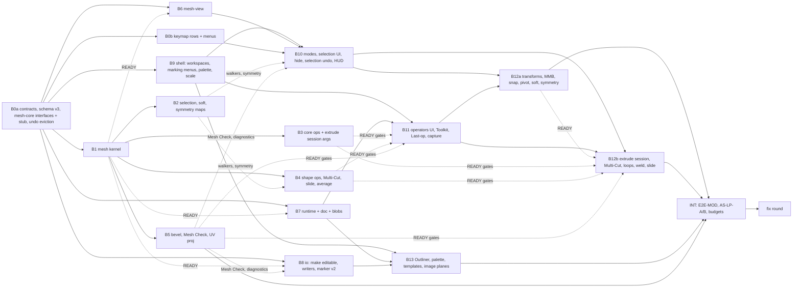

# Ekza Studio — Modeling plan (M6a, M6b, M6c, M7)

Status: v0.4 (2026-10-22: **the M6b MVP is integrated** — the owner flow model → Quick Rig → Create Skeleton → Bind
Skin → paint → CC0 clip library → VRM 1.0 for Space and OMOBA, [M6B-SPEC §0](M6B-SPEC.md#0-mvp-cut-owner-flow-2026-10-22);
the rest of §5 follows after the MVP); v0.3 (2026-10-19; v0.3 expands M6b on the owner's request into the full **Rig & Skin workspace**, §5, with its
build spec [M6B-SPEC](M6B-SPEC.md); v0.2 was the plan revised after the design review: one blocker, twenty
major and nineteen minor findings; every decision, including the rejected and partly applied ones, is in
[§12](#12-design-review-2026-10-19-decisions)). It **replaces the old ROADMAP M6 "Modeling, splines first"**
with a polygon-first sequence: M6a modeling base → M6b characters from own models (turnkey) → M6c UV editor and
texturing basics (optional) → M7 AI 3D generation; splines and generators move to M8. Each milestone gets a build
spec (`docs/M6A-SPEC.md`, …) derived from this plan, as [M2A-SPEC](M2A-SPEC.md) was derived from the roadmap.

- Inputs: research [10](research/10-dcc-poly-modeling.md) (tool map of a leading commercial desktop DCC),
  [11](research/11-modeling-ux-comparison.md) (its UX against a popular open-source DCC),
  [12](research/12-lowpoly-workflow.md) (low-poly workflow), [13](research/13-mesh-kernel.md) (mesh kernel),
  [14](research/14-skinning-own-models.md) (skeleton, skinning, own-model export),
  [15](research/15-ai-3d-generation.md) (AI generation), [16](research/16-model-workspace-ui.md) (Model workspace UI);
  earlier [03](research/03-ekza-reuse-audit.md), [06](research/06-collaboration.md),
  [08](research/08-extensibility-modeling.md), [09](research/09-ui-ux-spec.md).
- Decisions: [ADR 0014](adr/0014-mesh-kernel.md) mesh kernel, [ADR 0015](adr/0015-mesh-storage-in-the-document.md)
  mesh storage, [ADR 0016](adr/0016-modeling-interaction-paradigm.md) interaction paradigm (all three **Accepted**
  2026-10-19 with the M6a build spec), [ADR 0017](adr/0017-ai-generation-boundary.md) AI generation boundary
  (*Proposed*; its provenance items accepted with M6a, the rest at the M7 spec).
- Build spec: [M6A-SPEC](M6A-SPEC.md) v1.0 (2026-10-19) turns §2–§4 into contracts, normative behaviours and work
  packages; where it refines this plan (flattened extrude args, selection coalescing, B12b dependencies and the
  critical path, kept BIN ranges in the surgeon, …) its §12.2 is binding. [M6B-SPEC](M6B-SPEC.md) v1.1 (2026-10-19,
  revised after its design review; the record is its §12.5) does the same for §5 (Rig & Skin workspace), from
  research [17](research/17-dcc-rigging-basics.md), [18](research/18-constraints-control-shapes.md) and
  [19](research/19-rig-workspace-ui.md); its §12.2 is binding.
- Owner decisions with the defaults chosen: [DECISIONS-OPEN §G](DECISIONS-OPEN.md#g-modeling-iteration-m6am7-defaults-chosen-2026-10-18).
  Queue: [TODO.md](../TODO.md). Sizes are **agent-days** (ROADMAP convention).

---

## 0. Summary

**Desktop DCC or open-source DCC?** The desktop DCC for how the tool *feels* (component modes, right-click marking
menus, `Ctrl+E` extrude with a live manipulator that W/E/R keep editing, Shift+drag smart extrude, MMB-drag moves,
Multi-Cut, Target Weld, Slide Edge, `B` soft select, `G` repeat, undoable selection, the desktop DCC's menu names); the
open-source DCC for what happens *after* a click (adjust the last operation, type numbers into a running tool, live
preview with clean cancel, symmetry remembered per mesh) and for the **engine underneath** (a BMesh-style kernel with
attribute layers and destructive operations, no construction history). An alternative keymap preset (open-source-DCC
style) comes later as a data pack over the same operators.
Reasons in §1.

**What "turnkey" means**: inside one browser tab, with no other tool and no file conversion — block out a low-poly
character and a prop from primitives, colour them with a palette, fit a VRM humanoid skeleton, auto-skin and fix
weights, animate with the existing M1/M2a tools (FK/IK, Dope Sheet, Graph Editor), and export `.vrm` / `.glb` files
that pass the Ekza profiles (Space `vrm-humanoid-v1`, OMOBA `humanoid-glb-v1`, OMOBA handheld). AI generation then
feeds the same pipeline instead of replacing it.

| Milestone | What the owner gets | Size | Starts after |
|---|---|---|---|
| **M6a** Modeling base | Model workspace; box-model a low-poly prop or character body from a cube against front/side reference images (extrude with a live manipulator, inset, bevel, edge loops, Multi-Cut, slide edge, average vertices, bridge, merge/Target Weld, mirror + symmetry for every tool, soft select, hard/soft edges, hide/isolate, undoable selection); palette colouring; simple UV projections; poly-count HUD and Mesh Check; static GLB export (incl. the OMOBA handheld profile); fix meshes of imported models without breaking skin, expressions or MToon outlines | ≈ 108 + one fix round; critical path ≈ 28 working days | M2a release |
| **M6b** Rig & Skin workspace (turnkey) | VRM humanoid templates and Quick Rig; Joint tool, hierarchy editing, Orient and Mirror Joint; Bind Skin with auto weights; Paint Skin Weights, Component Editor and weight utilities; constraints parent/point/orient/aim and control-shape editing (both from M2c); bind pose and test poses, ROM clip; Validation panel; VRM 1.0 / GLB character writer; the turnkey loop closes | ≈ 70.5 + a fix round (turnkey minimum ≈ 62) | M6a B0a (contracts), then B1, B7, B8, B9 … per package (overlaps M6a on a staging branch) |
| **M6c** UV editor + texturing basics (optional) | UV editor pane, seams → LSCM unwrap → packing, image textures per material, decal region, ramp swatches, vertex-colour painting | ≈ 18 | M6a; independent of M6b |
| **M7** AI 3D generation | server gateway (off unless enabled, authenticated, server-side spend caps, CSP) with Tripo + Meshy adapters, Generate panel and job tray, post chain (reduce, cleanup, palette bake) on the modeling operators, provider or own rig, provenance in every export; later a self-hosted open-model worker | G1 ≈ 22, G2 ≈ 14 (G3 ≈ 6 with M4a/M4b) | M6b |

**When is it turnkey?** With about 8–10 agents in parallel and one fix round per integration, the M6a base is ready
≈ 31 working days after package B0a starts (≈ 37.5 with M6A-SPEC v1.1's critical path and fix round) and the
turnkey release (`v0.4.0`) ≈ 46–47 working days after it (§4.2, §5.2). These are planning estimates in agent-days, not commitments.
| **M8** Splines and generators (the old M6) | renderable curves, CV/EP/pen tools, sweep/loft/revolve generators with history, `EKZA_curves` | TBD | M7 |

Recommended order (§9): **M2a release → M6a → M6b (overlapping) → turnkey release → "Publish avatar" slice of M4a ‖
M7 G1 → M7 G2 ‖ M6c → M2b + rest of M2c → V1 → M4a T1 → M3 → M4b → M5 → M8.**

---

## 1. Desktop DCC or open-source DCC: the recommendation

### 1.1 Answer

Keep **one interaction paradigm, the desktop DCC's**, and adopt **the open-source DCC's semantics, not its keys**
(ADR 0016). The kernel copies **the open-source DCC's data model** (ADR 0014). This was the coordinator's starting
position; research 10, 11, 12, 13, 14 and 16 each tested it against evidence and kept it (13 adds the refinement "copy
the open-source DCC's data model, not just its UI ideas"; 16 adds the browser-key evidence).

### 1.2 Evidence

| Criterion | Desktop DCC | Open-source DCC | Weight for us |
|---|---|---|---|
| Owner muscle memory | the owner models in the desktop DCC | — | decisive for a solo owner-artist |
| Consistency with the shipped Animate side | Q/W/E, Channels, RMB marking menus, Alt navigation, `S` = set key, `R` = scale tool, `G` = repeat | `S`/`R`/`G` are modal scale/rotate/grab, RMB cancels, `Tab` = edit mode | one product, one muscle memory; the open-source DCC's keys would redefine four core keys inside one app (11 §7) |
| Industry convergence | — | The open-source DCC's own *Industry Compatible* keymap (5.2 LTS) follows the desktop DCC for modeling: `1`–`3` modes, `Ctrl+E` extrude, `Ctrl+B` bevel, `B` soft select, double-click loop (10 §0, 11 §2.2) | The default DCC keymap costs users of the open-source DCC little |
| Precise values, changing your mind | In-View Editor / INPUTS on history nodes until deleted | Adjust Last Operation, typed numbers during modal tools | **The open-source DCC wins**; we take the semantics (§1.3) |
| Discoverability | Shift+RMB puts the whole polygon vocabulary one gesture away | spread over edit-mode menus and pies | The desktop DCC wins |
| Half-model symmetry | selection-based symmetry modes, Mirror command | live Mirror modifier with clipping | The open-source DCC's live mirror is nicer; M6a stretch (§4.5) |
| Browser fit | F11 (fullscreen), F12 (DevTools), `Ctrl+Tab` unusable; marking menus are pointer gestures and survive | `Ctrl+R` (reload), `Ctrl+N`, `Ctrl+Tab`, `Alt+E` (Windows menus) unusable; `Tab` collides with focus traversal | both lose keys; the desktop DCC's losses are covered by digits `1`/`2`/`3` and the RMB menu (16 §1, §19.2) |
| Construction history | node per operation, index-fragile, fights deformers ("Delete Non-Deformer History") | none for mesh edits | we skip it (ADR 0014 §8): adjust-last + live primitive parameters cover the useful 80 % (10 §5) |
| Engine design | history DAG over index-addressed components | BMesh radial-edge with Euler operators, attribute layers, robust with non-manifold input | **The open-source DCC's model** (13 §2): imported VRMs (double-sided hair cards, bow-ties) break half-edge kernels |
| Web precedent | — | — | Blockbench (GPL-3.0, web low-poly modeler with armatures and weight paint) ships keymaps of the desktop DCC, the open-source DCC and Cinema 4D over one action set and implements adjust-last as "undo + re-run" (11 §10): patterns only, no code |

### 1.3 What we take

- **From the desktop DCC** (where things are and which keys do them): object/component selection modes on a selected
  object (no separate Edit Mode wall); RMB = modes, Shift+RMB = tools (slots provisional until the owner's
  calibration, Q-MOD-UI-1: S Extrude, W Multi-Cut, SW Delete), Ctrl+RMB = convert, Ctrl+Shift+RMB = selection options;
  `F8`/`F9`/`F10`; `Ctrl+E` extrude as a **session** whose manipulator and later W/E/R drags on the cap keep editing
  the same extrude (the desktop DCC's `polyExtrudeFace` with its localTranslate/Rotate/Scale), and Shift+drag smart
  extrude; **MMB-drag anywhere moves the selection** (along the picked handle, or in the view plane) and the Tweak
  selection style; the desktop-DCC loop table (double-click loop; Shift+double-click adjacent = full loop,
  non-adjacent = partial loop, parallel edge = ring; Ctrl+double-click deselects); `Shift+.`/`Shift+,` grow/shrink;
  **selection changes are undo steps** in Model (the desktop DCC records them by default); hide/show/isolate; `B` soft
  select (Volume/Surface); `D` pivot, `X`/`V` snap holds; Multi-Cut gestures (Ctrl-click loop, Ctrl+MMB centred loop,
  RMB completes); Target Weld; Slide Edge; Average Vertices; Delete vs Delete Edge/Vertex; Soften/Harden + Set Normal
  Angle; reference image planes in the ortho views; Modeling Tools panel; Poly Count HUD; `G` repeat, `Y` last tool,
  `T` brings back the parameters; the desktop DCC's names in menus.
- **From the open-source DCC** (what happens after an operation): Adjust Last Operation (card + Channels panel INPUTS);
  typed numbers during any modal drag and right after a keyboard-invoked operation (never while a manipulator merely
  stays on screen, so `1`–`7` keep their mode and shading meanings); modal tools with live preview and an `Esc` that
  leaves no history step; symmetry remembered per mesh; `1`/`2`/`3` component modes (Industry Compatible);
  Smooth-by-Angle as a one-shot operator; face-orientation and statistics overlays; the palette/collapsed-UV colouring
  trick; later Extrude Manifold, Auto Merge, Select Similar, live Mirror. Names used by other DCCs (Loop Cut, Knife,
  Proportional Editing, Mark Sharp, Merge by Distance) are **command-palette aliases**, never menu labels.
- **From neither**: no 3D cursor, no modifier stack UI, no construction history, no hybrid keymap.

### 1.4 For users of the open-source DCC

A "Coming from the open-source DCC" cheat sheet and the palette aliases ship with M6a; the complete alternative keymap
preset (open-source-DCC style: G/R/S modal transform with X/Y/Z, `E`, `I`, `K`, `M`, `F`, Alt+click loops with its own
navigation profile) is a V1+ data pack
over the same operator ids (11 §9, 16 §19.5).

---

## 2. Scope

### 2.1 The turnkey pipeline

```
 Model (M6a)                         Rig & Skin (M6b)                    Animate (M1/M2a, unchanged)        Export / Ekza
 primitives → extrude/loops/bevel →  template skeleton → Quick Rig →     FK/IK controls, Dope Sheet,        .vrm (VRM 1.0) / .glb /
 mirror/symmetry → palette colour →  auto-skin → weight fixes → ROM  →   Graph Editor, tweens, loops   →    handheld .glb → lints,
 Mesh Check + budget HUD             test → (back to Model: weights      → slot clips idle/walk/…           validators → Hub upload
        ▲                             follow topology edits)                                                 (T0 manual, T3 publish)
        └── AI generation (M7): gateway → import → reduce/cleanup/palette bake → same Model → Rig & Skin path
```

### 2.2 M6a BASE (✓ core, ◇ stretch; research references in brackets)

| Group | Items |
|---|---|
| Modes and selection | ✓ object/vertex/edge/face modes (`F8`, `F9`, `F10`, `1`/`2`/`3`, RMB menu), hilite (non-hilited meshes stay **opaque** and unpickable; per-pane "Dim unhilited" option), per-mode selection memory; ✓ click/marquee with desktop-DCC modifier keys, hover pre-selection, camera-based selection in shaded mode, X-ray select-through; ✓ edge loop, partial loop, ring, face loop, grow/shrink, convert (touching/contained, perimeters), border, shell, with **the desktop-DCC loop table** for vertices, edges and faces (§3.5); ✓ **selection changes are undo steps in Model** (consecutive gestures coalesce into one "Select" step; preference, on in Model, off in Animate); ✓ **hide/show/isolate**: Hide Selected `H`, Show All `Shift+H`, Hide Unselected `Alt+H` for components and objects, Isolate Select `Shift+L` per pane; ✓ **Tweak** selection style (drag an unselected component to move it; Move tool option, off by default); ◇ multi-component mode, lasso/paint select, Select Similar, component pick-walk [10 §3.1–3.2, 16 §5, §12.3] |
| Soft selection, symmetry | ✓ soft select Volume + Surface (`B`, `B`+drag radius, smooth falloff, curve presets), weights computed from the symmetry-expanded selection; ✓ symmetry Object/World X/Y/Z with tolerance (**metres**, default 0.001 m, shown in scene units) and Preserve Seam, remembered per mesh; vertex, **edge and face partner maps**; **every base tool mirrors** by the per-tool table of §3.14 (Multi-Cut cut points with `t`/`1−t`, Insert Edge Loop seeds, Target Weld pairs, Slide, Bridge, Merge/Collapse, Bevel, Delete, Paint Colour, soft select; seam rules: a seam-crossing ring inserts one loop, a seam-crossing cut becomes one symmetric cut, welds onto seam vertices collapse both partners); ✓ Symmetrize; ◇ live Mirror (per mesh, non-destructive, baked at export; promoted to base if the §3.14 table overruns, §4.7); topology symmetry → later [10 §3.3, 13 §5.10, 16 §12] |
| Primitives, templates | ✓ cube, sphere, cylinder, cone, plane, torus with low-poly defaults (sphere 12×8 = 168 tris, cylinder/cone 8 sides, torus 12×6, plane 1×1) and a desktop-DCC defaults preference (`primitiveDefaults: 'dcc'`); parameters live until the **first component edit of any kind** (a vertex nudge included; object transforms do not freeze them); ✓ templates: prop, handheld (grip gizmo, +Y shaft), humanoid **guides** (proportion guides, budget preset, symmetry Object X) and a humanoid body mesh generator (smooth/segmented, X-symmetric, T-pose, ~400–900 tris; its skeleton template is M6b) [10 §3.4, 12 §11, 16 §16.2] |
| Transforms, pivots, snapping | ✓ component W/E/R (new viewport Scale tool) with World/Object/**Normal** orientation; ✓ **MMB-drag anywhere** transforms the selection with W/E/R active (along the last-picked handle axis, or in the view plane when the centre was picked) unless a Channels panel or INPUTS field is selected, in which case it stays the virtual slider; ✓ `Ctrl+E` **extrude session** (W/E/R drags on the cap are absorbed into the extrude, §3.4) and Shift+drag smart extrude (one `mesh.extrude` step); ✓ grid (`X`) and vertex (`V`) snap holds, increment `J`; `V` targets any visible, unlocked mesh (align a separate head or hand before Combine); ✓ pivot edit (`D` hold, `Insert`/`Home`), Center Pivot, Pivot to Bottom Center, Bake Pivot; ✓ Freeze / Reset Transformations (required before skinning: glTF ignores a skinned mesh node's transform); ◇ edge snap `C`, interactive primitive placement, Shift+D duplicate with transform [10 §3.5, §4.19] |
| Topology tools | ✓ **Extrude** faces (together/individual; args `localTranslate`/`localRotate`/`localScale` XYZ, `offset`, `thickness`, `divisions`, local/world; the **primary field is `localTranslateZ`**, distance along the normal) and border edges; ✓ Inset; ✓ **Bevel** edges (fraction/absolute, 1–3 segments, chamfer, clamp, corners of ≥ 3 beveled edges filled with a fan + warning); ✓ **Insert Edge Loop** (relative, equal distance, multiple) and Offset Edge Loop; ✓ **Multi-Cut** (points on edges/vertices, Ctrl-click loop, Ctrl+MMB centred loop, snap step %, RMB/Enter completes, Backspace, Esc) and Connect; ✓ **Slide Edge/Vertex** (along adjacent rails, desktop-DCC Slide Edge Tool semantics, percent with numeric input, symmetric); ✓ **Average Vertices** (iterations, strength; borders and the seam pinned); ✓ **Bridge** (equal counts, or two faces; Divisions, Twist, Offset, linear interpolation); ✓ Fill Hole; ✓ Merge (distance), Merge to Center, **Target Weld**, Collapse, Merge by Distance; ✓ Delete (plain, keeps vertices) and Delete Edge/Vertex (clean), delete faces; ✓ Spin Edge, Flip Triangle Edge; ◇ Extrude Manifold option, Auto-weld toggle, Multi-Cut points inside faces and slice plane, bridge with unequal counts or curve interpolation, Poke, Chamfer Vertex, Extrude vertices [10 §3.6, §4, 13 §5] |
| Mesh-level | ✓ Combine, Separate, Extract, Duplicate, Duplicate Faces as **`MeshSetOp`s** (create/delete records and patch N refs in one transaction, layer and slot remaps, refusals; §3.4); ✓ Mirror (cut geometry, merge border vertices, reversed winding on the copy); ✓ Triangulate, Quadrangulate; ✓ Group / Parent / Unparent (`Ctrl+G`, `P`, `Shift+P`) [10 §3.7, §3.9] |
| Normals, shading | ✓ per-edge hard flag; new meshes **faceted** (record flag `faceted`), and every op follows one **hard-flag propagation rule** (§3.2) so an all-hard mesh stays all-hard; Soften/Harden, Set Normal Angle (one-shot), Reverse, Conform; ✓ WYSIWYG normals: viewport and exporter derive normals the same way; ✓ triangulation overlay and stored per-face diagonal (Flip on a quad); ✓ shading modes `4`–`7`, wire on shaded, flat, backface culling, normals and face-orientation overlays [12 §5, 16 §10] |
| Colour, UV | ✓ **per-face palette index** = colour truth; project palettes (swatch records), palette panel, Paint Colour tool, fill shell, select by swatch, replace swatch, eyedropper, palette variants; ✓ export colour outputs: palette PNG with collapsed UVs (default; forced for VRM), `COLOR_0`, one material per colour; ✓ **simple UV**: planar / box (automatic) / cylindrical projections writing `uv0`, UVs propagated by every op; ◇ ramp swatches, decal region; UV editor and unwrap → M6c [12 §4, §6, 13 §5.13] |
| Reference | ✓ **reference image planes** per ortho camera (front, side, top): PNG/JPG import, offset, scale, opacity, depth (behind / in front), lock; an `imagePlanes` record referencing an image asset by hash, never pickable, saved in `.ekzanim`, never exported [12 §11 step 2] |
| Validation, HUD | ✓ Poly Count HUD (scene/object/selected columns, triangle budget bar from the export profile or a user target); ✓ Mesh Check panel + overlay (non-manifold, lamina, zero-length/area, inconsistent winding, non-planar and concave n-gons, stray valence-2 vertices, loose geometry, open borders) with "select matching" and explicit fixes; ✓ budget presets as advisory lints [10 §4.17, 12 §2.2, 16 §10.4] |
| Workflow | ✓ Model workspace tab (Model › Rig & Skin › Animate › Review), marking menus, command palette, Modeling Tools panel with option boxes; ✓ **Adjust Last Operation** (pane card + Channels panel INPUTS, `T` opens it with the primary field focused), **Repeat Last** (`G`; tool-only operations re-activate their tool), **numeric input** during drags and right after keyboard-invoked operations (§3.4); ✓ one gesture = one undo step for every mesh op; autosave and `.ekzanim` include meshes [11 §6, 16 §3–§9] |
| Import / export | ✓ "Make editable" per imported mesh (licence-gated by VRM meta), with skin weights, morph deltas, UVs and colours kept as layers and propagated by every op (weld key includes every morph target's delta); ✓ surgeon "replace primitives" step for edited meshes of imported files (everything else byte-preserved; bake marker v2 so re-baking an edited export stays valid; Draco/quantized inputs and `extensionsUsed`/`extensionsRequired` handled; morph `NORMAL` deltas derived; `TANGENT` refused with a reason); ✓ edited characters re-displayed in Animate through the normal loader (MToon outlines and expressions intact, §3.6); ✓ author GLB writer for models made in the editor; ✓ new `ekza/omoba-handheld-v1` profile and `mesh.*` / `ekza.*` lints; ✓ `ekza_model_v1` provenance block; ✓ glTF-Validator on export (lazy) [12 §10, 13 §10, 15 §5.10] |

### 2.3 Non-goals (and where each goes instead)

| Not in M6a | Why | Where |
|---|---|---|
| NURBS surfaces, Bézier patches | not low-poly; glTF has no surface primitive | not planned; curves/generators in M8 |
| Sculpting, dyntopo, multires | "no crazy complexity"; different kernel and UX | not planned |
| Construction history (desktop-DCC node chain) | index-fragile, fights skinning, needs dirty propagation and a fine collaboration model (10 §5, 13 K6) | replaced by adjust-last + live primitives; history only for M8 curve generators |
| Booleans | need closed manifolds, add ~205 kB gz WASM (`manifold-3d`), produce n-gons/T-junctions | after M7, lazy worker adapter |
| Subdivision surfaces, Smooth Mesh Preview, creases | subdivision workflow, not low-poly | later (`Shift+1/2/3` reserved) |
| UV editor, seams/unwrap, packing, image textures, texture painting | the palette workflow needs no UV layout (12 L2) | M6c (painting: not planned) |
| Normal/AO bakes, PBR texture sets, tangents | low-poly presets never write `normalTexture`/`TANGENT` | not planned |
| LODs | no Ekza runtime reads glTF LODs (12 L10) | Reduce operator in M7 serves later LOD needs |
| Retopology, Quad Draw, edge flow | AI-mesh cleanup tools | after M7 G1, on demand |
| Skeleton, skinning, weight paint, VRM character writer | separate milestone, partly parallel | M6b |
| Decimate/Reduce, palette bake from textures, remesh | AI intake tools | M7 (package G-a) |
| Per-vertex/per-component CRDT, live co-modeling of one mesh | measured too costly and invalid merges (13 §9.6) | per-mesh claims in M3 (ADR 0015) |
| Alternative keymap preset (open-source-DCC style) | needs a tester fluent in the open-source DCC and a modal transform operator | V1+ data pack |
| Vertex-face mode, multi-UV-set editing, custom normal editing | niche for low-poly | later |

---

## 3. Architecture

### 3.1 Package map

New packages follow the layering of ARCHITECTURE §3 (headless below the view layer; `three` only in view packages).

| Package | Dir | Responsibility | May import | Must not import |
|---|---|---|---|---|
| `@ekza-studio/mesh-core` (new) | `packages/mesh-core` | SoA mesh, attribute layers, write log + `MeshDelta`, Euler operators, `validateMesh`, `topologyStats`, revision chunks/manifest, deterministic triangulation, derived normals, all modeling ops, selection walkers, soft selection, symmetry maps, UV projections (M6a) and unwrap/pack (M6c), skin math (M6b), templates; `/testing` (fast-check arbitraries, golden runner) | anim-core, `earcut`, `robust-predicates` | three, React, DOM, doc, WASM |
| `@ekza-studio/mesh-view` (new) | `packages/mesh-view` | edit-mode overlays (surface, edges, vertices, face dots, soft ramp, normals, lint, symmetry plane), `ComponentPicker` (hover, click, marquee, lasso, occlusion), BVH lifecycle, geometry descriptors → three | mesh-core, anim-core, `three`, `three-mesh-bvh` | React, R3F, editor-core |
| `@ekza-studio/mesh-wasm` (new, M7) | `packages/mesh-wasm` | lazy adapters in a worker: `Decimator` (meshoptimizer), later `BooleanSolver` (manifold-3d), `UvAtlas` (xatlas) | mesh-core, the WASM libraries | three, React, doc |
| `@ekza-studio/gen-core` (new, M7) | `packages/gen-core` | isomorphic generation types and state machine (ADR 0017) | nothing | everything |
| `@ekza-studio/gen-gateway` (new, M7) | `packages/gen-gateway` | server-only Fetch handler, adapters, job/blob stores, webhooks, quotas | gen-core | React, three, browser packages |
| `anim-core` (changed) | — | `ParamDef` (kinds, limits, step, `primary`, `bound: 'selection' \| 'pointer' \| 'value'`): the one parameter description shared by kernel ops and editor operators | — | — |
| `doc` (changed) | — | schema v3 tables (`meshes`, `groups`, `palettes`, `swatches`, `skeletons`, `joints`, `imagePlanes`), `CharacterRecord.source`, `AssetRecord.provenance`, `referencesOf` for the new tables (incl. `meshes.data.joints`), validation, migration; `UndoManager.entries()` and `onEvict` | — | — |
| `io` (changed) | — | `meshFromGltf` (make editable), `meshToPrimitives`, author writer (static in M6a, VRM 1.0 character in M6b), surgeon "replace primitives" with bake marker v2, in-memory container rebuild for the character display, palette PNG writer, handheld profile, new lints, `.ekzanim` `blobs/` | + mesh-core | — |
| `rig` (changed, M6b) | — | `skeletonFromDoc`, templates and the Quick Rig fitter, joint edits (orient, mirror, hierarchy), `updateAutoRig` with prop controls, constraint ops (parent/point/orient/aim) and the compiler rules, bake, control-shape maths (`measureSkinned` lives in `io/skeleton`) | + mesh-core (types only) | — |
| `editor-core` (changed) | — | `MeshRuntime` per edited mesh (two-phase commit, `loading` state, journal), `MeshSetOp` runner, `BlobStore` service with derived GC roots and an undo byte budget, `ComponentSelection` service (incl. hide bitsets), selection history parts, `mesh.*`/`select.mesh.*`/`palette.*`/`skel.*`/`skin.*` operators, `edit.adjustLast`/`edit.repeatLast`, `LastRun`, operator `params`, workspace state | + mesh-core | — |
| `viewport` (changed) | — | hosts mesh-view layers in panes, Scale tool, shading modes, modeling tools and manipulators (component spaces, smart extrude), snapping, pivot editing | + mesh-view | — |
| `editor` (changed) | — | workspace tabs, generic `MarkingMenu`, `CommandPalette`, hierarchical key-scope chain, Model panels (Toolkit, Palette, Mesh Check), Last-op card, HUD, Rig & Skin panels (M6b), Generate panel (M7) | — | — |

The Model and Rig & Skin workspaces load as lazy chunks (target ≤ 250 kB gzip excluding WASM); the first-visit
editor route and its CI gate (`check:size`, 900,000 B) are unchanged. The route already weighs ≈ 785 kB against an
800 kB target (wp-notes/m2a-platform-perf), so the code that B0a, B0b and B9 add to the **eager** Animate route
(workspace tabs, the generic `MarkingMenu`, schema v3 validation, `ComponentSelection`, keymap rows) has a budget of
**≤ +20 kB gzip** in total; the command palette's list UI and every Model menu body load lazily, and B9 runs
`check:size` with the chunk attribution report. `package.json` files, the lockfile and `apps/web/next.config.ts`
(`transpilePackages` for the new packages) stay with the integration agent (ARCHITECTURE §3 rule 6).

### 3.2 Mesh kernel ([ADR 0014](adr/0014-mesh-kernel.md))

- **BMesh-style radial-edge structure as struct-of-arrays typed arrays** (vertex, edge, corner, face; disk, radial
  and loop cycles): n-gons, non-manifold edges, wire edges and loose vertices are representable, so imported VRMs
  (double-sided cards, bow-ties) never lose faces. Half-edge was rejected because it drops such faces.
- **Stored** = intrinsic data (positions f32, edge endpoints + flags, corner→vertex, corner→next, face→first corner,
  face material + flags, attribute layers). **Derived** = adjacency (1.8 ms at 50k tris), normals (2.9 ms), triangulation,
  BVH, GPU buffers. Edit links exist only while a mesh is in component mode.
- **Indices are component IDs** (as in common DCCs): append on create, swap-remove on delete; every op returns its
  remap and the new selection; anything that must survive topology edits uses a **named group layer**.
- **Every write goes through a write log**; an op's coalesced log is its exact undo patch (`MeshDelta`). Topology code
  is written only with **Euler operators**.
- **Ops are pure and deterministic**: `(mesh, selection, args) → (delta, selection′, warnings)`, JSON args with the
  desktop DCC's parameter names; they **refuse with a reason rather than produce invalid topology**. Determinism gives
  adjust-last, repeat, goldens and agent/scripting use for free. Each op declares `params: ParamDef[]` (the type lives
  in anim-core, so mesh-core needs no editor-core import); its JSON schema, defaults and the editor's
  `OperatorDef.params` are all derived from that one list (§3.4).
- **Hard-flag propagation, one rule for every op**: an edge created inside a former face (Multi-Cut, Connect, Insert
  Edge Loop, Triangulate, Fill Hole fans) is hard when every edge of that face was hard; side and strip edges (extrude
  walls, bevel strips, bridge strips, inset rims) are hard when their dihedral angle exceeds the op's
  `smoothingAngle`, whose default is resolved at invoke time to **0° (all hard) on meshes flagged `faceted`** and 30°
  (desktop-DCC convention) otherwise; mirror seams and welds keep the flags of the edges they merge (hard wins).
  Property test: an all-hard mesh stays all-hard through every base op (P7).
- **Attribute layers with declared propagation rules** (uv, colour, custom normals, skin joints/weights ≤ 4 normalized,
  morph deltas, groups, palette index): this is the modeling-to-animation bridge — a fix on a skinned VRM keeps its
  weights and expressions.
- **One triangulation function** (quads on the shorter diagonal with an index tie-break and a stored per-face flip;
  `earcut` for n-gons) serves viewport, picking, HUD and export: what you see is what ships.
- **CPU picking** with `three-mesh-bvh` and a screen grid; GPU ID buffer only as a measured fallback.

### 3.3 Document storage and CRDT granularity ([ADR 0015](adr/0015-mesh-storage-in-the-document.md))

**Stance**: a mesh is **one record with one geometry field — a revision ref** — whose content lives in
content-addressed ~32 KiB chunks outside the document. **No per-vertex or per-component records, no per-vertex CRDT,
no new partition.** Measured on a 50k-tri mesh with Yjs 13.6.33: per-component maps put 1.83 MB into the CRDT and take
67 ms to load, and their merges can create faces that reference concurrently deleted vertices; a hash-ref record is
132 bytes after 21 revisions (13 §9.6).

```ts
// Sketch; the M6a spec owns the final shapes. Partition = the owner's: char:<id> for character meshes, scene for props.
interface MeshRecord {
  readonly id: MeshId;                                   // 'msh_<16 base62>'
  readonly name: string;
  readonly owner: { readonly character: CharacterId } | { readonly scene: true };
  readonly parent: GroupId | MeshId | null; readonly order: string;
  readonly placement: ReadonlyXf; readonly pivot: ReadonlyVec3;      // object transform + rotate/scale pivot (D)
  readonly source: { readonly asset: AssetId; readonly mesh: number } | null;   // glTF mesh it edits; null = authored
  readonly data: {                                       // null = asset-backed, not editable yet; one merge unit
    readonly manifest: string;                           // sha256 of the revision manifest = revision id
    readonly rev: number;
    readonly base: string | null;                        // parent revision (fork detection in M3, ADR 0015 §10)
    readonly joints: readonly JointId[];                 // copy of the manifest's skin palette, for referencesOf
  } | null;
  readonly faceted: boolean;                             // default smoothingAngle 0° for its ops (§3.2)
  readonly generator: { readonly kind: PrimitiveKind; readonly params: Readonly<Record<string, number | boolean>> } | null;
  readonly palette: PaletteId | null;
  readonly material: { readonly preset: 'unlit' | 'toon' | 'lit' } | { readonly assetSlots: readonly AssetMaterialRef[] };
  readonly colourOutput: 'palette-texture' | 'vertex-colour' | 'material-per-colour';
  readonly skin: { readonly skeleton: SkeletonId; readonly bind: SkinBindArgs | null }      // M6b, model-sourced
               | { readonly asset: AssetId; readonly skin: number } | null;                 // imported skin
  readonly budget: { readonly preset: string } | { readonly tris: number } | null;
  readonly deleted: Tombstone;
}
interface GroupRecord   { id; name; owner; parent; order; placement; pivot; deleted }            // Ctrl+G transform nodes
interface PaletteRecord { id; name; order; deleted }
interface SwatchRecord  { id; palette: PaletteId; slot: number /* u16, never reused; faces store it */;
                          order: string; name: string; srgb: [number, number, number]; kind: 'flat' | 'ramp'; deleted }
interface ImagePlaneRecord { id; camera: 'front' | 'side' | 'top'; asset: AssetId /* image bytes by hash */;
                          offset: [number, number]; scale: number; opacity: number; depth: 'behind' | 'front';
                          locked: boolean; visible: boolean; deleted }   // scene partition; never picked or exported
```

Morph target names and order live **only in the revision manifest** (layer order; VRM expression binds index it);
there is no `morphTargets` record field to drift from it. Asset-backed meshes take them from the asset.

- **Revision** = a deterministic manifest (`{format: 'ekza-mesh', version, counts, bounds, layers: [{name, domain, type,
  comps, interp, mirror, meta, chunkElems, chunks: [sha256…]}]}`) whose SHA-256 is the revision id; chunks are raw
  little-endian slices of each array/layer. Hashing is synchronous (in-repo SHA-256, ~0.2 ms per 64 KiB), so
  `transact` stays synchronous; only dirty chunks are rehashed. A layer's chunks may stop before its element count:
  the missing tail reads as the layer's default (zero deltas, zero weights), so appending points does not rewrite
  the tail chunk of every morph layer that is zero there (Seed-san's head has 129 targets).
- **`BlobStore`** (editor-core service, next to `AssetStore`): `put` (sync, dedupe), `get` (async, hash-verified),
  `persist`; memory, IndexedDB for autosave (a new `blobs` store, DB version upgrade, per-slot roots), `.ekzanim`
  `blobs/<sha256>` entries (ADR 0011 extended), HTTP presigned transport in M3. Chunks are not `AssetRecord`s.
- **GC roots are derived, never tracked as pins**: mark-and-sweep from the current records, every `meshes.data` value
  in the before/after patches of the doc undo and redo entries (`UndoManager.entries()`, new in B0a), the revisions
  held by open `MeshRuntime`s and the autosave slots' manifests. Evictions are explicit: `UndoManager.onEvict(entries)`
  and an `EditorHistory` step-drop event (both new in B0a) tell the store when steps leave the 500-entry window.
- **Undo memory is bounded in bytes, not only in entries**: chunks and journals reachable only from history count
  against a budget (default 256 MB, preference); above it the oldest steps are dropped (`onEvict`) with a toast
  "Older undo steps were released to save memory". Journals have their own cap (default 64 MB); a step whose journal
  was dropped undoes through the chunk rebuild. Bench in B7: 50 morph layers × 200 commits stays within the budget.
- **Commit and undo**: a tool gesture mutates the `EditMesh` in place (no `PreviewSession`, no document writes while
  dragging); commit = one transaction patching `data`; `PatchUndoManager` restores the ref (compare-before-restore) and
  `MeshRuntime` follows it through its journal (`applyDelta` backward, ≤ 5 ms) or rebuilds from chunks (≤ 40 ms).
  **Two-phase**: if `apply` throws or the transaction aborts, `MeshRuntime` applies the delta backward before
  rethrowing, so the runtime never diverges from the ref; while a chunk rebuild is pending (`BlobStore.get` is
  async) the runtime is `loading` and every `mesh.*` poll fails with "Mesh is loading". The journal edge to the last
  op is never evicted, so `edit.adjustLast` always takes the synchronous journal path.
- **Skin weights, morph deltas, UVs, colours, palette slots and groups are layers inside the revision**, so a topology
  edit and its weight update are one revision and one undo step. The joint palette of `skin.joints` is layer metadata
  in the manifest (a revision is self-describing, each entry with the joint's parent at commit time) and is copied
  into `data.joints` in the same field value, so `referencesOf` sees it and the two can never drift (one merge unit).
  Readers fold weights on a joint that no longer exists (a peer undid "add joint") onto the nearest existing ancestor
  from the manifest and raise `skin.dangling-joint`. This overrides research 14's separate `ekza.skin.v1` blob; its
  byte layout survives as the layer encoding and the export codec.
- **Partition**: meshes live in their owner's partition (`char:<id>` / `scene`). A character's skeleton, joints, meshes
  and rig share one document, so "delete a joint and move its weights to the parent" is one atomic transaction even
  under CRDT. This overrides research 13's `mesh:<id>` partition (reasons in ADR 0015 §Alternatives).
- **Collaboration (M3)**: entering component mode takes an exclusive **mesh claim** on the record (06 §8.2 pattern);
  peers receive revisions and fetch chunks by hash; skeleton and skin edits take the existing exclusive `rig` claim.
  Claims are advisory and never block offline peers, so `data.base` (the parent revision) ships in schema v3 now: in
  M3 a peer that receives a remote ref whose `base` is not its last-synced ref while it holds unsynced local commits
  keeps its own head as a "conflicted copy" mesh record (whose ref keeps the losing chunks reachable) and notifies,
  instead of a silent last-writer-wins loss of hours of work.
- **Schema v3** (one atomic change in package B0a, as M2a's A0 did schema v2): the seven tables above, `CharacterRecord.source
  = { kind: 'asset', asset } | { kind: 'model', skeleton }` (migration rewrites v2 records), `AssetRecord.provenance`
  (null by default; ADR 0017). Older apps open v3-only projects read-only (`minWriterVersion`).

### 3.4 Operators, tools and the modeling loop

```
 marking menu / Toolkit / keymap / palette ─► app.run('mesh.extrude', args) ───────────────────────────┐
 tool gesture (manipulator, Multi-Cut, Shift+drag) ─► MeshRuntime.beginOp(op, args) ─► preview into     │
     overlays (EditMesh mutated in place, no doc writes) ─► update(args′) … (numeric input, drags)       │
     ─► confirm: app.run(op, finalArgs) ──────────────────────────────────────────────────────────────┤
     ─► Esc: revert delta, no history step                                                              ▼
 operator apply (sync, one transaction): MeshRuntime commits the open session if its args match, else reverts and
     re-runs → BlobStore.put(dirty chunks) → tx.patch('meshes', id, { data: newRef }) with selectionBefore/After
     → EditorHistory step → LastRun { id, args, stepId, docSeqAfter, paneId }
 edit.adjustLast(patch): poll = step on top ∧ no store write since ∧ op adjustable → edit.undo + app.run(op, args ⊕ patch)
     (dragging a card value previews from the pre-op mesh without doc writes; release = one undo + one re-run)
 edit.repeatLast (G): app.run(lastRun.id, lastRun.args minus pointer-bound args) on the current selection, for
     repeatable ops; for tool-only ops (Multi-Cut, Target Weld, Slide) G re-activates the tool, like Y
```

- **Operator contract additions** (ADR 0016, extending ADR 0008): `params: ParamDef[]` (label, kind `number | int |
  distance | angle | percent | bool | enum | axis`, min/max, soft range, step, one `primary` field for typed digits,
  and `bound`: `'selection'` for targets taken from the selection, `'pointer'` for index-bound picks such as Multi-Cut
  `{edge, t}` points or Target Weld pairs, `'value'` for everything else), `flags.adjustable`, `flags.repeatable`;
  session `LastRun`. `ParamDef` lives in anim-core; each kernel op declares its `params` and `meshOperator()` derives
  the `OperatorDef` params, the JSON schema and the defaults from them, so the two never drift. The Last-op card,
  Channels panel INPUTS, option boxes, the command palette prompts and (V1) scripting/agent JSON schemas are generated
  from `params`.
- **Kernel ops are wrapped, not duplicated**: `meshOperator(meshOp)` builds an `OperatorDef` (poll from the kernel's
  `poll` and the runtime's `loading` state, apply through `MeshRuntime`), so menus, hotkeys, tools, tests, the AI post
  chain and a future MCP bridge all call the same `mesh.*` ids (13 §11.3). The dispatcher records `LastRun` and
  implements `edit.adjustLast`/`edit.repeatLast` (package B11; B7 provides the `MeshRuntime` hooks).
- **Repeat Last (`G`)**: repeatable ops drop their `pointer`-bound args and take their targets from the current
  selection; Insert Edge Loop seeds the ring from the selected edge and keeps divisions and weight; Extrude, Bevel,
  Inset, Bridge, Merge, Delete, Soften/Harden repeat with their values. Ops whose only targets are pointer picks
  (Multi-Cut, Target Weld, Slide) are not repeatable: `G` re-activates the tool, like `Y` (desktop-DCC convention: `G`
  after a tool re-enters it). The operator table of the M6a spec states `bound` per argument and `repeatable` per op.
- **`MeshSetOp`** (Combine, Separate, Extract, Duplicate, Duplicate Faces): a second contract next to
  the one-mesh `MeshOp`. Kernel helpers `copySubset(mesh, faces)` and `appendMesh(a, b, xf)` return layer and slot
  remaps; the editor-core runner creates or deletes `MeshRecord`s and patches N refs in **one transaction**, with
  record ids derived deterministically from (op, input ids, step seed) so an adjusted re-run reuses them. Rules:
  material slots are remapped by identity; palettes must match (or one mesh has none), otherwise a refusal offers
  "Assign palette"; morph layers are united in the first mesh's manifest order, missing deltas zero; skin layers need
  the same skeleton and the joint palettes are united and remapped. Refusals with a reason: different skeletons;
  mixed asset-backed and authored inputs; any Combine/Separate/Extract on asset-backed meshes in M6a (the surgeon
  replaces primitives of existing glTF meshes but does not add or remove meshes; M6b's skin surgeon revisits it);
  Duplicate Faces of an asset-backed mesh makes an authored static copy and drops skin and morph layers with a
  warning. Adjust-last over a `MeshSetOp` is allowed only when the re-run produces the same record set.
- **Modal tool contract**: `idle → hover-preview → placing/dragging → confirm | cancel`; `Esc` cancels with no history
  step; **RMB never cancels** (ignored during a drag, completes Multi-Cut, opens menus otherwise; the keymap
  conformance test asserts that no binding maps RMB to cancel); the wheel stays dolly; `PageUp`/`PageDown` step counts.
- **Numeric capture has a narrow window** (it never covers a manipulator that merely stays on screen): it is armed
  (a) **during an active drag** (manipulator, tool handle, card virtual slider), and (b) **right after an operator
  invoked from the keyboard** (`Ctrl+E`, `Mod+B`, …) until the first pointer move beyond the 3 px drag threshold, a
  click or a non-numeric key. While armed, digits, `.` and `-` start entry for the primary field, `Tab` moves to the
  next field, `Enter` applies through
  `edit.adjustLast`, `Esc` restores; grammar and units of research 09 §6.4. Outside the window `1`–`7` always keep
  their mode and shading meanings and `-`/`=` keep manipulator size. The explicit opener at any time is **`T`**: it
  opens the Last-op card with its primary field focused (desktop-DCC users click into its In-View Editor field the
  same way). Preference `numericCapture: 'auto' | 'explicit'` (default `auto`; `explicit` = only `T`).
- **Adjust-last needs no store contract change**: undo moves the step to redo, the re-run clears redo, so history length
  is unchanged ("Extrude (adjusted)"); ADR 0013's rules hold as written.

#### Extrude session (desktop-DCC `polyExtrudeFace` behaviour)

The most common desktop-DCC flow is `Ctrl+E`, then the extrude manipulator's own handles **or** `W`/`R` drags on the cap,
then Divisions in INPUTS. Without construction history this works through adjust-last:

- `mesh.extrude` args: `localTranslate` XYZ (Z = along the region normal; the **primary field**, what typed digits
  and the manipulator's Z arrow drive), `localRotate` XYZ, `localScale` XYZ, `offset` (inset of the cap, secondary),
  `thickness` (along per-vertex even-thickness normals, desktop-DCC semantics, secondary), `divisions`,
  `keepFacesTogether`, `space: 'local' | 'world'`, `smoothingAngle`.
- `Ctrl+E` runs the extrude with zero offsets and opens an **extrude session**: the extrude manipulator (translate,
  rotate and scale handles in the region frame) is shown and the Last-op card is live. Until the selection changes,
  a non-transform operator runs, the mode or workspace changes, undo/redo or a remote change hits the mesh, every
  drag on the extrude manipulator **and every `W`/`E`/`R` drag on the cap** is absorbed into the extrude's
  `local*` args through `edit.adjustLast`: one undo step, card still live, Divisions still editable afterwards.
- The zero-commit drop applies only when the session **ends** with every arg at zero (no coincident duplicate faces
  are left, research 10 §4.2); `Esc` during the first drag cancels the whole extrude.
- Shift+drag smart extrude is one `mesh.extrude` step that records the drag as `localTranslate`/`localScale`/
  `localRotate`, so its card is titled "Extrude" with Divisions editable.
- E2E: E2E-MOD-01 (typed `0.5` moves the cap 0.5 m along the normal, cap area unchanged), E2E-MOD-17 (`Ctrl+E` →
  `R`-scale the cap 0.5 → Divisions 2 in the card → one `Mod+Z` restores the cube), E2E-MOD-18 (Shift+`W`-drag →
  card "Extrude" with Divisions editable).

### 3.5 Selection

- `Selection` (ADR 0008 §8) gains mesh objects; a new imperative **`ComponentSelection`** service holds one bitset per
  mesh per mode, pick order (Bridge, Target Weld), the active component, **hide bitsets** per mesh and domain and a
  monotonic version. React reads counts only (09 §13.3: no per-frame React state).
- Session state adds `workspace`, `componentMode`, `hilite`, symmetry per mesh, soft-select settings, constraint,
  selection style, sticky snaps, pivot edit, isolate sets per pane and `lastOp` (16 §22). All U state; snapshots of
  component selections (run-length encoded) ride in `TxMeta.selectionBefore/After`.
- Topology ops return the new selection (behaviour of common DCCs); undo restores the snapshot.
- **Selection changes are undoable in Model** (the desktop DCC records selection in its undo queue by default, and the
  open-source DCC records edit-mode selection): `EditorHistory` gains a third, session-only step part, the **selection
  part** (`{ mesh, mode, before, after }` run-length encoded), next to ADR 0013's document and override parts.
  Consecutive selection gestures (clicks, marquees, loop picks, grow/shrink, convert) coalesce into one step labelled
  "Select"; hide/show steps are recorded the same way ("Hide"). Nothing enters the document or the CRDT. Preference
  `undoSelection` per workspace, default **on in Model, off in Animate** (the shipped animation behaviour). A stray
  click on empty space no longer throws away a hand-built loop selection.
- **Hidden components** (Hide Selected `H`, Show All `Shift+H`, Hide Unselected `Alt+H`; objects too) are not drawn,
  not pickable, get no soft-selection weight, stop the loop and ring walkers, and are not targets of any op (global
  ops such as Merge by Distance and Conform act on visible elements; edits to visible neighbours may move shared
  vertices, as in common DCCs). Hiding is per-user session state, cleared on file open, never exported.
  **Isolate Select** (`Shift+L`) is per pane: objects, or the selected faces in face mode. The desktop DCC's `Ctrl+H` and
  `Ctrl+1` stay unbound (browser history and tab switching).
- **Loop gestures follow the desktop-DCC loop table** for vertices, edges and faces: double-click an edge = its loop;
  Shift+double-click a component **adjacent** to the selection = the full loop, **non-adjacent** = the partial loop
  between them; Shift+double-click a parallel edge = the ring; Ctrl+double-click deselects the loop or partial loop
  (desktop DCC reference: loop selection help, 2017; §13).
- **Hilite**: meshes not in the hilite set stay **opaque** and are not pickable for components (fitting a helmet on a
  head or eyes in sockets needs them at full opacity); a per-pane "Dim unhilited" display option fades them;
  RMB-on-mesh adds a mesh to the hilite set.

### 3.6 Viewport

- `mesh-view` layers per edited mesh and pane: shaded surface with a per-corner layout and a `state` attribute
  (selected, hover, soft weight), edges (`LineSegments`, fat lines for selection), vertices (`Points` with a constant
  pixel size), face dots, normals, lint markers, symmetry plane; component tokens with a 1 px halo meet WCAG 3:1 (16 §10.3).
- New camera layers 6–9 (components, normals, lint, helpers); per-pane `DisplayFlags` gain shading
  (`wire | shaded | colours | lit`, keys `4`–`7`), wire on shaded, flat, cull, components, normals, face orientation,
  poly count, mesh check, symmetry plane.
- Skinned meshes render in **bind pose** in Model (a `BIND POSE` badge) through the mesh-view surface.
- **Character display outside Model has one code path**: the existing `ModelLoader.load(container)` on a container
  rebuilt **in memory** from the latest revisions — the surgeon's "replace primitives" output for asset-backed
  characters, the author writer's output for model-sourced ones (M6b, §5.2 C0) — when leaving Model and on idle after
  commits. A geometry swap inside the loaded scene is not used: three-vrm's MToon outline pass (3.5.5,
  `_generateOutline`) replaces `mesh.material` with `[surface, outline]` and adds two geometry groups, `GLTFLoader`
  makes one `Mesh` per primitive, and Make editable can change the primitive count, so a swapped `BufferGeometry`
  would lose outlines or render nothing. The rebuild costs tens to hundreds of milliseconds per switch (budget
  §3.12) and keeps the VRM's per-frame MToon updates, expressions and spring bones registered. E2E-MOD-30 checks
  outline pixels and expressions on Seed-san after an edit. Props (scene meshes) display through mesh-view geometry
  descriptors in every workspace.
- **Reference image planes** draw in their ortho camera only (front/side/top), on camera layer 9 (helpers), behind or
  in front of geometry by their `depth`, never in the pick pass; textures are decoded with `createImageBitmap`.
- Hidden components and isolated objects are skipped by the overlays and the picker (§3.5).
- Idle stays 0 frames (E2E-00 gate extended to the Model workspace).

### 3.7 Shell and keymap

- **Workspace tabs** as pipeline steps: `Model › Rig & Skin › Animate › Review` with status glyphs (● done, ◐ needs
  attention, ○ not started). Each workspace owns its dock layout (`ekza-animator:layout:v<N>:<ws>`), menu set, status
  line groups, default tool and pick mask, key-scope prefix and timeline visibility; switching keeps document, object
  selection and time. No default switch hotkey (all candidate chords are browser- or OS-reserved). Closes Q-UI-1.
- **Hierarchical key scopes**: `model.viewport.<mode>` → `model.viewport.component` → `model.viewport` → `viewport` →
  `model` → `global`. Only the DOM adapter's chain builder changes; `KeymapManager.resolve` already walks string scopes.
  Deeper scopes shadow shallower ones; the help line shows the resolved meaning.
- **Bindings** (full table: 16 §19, ADR 0016 §5): `F8`, `F9`/`1`, `F10`/`2`, `3`; F11/F12 never bound in web builds;
  `Mod+E` Extrude in `model.viewport.component` while Export keeps `Mod+E` elsewhere and gains `Mod+Shift+E`
  everywhere; `Mod+B` Bevel; `K` Multi-Cut; `M` merge menu; `G` repeat; `T` Last-op card with the primary field
  focused; `Y` last tool; `Delete` / `Mod+Delete`; `B`, `D`, `X`, `V`; `H` / `Shift+H` / `Alt+H` hide selected / show
  all / hide unselected; `Shift+L` isolate; `Shift+.`/`Shift+,`; `Ctrl+Alt+←/→` spin edge (menu fallback). Pointer:
  plain **MMB-drag** with W/E/R active moves/rotates/scales the selection (desktop-DCC rule; along the last-picked handle
  axis, or in the view plane), and runs the virtual slider instead when channels in the Channels panel or an INPUTS field are
  selected (the shipped M2a condition, which today does nothing without selected channels, so the change is additive
  in Animate too). Never bound: `Mod+R`, `Ctrl+N`, `Ctrl+Tab`, `Mod+Shift+I`, `Ctrl+H`, `Ctrl+1`, `Tab` outside modal
  tools, `Alt+E`/`Alt+F` on Windows.
- **Prerequisites pulled forward from M2c** (packages B0b and B9): generic `MarkingMenu` (FR-SHELL-09), command palette
  (FR-SHELL-08), workspaces (FR-SHELL-11), viewport Scale tool, shading modes. The hotkey editor (FR-SHELL-10) stays in M2c.

### 3.8 Colour model

- **Truth**: one `paint` face layer (u16 swatch **slot**) per mesh, pointing into the mesh's project palette (swatch
  records, sRGB). Recolouring = one swatch edit; a team variant = a second palette mapped by slot.
- **Export outputs** (derived, never stored): **A** palette PNG (`ekza-palette-v1`: 8×8 px cells, 64×64 for 64 swatches,
  NEAREST mag / LINEAR min / CLAMP, sRGB PNG via a deterministic in-repo encoder over `fflate`) with every corner UV
  collapsed to its swatch centre — exact colour at any distance, one material, works in MToon (default; forced for VRM);
  **C** `COLOR_0` (float32 linear, converted with the exact sRGB EOTF; plain GLB props only: MToon ignores vertex
  colours); **D** one material per colour (OMOBA's current prop style).
- Materials: presets *unlit palette* (`KHR_materials_unlit` in `extensionsUsed`, never `extensionsRequired`), *lit
  palette*; *toon palette* (MToon) needs the M6b writer.
- Meshes with `uv0` from projections and an asset texture keep their UVs; palette faces override them at export.

### 3.9 IO

- **Make editable** (`mesh.makeEditable`, per mesh, explicit, licence-gated): decode through the existing loaders;
  concatenate primitives (face material = primitive slot); weld bit-equal positions with equal skin data **and equal
  `POSITION` deltas in every morph target** (coincident lip or eyelid vertices that separate in a target stay apart;
  a disagreement means "do not weld", nothing to report); hard edges
  recovered where split normals differ; the file's normals kept as `normal.custom` until touched; skin, morph, UV and
  colour layers imported; degenerate faces dropped and counted; import report. Above 200k triangles: read-only until
  decimated (Reduce arrives in M7).
- **Export of an edited mesh** (`meshToPrimitives`): per material slot, shared triangulation, corner keys `(vertex,
  normal, uv, colour)` deduplicated, `NORMAL` always written (12 L4), uint16 indices below 65,536 vertices,
  `JOINTS_0` u8/u16 + `WEIGHTS_0` float32 renormalized after rounding, no `TANGENT`.
- **Morph `NORMAL` deltas are derived at export**: for every target whose original primitive carried `NORMAL` deltas
  (Polybot 16 of 16 targets, Seed-san 27 of 129), the writer evaluates the same hard-edge normal function on base +
  delta positions and subtracts the base normals (deterministic, WYSIWYG, no stored layer); targets without them stay
  without. E2E-MOD-12 asserts that every such target still has `NORMAL` with the primitive's vertex count and only
  finite values.
- **Tangents**: an edited primitive whose original had `TANGENT` is refused at export with the reason ("tangent
  generation arrives with mesh-wasm in M7") unless the user ticks "Drop tangents" (glTF lets renderers derive
  MikkTSpace tangents); Make editable warns up front. Neither fixture has `TANGENT`.
- **Two writers**: the **author writer** (fresh glTF Transform document; static models in M6a, VRM 1.0 characters in
  M6b) and the **surgeon "replace primitives" step** (append accessors, re-point `mesh.primitives[*]` of edited meshes
  only; nodes, skins, materials and VRM extensions keep their indices; untouched meshes are never re-encoded) — an
  extension of ADR 0005's preservation invariant with its own read-back test. Details the step must handle: a
  replaced primitive drops `KHR_draco_mesh_compression` (loaders would otherwise decode the old Draco data) and
  quantized (`KHR_mesh_quantization`) inputs are decoded and written as float/normalized accessors;
  `extensionsUsed`/`extensionsRequired` lose an extension when its last user is replaced (allowed diffs).
- **Bake marker v2**: today's `EkzaBakeMarkerV1` rolls back by truncating accessors and bufferViews to the baseline
  and records only replaced animations, so re-baking an exported, edited file (re-import, M4a "open from Ekza")
  would truncate the appended accessors that edited primitives point at. Marker v2 records the original JSON of each
  replaced primitive (as `replaced` does for animations) and baseline counts taken **before any geometry step**; a
  re-bake rolls geometry and clips back together and re-applies both. Dead BIN ranges of replaced primitives are
  dropped when no other accessor references them (allowed diff); there is no existing compaction policy to rely on.
  Read-back test: export → re-import → re-bake → glTF-Validator 0 errors, untouched bytes preserved, every
  primitive resolves (E2E-MOD-31).
- **Profiles**: new `ekza/omoba-handheld-v1` (`desktop / handheld-glb-v1`: static, ≤ 8 MiB, ≤ 64 nodes, ≤ 16 meshes,
  ≤ 512 primitives, only `KHR_materials_unlit`/`KHR_texture_transform` anywhere, hashed `asset.extras.ekza_handheld_v1`
  grip block); `local/generic` for props; the existing avatar profiles become exporter-agnostic in M6b.
- **Lints** (same table shape as ADR 0010 §4): `mesh.budget.{tris,materials,textures,joints}`, `mesh.non-manifold`,
  `mesh.zero-area-face`, `mesh.loose-geometry`, `mesh.inconsistent-winding`, `mesh.nonplanar-faceted`,
  `mesh.ngon-concave`, `mesh.influences`, `mesh.weights-unnormalized`, `mesh.unweighted-vertex`,
  `mesh.skinned-node-transform`, `ekza.positive-uniform-scale`, `ekza.no-matrix-node`, `tex.size`, `ekza.handheld.*`,
  `bevy.max-joints`, `ekza.provenance-*` (ADR 0017); M6b adds `skel.*`, `skin.*`, `vrm.tpose.*`, `vrm.meta-required`,
  `mtoon.outline-hard-edges`.
- **Provenance**: `asset.extras.ekza_model_v1 { schema: 1, rig, skeletonTemplate, provenance: { tool, toolVersion,
  projectSha256, derivedFrom[], generator: { kind: 'manual' | 'ai', … } } }`, hashed with the bytes, no key named `uri`,
  deterministic (research 14 §9.5, 15 §5.10).
- **Validators**: Khronos glTF-Validator (lazy, at export; in the IO worker once M2c builds it) and, for VRM, the pinned
  `vrm-validator` fork in CI only; our own lints are the contract. Read-back through `GLTFLoader` (+ three-vrm in M6b).

### 3.10 Characters from own models (M6b)

The binding version of this section is [M6B-SPEC](M6B-SPEC.md) §4–§5 (schema v4, characters from scene meshes,
`skeletonFromDoc`, the control rig regenerated inside every skeleton edit, test poses, constraints, shapes, the writer).

- `CharacterRecord.source.kind = 'model'`: skeleton (`SkeletonRecord`) + joints (`JointRecord`: rest world position in
  character space, identity rest rotation by default, humanoid bone, mirror link) + skinned meshes, all in `char:<id>`.
- **`skeletonFromDoc(records)`** produces the same pure `SkeletonDesc` that `skeletonFromGltf` produces today, with
  radii and foot support measured from the weight layers (typed-array `measureSkinned` shared with imports), so
  `autoRig`, leg/arm IK, the Dope Sheet, the Graph Editor and the VRMA/animation exports work unchanged (12 L7).
- **A model-sourced character still has a `GlbContainer`**: `CharacterRuntime` has a non-null `asset` and
  `container`, `ModelLoader.load(container, skeleton)` builds the display, and about 16 non-test call sites (export,
  import, attributes, export dialog) read `runtime.container`. Rather than plumbing a container-less runtime through
  all of them, the author writer **synthesizes the container** in memory (debounced on commit and on workspace
  switch), so display, export and rig keep one path and the writer is exercised constantly. The minimal character
  writer therefore moves into C0 (§5.2).
- **Bind pose = rest pose = VRM 1.0 T-pose**; inverse bind matrices are derived, never stored; **Apply Pose as Rest**
  converts A-pose models (Polybot is one) before animating.
- Template presets: Lite 17 (15 required + chest, neck), Core 21 (+ shoulders, toes), **Standard 33** (Core + mitten
  hands: thumb chain + one finger chain mapped to the middle-finger bones; default), Full 52 (+ upperChest, all fingers).
  Joint IDs `<skeletonId>:<humanBone>` (deterministic, as auto-rig control IDs).
- **Auto (low-poly)** binding: mesh islands that fit one bone bind rigidly; continuous parts get bone-heat diffusion
  (Baran–Popović 2007, clamped cotan Laplacian, PCG) in a worker; ≤ 4 influences, always normalized; masks by joint
  or vertex; adjust-last panel. Measured on Polybot: island-centroid rigid binding matches the artist's dominant
  joint on 90.5 % of vertices and is within one joint on 100 % (14 §5.3).
- Writers: fresh **VRM 1.0** (`VRMC_vrm` meta with licence presets and thumbnail, humanoid, unlit/lit palette
  materials; MToon writer stretch) and plain GLB (OMOBA's five slot clips); the **skin surgeon** writes weight edits
  into imported VRM/GLB files.

### 3.11 AI generation boundary (M7, [ADR 0017](adr/0017-ai-generation-boundary.md))

- Server-side gateway behind a provider-agnostic contract `ekza-gen/v1`; the browser never holds provider keys or
  provider origins (CI check on the client bundle). Three deployment modes: self-hosted (env keys), BYO key per
  request (never persisted, redacted), hosted platform key (only with accounts, M4b, and written provider consent to
  resale terms). Static-export builds hide the panel or connect to a gateway whose origin is fixed at build time.
- **Default deny**: the route is mounted only with `GEN_GATEWAY_ENABLED=1` **and** either an auth (a shared bearer
  token or a session) or a loopback-only bind; the server refuses to start with provider keys and no auth; daily and
  monthly spend caps come from server env and apply regardless of the client's `maxCostUsd`; a test asserts 404 when
  the gateway is not enabled. Without this, any reachable `next start` with `TRIPO_API_KEY` set would let anyone
  spend the operator's credits.
- **CSP**: `apps/web` has no Content-Security-Policy today. M7 G-b adds one (response headers in server builds, a meta
  tag in static exports, the gateway origin from build config, an e2e test that checks the policy) before BYO keys
  ship; until then ADR 0017 claims no CSP control.
- Results are untrusted GLB bytes: downloaded immediately, SHA-256, `AssetStore`, `io` budgets and validator, the
  normal importer. The post chain is the modeling operators. Provenance (provider, pinned model, op, params, input
  hashes, terms snapshot, raw hash, post steps) is recorded on `AssetRecord.provenance` at import and exported in
  `ekza_model_v1`; prompt text only on opt-in.
- Package G0 of research 15 is split: `AssetRecord.provenance`, the export block and the provenance lints are in M6a
  (B0a, B8); the intake operators (reduce, normalize, palette bake) open M7 (package G-a).

### 3.12 Budgets (reference machine, report-only except the gates)

| Scenario | Budget | Milestone |
|---|---|---|
| Idle editor in the Model workspace | 0 WebGL frames (gate, E2E-00) | M6a |
| Enter component mode on 50k tris (edit links, caches, overlays, BVH) | ≤ 40 ms | M6a |
| Hover pick (vertex/edge/face) at 50k tris | ≤ 0.5 ms | M6a |
| Marquee 10k vertices with occlusion | ≤ 16 ms | M6a |
| Drag 1,000 vertices (positions, dirty normals, GPU upload) | ≤ 4 ms per frame | M6a |
| Soft-selection drag over 10k vertices | ≤ 8 ms per frame | M6a |
| Typical topology op (extrude 100 faces; loop on a 200-quad ring), op + caches + GPU | ≤ 16 ms | M6a |
| Commit (hash dirty chunks + write the ref) / undo through the journal / undo fallback | ≤ 3 / ≤ 5 / ≤ 40 ms | M6a |
| Make editable from GLB / export one edited mesh | ≤ 150 / ≤ 50 ms | M6a |
| Leaving Model with an edited character (in-memory surgeon + `ModelLoader`, Seed-san) | ≤ 300 ms | M6a |
| Memory per edited 50k-tri mesh (current state) | ≤ 40 MB | M6a |
| Undo-retained chunks and journals (all meshes) | ≤ 256 MB default budget (preference), journals ≤ 64 MB; bench 50 morph layers × 200 commits | M6a |
| Model workspace chunk (gzip, excluding WASM); editor route gate; eager additions to the Animate route | ≤ 250 kB; `check:size` 900,000 B unchanged; ≤ +20 kB gzip | M6a |
| Auto-skin 10k vertices × 60 joints in the worker / paint stroke at 10k vertices | ≤ 1 s / ≤ 4 ms per frame | M6b |
| AI post chain 500k → 3k tris (weld, cleanup, reduce, normals, palette) in a worker | ≤ 2 s | M7 |

Measured basis (Node 25, Apple M4 Pro, 50k tris; the reference machine is ~2× slower): adjacency 1.8 ms, normals
2.9 ms, BVH build 6.3 ms / refit 0.9 ms / 1,000 raycasts 1.0 ms, meshoptimizer simplify to half 6.0 ms (13 §8.1).

### 3.13 Licences and clean-room

MIT + DCO (ADR 0009). Dependencies checked 2026-10-18 on the npm registry: `earcut` 3.2.4 (ISC), `three-mesh-bvh`
0.9.16 (MIT), `meshoptimizer` 1.3.0 (MIT), `robust-predicates` 3.0.3 (**Unlicense**: outside `ALLOWED_LICENSES`, needs a
reviewed entry in `tooling/license-exceptions.json`, or our own port of the four predicates), later `manifold-3d`
3.5.4 (Apache-2.0) and `xatlasjs` 0.2.0 (MIT, stale, no types), `gltf-validator` / `vrm-validator`
2.0.0-dev.3.10 (Apache-2.0). The open-source DCC, LoopTools (GPL-2.0+), Blockbench (GPL-3.0), Pinocchio's library
(LGPL) and ports of unclear provenance that claim to match the open-source DCC are **design references only**;
algorithms are implemented from papers and our own write-ups, and reviewers reject copied code.

### 3.14 Symmetry rules per tool

Symmetry (Object/World X/Y/Z) is a mode remembered per mesh. Transforms and selection-driven ops run on the
**symmetry-expanded selection**; tool-driven ops carry **pointer arguments** that need their own mirroring. B2 builds
the maps, B3/B4/B5 the kernel side, B12a/B12b the tools; the M6a spec copies this table as normative.

- **Partner maps** (session, rebuilt after each topology commit): vertex partner `Int32Array(P)` (−1 = none, self =
  on the seam) from a positional match within the **tolerance, in metres, default 0.001 m**, shown in scene units;
  **edge partner** = the edge whose endpoints are the partners of this edge's endpoints, with an `orientation` bit
  (same or reversed direction); **face partner** = the face over the partner vertex set. An edge or face that is its
  own partner lies on or across the seam.
- **Pointer-argument mapping**: a point `{edge, t}` maps to `{partner(edge), t}` when the orientation is the same and
  `{partner(edge), 1 − t}` when it is reversed; a self-partner edge (crossing the seam) maps to `1 − t` on itself, and
  a point within tolerance of the plane is one point, snapped onto it.
- **Seam rules**: one symmetric result, never two overlapping ones; Preserve Seam keeps seam vertices on the plane;
  an op that would move a seam vertex off the plane under Preserve Seam refuses with a reason.

| Tool / op | What is mirrored | Seam rule |
|---|---|---|
| W/E/R, MMB-drag, Tweak | partner vertices get the mirrored delta | seam vertices take the in-plane part (average of delta and mirrored delta); projected onto the plane with Preserve Seam |
| Soft select | weights computed from the expanded selection; each vertex takes its own side's delta scaled by its weight | vertices within tolerance of the plane: in-plane part only, as above |
| Extrude, Inset, Bevel, Offset Edge Loop, Delete, Merge/Collapse, Soften/Harden, Average Vertices, Paint Colour | expanded selection; scalar args apply to both halves; extrude `local*` args act in mirror-consistent region frames, so the numbers are identical | a region or merge group that is its own mirror is processed once; its merge centre is snapped onto the plane; Average keeps seam vertices on the plane |
| Multi-Cut | every cut point mapped as above; the mirrored path is a second cut | a path that crosses the seam is clipped at the first crossing, the crossing snaps onto the plane, and the kept half is mirrored: one symmetric cut |
| Insert Edge Loop | the seed edge's ring and the partner ring (weight mapped by orientation); Multiple/equal-distance identical | decided by the mapped seed point (refined in M6A-SPEC v1.1 §5.14): a loop whose mirror is itself (a waist ring, or a crossing ring at the plane) is inserted **once**; otherwise both loops (a cube X-ring at 0.3 gives two loops at x = ±0.2); every new vertex gets a partner |
| Slide Edge/Vertex | partner edges slide by the same percent along mirrored rails | seam vertices slide only along the plane |
| Target Weld | source `s` → target `g` also welds `p(s)` → `p(g)` | `g` on the seam: both `s` and `p(s)` weld onto `g`; `g = p(s)`: Merge to Center onto the plane; `s` on the seam and `g` off it: refused with Preserve Seam |
| Bridge | the picked pair and its mirrored pair; twist and start offset mirrored (sign flipped) | a pair of loops that is its own mirror (a neck) bridges once |
| Combine/Separate/Extract/Duplicate (`MeshSetOp`) | not mirrored (object-level); symmetry is re-detected on the result | — |

E2E: E2E-MOD-04 (extrude), -20 (symmetric Multi-Cut and a seam-crossing cut), -21 (Insert Edge Loop on an arm: two
loops; waist loop across the seam: one loop, all partners found), -22 (Target Weld under Object X, incl. onto a seam
vertex). **Fallback** if this table overruns B12b by more than two agent-days at its midpoint review: Live Mirror (one
half plus an evaluated mirror clipped at the seam, research 11 §6.6) moves from stretch to base as the character path,
and Symmetry mode narrows to transforms and soft select (decision record in §12).

---

## 4. M6a — Modeling base

### 4.1 Deliverables

Everything in §2.2 marked ✓, built as packages B0a…B13 plus integration; the M6a build spec (`docs/M6A-SPEC.md`) fixes the
TypeScript contracts, normative behaviours (from research 10 §4, 13 §5, 16 §5–§14) and the e2e list before B0a starts.

### 4.2 Work packages

Parallel build in separate worktrees (branches `m6a/<slug>`), the M2a pattern: B0a lands contracts, stubs, the schema
change and the shared foundation first, including **mesh-core's public interfaces and a trivial reference
`editMeshFrom` for static meshes**, so that B6, B7 and B8 start right after B0a instead of waiting for the kernel;
everything that needs the real kernel integrates through `READY`/`test.fixme` gates that turn on when B1 merges.
Package owners write and land the E2E-MOD tests of their scope (as READY-gated tests, the M2a pattern); INT turns the
gates into failures and owns the cross-package scenarios. "Dirs" are indicative; the spec's shared-file table (§4.3)
is binding.

| ID | Slug | Scope | Dirs (indicative) | Size | Starts after |
|---|---|---|---|---|---|
| B0a | `contracts-foundation` | ADRs 0014–0016 accepted; **schema v3** atomic (seven tables incl. `imagePlanes`; `CharacterRecord.source`, `AssetRecord.provenance`, `MeshRecord.data { manifest, rev, base, joints }`, `faceted`; migration; `minWriterVersion`; `referencesOf` for the new tables); **mesh-core public interfaces** (`MeshData`, `EditMesh` traversal, `MeshDelta`, `MeshOp`/`MeshSetOp`, `ComponentSelection`) with a reference `editMeshFrom` for static meshes and a barrel with stub exports; `mesh-view` skeleton; `ParamDef` in anim-core; `BlobStore` interface + memory implementation; **`UndoManager.entries()` + `onEvict`, `EditorHistory` step-drop event and selection parts**; `OperatorDef.params` + `adjustable`/`repeatable` + `bound`, `LastRun`, `edit.adjustLast`/`edit.repeatLast` stubs; session fields, `DisplayFlags`, `MenuItemDef.workspaces`, `ToolDef.workspaces/modes`; licence exception for `robust-predicates`; test-API stubs; eager-route delta ≤ +20 kB gzip (shared with B0b, B9) | `doc/src/{records.ts,snapshot,migrations,undo,store/references.ts}`, `anim-core/src/params`, `editor-core/src/{types.ts,history,operators/args.ts}`, `packages/mesh-*/{package.json,src/index.ts}`, `tooling/` | 3.5 | M2a release |
| B0b | `keymap-menus` | hierarchical key-scope chain in the DOM adapter, `KeymapManager.preset` widening, scope strings, **all M6a keymap rows** (modes, `Mod+E`/`Mod+Shift+E`, `H`/`Shift+H`/`Alt+H`, `Shift+L`, `T`, `G`, `Y`, …) and **menu registrations** with stub operators; keymap conformance (reserved chords, no conflicts per scope, every binding names a registered operator, **RMB never maps to cancel**); then hands `keymap/**` and the menu files to B9 | `editor-core/src/keymap/**`, menu registration files, `editor/src/input/keyboard.ts` | 2 | B0a |
| B1 | `mesh-kernel` | 13 K-1: SoA arrays, attribute layers with interp/mirror rules, write log + `MeshDelta`, Euler operators, `validateMesh`, `topologyStats`, revision manifest/chunks with the implicit default tail, **deterministic triangulation** and derived normals (shared by everyone), hard-flag propagation helpers and `smoothingAngle` resolution, six primitives with low-poly defaults, fast-check arbitraries, goldens runner; first benches; replaces the B0a reference stub | `mesh-core/src/{core,layers,log,euler,validate,revision,triangulate,normals,primitives,testing}` | 7 | B0a |
| B2 | `mesh-select` | 13 K-3: loop/ring/partial loop/face loop walkers with the desktop-DCC vertex/edge/face loop table and loop deselect, grow/shrink, convert (touching/contained/perimeter), border, shell; hide bitsets honoured by every walker; soft-selection weights (volume, surface, falloff as an anim-core curve) from the expanded selection; symmetry: **vertex, edge and face partner maps**, edge orientation, pointer-argument mapping (`t`/`1−t`), seam helpers, selection expansion (§3.14) | `mesh-core/src/{select,soft,symmetry}` | 4 | B1 |
| B3 | `mesh-ops-core` | 13 K-4: **extrude** with the session args (`localTranslate`/`localRotate`/`localScale`, `offset`, `thickness`, `divisions`, local/world; zero-drop only at session end) and border edges, inset, insert edge loop (relative/equal/multiple), offset edge loop, connect, merge/merge to centre/target weld/collapse/merge by distance, delete/delete edge-vertex/delete faces, fill hole, **bridge** (equal counts, two faces; divisions, twist, offset), duplicate/extract faces; per-op hard-flag rule and §3.14 symmetry behaviour for these ops | `mesh-core/src/ops/{extrude,inset,loop,connect,merge,delete,fill,bridge,duplicate}` | 8.5 | B1 |
| B4 | `mesh-ops-shape` | 13 K-5 + K-6 base: mirror (cut, merge, reversed winding), symmetrize, normals ops (harden/soften/by angle/conform/reverse), triangulate/quadrangulate, spin/flip edge, separate/combine with the **`copySubset`/`appendMesh` remap helpers** of `MeshSetOp`, freeze transforms (bake placement, inverse-transpose normals, winding flip on negative determinant); **Multi-Cut** path (points on edges/vertices, Ctrl loop, snap step, exact n-gon chord tests, seam-crossing clip); **slide edge/vertex** (rails, percent, symmetric); **average vertices** (iterations, strength, borders and seam pinned) | `mesh-core/src/ops/{mirror,normals,triangulate,quad,spin,separate,combine,freeze,cut,slide,average}` | 9.5 | B1 (B2 helpers via READY gates) |
| B5 | `mesh-bevel-check-uv` | 13 K-7 bounded: edge bevel, fraction/absolute, 1–3 segments, chamfer, clamp overlap, profile, harden borders, fan corners for ≥ 3 beveled edges with > 1 segment (warning), refusals for non-manifold; **Cleanup/Mesh Check diagnostics** and fixes (10 §4.17), shared with B8's lints; UV projections planar/box/cylindrical | `mesh-core/src/ops/bevel`, `mesh-core/src/check`, `mesh-core/src/uv/project` | 8.5 | B1 |
| B6 | `mesh-view` | 13 K-8: overlays (surface/state, edges, vertices, face dots, x-ray, soft ramp, normals, face orientation, lint markers, triangulation, symmetry plane), hidden and isolated elements skipped, "Dim unhilited", incremental uploads, `ComponentPicker` (hover, click, marquee, occlusion; lasso stretch), BVH lifecycle, geometry descriptors for props; built on the B0a reference stub, switched to B1 by READY gates | `packages/mesh-view`, `viewport/src/mesh` | 6.5 | B0a |
| B7 | `mesh-runtime-doc` | 13 K-9: meshes/groups/palettes/swatches/imagePlanes table implementations and validation, `BlobStore` (memory; **IndexedDB upgrade with a `blobs` store and per-slot roots**; `.ekzanim` `blobs/`), **derived GC roots, undo byte budget and journal cap**, `MeshRuntime` (op sessions, journal fast path, sync-to-ref fallback, **two-phase commit, `loading` state**, hooks for adjust-last and the extrude session, symmetry-expanded runs), the **`MeshSetOp` runner** (N refs, record creation/deletion in one transaction), selection snapshots; conformance suite extended on memory and `doc-yjs` (mesh-ref undo, compare-before-restore, unknown layers survive, dangling joint fold, morph names single source, `data.base` fork case); bench 50 morph layers × 200 commits; multi-tab autosave recovery e2e with a mesh | `editor-core/src/mesh`, `editor-core/src/services/blobs`, `editor/src/services/{blobs,autosave.ts}`, `io/src/project`, `doc/src/testing/mesh*` | 7 | B0a (B1 via READY gates) |
| B8 | `mesh-io` | 13 K-2 + 12 §10: make editable (static and skinned layers, morph-aware weld key, report, licence gate), `meshToPrimitives` with derived morph `NORMAL` deltas, author GLB writer for static models, surgeon "replace primitives" (Draco/quantized inputs, extension allowed diffs, `TANGENT` refusal) and **bake marker v2** with the re-bake read-back test, **in-memory container rebuild** feeding `ModelLoader` for edited characters, palette PNG writer and colour outputs A/C/D, handheld profile, new lints (diagnostics from B5), `ekza_model_v1` + provenance lints, lazy glTF-Validator at export, read-back | `io/src/{mesh,export/author,surgeon/{replacePrimitives,bakeIntoModel.ts},png,lints,profiles}` | 10 | B0a (B1, B5 via READY gates) |
| B9 | `shell-workspaces` | 16 U-0: workspace tabs with status glyphs, per-workspace layouts/menus/status-line group registry, generic `MarkingMenu` (09 §7.4 geometry), command palette with aliases (list UI lazy), viewport Scale tool, shading modes `4`–`7`, overlay layer infrastructure, **overlay slots in `PaneView`/`ViewportPanel`** that B10–B13 register into, `check:size` with the attribution report; owns `keymap/**` and the menu files after B0b | `editor/src/{shell,overlays}`, `editor/src/panels/viewport/{PaneView,ViewportPanel}.tsx`, `viewport/src/{tools/scale,manipulators/scale,layers.ts,manager/shading}` | 5.5 | B0a |
| B10 | `model-select-ui` | 16 U-1: component modes and hilite (opaque non-hilited meshes), `ComponentSelection` service, picking wiring (click, marquee, desktop-DCC loop gesture table), camera-based selection, RMB mode menu and Ctrl+RMB convert menu, **selection undo in Model** (coalesced "Select" steps, preference), **hide/show/isolate**, Poly Count HUD with budget bar, Mesh Check panel + overlay | `editor-core/src/selection/component`, `editor/src/panels/{viewport/hud,meshcheck}`, select operators | 6.5 | B9, B6, B0b (B2 walkers, B5 Mesh Check via READY gates) |
| B11 | `model-ops-ui` | 16 U-2: registration of every `mesh.*` operator with `params` (derived through `meshOperator`), Model menus (Mesh, Edit Mesh, Mesh Tools, Mesh Display), Shift+RMB menus, Modeling Tools panel and option boxes, **Last-op card + Channels panel INPUTS**, `LastRun` recording and `edit.adjustLast`/`edit.repeatLast` in the dispatcher, `G`/`T`/`Y` semantics, the **numeric capture window** and the `T` opener | `editor-core/src/operators/builtin/{index.ts,edit.ts,mesh,lastop}`, `editor/src/panels/{toolkit,channels/inputs,viewport/LastOpCard}` | 5.5 | B9, B7 |
| B12a | `model-transform-tools` | 16 U-3, transforms: modal tool contract; component W/E/R in World/Object/Normal space; **MMB-drag** (desktop-DCC rule) and the Tweak style; snapping `X`/`V`/`J` with targets on other meshes; pivot editing `D`/`Insert`/`Home`, pivot menu; soft select `B`/`B`+drag + ring; symmetry dropdown + plane and transforms under symmetry (seam rules); modal readout chip. **Owner feel check** (30 min in Chrome) when it merges | `viewport/src/tools/model/transform`, `viewport/src/{manipulators/component,snap,pivot}`, `editor/src/panels/viewport/ModalReadout` | 5 | B10, B11 |
| B12b | `model-topology-tools` | 16 U-3, topology: **extrude session** with the extrude manipulator (W/E/R absorption via READY gate on B12a), inset and bevel handles, Shift+drag smart extrude; Multi-Cut, Insert Edge Loop (with slide), Target Weld and **Slide Edge/Vertex** tools; symmetric pointer arguments (§3.14) | `viewport/src/tools/model/{extrude,multicut,loop,weld,slide}`, `viewport/src/manipulators/extrude` | 5 | B10, B11 (B3/B4 ops via READY gates) |
| B13 | `model-content` | 16 U-4 + 12 §4: Outliner for meshes and groups (badges, triangles, `prim`/`✎`/`⊘ asset`, Make editable inline with the VRM licence gate, reparent in Model), Palette panel, Paint Colour tool and `palette.*` ops, Model start card, primitive UI, templates (prop, handheld with grip gizmo, humanoid guides and body mesh generator), **reference image planes** (import, per-camera placement, opacity, depth, lock; Attribute panel), Getting started card, Export dialog "Static model" section | `editor/src/panels/{outliner,palette,imageplanes}`, `editor/src/panels/viewport/ModelEmptyState`, `editor-core/src/operators/builtin/{palette,imageplane}`, `mesh-core/src/templates`, `editor/src/dialogs/export/model` | 7.5 | B9, B7, B8 |
| INT | `integration` | turns READY gates into failures; cross-package E2E-MOD scenarios (01, 15, 16, 30, 31), AS-LP-A/B static parts with the scripted twin, budget bench, README/ROADMAP/REQUIREMENTS (FR-MOD rows), DECISIONS-OPEN record, owner demo script; owns `apps/web/next.config.ts` and the manifests | `apps/web/e2e/m6a-*`, docs | 6 | B1…B13 |
| FIX | `integration` fix round | findings of the INT verifier, one round budgeted (M2a needed one) | as found | ≈ 4 | INT |

**Total ≈ 108 agent-days plus the budgeted fix round (≈ 4).** About 6 agents run in parallel right after B0a (B0b,
B1, B6, B7, B8, B9) and up to 10 once B1 merges (B2…B5 join).

**Critical path** (working days from the start of B0a): B0a (3.5) → B6 (6.5) → B10 (6.5) → B12a ‖ B12b (5) → INT (6)
≈ **27.5**, ≈ 31 with the fix round. Kernel side: B0a → B1 (7) → B4 (9.5) ends at day 20, B3/B5 at 19, B8 at 13.5, B13
at 21, so they have slack. Without the B0a reference stub (B6/B7/B8 waiting for B1) the path was ≈ 32 days before
fix rounds; the v0.1 figure of 25.5 had left out B10's dependency on B6.



### 4.3 Shared files and ownership

As M2A-SPEC §8.1: one owner per file at a time, contract PRs for everything else.

| File or tree | Owner | Others |
|---|---|---|
| `doc/src/records.ts`, `doc/src/snapshot/**`, `doc/src/migrations/**`, `doc/src/store/references.ts`, `doc/src/undo/**`, `editor-core/src/types.ts`, `editor-core/src/operators/args.ts`, `editor-core/src/history/**`, `anim-core/src/params/**` | B0a, then **closed** | contract PRs reviewed by the integration agent |
| `mesh-core/src/index.ts` (barrel) | B0a pre-creates it with stub exports | B1–B5 replace their stubs; no other edits |
| `editor-core/src/keymap/**`, menu registration files | B0b, then B9 | B10–B13 add rows through contract PRs |
| `viewport/src/layers.ts`, `viewport/src/manager/**`, `editor/src/shell/**` | B9 | B6 rebases its layer use; B13 adds the Model start card through a slot |
| `editor/src/panels/viewport/PaneView.tsx`, `ViewportPanel.tsx` | B9 (overlay slots) | B10 HUD, B11 Last-op card, B12a modal readout, B13 empty state register into slots |
| `editor-core/src/operators/builtin/index.ts`, `edit.ts` (`edit.adjustLast`, `edit.repeatLast`, `LastRun` recording) | B11 | B7 provides the `MeshRuntime` hooks; B0a only stubs |
| `editor/src/test-api/**` | B0a keeps `index.ts` | probe owners fill their slices |
| `io/src/lints/**`, `io/src/surgeon/**` | B8 | B5 supplies diagnostics through `mesh-core/src/check` |
| `editor/src/services/autosave.ts` | B7 | — |
| package manifests, the lockfile, `apps/web/next.config.ts` (`transpilePackages`) | integration agent | packages request entries |

### 4.4 Acceptance

Unit and headless gates:

- **Kernel property tests** on every op (13 §12): P1 validity (a valid mesh or a refusal with a reason, never a throw),
  P2 Euler characteristic with documented deltas, P3 manifoldness preserved for the manifold-preserving class, P4
  orientation and normals, **P5 bit-exact undo/redo**, **P6 determinism** (same manifest hash in Node and Chromium), P7
  attribute propagation (≤ 4 normalized influences, seams kept, mirror swaps sides, **an all-hard mesh stays
  all-hard** through every base op), P8 serialization round trip, P9 symmetry involution, P10 symmetric input +
  symmetric args → symmetric output for every tool in §3.14.
- **Count oracles** (10 §9): cube 8/12/6; extrude one face 12/20/10; two adjacent faces together 14/24/12, individually
  16/28/14; loop around four sides 12/20/10; bevel one edge 10/15/7, all edges 24/48/26; delete one edge plain 8/11/5,
  Delete Edge/Vertex 6/9/5; Merge to Center on the top face 5/8/5; collapse one edge 7/11/6; triangulate 8/18/12; half
  cube → Mirror with merge 8/12/5 → 12/20/10; open 8-sided cylinder → Fill Hole ×2 16/24/8 → 16/24/10; spin keeps counts.
- **IO**: authored GLBs 0 glTF-Validator errors; surgeon "replace primitives" keeps every untouched JSON value and the
  BIN prefix byte-identical and adds no validator errors; export → re-import → re-bake keeps 0 validator errors and
  every primitive resolving (marker v2); morph targets keep `NORMAL` where they had it; palette export → re-import →
  each face's colour equals its swatch within 1/255; export twice and after reopening `.ekzanim` → byte-identical.
- **Conformance suite** green on the memory store and `doc-yjs` with the schema v3 tables, mesh-ref undo, the
  dangling-joint fold (peer undoes "add joint" after another painted on it), morph names from one source, and the
  `data.base` fork case.
- **Memory**: the B7 bench (50 morph layers × 200 commits) stays within the undo byte budget; evicted steps release
  their chunks (GC from derived roots).

E2E (Chrome and SwiftShader; mouse and trackpad profiles):

| ID | Scenario | Owner |
|---|---|---|
| E2E-MOD-01 | Empty scene → Cube → `3` → click the top face → `Ctrl+E` → type `0.5` `Enter` (keyboard-invoked capture): the cap moved 0.5 m along the normal and its area is unchanged; the Last-op card reads Local Translate Z 0.500 m; Divisions → 2 adds no undo step; one `Mod+Z` restores 8/12/6 | INT |
| E2E-MOD-02 | Mac without F-keys: E2E-MOD-01 with `1`/`2`/`3` and the RMB menu only | B10 |
| E2E-MOD-03 | `Mod+E` extrudes over a face-mode viewport and opens Export over the Outliner; `Mod+Shift+E` opens Export everywhere; the help line shows each meaning | B0b |
| E2E-MOD-04 | Symmetry Object X on the generated humanoid body mesh: extruding a left-arm face extrudes the right; the HUD updates once; every off-seam vertex has a partner | B12b |
| E2E-MOD-05 | Multi-Cut across two quads; Ctrl-click inserts a loop; `Esc` cancels with no history step; RMB completes | B12b |
| E2E-MOD-06 | Insert Edge Loop Multiple = 3 on an 8-sided cylinder ring; counts match the golden; select an edge of another ring, `G` inserts the same loops there; after a Multi-Cut, `G` re-activates the Multi-Cut tool | B12b |
| E2E-MOD-07 | Bevel one cube edge (fraction 0.3) → 10/15/7; Segments 2 in the card; one undo | B11 |
| E2E-MOD-08 | Target Weld by drag; Merge to Center on a top face → 5/8/5; Merge by distance after Combine | B12b |
| E2E-MOD-09 | Delete the −X half, Mirror (cut, merge) → 12/20/10; Conform; Mesh Check clean | B11 |
| E2E-MOD-10 | Soft select `B` + `B`-drag radius moves a 1,000-vertex region within the drag budget; one undo | B12a |
| E2E-MOD-11 | Palette: paint faces, edit a swatch (all its faces recolour), export GLB with the palette texture; read-back colours within 1/255; `COLOR_0` output on `local/generic` | B13 |
| E2E-MOD-12 | Make editable on a Polybot mesh, add a loop, export through the surgeon: untouched bytes preserved, weights kept on the new vertices, every morph target that had `NORMAL` still has it (primitive's vertex count, finite values); a synthetic `modification: prohibited` VRM is blocked with the reason | B8 |
| E2E-MOD-13 | Handheld template → sword (extrude, merge tip, 6-sided handle) → `ekza/omoba-handheld-v1` lints clean, only allowed extensions anywhere, grip block hashed, < 100 KB | B13 |
| E2E-MOD-14 | Autosave + crash recovery restores an edited mesh; reopening `.ekzanim` → identical manifest hashes; a second tab recovering the same slot sees the same mesh (multi-tab) | B7 |
| E2E-MOD-15 | Scripted low-poly humanoid body (10 §7 sequence through operators): ≤ 3,000 tris, closed, manifold, consistently wound; identical V/E/F on every run; GLB loads in three.js | INT |
| E2E-MOD-16 | Idle: 0 frames over 2 s in the Model workspace with a 20k-tri mesh in face mode (E2E-00 extended) | INT |
| E2E-MOD-17 | Extrude session: `Ctrl+E` → `R`-scale the cap to 0.5 → Divisions 2 in the card → one `Mod+Z` restores the cube 8/12/6 | B12b |
| E2E-MOD-18 | Smart extrude: Shift+`W`-drag a face → card titled "Extrude" with Divisions editable; Divisions 3 → golden counts; one undo | B12b |
| E2E-MOD-19 | Capture window: `Ctrl+E` → drag the manipulator → release → `4` switches to wireframe and changes no argument; `3` returns to object mode; `T` → `0.3` `Enter` sets Local Translate Z | B11 |
| E2E-MOD-20 | Symmetric Multi-Cut under Object X: a cut on the left torso appears mirrored on the right with every new vertex partnered; a cut crossing the seam yields one symmetric cut | B12b |
| E2E-MOD-21 | Insert Edge Loop with symmetry: on an arm → two loops at mirrored weights; a waist loop across the seam → one loop, all partners found | B12b |
| E2E-MOD-22 | Target Weld under Object X: a left weld also welds its partner; a weld onto a seam vertex collapses both partners onto it | B12b |
| E2E-MOD-23 | MMB-drag: `W` active, vertices selected, no channel selected → MMB-drag moves in the view plane; after picking the X handle → along X only; with an INPUTS field selected → the virtual slider edits it instead | B12a |
| E2E-MOD-24 | Slide Edge an elbow loop by 30 %: every moved vertex stays within 1e-4 m of the pre-slide surface (silhouette kept); Average Vertices keeps border and seam vertices pinned | B12b |
| E2E-MOD-25 | Hide the arm faces (`H`), marquee through the hidden area selects nothing hidden, extrude a torso face (hidden faces untouched), `Shift+H` shows all; `Shift+L` isolates one mesh in one pane only | B10 |
| E2E-MOD-26 | Selection undo and loop table: build a loop selection, click empty space, `Mod+Z` restores it (consecutive clicks coalesce into one "Select" step); Shift+double-click adjacent → full loop, non-adjacent → partial loop (vertex, edge, face), parallel edge → ring, Ctrl+double-click deselects; in Animate selection is not undoable | B10 |
| E2E-MOD-27 | Primitive freeze: change a cylinder's Axis Divisions (live), nudge one vertex, the `prim` badge becomes `✎` and the parameters are no longer offered | B13 |
| E2E-MOD-28 | Combine an 8-sided arm cylinder with the torso (`V` snaps the arm to a torso vertex), Bridge with Divisions 2, Twist 1, Offset 0 → golden counts, manifold, one undo | B12b |
| E2E-MOD-29 | Reference image planes: import front and side PNGs, set offset/scale/opacity, lock; clicks through them pick geometry; saved and restored by `.ekzanim`; absent from exports | B13 |
| E2E-MOD-30 | Seed-san: Make editable on the face mesh, add a loop, switch to Animate → MToon outline pixels present, a blink expression still deforms the mesh, spring bones run | INT |
| E2E-MOD-31 | Re-bake: export an edited Polybot through the surgeon → re-import → bake an animation again → glTF-Validator 0 errors, untouched bytes preserved, every primitive resolves | INT |
| E2E-MOD-32 | All-hard: on a faceted cube, run each base topology tool once through the UI; the normals overlay shows no smoothed edge | B11 |

Manual acceptance: **AS-LP-A** (character from a cube against reference images, ≤ 3,000 tris, colour, Mesh Check
clean, symmetric, every base tool of §8 used) and **AS-LP-B** (sword) of §8, run by a tester experienced in the desktop
DCC (the owner) in Chrome; times recorded, not gating. **Owner feel check** (30 minutes, Chrome) right after B12a merges:
component W/E/R, MMB-drag, snapping, pivot, soft select and symmetry, so comfort problems surface before INT.

### 4.5 M6a-stretch (`test.fixme` until built; fallbacks named)

Live Mirror (fallback: Symmetry mode + Mirror op; promoted to base under the §3.14 overrun rule); Extrude Manifold
option; Auto-weld toggle; Select Similar; lasso/paint select; multi-component mode; component pick-walk; Multi-Cut
points inside faces and slice plane; Bridge with unequal counts or curve interpolation; Poke/Chamfer Vertex/vertex
extrude; edge snapping `C`; interactive primitive placement; ramp swatches and decal region (fallback: M6c). Tweak
style and reference image planes moved to base in v0.2.

### 4.6 Definition of done

All B packages merged into `dev`; `pnpm run ci` green with E2E-MOD-01…32, the existing E2E-00…27 and E2E-M2A-01…25 in
Chrome and SwiftShader; kernel property tests and count oracles green; budgets recorded (§3.12); AS-LP-A/B passed by
the owner; README with the Model workspace and GIFs; DECISIONS-OPEN records the build deviations; tag `v0.3.0` (owner's
call).

### 4.7 Risks specific to M6a

| Risk | Mitigation |
|---|---|
| Bevel and knife scope creep (open-source DCC: 8.5k and 4.9k lines) | bounded v1 scopes with refusals; segments ≤ 3; in-face cut points stretch |
| Contract ripple through shipped code (operators, selection, keymap scopes, history, schema) | one atomic B0a (B0b for keymap rows); conformance and keymap tests extended there; existing e2e must stay green at every merge |
| Topology edits silently breaking skin or expressions on imported VRMs | layer propagation rules + P7 tests; morph target removal blocked; E2E-MOD-12 |
| F-keys and browser chords (`F10`, `Ctrl+B` in Firefox, `Ctrl+Shift+E` Firefox Network Monitor, `Ctrl+Alt+arrows` on some Windows drivers) | digits + RMB menus as the primary path; `preventDefault`; per-release QA matrix (Chromium is the supported target) |
| Numeric capture eating mode digits after an operation | armed only during a drag or right after a keyboard-invoked operator until the first pointer move, click or non-numeric key; `T` as the explicit opener; E2E-MOD-19; preference `explicit` |
| Symmetry for pointer-argument tools (Multi-Cut, loops, weld) costs more than planned | per-tool table fixed in §3.14 before B12b; P10 property test; midpoint review; fallback: Live Mirror to base, Symmetry mode for transforms and soft select only |
| Tool comfort only discovered in the final owner run | B12 split in two packages; owner feel check after B12a; AS-LP-A requires every base tool |
| Undo memory with many morph layers (Seed-san head: 129 targets) | implicit default tail in chunks; byte budget with eviction toast; journal cap; B7 bench |
| Eager route growth from shell work (785 kB of 800 kB target) | ≤ +20 kB gzip for B0a/B0b/B9; lazy palette list and Model menus; attribution report in B9 |
| Marking-menu compass positions not calibrated against the desktop DCC | slots provisional; owner check before the spec freezes (Q-MOD-UI-1) |
| Model chunk size | lazy workspace chunk ≤ 250 kB gz; `check:size` gate on the first-visit route unchanged |

---

## 5. M6b — Rig & Skin workspace (turnkey)

**Status 2026-10-22: the MVP cut ([M6B-SPEC §0](M6B-SPEC.md#0-mvp-cut-owner-flow-2026-10-22), ADR 0020) is integrated**
(packages C0–C4, C6, C7, C10, C12 and INT; [ROADMAP](ROADMAP.md#m6b-mvp-work-package-status),
[integration notes](wp-notes/m6b-integration.md)). The deferred parts listed in M6B-SPEC §0.3 (constraints, control
shapes, the Joint tool, imports recovery, inpainting, the A-pose path) and AS-LP-T remain the turnkey work below.

Build spec: [M6B-SPEC](M6B-SPEC.md) v1.1 (2026-10-19, revised after its design review, §12.5 there) — contracts
(schema v4), normative behaviours, operator table,
keymap, UI placement, work packages C0…C11 + INT, E2E-SKIN/E2E-RIG/E2E-CNS scenarios and the turnkey acceptance AS-LP-T;
where it refines this section, its §12.2 is binding. On the owner's request ("do we have basic rigging tools? let's add
them too") M6b grew from "characters from own models" into a **full but bounded Rig & Skin workspace** with the
desktop DCC's rigging basics (research [17](research/17-dcc-rigging-basics.md)), constraints and control-shape editing
moved from M2c (research [18](research/18-constraints-control-shapes.md)) and a complete workspace UI (research
[19](research/19-rig-workspace-ui.md)).

### 5.1 Deliverables

| Group | Items |
|---|---|
| Workspace | Rig & Skin tab (Model › Rig & Skin › Animate) with four modes — Object, **Skeleton** `1`, **Skin** `2`, **Shapes** `3` (`F8` toggles); pose view `Bind │ Test │ Clip`; desktop-DCC Rigging menus (Skeleton, Skin, Constrain, Control) and marking menus; Rig Toolkit with a setup checklist (Template → Fit → Bind → Test → Fix weights → Control rig → Animate); Paint Weights panel; Component Editor; **Validation panel** as the export gate (`skel.*`, `skin.*`, `rig.*`, `vrm.*` lints with severities per export profile); selection undo; Animate keying rows shadowed so nothing in Rig & Skin ever keys |
| Characters from models | a model-sourced character from selected scene meshes (adoption with frozen placements, the live generator ended), `skeletonFromDoc`, the synthesized container (one display/export path, in a lazy `character-runtime` chunk every workspace loads for own-model characters), live skinned display, `rig.autoRig.update` inside every skeleton edit (control IDs from rename-proof joint keys, curves and user shape edits kept; user-authored chains get visible controls); **Attach Prop** (prop joint under the root, rigid bind, `prop.*` control, parent constraint with keyable weights); **sockets** (non-deforming helper joints with a control: back and hip sheathes, aim targets); Import Static Model |
| Skeleton | VRM humanoid templates Lite 17 / Core 21 / **Standard 33** (mitten hands, default) / Full 52 with 2° rest flexion at elbows and knees, pre-fitted on M6a's generated body; **Quick Rig** (five markers or a One-Click guess, guides, Snap to Projected Center; T- and A-posed meshes); **Joint tool** (projected centre, X symmetry, MMB/`Insert` reposition, `Backspace`, `Enter`/RMB one step, automatic parent); Insert Joint, Split Bone, Add Chain, Duplicate Joints; Remove (splice) and Delete (subtree); Parent/Unparent; rename with mirror rename; Map Humanoid Bone; Set Side; joint roles (deforming bone, non-deforming helper such as the template root, prop); **Orient Joint** (`world`/`xAim`/`yAim` presets, key conversion on bone-aligned controls); **Mirror Joint** (YZ, Orientation/Behavior, update in place); joint display (X-ray, size, side colours, axes, labels); Apply Pose as Rest |
| Test loop | one rule per state: `W` moves rests (Move Skinned Joints after binding; `D` + drag moves one joint), `E` on a bound joint is a **test pose** (session, never a key; IK limbs bend in FK for the test), also from Skin mode without leaving the brush; Go to Bind Pose (the constraint-free rest); ROM test clip; painting on the posed mesh |
| Binding | Bind Skin with `auto-lowpoly` (rigid islands + bone heat, default), `closest` (in hierarchy, dropoff), `rigid-islands`, `heat`; joint/point masks; one joint = rigid attach; symmetrize; ≤ 4 influences, always normalized; in a worker; adjustable; **Auto Weights for Selected Joints** (Add Influence for a new chain on a bound mesh) |
| Weights | normalization with **holds**; **Paint Skin Weights** (Replace/Add/Scale/Smooth, Flood, value/opacity, deterministic stroke rule, surface/volume, X-mirror stroke, sample, pick influence); weight display (greyscale, ramp, influence colours, **numbers overlay**, Lock-Relative); **Component Editor** with a Hold row; assign, rigid islands, Mirror/Copy (weight inpainting)/Smooth/Hammer Skin Weights, copy/paste vertex weights, Prune, Normalize, Remove Unused Influences, Move Weights; missing weights after Model edits filled by inpainting with a review flag |
| Constraints (FR-RIG-10, from M2c) | parent, point, orient, aim as built-in rig ops on the shipped `ConstraintRecord`; weights and blend as keyable holder attributes; maintain offset (rest-derived, stored, snap; per target, with Update Offset › Match for drops); averaged rotations; five world-up types; compiler fixes (a prop follows an IK hand, cycles disable only the constraint); Update/Clear Offset, Bake to Keys, Mirror, Delete; also in Animate's Rig menu; ◇ space switching |
| Control shapes (FR-RIG-13, from M2c) | library (+ arrow, double arrow, gear, double circle), colour, size, line width, `W`/`E`/`R` on the shape offset, CV editing into custom shapes, Mirror/Copy/Paste/Reset/Size from Mesh; user edits survive rig updates; never keys |
| Export | fresh **VRM 1.0** and plain **GLB** character writer: VRM meta with licence presets (explicit choice, CC0 first), thumbnail, palette materials, `ekza_model_v1`, slot clips, props policy; OMOBA five-clip GLB; validators and read-back; exporter-agnostic `ekza/space-avatar-v1`; interop banner; T0 guide |
| Imports | weight edits on made-editable meshes of imported characters exported through M6a's surgeon (the skin surgeon); `char.makeEditable` converts an imported character (rebind at rest, licence gate) |
| Schema | v4: VRM meta on characters, prop joints, thumbnail assets, test clips, shape edit markers; projects with own-model characters or constraints open read-only in `v0.3.x` |

**Non-goals** (owner): set driven keys, a node editor, rig scripting, blend-shape authoring, muscle systems. Also out:
skin layers, envelopes (stretch), DQ skinning, > 4 influences, scale/geometry constraints, joint limits, a full-body
IK/retargeting system, VRM 0.x export, spring-bone/expression authoring (M6B-SPEC §1.3).

### 5.2 Work packages

Branches `m6b/<slug>` merge into the staging branch `m6b/dev` until M6a's `release/0.3.0` is cut (schema v4 must not
reach a `v0.3.x` build); INT then merges `m6b/dev` into `dev`. Sizes in agent-days; dirs and gates in M6B-SPEC §9.

| ID | Slug | Scope | Size | Starts after (M6b; M6a) |
|---|---|---|---|---|
| C0 | `rig-contracts` | schema v4, every contract and stub, lazy `rig-workspace`, `skin-worker` and `character-runtime` chunks, Polybot-unskinned fixtures, the contract requests to M6a (CR-1…CR-10, filed as M6A-SPEC contract PRs on `dev`) | 4.5 | —; B0a |
| C1 | `character-runtime` | Import Static Model, character from scene meshes, `skeletonFromDoc` (in `io`), `measureSkinned`, minimal writer + synthesized container, `SkinnedSurface`, `rig.autoRig.update` with joint keys, prop and socket controls | 6 | C0; B1, B7, B8, B9 |
| C2 | `skeleton-kernel` | templates, joint edits and roles, Duplicate Joints, sockets, Orient/Mirror Joint, Attach Prop, Apply Pose as Rest, Quick Rig fitter (T- and A-pose) and One-Click guess, triangle BVH, `skel.*` lints | 5.5 | C0; B1 |
| C3 | `skeleton-ui` | Joint tool (automatic parent), Insert Joint, Socket tool, joint display and picking, the move/rotate/test rule (IK limbs in FK), Quick Rig stepper, option boxes, Attributes/Channels/Outliner joint UI | 5.5 | C2, C7; B6, B11, B12a |
| C4 | `auto-skin` | bind methods (closest, rigid islands, heat, auto-lowpoly) over deforming joints, post-processing, Auto Weights for Selected Joints, worker, Bind/Unbind operators, the sparse kit (PSD Laplacian, PCG, LDLᵀ) | 6 | C0; B1, B7 |
| C5 | `weights-kernel` | normalization and holds, stroke maths and the stroke session, table edits, utilities, mirror, inpainting transfer and fill, `skin.*` lints | 4.5 | C4; B2 |
| C6 | `skin-ui` | Paint Skin Weights tool, weight display and numbers, Paint Weights panel, Component Editor, utilities wiring, the Skin-mode test rotate | 6 | C5, C7, C1; B6, B10, B12a |
| C7 | `rig-shell` | the tab, modes, pose view and test pose (constraint-free Bind view, history drop), ROM clip, keymap and shadows, menus, marking menus, Toolkit and checklist, Validation, eager gate | 6.5 | C0; B0b, B9, B10, B11 |
| C8a | `constraint-kernel` | the four constraint ops with per-target offsets and match, compiler rules R3–R10, bake and mirror cores | 5 | C0 |
| C8b | `constraint-ui` | constraint operators, Attributes/Channels/Outliner UI, lines, Animate's Constrain menu | 3 | C8a, C7; B11 |
| C9 | `control-shapes` | shape library additions, `rig.shape.*`, Shapes mode with CV edit, edited-field preservation, the shape-only patch path (no recompile) | 3.5 | C1, C7; B10, B12a |
| C10 | `character-writer` | VRM 1.0 / GLB writer, meta and licence presets, thumbnail, profiles, `vrm.*` lints, export dialog | 5 | C1; B8 |
| C11 | `imports-recovery` | weight edits on imports through the surgeon, `char.makeEditable`, missing-weight fill and review | 4.5 | C5, C10; B8 |
| INT | `integration` | E2E-SKIN-08, E2E-RIG-10, AS-LP-S2, budgets, docs, owner demo; one fix round (≈ 4) | 5 | all C packages; M6a INT + fix round |

**Total ≈ 70.5 agent-days** plus the fix round (≈ 4); the **turnkey minimum** ≈ 62 (deferrable to the fix round:
Orient Joint key conversion, One-Click guess, averaged table rows, Lock-Relative, Move Weights, Copy Skin Weights
between meshes, Bake to Keys, shape CV editing, `char.makeEditable`, Duplicate Joints, the Skin-mode test rotate).
Growth over v0.2's 43.5: research 17's tools (≈ +8), constraints and shapes (≈ +10.5), the contracts/runtime split
(≈ +3), the spec's design review (≈ +5.5; M6B-SPEC §12.5).

**Schedule** (working days from the start of M6a's B0a, M6A-SPEC v1.1 dates): C0 4.5–9; C8a 9–14; C2 11.5–17; C4
13–19; C1 15–21; C5 19–23.5; C7 19.5–26; C10 21–26; C3 26–31.5; C6 26–32; C8b 26–29; C9 26–29.5; C11 26–30.5. M6b's
work ends ≈ day 32; INT waits for M6a's fix round and release cut (≈ 37.5) and ends ≈ 42.5; with M6b's fix round the
**turnkey release `v0.4.0` lands ≈ 46–47 working days after B0a starts**. At most six M6b agents run at once. Contract
requests to M6a land on `dev` by M6A-SPEC contract PRs and reach `m6b/dev` only through `dev`; each has a fallback.

### 5.3 Acceptance

- **Quality gates** (headless): Polybot without weights → auto-skin within one joint of the artist's dominant joint on
  ≥ 98 % of points and exact on ≥ 85 %, no weight on the helper `root`; the generated body has no forearm point on the
  spine; the Quick Rig fitter places every humanoid joint within 0.03 H on Seed-san and on T- and A-posed Polybot, and
  the A-pose path (Quick Rig → Bind → T-Stance → Apply Pose as Rest) ends `skel.tpose`-clean; normalization properties (sums 1e-9, ≤ 4
  influences, held weights bit-equal, idempotent normalize); Orient Joint leaves skinning and humanoid animation within
  1e-9; Mirror Joint and Mirror Skin Weights are involutions; constraint rest exactness (1e-9), "inactive = absent", the
  M2a schedule identity and export byte-identity; shape edits never key or recompile; split-vertex crack ≤ 1e-6 m over
  the ROM clip.
- **Exports**: 0 glTF-Validator and `vrm-validator` errors; `skeletonFromGltf(written)` equals `skeletonFromDoc(records)`;
  a VRMA idle plays on the exported VRM in three-vrm; OMOBA rules pass with five clips; re-export byte-identical; the
  skin surgeon keeps every original JSON value except the allowed diffs.
- **E2E**: E2E-SKIN-01…14 (Quick Rig + auto-skin + ROM, paint, mirror weights, joint edits after animating, VRM and OMOBA
  exports, skin surgeon, the scripted turnkey walkthrough, Joint tool + Mirror/Orient Joint, test pose + posed painting,
  numbers + table, missing weights, Make Character Editable, Apply Pose as Rest), E2E-RIG-01…10 (checklist, modes and
  scopes, Joint tool gestures, paint keys, pose view, constraint UI, shapes, Validation gate, Mac trackpad, idle),
  E2E-CNS-01…04 (prop follows an IK hand and is dropped, bake an aim, replace + CV edit, mirror shapes).
- **Manual**: AS-LP-T — "Lowpoly Lad and his sword" end to end in one project (§8, M6B-SPEC §10.3); definition of done
  as M6a; tag `v0.4.0` = the turnkey release (owner's call).

### 5.4 Later (after M6b)

Space switching if the stretch slips (M5); envelope binding; Paint Select and gradient brushes; cross-skeleton Copy Skin
Weights; geodesic voxel binding (M7 G2, for AI meshes); a geometry surgeon for topology edits that keeps every VRM
extension; editing on the posed cage; the MToon writer if the stretch slips; expressions (morph targets +
`VRMC_vrm.expressions`), lookAt, spring bones; curve compensation for Apply Pose as Rest; scale and geometry constraints.

---

## 6. M6c — UV editor and texturing basics (optional)

The palette workflow ships without UV layout, so M6c is scheduled by demand: detailed props, kept textures of AI
outputs, painted eyes and logos. It can run in parallel with M7.

| ID | Scope | Size |
|---|---|---|
| D1 | `mesh-core` unwrap: seams (`edgeFlags.seam`) → charts, LSCM (Lévy et al. 2002) with a conjugate-gradient solver, non-disc charts refused with a seam hint, in-house skyline packer with texel density and margins; optional `UvAtlas` adapter (xatlas, lazy worker) | 5 |
| D2 | UV Editor pane (Canvas2D like the Graph Editor, ADR 0007 reasoning): UV mode (RMB menu and switcher only; F12 is DevTools), island select/move/scale/rotate, pin, checker display, M-UV layout preset | 6 |
| D3 | Texturing basics: image textures per material slot (import PNG, assign, display, export), decal region with planar projection into it, ramp swatches, per-corner vertex-colour painting with gradients | 5 |
| INT-c | E2E-UV-01…04 (unwrap without flips, overlap-free packing, decal export, textured round trip) | 2 |

**Total ≈ 18.** Texture painting stays out of scope.

---

## 7. M7 — AI 3D generation

### 7.1 Phases

| Phase | Scope | Size |
|---|---|---|
| G0 (inside M6a) | `AssetRecord.provenance` (schema v3, B0a), `ekza_model_v1` provenance block and the four `ekza.provenance-*` lints (B8), the `EditorServices.generation` optional slot | in M6a |
| **G1** | G-a intake operators; G-b `gen-core` + `gen-gateway` (default deny, auth, server caps, CSP); G-c Tripo and Meshy adapters + mock provider server; G-d editor side; G-e integration | ≈ 22 |
| **G2** | G-f self-hosted GPU worker image (TRELLIS.2, TripoSG, UniRig; SBOM licence check); G-g `fal` + `hunyuan-cloud` adapters, multiview, OBJ import for quads; G-h geodesic voxel binding (research 14 §5.5); integration | ≈ 14 |
| G3 (with M4a/M4b) | hosted platform key with per-user quotas and spend dashboards, BYO on hosted, registry AI fields and Hub badge (upstream), optional C2PA sidecar | ≈ 6 + upstream |

### 7.2 G1 work packages

| ID | Scope | Size |
|---|---|---|
| G-a | `mesh-wasm` with meshoptimizer 1.3.0 `simplifyWithAttributes` in a worker (UV/normal weights, `vertex_lock` on seams and palette borders, `Regularize` for skinned meshes, exact triangle target by search); `mesh.normalize` (+Z forward — Tripo exports +X by default — metres, origin bottom centre, target height), `mesh.reduce`, `mesh.paletteBake` (area-weighted base-colour samples, k-means in OKLab → `paint` slots), texture downsize; intake preset; "Decimate first" for > 200k-tri imports | 5 |
| G-b | `gen-core` types and state machine; `gen-gateway` Fetch handler: providers, uploads (≤ 20 MB; the server verifies the image type and rejects EXIF/XMP segments, since the browser re-encodes, see G-d; `sharp` stays banned), quotes, idempotent jobs, SSE, artifacts by SHA-256, webhook verification (Tripo HMAC over `t.rawBody`, 5-min window, dedupe; Meshy re-fetch), scheduler with per-provider limits, never re-POST after a create timeout, redacting logger; **default deny**: mounted only with `GEN_GATEWAY_ENABLED=1` and an auth (shared bearer token or session) or a loopback-only bind, startup refuses provider keys without auth, daily/monthly spend caps from server env independent of client args, a test that the route is 404 when disabled; mounted as a Next route handler in server builds only (`pageExtensions` trick, as `page.dev.tsx`) or as `apps/gen-gateway`; **CSP for `apps/web`** (headers in server builds, a meta tag in static exports, the gateway origin from build config, e2e check of the policy), landing before BYO keys | 6.5 |
| G-c | Tripo adapter (P1 low-poly, rig `v3.0-20260909` with `spec: "vrm"`), Meshy adapter (Smart Topology `meshy-t2.5`; the deprecated `lowpoly` mode retires 2026-10-30, never used), pinned model versions, contract tests on recorded exchanges, Node mock provider server with scripted failures | 5 |
| G-d | Generate panel (lazy chunk; Image/Text tabs, provider terms badges, presets Prop ≤ 500 / Character ≤ 3k / Hero ≤ 10k tris, quote line, **paid-tier attestation** per provider), input images **re-encoded in the browser** (`OffscreenCanvas` → PNG/WebP drops EXIF and GPS), job tray in the help line, `GenerationClient`, `gen.*` operators, post-chain dialog with live budgets (records `aiMarksMayBeAltered` when reduce or palette bake ran), provider-rig import through `char.makeEditable`, provenance badge | 4.5 |
| G-e | E2E-GEN-01…04 against the mock gateway, CI check "no provider key name or origin in the client bundle", CSP e2e, gateway-disabled 404 test, self-host guide (auth and caps required) | 1 |

### 7.3 Acceptance (G1)

From one reference image a user gets a rigged, ≤ 3,000-triangle, ≤ 16-colour humanoid, animates idle/walk with the
M2a tools and exports a VRM 1.0 that passes `ekza/space-avatar-v1` lints with `ekza_model_v1.provenance.generator`;
everything green against the mock server in Chrome and SwiftShader; no provider key or origin in the client bundle;
real providers only in a manual smoke script with a $5 cap.

### 7.4 Provider snapshot (verified 2026-10-18; re-verify at the M7 spec, prices change monthly)

Tripo (default for characters): native low-poly P1 (48–20,000 faces) and P2 (quads), rig v3.0 with VRM 1.0 bone naming
(`spec: "vrm"`, opt-in), HMAC-signed webhooks, paid users own outputs and inputs/outputs are not used for training;
≈ $0.40–0.60 per textured model + $0.25 rig. Meshy (default for props, second adapter): Smart Topology 100–30,000
triangles, ≈ $0.19–0.30 per mesh, OpenAPI + SSE, unsigned webhooks, 3-day retention, non-Enterprise data may be used
for training, AI marks must not be removed, resale clauses need written confirmation before a hosted platform key.
Open path: TRELLIS.2 (MIT, but its setup pulls nvdiffrast/nvdiffrec under a non-commercial NVIDIA licence), TripoSG
and UniRig (MIT); Hunyuan3D open weights only as an opt-in with a territory gate (EU, UK and South Korea excluded,
1M-MAU cap). Details and sources: research 15 §2–§4.

Re-verified 2026-10-24 for G-b/G-c ([research 15 addendum A](research/15-ai-3d-generation.md#addendum-a--re-verification-for-m7-g-bg-c-2026-10-24),
DECISIONS-OPEN §T): Tripo P1 is 50–20,000 faces, the rig version is sent as `model` (default still v1.0), P-series
concurrency is 5; both providers remesh an **uploaded** mesh (Meshy `/remesh`, 100–300,000, quads, 5 credits; Tripo
`/mesh/decimate` v3.0, 500–20,000 / quads 500–10,000, 35/40 credits); Meshy's `lowpoly` retires 2026-10-30 as planned;
no provider lists Russia as restricted, but all bill through Stripe or USD cards; fal.ai is the proposed third adapter.

---

## 8. End-to-end acceptance AS-LP — "Lowpoly Lad and his sword"

Run by a tester experienced in the desktop DCC (the owner) in Chrome on a fresh profile with built-ins only; the
scripted twin **AS-LP-S** replays the same operator sequence headlessly (Node for mesh/rig/skin/export, SwiftShader
for viewport steps; every tool of Part A in the same order) and asserts golden counts, validator results and file
hashes. Times are recorded, not gating: character ≤ 90 min, prop ≤ 15 min, rig + skin ≤ 30 min, walk ≤ 30 min.

| Part | Milestone | Steps | Checks |
|---|---|---|---|
| **A. Character** | M6a | New → **Low-poly humanoid guides** (proportion guides, budget preset, symmetry Object X; no body mesh); import front and side **reference image planes**; **start from a cube**; block out the torso with extrude sessions (`Ctrl+E` then `W`/`R` on the cap) and Insert Edge Loop; **Multi-Cut** the shoulder or hip topology; extrude the legs; a separate 8-sided arm cylinder snapped with `V`, joined by **Combine + Bridge** with Divisions ≥ 1; a separate head box (bevel) joined the same way or kept as its own mesh; **soft select** to shape the head; **Target Weld** at least once; ≥ 2 loops at elbows and knees placed with **Slide Edge**; shoulder ring + armpit loop, hip diagonal; mitten hands, box feet; hide the arms to work on the armpits; all hard, soften the head by angle, flip one diagonal; paint 8–16 swatches | **tris ≤ 3,000** (no lower bound); joint-loop checks (≥ 2 loops at elbows and knees, shoulder ring, armpit loop); 1 material; 1 texture ≤ 128²; 0 non-manifold, zero-area or loose; partners within 1 mm; min Y = 0 ± 5 mm; transforms frozen; the operator log contains each named tool |
| **A′. Body generator check** | M6a | New → humanoid body mesh generator (smooth, then segmented) | 400–900 tris; closed, manifold, X-symmetric, T-posed; 5 minutes |
| **B. Prop** | M6a | New → handheld; cube → blade (extrude, merge tip to centre), cross-guard, 6-sided handle, pommel; same palette, all hard; ◇ preview in the right hand | 80–400 tris; static; ≤ 16 meshes; grip block in bounds; `ekza/omoba-handheld-v1` clean, < 100 KB |
| **C. Rig and skin** | M6b | (in the same project as A and B, with a 3-segment ponytail added in A) Quick Rig (Standard 33, five markers or One-Click guess; a knee fitted with `D` + drag); a hair chain with Add Chain (parented to `head`) + Orient Joint; `skel.*` pass; Bind → Auto (low-poly); `E` on an elbow and a knee (test pose); play the ROM clip; fix shoulders with Smooth/Replace (mirror stroke); type 0.5 on elbow/knee loops in the Component Editor; Mirror Skin Weights L→R; Prune; **C2** Attach Prop (the sword in the right hand) + a **Back socket** added as a third grip target `back` (snap offset); **C3** control shapes (arrow, colour, mirrored arm circles); variant C′: the segmented body | every point weighted, none on the helper `root`; ≤ 4 influences; sums within tolerance; a visible control rotates the ponytail; crack distance ≤ 1e-6 m over ROM; sword rest-exact in the hand; shape edits create no keys; C′: upper/lower arm and leg islands 100 % single influence (M6B-SPEC §10.3 row C′, P-S7) |
| **D. Animate** | M6b (M1/M2a tools) | controls appear as for an imported VRM; 1 s in-place walk loop at 30 fps with IK legs (planted feet, closed loop) and a ponytail swing; an `attack` with the IK right arm swinging the sword and a sheathe (grip weights hand → back keyed); rough `idle`, `cast`, `death` | M2a walk checks hold on the own character; the sword follows the hand, then sits on the back socket |
| **E. Export** | M6a (static) + M6b | VRM meta (authors, CC0, thumbnail) → `ekza/space-avatar-v1` → `lowpoly-lad.vrm` (sword included); `ekza/omoba-humanoid-v1` with five clips (sword excluded: OMOBA equips handhelds); `ekza/omoba-handheld-v1` → `lowpoly-sword.glb` | glTF-Validator and `vrm-validator` 0 errors; Ekza lints 0 errors; read-back equal (tris, joints, humanoid map, palette samples within 1/255); three-vrm plays `walk`; VRM < 1 MiB; export twice and after reopening the project → byte-identical; (owner, optional) upload both to Ekza Hub |

Release-note caveat (ADR 0010 §6): OMOBA **admits** the humanoid but plays its own retargeted library on VRM avatars;
"passes the OMOBA profile" is not "plays our walk in OMOBA". Ekza Space plays embedded `idle`/`walk`.

---

## 9. Ordering relative to M2b, M2c, M3 and M4

| # | Step | Why here |
|---|---|---|
| 1 | **M2a release** (`v0.2.0`): owner review of DECISIONS-OPEN §F, demo script, tag | A stable, tagged animation baseline before a large iteration touches shared contracts (operators, selection, keymap, schema) |
| 2 | **M6a** with the M2c shell prerequisites pulled into B0b and B9 | The owner's priority is a turnkey tool; marking menus, command palette and workspaces are prerequisites for every modeling surface, so they move forward rather than delaying modeling; the rest of M2c does not block modeling |
| 3 | **M6b**, overlapping M6a from C0 | Needs only the kernel foundation (B1), document runtime (B7), make-editable (B8) and the shell (B9); skeleton, auto-skin and writers are built on imported static meshes while M6a's tools are in flight |
| 4 | **Turnkey release** (`v0.4.0`) | Closes the loop model → rig → animate → export; T0 (manual upload to Hub) works with no ecosystem change |
| 5 | **"Publish avatar"** (the T3 slice of M4a) in parallel with M7 G1 | Needs only the `studio-upload` registry scope (the avatar kind exists, unlike `ekza:animation`), ≈ 2 days here plus registry work in its repository; ends the turnkey story inside Ekza |
| 6 | **M7 G1**, then G2 (with M6c in parallel if wanted) | Generated meshes are only useful once cleanup (M6a) and rig/skin (M6b) exist; contracts are already in place from M6a, so nothing is retrofitted; integrating later also lands on newer provider models (Meshy and Tripo retired modes within months) |
| 7 | **M2b** (FBX/BVH retarget, incl. common auto-rigger skeletons) and the rest of **M2c** → **V1** release | M2b's humanoid inference (FR-IO-13) also helps M7 with provider rigs that use auto-rigger bone names (G2); M2c polish (onion skin, playblast, audio, hotkey editor, IO worker; constraints and control-shape editing moved to M6b) can then include the Model and Rig & Skin workspaces |
| 8 | **M4a T1** (typed animation assets) | Registry migration and game consumers in other repositories; independent of collaboration |
| 9 | **M3** collaboration, then **M4b** | No team user exists yet; mesh storage (chunks, claims) must be settled first so the sync transport and `HttpAssetStore` cover mesh blobs once; `doc-yjs` keeps running the conformance suite with the schema v3 tables meanwhile, so the store contract does not drift |
| 10 | **M5**, then **M8** splines and generators | `mesh-core` is the generator output type, so M8 builds on M6 without a second kernel |

---

## 10. Risks (cross-milestone)

| Risk | Milestone | Mitigation |
|---|---|---|
| Scope creep from the desktop DCC's breadth (~90 matrix rows in research 10) | M6a | BASE/stretch tags; fixed package list; bevel ≤ 3 segments; no in-face cut points in base |
| Invalid topology or non-deterministic ops (breaks adjust-last, goldens, undo) | M6a | refusal policy, `validateMesh` after every commit in debug builds, P1–P9 property tests, Node vs Chromium hash test |
| Silent damage to skinned or expression-bearing imports | M6a/M6b | layer propagation rules, stable morph order, licence gate, surgeon tests, E2E-MOD-12 |
| Contract ripple through shipped M1/M2a code | M6a | atomic B0a; existing e2e stay green at every merge |
| Undo history pinning hundreds of MB (morph-heavy imports, whole-layer ops such as Mirror, Freeze, Conform) | M6a | derived GC roots, byte budget with eviction, journal cap, implicit default tail, B7 bench |
| Edited characters losing MToon outlines or expressions in Animate | M6a | one display path through `ModelLoader` on a rebuilt container; E2E-MOD-30 |
| Re-baking an edited export produces an invalid VRM | M6a/M4a | bake marker v2; E2E-MOD-31 |
| A collaborator's offline modeling silently lost under last-writer-wins | M3 | `data.base` in schema v3; conflicted copy on fork (ADR 0015 §10) |
| An exposed gateway spends the operator's credits | M7 | default deny, required auth, server-side caps, 404 test |
| Auto-skin quality on single-piece organic bodies | M6b | bone heat with stiffness + rigidify; weight tools in the MVP; two fixture kinds in the gates |
| M6b scope growth (≈ 70.5 vs 43.5 agent-days) after the Rig & Skin expansion and its design review | M6b | M6b's work ends before M6a's release cut; a named turnkey minimum (≈ 62) and stretch list; M6B-SPEC §12.3 |
| Constraint compiler changes (priority swap, data-flow edges) shift shipped schedules or exports | M6b | schedule-identity and export byte-identity gates on every M2a fixture rig (M6B-SPEC P-C3) |
| Schema v4 reaching a `v0.3.x` build | M6b | the `m6b/dev` staging branch until the `release/0.3.0` cut (M6B-SPEC §2.2) |
| A-pose assets and the VRM T-pose rule; Apply Pose as Rest shifts existing clips | M6b | `skel.tpose` lint; offer it before animating; warning |
| Provider churn, terms (resale, training) and cost attacks | M7 | pinned versions, contract tests, BYO and self-host first, quotes, caps, kill switch, mock server in CI |
| Licence traps (GPL references, Unlicense, nvdiffrast non-commercial, Hunyuan territory) | all | clean-room rule, licence gate with reviewed exceptions, worker SBOM check, weights never vendored |
| Bundle growth past the route gate | all | lazy workspace chunks and workers; `check:size` on the first-visit route |
| `vrm-validator` fork goes stale (last publish 2024-11) | M6b | CI-only, pinned; our `vrm.*` lints and the three-vrm read-back are the contract |
| OMOBA admission ≠ playback; Bevy 0.20 (released 2026-10-08) may change loader behaviour | M6b | caveat in the export dialog; re-run research 12's runtime matrix when OMOBA upgrades from 0.19.1 |
| Collaboration designed but not exercised until M3 | M3 | mesh records in the conformance suite on `doc-yjs` from B7; claims specified in ADR 0015 |

---

## 11. Research conflicts and how this plan resolves them

| # | Topic | Positions | Resolution | Why |
|---|---|---|---|---|
| 1 | Where skin weights live | 13: layers in the mesh revision; 14: separate `ekza.skin.v1` blob + topology hash | **Layers in the revision** (byte layout of 14 kept as the encoding and export codec) | Topology edits and their weight updates stay one revision and one undo step; no stale state; a paint stroke rewrites only the ~32 KiB chunks it touched |
| 2 | Mesh partition | 13: new `mesh:<id>` partition (alternative `char:<id>`); 06 P3: `model/<id>` doc | **Owner's partition** (`char:<id>` / `scene`); mesh claims are record-scoped | No change to the closed `Partition` union; no document per prop; joint deletion + weight move stays atomic in one CRDT document; a per-mesh partition can come later by migration if per-document modeler ACLs are needed |
| 3 | Adjust-last mechanism | 13: amend-last option in `TxMeta`/`PatchUndoManager`; 16: `EditorHistory.amend`; 11: undo + re-run dispatcher | **Undo + re-run** (`edit.adjustLast`, ADR 0008 dispatcher pattern) | No store or ADR 0013 change; proven in a web stack (Blockbench); history length unchanged |
| 4 | Key scope naming | 11: one `mesh` scope; 16: hierarchical `model.viewport.component` … | **Hierarchical** (`model.viewport.component` = 11's `mesh`) | `K`, `M`, `T`, `Home` need Model meanings in object mode too |
| 5 | `F11` for face mode | 11: bind F8–F11; 10, 16: F11 unusable | **F11/F12 never bound in web builds**; `3` and the RMB menu | A browser that delivers F11 still goes fullscreen: one press would do two things |
| 6 | `Delete` on edges | 10: the desktop DCC's plain Delete (keeps vertices) + `Ctrl+Delete` clean; 16: Delete dissolves | **Plain Delete (desktop-DCC behaviour)** + stray-vertex lint with a one-click fix; research 16 §6.1, §19.3 and §19.4 are marked superseded (the SW slot runs plain Delete, Delete Edge/Vertex is in the slot's list) | Owner muscle memory; one cube edge under Delete Edge/Vertex changes the shape (cube → prism) |
| 7 | Live Mirror | 11: modeling v1; 10: NEXT | **M6a-stretch**, promoted to base only under the §3.14 overrun rule | Symmetry mode + Mirror cover the half-model workflow in desktop-DCC style once every tool mirrors (§3.14); live mirror adds an evaluated-mesh layer to picking and export |
| 8 | Smoothing | 11: live built-in modifier; 12: one-shot operator | **One-shot Set Normal Angle + stored hard flags**; no modifier registry in M6a | Users of the open-source DCC (4.1) reported friction re-applying auto-smooth after edits; one fewer concept |
| 9 | Omitting `NORMAL` on faceted meshes | 10: possible; 12: always write | **Always write `NORMAL`** | Some importers render unlit without it; it cannot express mixed hard/soft shading |
| 10 | Primitive defaults | 10: sphere 12×8, torus 12×6; 16: sphere 8×6 | **Research 10's values** + desktop-DCC defaults preference | 12×8 reads as round at character scale; both are low poly |
| 11 | Mitten finger chain | 12: middle finger; 14: index finger | **Middle finger** | Pointing gestures curl the middle finger and extend the index: a mitten then reads as a fist, closer to intent |
| 12 | Template presets | 12: core 21 (+ mitten 33, full 51); 14: Lite 17, Standard 33, Full 52 | **Lite 17, Core 21, Standard 33 (default), Full 52** | Union of both; Standard (mitten) is the default in both notes |
| 13 | Command palette | 11: exists (`Mod+K`); code on `dev`: not built | **Build it in B9** | Verified on `dev` 2026-10-18 |
| 14 | Bevel segments | 13: 1–8 in v1; 10: ≤ 3 in BASE | **≤ 3 in M6a** | Bounded scope; low-poly bevels use 1–2 segments |
| 15 | Decimate and intake ops | 13 K-11 and 15 G0: inside the modeling iteration | **Provenance contracts in M6a; intake ops open M7 (G-a)** | Keeps M6a to box modeling; nothing in M6a needs decimation except > 200k-tri imports, which stay read-only until then |
| 16 | UV in the base | 12: later (palette first); task: simple UV in base | **Projections in M6a; editor and unwrap in M6c** | Primitives need UVs anyway; projections are ~1.5 days |
| 17 | Shell prerequisites | 16: pull into the modeling iteration; ROADMAP: M2c | **Pulled into M6a B9** (hotkey editor stays in M2c) | Every modeling surface depends on them |
| 18 | Schema changes | 13, 14, 15 each propose one | **One atomic schema v3 in B0a** for M6a and M6b records | The M2a pattern; M6b can start in parallel against fixed records |
| 19 | Rig for generated humanoids | 15 Q8 open | **Provider rig when available (Tripo `vrm` spec), own Quick Rig + auto-skin otherwise; voxel binding in G2** | Voxel binding (the method for polygon soup) is not in M6b; provider rigs are VRM-named and fast |
| 20 | Mesh blob granularity | 10 §8: whole-blob revisions are fine at low poly; 13: chunked | **Chunked revisions** | Same code path, but autosave and M3 upload write only changed chunks; worst case equals a whole blob |
| 21 | Primary field of Extrude | 16 §8.2: Offset (an inset) as the headline value; 10 §4.2: Local Translate Z along the normal | **`localTranslateZ`** primary, Offset and Thickness secondary | Typed `0.5` after `Ctrl+E` must push the cap out, as the desktop DCC's Z handle and the open-source DCC's `E` do |
| 22 | Numeric capture | 11 §6.4: armed from the run until tool switch, empty click or selection change | **Narrow window** (drag, or keyboard-invoked op until the first pointer move/click/non-numeric key) + `T` opener | With a persistent extrude manipulator the wide window swallowed `1`–`7` |
| 23 | Selection undo | 09 §6.3: not undoable ("the desktop DCC has an option") | **Undoable in Model** (coalesced "Select" steps, session-only), off in Animate | The desktop DCC records selection in its undo queue by default; the open-source DCC records edit-mode selection |
| 24 | RMB during a drag | 16 §9, §19.3 and 10 §4.2: Esc or RMB cancels; ADR 0016: RMB never cancels | **RMB never cancels** (ignored during a drag, completes Multi-Cut) | A cancel on RMB would throw away a Multi-Cut a desktop-DCC user means to complete |
| 25 | Non-hilited meshes | 16 §5.3: drawn at 70 % opacity | **Opaque**, "Dim unhilited" per pane | Fitting work needs neighbours at full opacity; transparency sorting artefacts |
| 26 | Symmetry tolerance unit | 10 §3.3: 0.001 × bbox diagonal; 16 §12.1: 0.001 m | **Metres, default 0.001 m**, shown in scene units | A unit that does not change when the mesh grows |

---

## 12. Design review (2026-10-19): decisions

The v0.1 plan went through a design review (modeling UX against the two reference DCCs, kernel and storage, IO, schedule,
AI security). Every finding is listed with what was done. **Applied** = as proposed; **Applied (variant)** = the
problem is fixed another way, with the reason; **Rejected** = not done, with the reason. Nothing was dropped silently.

| # | Sev. | Finding | Decision | Where / reason |
|---|---|---|---|---|
| R1 | blocker | BlobStore GC from "pinned undo steps" has no eviction API; retention bounded by entries, not bytes; morph layers make whole-layer commits expensive | **Applied** | `UndoManager.entries()`/`onEvict`, `EditorHistory` step-drop event (B0a); GC roots derived from undo/redo entries, records, runtimes and autosave slots; 256 MB undo byte budget + 64 MB journal cap with eviction toast; bench 50 morph layers × 200 commits (B7). Added: implicit default tail in chunks, so appending points does not rewrite every zero morph layer (§3.3, ADR 0015 §2–§3, §6) |
| R2 | major | `Ctrl+E` then `W`/`R` closes the Last-op card; Divisions cannot change after a move | **Applied** | extrude session with `local*` args, absorbed W/E/R drags, zero-drop at session end, smart extrude as one step; E2E-MOD-17/18 (§3.4, ADR 0016 D7) |
| R3 | major | numeric capture armed for the whole manipulator lifetime eats `1`–`7` | **Applied (variant)** | narrow window (a) drag, (b) keyboard-invoked op until the first pointer move/click/non-numeric key; the explicit opener is **`T`** (focuses the primary field), not `Tab` or `=`: `Tab` is never bound outside modal tools and `-`/`=` are the shipped manipulator-size keys; E2E-MOD-19 (§3.4, ADR 0016 D8, Q-MOD-UI-8) |
| R4 | major | symmetry only for selection-driven ops; pointer-arg tools and seam cases unspecified | **Applied** | edge/face partner maps (B2), per-tool table with seam rules (§3.14), P10, E2E-MOD-20/21/22. Live Mirror stays stretch with a measured promotion rule instead of being promoted now: desktop-DCC users model characters with Symmetry mode, and the table is bounded |
| R5 | major | component selection not undoable; research 09's claim about the desktop DCC inaccurate | **Applied (variant)** | the full fix, not the ring-buffer alternative: `EditorHistory` already interleaves session-only parts (ADR 0013), so a selection part costs little; coalesced "Select" steps, on in Model, off in Animate; research 09 §6.3 corrected; E2E-MOD-26 (§3.5) |
| R6 | major | The desktop DCC's MMB-drag move is missing; research 10 claims it exists | **Applied** | MMB-drag with W/E/R active unless channels/INPUTS are selected (the shipped slider condition), Animate included because today's MMB without channels does nothing; Tweak style promoted to base (Move option, off by default); research 10 §3.1 corrected; E2E-MOD-23 (B12a) |
| R7 | major | Slide Edge/Vertex and Average Vertices missing | **Applied** | `mesh.slide` and `mesh.averageVertices` in B4, slide tool in B12b; E2E-MOD-24 |
| R8 | major | hide/isolate not scheduled | **Applied** | `H`/`Shift+H`/`Alt+H`, `Shift+L` per pane; hide bitsets in walkers and ops (B2, B10); hiding is session state, not saved; E2E-MOD-25 |
| R9 | major | reference image planes only stretch | **Applied** | base, B13 (+1.5); `imagePlanes` table in schema v3; AS-LP-A step; E2E-MOD-29 |
| R10 | major | AS-LP-A could skip box modeling; tool coverage and the 1,500-tri floor | **Applied** | starts from a cube with guides only; image planes; Multi-Cut, Target Weld, Combine + Bridge, soft select, Slide Edge required; tris ≤ 3,000, no lower bound; generated body is a separate 5-minute check A′; AS-LP-S replays the same sequence (§8) |
| R11 | minor | B12 under-sized; comfort found only at the end | **Applied (variant)** | split into B12a (transforms) and B12b (topology tools), 5 + 5, run **in parallel** (W/E/R absorption behind a READY gate) rather than in sequence, so the split does not lengthen the critical path; owner feel check after B12a |
| R12 | minor | research 16 mocks treat Offset as the headline extrude value | **Applied** | `localTranslateZ` primary; mocks fixed; E2E-MOD-01 asserts the cap moved 0.5 m along the normal with unchanged area |
| R13 | minor | faceted meshes vs 30° rule; no hardness rule for cut/loop/bridge/fill/mirror edges | **Applied** | one propagation rule (§3.2), `faceted` record flag resolves `smoothingAngle` to 0°, P7 extension, E2E-MOD-32 |
| R14 | minor | Repeat Last with pointer args undefined | **Applied** | `ParamDef.bound`; tool-only ops not repeatable, `G` re-activates the tool; Insert Edge Loop seeds from the selected edge (§3.4, ADR 0016 D6) |
| R15 | minor | research 16 still says Delete dissolves; ADR 0016 calls slots fixed | **Applied** | research 16 §6.1/§19.3/§19.4 marked superseded; ADR 0016 D1 slots provisional until Q-MOD-UI-1 |
| R16 | minor | documents disagree on RMB cancel | **Applied** | RMB never cancels (ignored during drags, completes Multi-Cut); research 10/16 fixed; keymap conformance assertion in B0b |
| R17 | minor | non-hilited meshes faded to 70 % | **Applied** | opaque by default, "Dim unhilited" per pane (§3.5) |
| R18 | minor | loop gestures not the desktop-DCC table | **Applied** | Desktop-DCC table for vertices, edges, faces incl. Ctrl+double-click deselect; E2E-MOD-26 |
| R19 | minor | primitive tweaks lost when parameters change | **Applied (variant)** | freeze at the first component edit of any kind (the simpler of the two proposals, no index re-mapping); E2E-MOD-27 |
| R20 | minor | tolerance unit, soft weights near the seam, cross-mesh snap, Bridge parameters | **Applied (variant)** | metres (0.001 m); soft weights from the expanded selection, seam vertices in-plane; Bridge divisions/twist/offset + E2E-MOD-28. Cross-mesh targets apply to **`V`** (and `C` when built), not to `X`: grid snap has no mesh target |
| R21 | major | surgeon "replace primitives" vs the bake marker; no compaction policy exists | **Applied** | bake marker v2 (replaced primitives' JSON, pre-geometry baseline), dead-range drop as an allowed diff, re-bake read-back E2E-MOD-31; research 13 §10.4 corrected |
| R22 | major | morph `NORMAL` deltas dropped or wrong after edits | **Applied** | option (a): derived at export from the same normal function; E2E-MOD-12 extended |
| R23 | major | geometry swap breaks MToon outlines and per-primitive meshes | **Applied** | option 1: rebuild through `ModelLoader` on an in-memory container (one path); ≤ 300 ms budget; E2E-MOD-30 |
| R24 | major | critical path understated (≈ 32, not 25.5) | **Applied** | B0a ships mesh-core interfaces + a reference stub so B6/B7/B8 start after B0a; path ≈ 27.5 + fix round with the added scope (§4.2) |
| R25 | major | B0 overloaded | **Applied (variant)** | B0a (3.5, not 3: it also carries `imagePlanes`, `data.base`/`joints` and `faceted`) and B0b (2) for keymap rows and menus, run **in parallel with B9** by its own agent rather than inside B9, which keeps B9 at 5.5 days; B9 owns `keymap/**` after B0b |
| R26 | major | `MeshSetOp`s (Combine, Separate, …) have no contract | **Applied** | `MeshSetOp` contract, remap helpers, refusals, deterministic record ids, adjust-last only with an unchanged record set (§3.4, ADR 0014 D7) |
| R27 | major | skin palette invisible to `referencesOf`; morph names stored twice | **Applied (variant)** | (a) the palette is copied into `data.joints` **inside the `data` field value** rather than a separate `skin.palette` field: a separate field is a separate merge unit and could drift from the ref under per-field undo, the very failure (b) describes; dangling joints fold to the nearest ancestor recorded in the manifest + `skin.dangling-joint`; (b) morph names only in the manifest, `MeshRecord.morphTargets` removed; both in the doc-yjs conformance suite |
| R28 | major | offline last-writer-wins loses whole revision chains silently | **Applied** | `data.base` in schema v3 now; conflicted-copy handling in M3 (ADR 0015 §10) |
| R29 | major | model-sourced characters have no `GlbContainer`; C0 under-sized; C3 dependencies missing; no turnkey date | **Applied** | synthesized container through the author writer; minimal writer moved to C0 (2 → 4.5, C5 6 → 5); C3 → B6/B10/B12a/B12b; turnkey ≈ 40–45 working days after B0a (§5.2) |
| R30 | major | gateway reachable without auth on any server build | **Applied** | default deny, required auth or loopback bind, server-side caps, 404 test (§3.11, ADR 0017 §2–§3) |
| R31 | major | ADR 0017 claims a CSP that does not exist | **Applied (variant)** | the CSP work item goes into **M7 G-b**, before BYO keys ship, not into M6a B0a: no M6a feature handles secrets, and B0a is on the critical path; ADR 0017 reworded meanwhile |
| R32 | minor | Draco, quantization, extension lists and `TANGENT` on replaced primitives | **Applied (variant)** | Draco removal, quantized inputs and extension allowed diffs in B8; `TANGENT`: refuse with a reason plus an explicit "Drop tangents" option rather than pulling a MikkTSpace generator into B8 — neither fixture has tangents and the generator arrives with mesh-wasm in M7 |
| R33 | minor | weld can glue lips/eyelids that open in a target | **Applied** | morph `POSITION` deltas in the weld key (§3.9, ADR 0014 D16) |
| R34 | minor | `ParamDef` vs kernel schema drift | **Applied** | `ParamDef` in anim-core; ops declare `params`; schema, defaults and `OperatorDef.params` derived (§3.2) |
| R35 | minor | ownership hotspots and missing edges | **Applied** | §4.3 ownership table; B10 → B5 and B8 → B5 edges in §4.2 |
| R36 | minor | runtime/ref divergence on failed transactions; stale runtime during async rebuild | **Applied** | two-phase commit, `loading` state, journal edge to the last op never evicted (§3.3) |
| R37 | minor | autosave IDB has no chunk store | **Applied** | IDB upgrade, `blobs` store, per-slot roots in B7; multi-tab recovery in E2E-MOD-14 |
| R38 | minor | eager route growth (785 of 800 kB) | **Applied** | ≤ +20 kB gzip for B0a/B0b/B9, lazy palette list and Model menus, attribution report (§3.1) |
| R39 | minor | ADR 0017 gaps: codec, BYO-on-hosted terms, free tier, watermarks | **Applied** | browser re-encode; BYO-on-hosted added to Q-GEN-4; paid-tier attestation with an error lint for T3 publish; ask Meshy under Q-GEN-4 and record `aiMarksMayBeAltered` (ADR 0017 §7–§10) |
| R40 | minor | INT under-sized; TODO order of B9 | **Applied (variant)** | INT 6 + a budgeted fix round (≈ 4); package owners land their own E2E-MOD tests so 32 scenarios fit; TODO reworded so B0b, B1, B6–B9 start right after B0a |

---

## 13. Sources

Research notes of this iteration (each with its own primary sources: desktop DCC 2026/2027 help, open-source DCC
5.2 LTS manual, glTF 2.0 and VRM 1.0 specifications, three.js r186, Bevy 0.19.1, provider docs and terms):
[10](research/10-dcc-poly-modeling.md), [11](research/11-modeling-ux-comparison.md), [12](research/12-lowpoly-workflow.md),
[13](research/13-mesh-kernel.md), [14](research/14-skinning-own-models.md), [15](research/15-ai-3d-generation.md),
[16](research/16-model-workspace-ui.md).

Re-verified for this plan on 2026-10-18:

- npm registry (latest version and licence): `three-mesh-bvh` 0.9.16 MIT, `meshoptimizer` 1.3.0 MIT, `earcut` 3.2.4 ISC,
  `robust-predicates` 3.0.3 Unlicense, `manifold-3d` 3.5.4 Apache-2.0, `xatlasjs` 0.2.0 MIT, `gltf-validator` and
  `vrm-validator` 2.0.0-dev.3.10 Apache-2.0, `@gltf-transform/core` 4.5.1 MIT — https://registry.npmjs.org/
- Tripo rig endpoint (`spec` values incl. `vrm` "VRM 1.0 humanoid bone naming"; model `v3.0-20260909`, opt-in):
  https://developers.tripo3d.com/en/docs/animations-rig.md
- Meshy `lowpoly` model type deprecated, retiring 2026-10-30; Smart Topology replacement:
  https://docs.meshy.ai/api/changelog , https://docs.meshy.ai/api/asset-retention
- Design review checks (2026-10-19): the desktop DCC's Move Tool, "middle drag anywhere on the screen, to move in
  three axes … with a manipulator handle selected, to move in a single axis" — desktop DCC reference: Move Tool
  help (2022); the desktop DCC's loop selection (Shift+double-click non-adjacent = partial loop, Ctrl+double-click
  deselects) — desktop DCC reference: loop selection help (2017); selection commands fill the desktop DCC's undo queue
  (users ask the vendor to consolidate them) — the vendor's ideas forum, "consolidate undo steps for selection";
  `@pixiv/three-vrm-materials-mtoon` 3.5.5 `_generateOutline` adds two geometry groups and a material array (read in
  the installed package); `PatchUndoManager` evicts with `splice` and exposes no eviction API, `EkzaBakeMarkerV1`
  rolls back by truncation, `apps/web` sends no CSP, the autosave DB has only `slots` and `assets`, and the viewport's
  plain MMB runs the virtual slider only with selected channels (code on `dev`, read-only).
- Repository state on `dev` (read-only): `Partition` is `'scene' | char:… | clip:…` (`packages/doc/src/records.ts`),
  `SCHEMA_VERSION = 2`, `Mod+E` opens Export (`packages/editor-core/src/keymap/dcc.ts`), one workspace `'animate'`,
  no command palette and no viewport Scale tool yet, `ALLOWED_LICENSES` without Unlicense (`tooling/check-licenses.mjs`).
