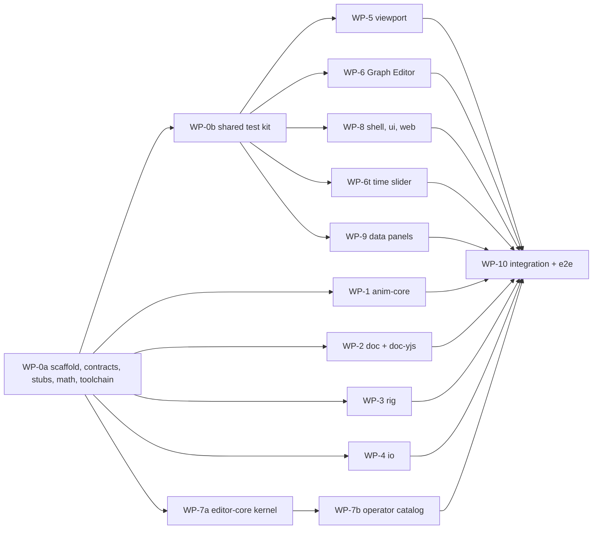

# Ekza Studio — MVP build specification (milestone M1)

Status: v0.2 (2026-10-17, design review revision) with the **v0.3 integration** changes of 2026-10-18 marked
inline. Audience: the integration agent (WP-0, WP-8, WP-10), seven
parallel implementation agents (WP-1…WP-9) and reviewers. Read [ARCHITECTURE.md](../ARCHITECTURE.md) first;
decisions are in [adr/](adr/README.md); numbered requirements are in [REQUIREMENTS.md](REQUIREMENTS.md).

Normative words: **MUST**, **SHOULD**, **MAY**. "Contract" means a type or signature in §4 or in a work
package's *Public API* block. Changing a contract requires a PR that updates this file first. Where an ADR
shows a code sketch that differs from §4, **§4 wins** (ADR snippets are illustrative).

Contents: [1 Scope](#1-scope) · [2 Pinned dependencies and toolchain](#2-pinned-dependencies-and-toolchain) ·
[3 Repository layout and conventions](#3-repository-layout-and-conventions) ·
[4 Shared contracts](#4-shared-contracts) · [5 User stories](#5-user-stories) ·
[6 Acceptance tests and e2e scenarios](#6-acceptance-tests-and-e2e-scenarios) ·
[7 Work packages](#7-work-packages) · [8 Integration plan and M1 definition of done](#8-integration-plan-and-m1-definition-of-done)

### What changed in v0.2

The v0.1 draft was reviewed through four lenses (animator UX, correctness of IO and math, implementability,
future OSS/Ekza fit). Every blocker and major issue is resolved below; rejected or partly accepted points are
recorded in [DECISIONS-OPEN §D](DECISIONS-OPEN.md#d-design-review-outcomes-2026-10-17). The main changes:

- Tangent acceptance tests now follow the AnimX rules the engine implements (E2E-08, US-08, §4.11.4).
- VRM 0.x facing is handled explicitly in the parity, VRMA and facing tests (§4.11.9, E2E-03, E2E-17).
- Operators run as `prepare` (async, no writes) + `apply` (sync, inside one transaction). They compose through
  exported edit helpers, never by calling each other inside a transaction (§4.5, §4.11.0).
- Shared test kit, final `package.json` files, a single lockfile owner and explicit panel registration in
  WP-0; WP-7 is split into a kernel (7a) and an operator catalog (7b); scope is split into **M1 core** and
  **M1-stretch** (§1.2).
- Animator workflow additions: time-slider retiming, Gimbal rotate mode, viewport marquee and pick cycling,
  undoable unkeyed edits (editor history), separate `cog` and `fk.hips` controls, mesh-based control sizing,
  `Plant Feet` for FK legs, import at the source frame rate with key reduction.
- IO correctness: surgeon container and rollback rules, avatar-scale input budgets, VRMA reader and writer
  rules, import mapping per glTF interpolation, shape-preserving insert that freezes neighbours,
  `VRMC_node_constraint` preview.
- Collaboration readiness: per-field merge units in `Change` and undo, partition lifecycle, async asset store,
  scene clock, a replicating conformance suite running against a test-only Yjs store **in M1** (ADR 0002).
- Ecosystem: clip provenance/contact/tags, registry-aligned lint codes, export profiles as data,
  importer/exporter/menu/table registries, licence and DCO checks in CI.

### What changed in the v0.3 integration

WP-1…WP-9 were merged into `dev` and their cross-package requests decided (DECISIONS-OPEN §E "Integration
decisions", INT-1…INT-31). Contract changes, each marked *v0.3 integration* where it lands: six operators join
`OperatorMap` (`select.channels`, `view.camera.setSettings`, `view.selectionMask`, `prefs.set`, `workspace.reset`,
`workspace.showPanel`); `OperatorDef.coalesce`; `SessionState.hoverControl`; `EditorServices.samplesPath`;
`PartitionLookup`; `RigWarning` `'unpaired-mirror'`; `EkzaBakeMarkerV1.generatorAdded`; anim-core `opts` on
`resolveKeyHandles`/`insertKeyPreservingShape`; `TimeSliderController.cancel()`. Behaviour clarifications: store and
runner rules (§4.11.0), the yaw-only facing check (§4.11.9), the surgeon generator rule (§4.11.11), lint severities
(§4.11.13), test-API probes (§4.8), the shell's `file.new` confirmation (§4.9).

**Acceptance round 1** (2026-10-18, DECISIONS-OPEN §E INT-32…INT-38): keying an unkeyed edit keeps that edit's undo
step (§4.11.0 rule 7, §4.11.1 rule 5, ADR 0013); Graph Editor press rules for Shift on a selected key and
double-clicks across tools (§4.11.18); `F` frames a control with the controls below it (§4.9 `view.frame`); import
and export dialog defaults (§4.11.6, §4.11.10 rule 7); the built stretch items (§1.2). Regression specs:
`apps/web/e2e/acceptance-round1.spec.ts`.

**Acceptance round 2** (DECISIONS-OPEN §E INT-39…INT-49): keyboard focus rules for dropdowns, Graph Editor fields
and the Outliner (§4.10 "Keyboard focus"); pick candidates ordered by screen distance (§4.11.16); a snapped key drag
stops a frame short of a neighbour (§4.11.3); a click inside the time-slider band sets the time (§4.11.17); bake
names and empty clips (§4.11.10 steps 7–8); the rotate-order note (§4.11.5). Regression specs:
`apps/web/e2e/acceptance-round2.spec.ts`.

**Acceptance round 3** (DECISIONS-OPEN §E INT-50…INT-52): menu triggers hand the keyboard back (§4.10 "Keyboard
focus"); the second press of a Graph Editor double-click can drag (§4.11.18); the time slider's menu without a band
acts on the current frame (§4.11.17). Regression specs: `apps/web/e2e/acceptance-round3.spec.ts`.

**WP-10 final** (DECISIONS-OPEN §E INT-53…INT-58): E2E-02…E2E-27 written and green; E2E-25 presses `E` before the
gimbal toggle (§6.2). The pre-integration fixme gates now fail a scenario; unbuilt §1.2 stretch items are `test.fixme`
in `apps/web/e2e/stretch.spec.ts`. ARCHITECTURE §14 budgets are recorded in ROADMAP "M1 budgets".

**Final acceptance** (DECISIONS-OPEN §E INT-59…INT-61): a drag on a manipulator handle whose channel is locked
changes nothing and says so (§4.11.16); counts in the Export dialog take the right number; Graph Editor value labels
and frame numbers keep out of each other's area.

---

## 1. Scope

### 1.1 In scope (M1 core)

| Area | MVP content |
|---|---|
| Open | `.glb` and `.vrm` (VRM 0.x and 1.0) via file picker, drag-and-drop anywhere and bundled samples (Seed-san VRM 1.0, Polybot VRM 0.x, Quaternius UAL generic GLB); `.vrma` import as a new clip; `.ekzanim` and `.ekzanim.json` projects. The three.js loader decodes Draco/meshopt/KTX2 with self-hosted decoders; the headless reader rejects compressed *animation* data with `EkzaError('compressed-animation')`. |
| Rig | Auto-generated FK rig: humanoid (VRM) with NURBS-like circle controls sized from the skinned mesh, offset groups (zero pose = rest), side colours, `root` + `cog` (pure space, translate+rotate) + `fk.hips` (pelvis), secondary controls for non-humanoid joints (hidden by default); 1:1 FK rig for generic skinned GLBs. Constraint and solver slots in the kernel (no implementations). `VRMC_node_constraint` evaluated in the preview. A pure two-bone IK *solver function* used by `Plant Feet`. |
| Outliner | Character → Rig (controls tree) / Skeleton (bones, read-only) / Clips; filter by name and VRM humanoid name; selection sync. |
| Channels | Values of the lead selection's keyable channels (degrees for rotation), multi-selection editing, colour states keyed-on-frame / keyed / changed / locked, numeric entry with relative expressions, right-click: key selected, reset, lock/unlock. Rotate order shown read-only. |
| Viewport | One canvas; layouts single / 2-pane (left: locked shot camera, right: free persp) / 4-view (top, persp, front, side); Alt+drag navigation (industry-standard DCC: Alt+LMB tumble, Alt+MMB track, Alt+RMB dolly; wheel) and a trackpad profile; F/A framing; display toggles mesh, skeleton, controls, x-ray, grid; HUD with camera name, `LOCKED` badge, clip frame and scene time; navigating an unlocked shot camera persists without entering undo. |
| Selection | Click, Shift/Mod modifiers, **marquee** (crossing test), **click-cycling** through overlapping controls, hover/selected/lead highlight tokens; outliner sync. |
| Manipulators | `W` translate (object/world), `E` rotate (object/world/**gimbal**); constant pixel size; picking priority manipulator > control > joint. `Q` select tool. |
| Keying | `S` (all keyable), `Shift+W/E/R` (translate/rotate/scale), key selected channels (Channels), auto-key toggle (default rule: only channels that already have curves; preference "all"), delete keys at frame / selected keys. |
| Time | Time slider with ruler, key ticks of the selected controls (summary row), scrub, **Shift-select a frame or range and move, scale, delete, copy, paste or set tangents of its keys**, playback range, play/stop, loop/once/oscillate, real-time and every-frame playback, per-clip fps (24/25/30/48/50/60/custom), a scene clock shared by all characters. |
| Graph Editor | Canvas2D; channel list with X/Y/Z colours; pan/zoom/frame per navigation profile; click, box and double-click (whole curve) selection of keys and tangent handles; move keys (LMB on selection or MMB anywhere) with axis lock and frame snapping; tangent types auto, spline, clamped, linear, flat, stepped (+ stepped-next, fixed in the menu); break/unify; weighted curves with lock/free weight; pen-like handle dragging; insert key on curve (shape preserving); numeric fields (frame, value, in/out angle, in/out weight); pre/post infinity constant/linear/cycle/cycle-offset/oscillate with dotted display; Euler filter; **Simplify** (error-bounded key reduction); copy/paste keys at the current frame. |
| Clips | Multiple named clips per character (new, rename, duplicate, delete, switch, settings: fps, range, loop, root motion, Ekza slot, contact frame, tags, provenance); embedded clips imported as editable curves at the **source frame rate** with key reduction (selectable per clip at import). |
| Pose | Copy/paste pose (also across humanoid characters), paste mirrored, mirror pose (flip / L→R / R→L, humanoid), reset to rest, **Pin Feet / Plant Feet** (re-solves FK legs so the feet return to pinned positions; writes FK keys). |
| Undo | Transactions; one gesture = one undo step; per-user stack; **editor history** that also undoes unkeyed (session override) edits; selection restored by undo/redo. |
| Export | (1) bake into the original GLB/VRM (append-only surgeon, lossless for every JSON value and every original BIN byte); (2) animation-only GLB; (3) VRMA, one clip per file. Read-back check in the app; glTF-Validator in tests; Ekza Tier-0 lints, export profiles and `ekza_animation_v1` metadata with provenance. |
| Project | `.ekzanim` save/load (zip: manifest, project.json, assets by SHA-256) and `.ekzanim.json` debug variant. |
| Shell | Next.js `/editor` client island; dockview workspace; menu bar, status line, help line; Space tap maximizes the pane or panel under the pointer; first-run dialog (navigation profile, Space behaviour); import and export dialogs; About with sample credits and third-party notices; toasts with Undo. |
| Extensibility | Registries for operators, tools, keymaps, panels, menus, importers, exporters, export profiles, control shapes, rig op kinds and document tables; built-ins register through them. |
| Collaboration readiness | Document store boundary with per-field merge units, partitions with an `open/close` lifecycle, async content-addressed asset store, and a conformance suite whose replicating half runs in CI against a private, test-only Yjs store (`packages/doc-yjs`). No network. |

### 1.2 M1-stretch (implement only if time remains; their tests are `test.fixme` until done)

| Item | Why it is stretch | Fallback in M1 core |
|---|---|---|
| Plateau tangent (FR-GE-08) | No oracle; "plateau if cheap" | Key `7` and the menu item poll-fail with "not available yet"; the enum value exists |
| Cycle-aware auto tangents (FR-GE-17) | Improvement over a leading commercial desktop DCC, no oracle | Plain AnimX auto at the ends |
| Mesh-click picking (CPU skinned raycast) | Cost of skinned raycasts; controls are pickable | Click controls, outliner, marquee |
| Space-hold camera radial; one-button macOS navigation profile | UI polish | Pane header camera menu; Trackpad profile |
| Pose-preserving rotate-order change (FR-RIG-08, FR-CB-06) | Needs union-time resampling (§4.11.5) | Rotate order is read-only in the Channels panel and Attributes |
| Animation-only GLB import onto a character (FR-IO-10) | Name remapping across skeletons | E2E-18 verifies exports by re-reading them in Node |
| In-app glTF-Validator worker | Bundle size, worker plumbing | Read-back check in the app; validator in tests |
| Bevy lints (`bevy.*`) | No Bevy consumer in M1 | — |
| Static-export, offline, storage-blocked and context-loss e2e (NFR-09, NFR-12, NFR-13) | CI plumbing | Manual QA items in §8.3 |

*Status at acceptance round 1 (2026-10-18)*: built and enabled — the pose-preserving rotate-order change (WP-7b
`rig.setRotateOrder`; the rotate order is **editable** in Attributes and the Channels panel, so the "read-only"
fallback above no longer applies), the plateau tangent (W1-5), mesh-click picking (WP-5 V-13), the camera radial
and the one-button macOS profile (V-14, WP-5/WP-6 navigation), and the `bevy.*` lint rules. Not built: cycle-aware
auto tangents (compile option, off by default), animation-only GLB import onto a character (a clear "No animation
… fits the character" message), the in-app validator worker, and the static-export/offline/storage/context-loss
e2e scenarios (checked manually in §8.3; acceptance round 1 passed them).

### 1.3 Out of scope (roadmap)

Leg/arm IK controls, IK/FK switching and matching, constraints implementations (M2a/M2c, slots exist),
full Dope Sheet, onion skin, motion trails, animation layers UI and evaluation of non-base layers, marking
menus, command palette, hotkey editor, tween slider, breakdown keys, buffer curves, normalized/stacked graph
views, Graph Editor scale/region tools, time bookmarks, audio, playblast, VRMA expressions and lookAt,
FBX/BVH import, `.gltf` multi-file import, collaboration networking, Ekza upload, plugins loading, modeling,
autosave, scale manipulator, spring-bone baking, IO worker replica. See [ROADMAP.md](ROADMAP.md).

### 1.4 What M1 is for (say it plainly)

M1 is a public **alpha** (tag `v0.1.0`). It is credible for **in-place loops, upper-body emotes (no facial
expressions yet), idles, gestures, and full-body blocking with planted feet**. Legs are FK: moving `cog` moves
the feet, so weight shifts and crouches need `Pose → Plant Feet` on each key (one click per key, one undo step),
and feet can still slide *between* keys. Leg IK with pole vectors is the first item of M2a
([ROADMAP M2a](ROADMAP.md#m2a--game-clip-daily-driver--2025-agent-days)); the owner may pull it into M1
(DECISIONS-OPEN Q-RIG-5). The README, the demo script (§8.3) and the first-run "Getting started" card state this.

---

## 2. Pinned dependencies and toolchain

All versions are exact (no ranges) and were released on or before 2026-10-03 (≥ 14 days before
2026-10-17), verified against the npm registry on 2026-10-17. Newer releases noted in the last column are
adopted by a normal dependency PR after their soak.

| Package | Version | Released | Where (dep / devDep) | Notes / newer |
|---|---|---|---|---|
| Node.js | 24 LTS (`.nvmrc` `24`); `engines.node` `>=24.11.0` | — | all | Node 25 works with engine warnings |
| pnpm | 10.32.1 (`packageManager`) | — | root | no corepack needed |
| typescript | 6.0.3 | 2026-04-16 | root dev | 7.0.2 has no JS API (ADR 0001) |
| turbo | 2.11.7 | 2026-10-02 | root dev | 2.11.9 |
| oxlint | 1.86.0 | 2026-09-28 | root dev | 1.88.0 |
| oxlint-tsgolint | 7.0.2003 | 2026-09-24 | root dev | 7.0.2004 |
| @biomejs/biome | 2.5.15 | 2026-09-30 | root dev | formatter + import sorting only |
| vitest | 4.1.11 | 2026-08-18 | dev: every package | 5.0.x excludes Node 25 |
| @vitest/browser-playwright | 4.1.11 | 2026-08-18 | dev: viewport, curve-editor, editor | — |
| playwright, @playwright/test | 1.63.0 | 2026-09-04 | dev: root, apps/web | 1.64.1 |
| fast-check | 4.10.2 | 2026-09-19 | dev: anim-core, doc, doc-yjs, rig, editor-core | — |
| @types/node | 24.19.1 | 2026-10-01 | dev: every package | types the global WebCrypto |
| gltf-validator | 2.0.0-dev.3.10 | 2024-10-22 | dev: io, editor-core, headless-tests, apps/web; dep: editor (worker, stretch) | only release line |
| next | 16.3.8 | 2026-09-30 | dep: apps/web | 16.4.2 |
| react, react-dom | 19.3.0 | 2026-09-09 | dep: editor, ui, web | 19.3.1; R3F requires `<19.4` |
| @types/react, @types/react-dom | 19.3.0 | 2026-09-09 | dev: editor, ui, web | — |
| three | 0.186.1 | 2026-09-24 | dep: io (`/three` subpath), viewport, editor, apps/web (e2e route); dev: anim-core, rig, headless-tests | single copy |
| @types/three | 0.186.0 | 2026-09-11 | dev: anim-core, rig, io, viewport, editor, headless-tests, apps/web | — |
| @react-three/fiber | 9.8.1 | 2026-09-24 | dep: editor | 9.8.2 |
| @pixiv/three-vrm | 3.5.5 | 2026-07-09 | dep: io, apps/web (e2e route); dev: headless-tests (parity) | exact pin; one copy |
| @pixiv/three-vrm-animation | 3.5.5 | 2026-07-09 | dev: io, headless-tests; dep: apps/web (e2e route) | VRMA playback check |
| @gltf-transform/core, /extensions, /functions | 4.5.1 | 2026-09-28 | dep: io; dev: root (fixture tooling) | writers for fresh documents only |
| meshoptimizer | 1.3.0 | 2026-09-25 | dev: root (generates the compressed fixture) | MIT |
| fflate | 0.8.3 | 2026-05-16 | dep: io | zip |
| yjs | 13.6.33 | 2026-09-23 | dep: `packages/doc-yjs` only (private, test-only) | v14 is RC; never imported by app code |
| camera-controls | 3.1.2 | 2025-11-17 | dep: viewport | — |
| zustand | 5.0.15 | 2026-08-13 | dep: editor-core (`zustand/vanilla`), editor | — |
| dockview-react | 8.4.0 | 2026-09-30 | dep: editor | 8.6.0; never `dockview-enterprise` |
| react-resizable-panels | 4.14.2 | 2026-10-02 | dep: editor | 4.14.5 |
| @tanstack/react-virtual | 3.14.13 | 2026-09-14 | dep: editor | 3.14.21 |
| radix-ui | 1.6.7 | 2026-07-24 | dep: ui | 1.8.1 |
| lucide-react | 1.51.0 | 2026-10-03 | dep: ui | 1.59.0 |
| tailwindcss, @tailwindcss/postcss | 4.3.3 | 2026-07-16 | dep: ui; dev: apps/web | — |
| @fontsource-variable/inter, @fontsource-variable/jetbrains-mono | 5.3.0 | 2026-07-19 | dep: ui | OFL-1.1, self-hosted |

Not used in the MVP (decided): `@react-three/drei`, `comlink` (in-house RPC M2), `cmdk` (palette V1),
`dependency-cruiser` (ADR 0001), `immer`/`mutative`, `@hocuspocus/*` and `y-*` packages (M3), `sharp`
(ignored optional dependency of Next; images are `unoptimized`).

`pnpm-workspace.yaml` (normative):

```yaml
packages: ["apps/*", "packages/*"]
minimumReleaseAge: 20160          # 14 days, minutes
ignoredOptionalDependencies: ["sharp"]   # LGPL libvips binaries never installed (ADR 0009)
catalog:
  three: 0.186.1
  "@types/three": 0.186.0
  react: 19.3.0
  react-dom: 19.3.0
  "@types/react": 19.3.0
  "@types/react-dom": 19.3.0
  "@pixiv/three-vrm": 3.5.5
  "@pixiv/three-vrm-animation": 3.5.5
  typescript: 6.0.3
  vitest: 4.1.11
  "@types/node": 24.19.1
onlyBuiltDependencies: []         # add only after review when `pnpm install` reports ignored builds
```

**Root scripts** (`package.json`): `dev` (`turbo run dev --filter=web`), `build`, `test` (`turbo run test`),
`test:e2e` (`pnpm --filter web e2e`), `lint` (`oxlint --type-aware`), `format` / `format:check`
(`biome format`), `typecheck` (`tsc -b`), `check:deps` (`node tooling/check-deps.mjs`), `check:fixtures`
(`node tooling/check-fixtures.mjs`), `check:licenses` (`node tooling/check-licenses.mjs`), `ci` (format:check,
lint, typecheck, check:deps, check:fixtures, check:licenses, test, build, test:e2e).

**TypeScript configuration** (normative; verified with tsc 6.0.3, whose `types` default is `[]`):

| File | Options |
|---|---|
| `tsconfig.base.json` | `target: "ES2023"`, `lib: ["ES2023"]`, `types: []`, `module: "esnext"`, `moduleResolution: "bundler"`, `verbatimModuleSyntax: true`, `strict: true`, `noUncheckedIndexedAccess: true`, `exactOptionalPropertyTypes: true`, `noImplicitOverride: true`, `isolatedModules: true`, `skipLibCheck: true`, `composite: true`; no `baseUrl`, no `paths` (workspace resolution via `exports`) |
| `tooling/tsconfig/headless.json` (anim-core, doc, doc-yjs, rig, io main entry, editor-core) | extends base; `types: ["node"]` (only for the global WebCrypto `crypto` typing; runtime use of Node APIs is a lint error outside `src/testing/**` and `test/**`) |
| `tooling/tsconfig/browser.json` (viewport, curve-editor, ui, editor, apps/web, `io/src/three`) | extends base; `lib: ["ES2023", "DOM", "DOM.Iterable"]`, `types: []`, `jsx: "react-jsx"` |
| `tooling/tsconfig/worker.json` (`io/src/worker`, `editor/src/workers`) | extends base; `lib: ["ES2023", "WebWorker"]` |
| `tooling/tsconfig/test.json` (each package's `test/`) | extends the package config; `types: ["node", "vitest/globals"]` (browser-mode tests add `@vitest/browser-playwright`) |

oxlint `no-restricted-globals` in headless packages: `window`, `document`, `navigator`, `process`, `Buffer`,
`require`. `no-restricted-imports`: the dependency table in ARCHITECTURE §3, plus `node:*` only in
`src/testing/**`, `test/**` and `tooling/**`.

**Licence and DCO checks** (ADR 0009): `tooling/check-licenses.mjs` runs
`pnpm licenses list --prod --json` and fails on any production dependency whose licence is outside
`MIT, ISC, BSD-2-Clause, BSD-3-Clause, Apache-2.0, 0BSD, BlueOak-1.0.0, CC0-1.0, OFL-1.1` unless it is listed
in `tooling/license-exceptions.json` with a rationale (initial entries: `caniuse-lite` CC-BY-4.0 build-time
data; `lightningcss` and its platform binaries MPL-2.0, unmodified build tool). It also fails when `sharp` or
any `@img/sharp-*` package is present. CI job `dco` checks a `Signed-off-by:` trailer on every PR commit.
`apps/web` generates `public/THIRD_PARTY_NOTICES.txt` from the client bundle's packages at build time
(licence texts and NOTICE files, including gltf-validator's Apache-2.0 NOTICE and the OFL font notices); the
About dialog links it.

---

## 3. Repository layout and conventions

```
ekza-studio/
├── apps/web/                      Next.js 16 shell
│   ├── app/                       layout.tsx, page.tsx (landing), editor/page.tsx + EditorIsland.tsx,
│   │                              dev/panels/page.tsx (panel harness), e2e/vrma-check/page.tsx
│   ├── public/samples/            generated by scripts/copy-assets.mjs from fixtures/ (git-ignored)
│   ├── public/decoders/           generated from three/examples/jsm/libs/{draco,basis,meshopt} (git-ignored)
│   ├── e2e/                       Playwright specs, helpers (seed.ts), verification page assets
│   ├── scripts/copy-assets.mjs  scripts/third-party-notices.mjs
│   └── playwright.config.ts  next.config.ts  postcss.config.mjs  app/globals.css
├── packages/
│   ├── anim-core/   src/{math,curve,curve/animx,euler,spline,reduce,errors.ts}/  test/  NOTICE  LICENSE-APACHE-2.0
│   ├── doc/         src/{ids,records,store,undo,queries,tables,snapshot,migrations,time}/  src/testing/  test/
│   ├── doc-yjs/     src/  src/testing/  test/            private, test-only (yjs); never a dependency of the app
│   ├── rig/         src/{humanoid,autorig,compile,kernel,sampler,inverse,ik,import,mirror,pose,schedule}/  test/
│   ├── io/          src/{glb,gltf,budget,skeleton,animation,vrma,bake,surgeon,writers,lint,profiles,validate,project}/
│   │                src/three/  src/worker/  src/testing/  test/
│   ├── editor-core/ src/{app,session,prefs,history,operators,edit,keymap,tools,registries,playback,evaluation,
│   │                characters,services,workflows,testing}/  test/
│   ├── headless-tests/ test/{rig,io,ops}.*.test.ts   private, test-only: cross-package Node tests on licensed fixtures
│   ├── viewport/    src/{manager,panes,cameras,navigation,sync,controls,picking,manipulators,tools,framing,overlays}/  test/
│   ├── curve-editor/src/{view,painters,hit,graph,timeline,tools,channel-tree}/  test/
│   ├── ui/          src/{tokens,primitives,icons}/  tokens.json  styles.css
│   └── editor/      src/{shell,gl,input,dialogs,panels/*,panels/index.ts,services,hooks,test-api,workers}/
├── fixtures/                      models/, animations/ (licensed binaries, LICENSES.md), synthetic/ (generated JSON, MIT)
├── tooling/                       tsconfig/, check-deps.mjs, check-fixtures.mjs, check-licenses.mjs,
│                                  license-exceptions.json, make-compressed-fixture.mjs, animx-oracle/
├── docs/                          research/, adr/, REQUIREMENTS, ROADMAP, MVP-SPEC, DECISIONS-OPEN, GLOSSARY
├── .github/workflows/ci.yml  .github/PULL_REQUEST_TEMPLATE.md  .github/ISSUE_TEMPLATE/
├── package.json  pnpm-workspace.yaml  pnpm-lock.yaml  turbo.json  tsconfig.base.json  tsconfig.json
├── .oxlintrc.json  biome.json  .nvmrc  .editorconfig  .gitignore  REUSE.toml
└── LICENSE  README.md  ARCHITECTURE.md  CONTRIBUTING.md  CODE_OF_CONDUCT.md  SECURITY.md  TRADEMARKS.md
```

Conventions (all packages):

1. Every package: `package.json` with `"private": true`, `"type": "module"`,
   `"exports": {".": "./src/index.ts"}` plus declared subpaths (`./testing`, `./three`, `./worker`), scripts
   `test`, `typecheck`. `"sideEffects": false` is allowed because **nothing registers on import**: every
   registration is an explicit call (`registerBuiltinOperators(app)`, `registerBuiltinPanels(registry)`, …).
2. Public API only through `src/index.ts` and declared subpaths. Deep imports across packages are lint errors.
3. **`package.json` files and `pnpm-lock.yaml` are owned by the integration agent.** WP-0 writes the final
   dependency and devDependency set of every package from §2, runs `pnpm install` once and commits the
   lockfile. An implementation agent that needs a new dependency opens a *dependency request* (PR comment or
   issue with name, version, licence, reason); only the integration agent edits `package.json` or the lockfile.
4. Units: frames, metres, radians internally; degrees only in UI formatting.
5. No allocation in per-frame paths (`evaluate`, `sample`, `SceneSync.apply`, painters' inner loops): reuse typed
   arrays and out-parameters.
6. Errors: domain functions throw `EkzaError` (`anim-core/src/errors.ts`, re-exported by `doc`) for invalid
   caller input; they never throw on document content (repair and warn). Codes are listed in §4.11.0.
7. Tests live in `packages/*/test/**/*.test.ts`. Licensed fixtures are read with `readFixture(name)` from
   `@ekza-studio/doc/testing`; synthetic fixtures with `readSyntheticFixture(name)`.
8. Copy-adapted code carries an attribution header:
   `// Adapted from <repo>/<path> @ <commit> (MIT, © <holder>). Changes: <summary>.`
9. Commit messages: Conventional Commits; every commit has a DCO `Signed-off-by:` trailer.
10. **Panels register explicitly.** Each panel directory exports `register<Name>Panel(registry: PanelRegistry)`.
    WP-0 creates `packages/editor/src/panels/index.ts` with `registerBuiltinPanels(registry)` calling every
    one of them, with placeholder bodies. Panel owners edit only their directory; the shell (WP-8) never edits
    panel directories and panel owners never edit the shell.
11. **Tailwind sources.** `packages/ui/styles.css` starts with `@import "tailwindcss";` followed by
    `@source "../editor/src";` and `@source "./src";` so classes used only inside workspace packages reach the
    CSS that `apps/web` builds. A WP-0 smoke test asserts that a class used only in `packages/editor` is in
    the built CSS.
12. **Fakes come only from the shared test kit** (WP-0b): `@ekza-studio/editor-core/testing`,
    `@ekza-studio/doc/testing`, `@ekza-studio/io/testing` and `fixtures/synthetic/*`. A WP may extend the
    kit through a PR to its owner; it does not write private fakes of another package's interface.
13. `check:fixtures` covers `fixtures/models/**` and `fixtures/animations/**` (licensed binaries, one SHA-256 row
    each in `fixtures/LICENSES.md`). `fixtures/synthetic/**` is generated test data under the repository licence.
14. Cross-package Node tests on licensed fixtures live in the private package `packages/headless-tests` (depends on
    every headless package plus three, three-vrm, three-vrm-animation and gltf-validator as devDependencies), so
    no package needs a dev dependency that points up the layer graph. Test files are owned by prefix: `rig.*`
    WP-3, `io.*` WP-4, `ops.*` WP-7b.

---
## 4. Shared contracts

These are the canonical cross-package types. WP-0 turns each block into the named file verbatim (adding JSDoc
is allowed, changing shapes is not). The function signatures each package exports are listed in its work
package (§7) and are contracts too. All §4 blocks and §7 *Public API* blocks compile together under the §2
compiler options (checked with tsc 6.0.3; §7 blocks as declaration files).

### 4.1 anim-core — math, curves, splines, errors

`packages/anim-core/src/types.ts`

```ts
// ---------- math ----------
export type Vec3 = [number, number, number];
export type Quat = [number, number, number, number];            // x, y, z, w (glTF/three order)
export type ReadonlyVec3 = readonly [number, number, number];
export type ReadonlyQuat = readonly [number, number, number, number];
/** 4×4 matrix, column-major (three.js `Matrix4.elements` layout), length 16, float64. */
export type Mat4 = Float64Array;
/** Translation · Rotation · Scale. Humanoid rigs use uniform scale (s[0] === s[1] === s[2]). */
export interface Xf { t: Vec3; q: Quat; s: Vec3 }
export interface ReadonlyXf { readonly t: ReadonlyVec3; readonly q: ReadonlyQuat; readonly s: ReadonlyVec3 }
/** Returned by every register/subscribe call. */
export type Disposer = () => void;

/**
 * Rotate order in common DCC semantics: the FIRST letter is applied FIRST.
 * 'xyz' ⇒ R = Rz·Ry·Rx (column vectors) ≡ three.js Euler order 'ZYX'.
 */
export type RotateOrder = 'xyz' | 'yzx' | 'zxy' | 'xzy' | 'yxz' | 'zyx';
export type ThreeEulerOrder = 'XYZ' | 'YXZ' | 'ZXY' | 'ZYX' | 'YZX' | 'XZY';
/** Euler angles in radians indexed by axis: [rx, ry, rz], independent of the rotate order. */
export type Euler3 = Vec3;

// ---------- animation curves ----------
/** Time in frames (float64) of the owning clip's frame rate. Integer by default. */
export type Frame = number;
/** Rational frame rate, e.g. {num: 30, den: 1}, {num: 30000, den: 1001}. seconds = frame · den / num. */
export interface Fps { readonly num: number; readonly den: number }

export type TangentType =
  | 'auto' | 'autoEase' | 'autoMix'          // AnimX-exact, clamped (never overshoot); end keys flat
  | 'spline' | 'clamped' | 'plateau'         // documented approximations (research 01 §5.4); plateau is M1-stretch
  | 'linear' | 'flat'
  | 'step' | 'stepNext'                      // interpolation flags, read from the OUT side of a span's start key
  | 'fixed';                                 // user-edited handle, never recomputed
export type InfinityMode = 'constant' | 'linear' | 'cycle' | 'cycleOffset' | 'oscillate';

/** Offset of a tangent control point from its key, in (frames, value units). in: dt <= 0, out: dt >= 0. */
export interface Handle { readonly dt: number; readonly dv: number }

export interface KeyData {
  readonly t: Frame;
  readonly v: number;                         // metres | radians | unitless
  readonly inType: TangentType;
  readonly outType: TangentType;
  /** Used only when inType/outType === 'fixed'. Non-weighted curves use the direction only. */
  readonly inHandle: Handle;
  readonly outHandle: Handle;
  readonly broken: boolean;                   // false = unified (collinear when edited)
  readonly weightLocked: boolean;             // weighted curves: handle drags change angle only
  readonly breakdown?: boolean;               // V1; stored, ignored by MVP UI
}

export interface AnimCurve {
  readonly keys: readonly KeyData[];          // sorted by t, unique t
  readonly weighted: boolean;
  readonly pre: InfinityMode;
  readonly post: InfinityMode;
}

export const Segment = { Hermite: 0, Bezier: 1, Linear: 2, Step: 3, StepNext: 4 } as const;
export type SegmentKind = (typeof Segment)[keyof typeof Segment];

/** Compiled, evaluation-ready form. All arrays have length keyCount unless noted. */
export interface CompiledAnimCurve {
  readonly keyCount: number;
  readonly t: Float64Array;
  readonly v: Float64Array;
  /** Resolved tangent slopes in value units per frame (weighted: slope of the resolved handle). */
  readonly inSlope: Float64Array;
  readonly outSlope: Float64Array;
  /** Resolved handle offsets (frames, value) after tangent computation and, for weighted curves, the
   *  monotonic-X correction. Non-weighted: dt = ±(span to neighbour)/3. Used by painters and editors. */
  readonly inDt: Float64Array;
  readonly inDv: Float64Array;
  readonly outDt: Float64Array;
  readonly outDv: Float64Array;
  /** Length max(keyCount − 1, 0): kind of segment i (key i → key i+1). */
  readonly segment: Uint8Array;
  readonly weighted: boolean;
  readonly pre: InfinityMode;
  readonly post: InfinityMode;
}

/** Injectable engine so packages can test against fakes before WP-1 lands. */
export interface CurveEngine {
  compile(curve: AnimCurve): CompiledAnimCurve;
  evaluate(curve: CompiledAnimCurve, frame: Frame): number;
}

/** Error-bounded key reduction (Graph Editor Simplify, import). */
export interface ReduceOptions {
  /** Max |Δvalue| in curve units (radians or metres), checked at every ORIGINAL key time and at every
   *  integer frame between the first and last key. */
  readonly tolerance: number;
  /** Frames that must keep a key (step discontinuities, contact frames). First and last keys are always kept. */
  readonly keep?: readonly Frame[];
}
export interface ReduceResult { readonly keys: KeyData[]; readonly removed: number; readonly maxError: number }

/** Graph Editor numeric tangent fields in the desktop-DCC convention (x in seconds, display units). */
export interface TangentFields { readonly angleDeg: number; readonly weight: number }

// ---------- geometry (control shapes now, spline modeling later) ----------
export type SplineKind = 'poly' | 'bezier';                     // 'nurbs' reserved for M6
export interface Spline {
  readonly kind: SplineKind;
  readonly closed: boolean;
  readonly points: readonly ReadonlyVec3[];                     // local space
  readonly handlesIn?: readonly ReadonlyVec3[];                 // bezier only, absolute positions
  readonly handlesOut?: readonly ReadonlyVec3[];
}
export interface SplineSet { readonly v: 1; readonly splines: readonly Spline[] }
/** Open string: built-ins below, extensions register more through `registerControlShape`. */
export type ControlShapeKind = string;
export const BUILTIN_CONTROL_SHAPES = [
  'circle', 'halfCircle', 'square', 'cube', 'sphere', 'diamond', 'arrow4', 'star', 'cross', 'lollipop', 'custom',
] as const;
export type BuiltinControlShape = (typeof BUILTIN_CONTROL_SHAPES)[number];
```

`packages/anim-core/src/errors.ts` (implemented by WP-0; `doc` re-exports it)

```ts
export class EkzaError extends Error {
  readonly code: string;
  readonly details: unknown;
  constructor(code: string, message: string, details?: unknown) {
    super(message);
    this.name = 'EkzaError';
    this.code = code;
    this.details = details;
  }
}
```

### 4.2 doc — records, partitions, store, transactions, undo, replication

`packages/doc/src/ids.ts`

```ts
declare const __brand: unique symbol;
export type Brand<T, B extends string> = T & { readonly [__brand]: B };

export type AssetId = Brand<string, 'AssetId'>;         // lowercase SHA-256 hex of the exact bytes
export type CharacterId = Brand<string, 'CharacterId'>; // 'chr_' + 16 base62
export type RigId = Brand<string, 'RigId'>;             // 'rig_' + 16
/** Auto-rig: `${RigId}:${templateKey}` (deterministic, e.g. 'rig_a1…:fk.upperArm.L'). User-created (V1): 'ctl_' + 16. */
export type ControlId = Brand<string, 'ControlId'>;
export type ConstraintId = Brand<string, 'ConstraintId'>; // 'cns_' + 16
export type SolverId = Brand<string, 'SolverId'>;         // 'slv_' + 16
export type CameraId = Brand<string, 'CameraId'>;         // 'cam_' + 16
export type ClipId = Brand<string, 'ClipId'>;             // 'clp_' + 16
export type LayerId = Brand<string, 'LayerId'>;           // 'lay_' + 16
export type CurveId = Brand<string, 'CurveId'>;           // 'crv_' + 16
export type KeyId = Brand<string, 'KeyId'>;               // 'k_' + 12
export type UserId = Brand<string, 'UserId'>;             // 'local' in the MVP
export type ProjectId = 'project';

/** ID type per kind, for the typed `newId(kind)` (WP-0). */
export interface IdOfKind {
  character: CharacterId; rig: RigId; constraint: ConstraintId; solver: SolverId; camera: CameraId; clip: ClipId;
  layer: LayerId; curve: CurveId; key: KeyId; tx: string;
}
export type IdKind = keyof IdOfKind;
/** Randomness source; tests and `?e2e=1` inject a seeded one. */
export interface IdSource { randomBytes(n: number): Uint8Array }
```

`packages/doc/src/records.ts`

```ts
import type { AnimCurve, ControlShapeKind, Fps, Frame, InfinityMode, KeyData, ReadonlyQuat, ReadonlyXf,
  RotateOrder, SplineSet } from '@ekza-studio/anim-core';
import type { AssetId, CameraId, CharacterId, ClipId, ConstraintId, ControlId, CurveId, KeyId, LayerId, RigId,
  SolverId, UserId } from './ids';

/** Soft-delete marker for structural records (research 06 R4). `at` = ms since epoch. */
export type Tombstone = { readonly by: UserId; readonly at: number } | null;

export type ChannelId = 'tx' | 'ty' | 'tz' | 'rx' | 'ry' | 'rz' | 'sx' | 'sy' | 'sz' | `@${string}`;
export const TRS_CHANNELS = ['tx', 'ty', 'tz', 'rx', 'ry', 'rz', 'sx', 'sy', 'sz'] as const;
export type TrsChannel = (typeof TRS_CHANNELS)[number];
export type ChannelValues = Partial<Record<ChannelId, number>>;

export type Side = 'L' | 'R' | 'C';
export type Axes = readonly [boolean, boolean, boolean];
export type ModelFormat = 'vrm0' | 'vrm1' | 'gltf';

/** VRM 1.0 humanoid bone names (55). Order defines the `humanLocal` buffer layout (rig HUMAN_BONE_NAMES). */
export type HumanBoneName =
  | 'hips' | 'spine' | 'chest' | 'upperChest' | 'neck' | 'head' | 'leftEye' | 'rightEye' | 'jaw'
  | 'leftUpperLeg' | 'leftLowerLeg' | 'leftFoot' | 'leftToes'
  | 'rightUpperLeg' | 'rightLowerLeg' | 'rightFoot' | 'rightToes'
  | 'leftShoulder' | 'leftUpperArm' | 'leftLowerArm' | 'leftHand'
  | 'rightShoulder' | 'rightUpperArm' | 'rightLowerArm' | 'rightHand'
  | 'leftThumbMetacarpal' | 'leftThumbProximal' | 'leftThumbDistal'
  | 'leftIndexProximal' | 'leftIndexIntermediate' | 'leftIndexDistal'
  | 'leftMiddleProximal' | 'leftMiddleIntermediate' | 'leftMiddleDistal'
  | 'leftRingProximal' | 'leftRingIntermediate' | 'leftRingDistal'
  | 'leftLittleProximal' | 'leftLittleIntermediate' | 'leftLittleDistal'
  | 'rightThumbMetacarpal' | 'rightThumbProximal' | 'rightThumbDistal'
  | 'rightIndexProximal' | 'rightIndexIntermediate' | 'rightIndexDistal'
  | 'rightMiddleProximal' | 'rightMiddleIntermediate' | 'rightMiddleDistal'
  | 'rightRingProximal' | 'rightRingIntermediate' | 'rightRingDistal'
  | 'rightLittleProximal' | 'rightLittleIntermediate' | 'rightLittleDistal';

/** Semantic bone reference; never a glTF node index (indices change on re-export). */
export type BoneRef =
  | { readonly humanoid: HumanBoneName }
  | { readonly name: string; readonly parentName: string | null; readonly occurrence?: number };

export interface ProjectRecord {
  readonly id: 'project';
  readonly name: string;
  readonly schemaVersion: number;              // core format version that last wrote the project (SCHEMA_VERSION)
  readonly minWriterVersion: number;           // apps whose SCHEMA_VERSION is lower open the project read-only (research 06 R11)
  readonly sceneFps: Fps;                      // scene clock rate and default fps of new clips; {num: 30, den: 1}
  readonly sceneRange: { readonly start: Frame; readonly end: Frame };   // scene frames; default 0..60
  readonly units: 'm';
  readonly upAxis: 'Y';
}

export interface AssetRecord {
  readonly id: AssetId;                        // sha256 hex
  readonly name: string;                       // original file name
  readonly ext: 'glb' | 'vrm' | 'vrma';
  readonly mime: 'model/gltf-binary';          // no registered media type exists for VRM/VRMA (research 03 §7.2)
  readonly size: number;
  readonly role: 'model' | 'animation-source';
}

export interface CharacterRecord {
  readonly id: CharacterId;
  readonly name: string;
  readonly asset: AssetId;
  readonly format: ModelFormat;
  readonly rig: RigId;
  readonly placement: ReadonlyXf;              // scene placement of the character root (MVP: offset along X per character)
  readonly order: string;                      // fractional index
  readonly deleted: Tombstone;
}

export interface RigRecord {
  readonly id: RigId;
  readonly character: CharacterId;
  readonly format: 'ekza.rig';
  readonly version: 1;
  readonly generator: { readonly name: 'ekza-autorig-humanoid' | 'ekza-autorig-generic'; readonly version: string };
  readonly skeleton: {
    readonly format: ModelFormat;
    readonly fingerprint: string;              // 'sha256:<hex>' of sorted names/parents/rest TRS (1e-5)
    readonly facing: ReadonlyQuat;             // model → canonical character space; VRM 0.x: [0, 1, 0, 0]
  };
  readonly deleted: Tombstone;
}

export interface ControlShape {
  readonly kind: ControlShapeKind;
  readonly size: number;                       // metres (radius / half-extent)
  readonly offset: ReadonlyXf;                 // shape placement in control-local space (orientation, slide down the bone)
  readonly custom: SplineSet | null;           // kind === 'custom' only
  readonly color: 'side' | `#${string}`;
  readonly lineWidth: number | null;           // px; null = theme default (2)
}

export interface Binding {
  readonly bone: BoneRef;
  readonly mode: 'rotate' | 'translateRotate' | 'full';
}

export interface AttrDef {
  readonly type: 'float' | 'bool' | 'enum';
  readonly default: number;
  readonly min?: number;
  readonly max?: number;
  readonly enumLabels?: readonly string[];
  readonly keyable: boolean;
  readonly stepped?: boolean;
}

export interface ControlRecord {
  readonly id: ControlId;
  readonly rig: RigId;
  readonly key: string;                        // template key, e.g. 'fk.upperArm.L', 'cog', 'fk.hips', 'sec.hat'
  readonly name: string;                       // display name, e.g. 'L Upper Arm'
  readonly side: Side;
  readonly group: 'body' | 'fingers' | 'face' | 'secondary';
  readonly parent: ControlId | null;           // default space; null = character root
  readonly order: string;                      // fractional index among siblings
  readonly restWorld: ReadonlyXf;              // W_c⁰ in canonical character space
  readonly rotateOrder: RotateOrder;
  readonly keyable: { readonly t: Axes; readonly r: Axes; readonly s: Axes };
  readonly locked: { readonly t: Axes; readonly r: Axes; readonly s: Axes };
  readonly drives: Binding | null;             // null: pure space control (root, cog)
  readonly mirror: ControlId | null;           // counterpart; null for side 'C' and for unpaired L/R controls
  readonly attrs: Readonly<Record<string, AttrDef>>;   // empty in the MVP
  readonly shape: ControlShape;
  readonly hiddenByDefault: boolean;           // secondary controls: true
  readonly deleted: Tombstone;
}

export type SpaceTarget =
  | { readonly kind: 'world' }
  | { readonly kind: 'control'; readonly id: ControlId }
  | { readonly kind: 'bone'; readonly bone: BoneRef };

/** Schema slot (research 07 §19.1). MVP compiles these to disabled ops. */
export interface ConstraintRecord {
  readonly id: ConstraintId;
  readonly rig: RigId;
  readonly type: 'parent' | 'point' | 'orient' | 'aim';
  readonly driven: { readonly control: ControlId } | { readonly bone: BoneRef };
  readonly targets: Readonly<Record<string, { readonly target: SpaceTarget; readonly weight: number; readonly offset?: ReadonlyXf }>>;
  readonly maintainOffset: boolean;
  readonly params: Readonly<Record<string, unknown>>;   // aim settings, skip axes, blend (typed in V1)
  readonly enabled: boolean;
  readonly deleted: Tombstone;
}

/** Schema slot for IK/foot roll/chains (research 07 §19.1). MVP compiles these to disabled ops. */
export interface SolverRecord {
  readonly id: SolverId;
  readonly rig: RigId;
  readonly type: 'ik2' | 'footRoll' | 'chain';
  readonly params: Readonly<Record<string, unknown>>;
  readonly enabled: boolean;
  readonly deleted: Tombstone;
}

export interface CameraRecord {
  readonly id: CameraId;
  readonly name: string;                       // 'shotCam'
  readonly projection: 'perspective' | 'orthographic';
  readonly fovY: number;                       // radians (perspective)
  readonly orthoHeight: number;                // metres (orthographic)
  readonly near: number;
  readonly far: number;
  readonly transform: ReadonlyXf;              // world; s = [1,1,1]
  readonly target: readonly [number, number, number];   // orbit pivot (camera-controls target)
  readonly aspect: number | null;              // safe-frame aspect (w/h); null = pane aspect
  readonly locked: boolean;                    // document-level lock: no pane may navigate it
  readonly order: string;
  readonly deleted: Tombstone;
}

export type RootMotionMode = 'hips' | 'in-place';

export type ClipSource =
  | { readonly kind: 'new' }
  | { readonly kind: 'embedded'; readonly asset: AssetId; readonly animationIndex: number; readonly animationName: string }
  | { readonly kind: 'imported'; readonly fileName: string; readonly asset: AssetId | null };

export type Redistributable = 'yes' | 'no' | 'unknown';
export interface DerivedFrom {
  readonly title: string;
  readonly author: string;
  /** SPDX identifier (e.g. 'CC0-1.0'), 'LicenseRef-VRM-PL-1.0', 'unknown' or 'proprietary'. */
  readonly license: string;
  readonly sourceSha256: string | null;
}
export interface ClipProvenance {
  readonly derivedFrom: readonly DerivedFrom[];   // empty for clips authored from scratch
  readonly redistributable: Redistributable;      // 'yes' for clips authored from scratch
}

export interface ClipRecord {
  readonly id: ClipId;
  readonly character: CharacterId;
  readonly name: string;                       // display name, ≤ 64 chars, [A-Za-z0-9 _.-]
  readonly slot: string | null;                // Ekza slot vocabulary v1 (ADR 0010) or null
  readonly fps: Fps;
  readonly range: { readonly start: Frame; readonly end: Frame };   // clip frames, integers, start < end
  readonly sceneStart: Frame;                  // scene frame at which clip frame 0 plays (default 0)
  readonly loop: boolean;
  readonly rootMotion: RootMotionMode;
  readonly contact: Frame | null;              // impact pose (attack/cast), clip frames; exported as contactSeconds
  readonly tags: readonly string[];            // lowercase [a-z0-9_-], ≤ 8 tags
  readonly provenance: ClipProvenance;
  readonly source: ClipSource;
  readonly order: string;
  readonly deleted: Tombstone;
}

export interface LayerRecord {
  readonly id: LayerId;
  readonly clip: ClipId;
  readonly name: string;                       // 'Base'
  readonly mode: 'override' | 'additive';
  readonly weight: number;
  readonly mute: boolean;
  readonly solo: boolean;
  readonly owner: UserId | null;               // P3 per-user layers ("four hands"); null in the MVP
  readonly order: string;                      // base layer = lowest
  readonly deleted: Tombstone;
}

export interface CurveRecord {
  readonly id: CurveId;
  readonly clip: ClipId;
  readonly layer: LayerId;
  readonly control: ControlId;
  readonly channel: ChannelId;
  readonly weighted: boolean;
  readonly pre: InfinityMode;
  readonly post: InfinityMode;
  /** "Static attribute value" (desktop-DCC term): used when the curve has no keys. null = channel default. */
  readonly staticValue: number | null;
  readonly locked: boolean;                    // Graph Editor lock (no edits)
  readonly muted: boolean;                     // V1 (evaluator ignores in MVP)
  readonly deleted: Tombstone;
}

export interface KeyRecord extends KeyData {
  readonly id: KeyId;
  readonly clip: ClipId;
  readonly curve: CurveId;
}

/** Built-in tables. Extensions add tables by declaration merging plus a runtime `TableDef` (§4.11.0). */
export interface Tables {
  project: ProjectRecord;
  assets: AssetRecord;
  characters: CharacterRecord;
  rigs: RigRecord;
  controls: ControlRecord;
  constraints: ConstraintRecord;
  solvers: SolverRecord;
  cameras: CameraRecord;
  clips: ClipRecord;
  layers: LayerRecord;
  curves: CurveRecord;
  keys: KeyRecord;
}
export type TableName = keyof Tables;
export type RecordOf<T extends TableName> = Tables[T];
export type IdOf<T extends TableName> = Tables[T]['id'];
export type AnyRecord = Tables[TableName];
export type SoftDeletableTable = Exclude<TableName, 'project' | 'assets' | 'keys'>;
export const BUILTIN_TABLES = [
  'project', 'assets', 'characters', 'rigs', 'controls', 'constraints', 'solvers', 'cameras', 'clips', 'layers',
  'curves', 'keys',
] as const;
export type BuiltinTableName = (typeof BUILTIN_TABLES)[number];

/** CRDT document boundary (ADR 0002): scene | char:<CharacterId> | clip:<ClipId>. */
export type Partition = 'scene' | `char:${string}` | `clip:${string}`;

/** Unit of last-writer-wins merge and of compare-before-restore undo (research 06 R3). */
export type MergeUnit = 'record' | 'field';
export const MERGE_UNIT: Readonly<Record<BuiltinTableName, MergeUnit>> = {
  project: 'field', assets: 'record', characters: 'field', rigs: 'field', controls: 'field',
  constraints: 'field', solvers: 'field', cameras: 'field', clips: 'field', layers: 'field', curves: 'field',
  keys: 'record',
};

/** v0.3 integration (WP-2): resolves what a record alone cannot tell — rig-scoped records (controls, constraints,
 *  solvers) reference only their rig, and their partition is `char:<the rig's character>`. Stores pass a lookup over
 *  their own state; an unknown rig yields `undefined` (the record then belongs to `scene`). */
export interface PartitionLookup {
  rigCharacter(rig: RigId): CharacterId | undefined;
}

/** Runtime description of a table: built-ins are registered by `doc`, extensions call registerTable(). */
export interface TableDef {
  readonly name: string;                       // built-ins unprefixed; extensions namespaced 'vendor.table'
  readonly version: number;                    // per-table schema version (DocSnapshot.tableVersions)
  readonly mergeUnit: MergeUnit;               // nested objects (shape, keyable, range, placement, …) are atomic values
  readonly softDelete: boolean;
  /** `lookup` (v0.3 integration) is passed by stores; the built-in rig-scoped tables require it. */
  partition(record: { readonly id: string }, lookup?: PartitionLookup): Partition;
  /** [] when valid; otherwise human-readable problems. */
  validate(record: unknown): readonly string[];
  /** Pure, idempotent migrations; index i migrates version i+1 → i+2. New IDs derive as hash(oldId + ':' + purpose). */
  readonly migrations: readonly ((record: unknown) => unknown)[];
}

/** Helper used by the curve engine: a curve record + its keys as an AnimCurve. */
export type CurveWithKeys = { readonly curve: CurveRecord; readonly keys: readonly KeyRecord[] } & AnimCurve;
```

`packages/doc/src/store.ts`

```ts
import type { CharacterId, ClipId, ControlId, CurveId, LayerId, RigId, UserId } from './ids';
import type { ChannelId, ClipRecord, ControlRecord, CurveRecord, IdOf, KeyRecord, LayerRecord, Partition,
  RecordOf, RigRecord, SoftDeletableTable, TableName } from './records';

export type Origin = 'local' | 'undo' | 'redo' | 'preview' | 'remote' | 'load' | 'import' | 'migration' | 'cleanup';

export interface TxMeta {
  readonly label: string;                      // undo menu label, e.g. 'Set Key'
  readonly coalesceKey?: string;               // same key within coalesceMs merges into one undo entry
  readonly coalesceMs?: number;                // default 0 (no coalescing)
  readonly undoable?: boolean;                 // default true; false: committed, never on the undo stack
  readonly selectionBefore?: unknown;          // opaque snapshots from editor-core, restored by undo/redo
  readonly selectionAfter?: unknown;
}

/** Whole-record before/after. `before === undefined` = insert; `after === undefined` = hard delete. */
export interface Change<T extends TableName = TableName> {
  readonly table: T;
  readonly id: IdOf<T>;
  readonly before: RecordOf<T> | undefined;
  readonly after: RecordOf<T> | undefined;
  /** Top-level fields that changed: set for updates of field-merge tables (patch, or put over an existing
   *  record). Absent for inserts, hard deletes and record-merge tables. */
  readonly fields?: readonly string[];
}
/** Discriminated union: narrowing on `table` narrows `before`/`after`. */
export type AnyChange = { [T in TableName]: Change<T> }[TableName];

export interface ChangeBatch {
  readonly txId: string;
  readonly origin: Origin;
  readonly label: string;
  readonly user: UserId;
  readonly version: number;                    // store version after this batch
  readonly changes: readonly AnyChange[];
}

/** Read access with read-your-writes inside a transaction or preview. Unopened partitions read as absent. */
export interface ReadView {
  get<T extends TableName>(table: T, id: IdOf<T>): RecordOf<T> | undefined;   // excludes soft-deleted
  getIncludingDeleted<T extends TableName>(table: T, id: IdOf<T>): RecordOf<T> | undefined;
  list<T extends TableName>(table: T): readonly RecordOf<T>[];                // excludes soft-deleted, ordered by id
  isOpen(partition: Partition): boolean;
  readonly query: DocQueries;
}

export interface Tx extends ReadView {
  /** Insert, or replace a whole record. Over an existing record of a field-merge table the change records the
   *  diffed fields; stores created with `strictPut` (tests, dev) throw EkzaError('use-patch') instead. */
  put<T extends TableName>(table: T, record: RecordOf<T>): void;
  /** Shallow-merge fields into an existing record (per-field LWW under a CRDT adapter). */
  patch<T extends TableName>(table: T, id: IdOf<T>, fields: Partial<Omit<RecordOf<T>, 'id'>>): void;
  /** Hard delete. Allowed for 'keys' always; for other tables only when the record has no dependants. */
  remove<T extends TableName>(table: T, id: IdOf<T>): void;
  softDelete<T extends SoftDeletableTable>(table: T, id: IdOf<T>): void;
  restore<T extends SoftDeletableTable>(table: T, id: IdOf<T>): void;
  /** Late metadata for the OUTERMOST transaction; the last call wins. */
  annotate(meta: Partial<Pick<TxMeta, 'label' | 'selectionAfter'>>): void;
}

/** Derived, cached indexes. All results are stable-ordered and exclude soft-deleted records. */
export interface DocQueries {
  /** Sorted by t; duplicate times resolved: the greatest KeyId wins, losers are reported by `hiddenKeys`. */
  keysOfCurve(curve: CurveId): readonly KeyRecord[];
  hiddenKeys(curve: CurveId): readonly KeyRecord[];
  curvesOfClip(clip: ClipId): readonly CurveRecord[];
  curvesOfControl(clip: ClipId, control: ControlId): readonly CurveRecord[];
  /** Canonical curve (smallest CurveId) for a channel; duplicates are unioned by keysOfCurve of the canonical one. */
  curveFor(clip: ClipId, layer: LayerId, control: ControlId, channel: ChannelId): CurveRecord | undefined;
  layersOfClip(clip: ClipId): readonly LayerRecord[];      // by order; [0] = base layer
  baseLayer(clip: ClipId): LayerRecord | undefined;
  clipsOfCharacter(character: CharacterId): readonly ClipRecord[];   // by order (char partition; no clip doc needed)
  rigOfCharacter(character: CharacterId): RigRecord | undefined;
  controlsOfRig(rig: RigId): readonly ControlRecord[];     // parents before children, then by order
  controlByKey(rig: RigId, templateKey: string): ControlRecord | undefined;
  /** Partitions referenced by open records (character → char:, clip → clip:) that are not open. [] in the MVP. */
  missingPartitions(): readonly Partition[];
}

export interface PreviewSession {
  readonly label: string;
  readonly active: boolean;
  /** Remote changes to records the overlay touches, received during the preview. Always empty in the MVP. */
  readonly conflicts: readonly AnyChange[];
  /** Discard the previous overlay, then apply fn on top of committed state. Emits an origin 'preview' batch. */
  update(fn: (tx: Tx) => void): void;
  /** Write the overlay as ONE transaction (one undo step unless meta.undoable === false). Null when empty. */
  commit(meta?: Partial<TxMeta>): ChangeBatch | null;
  /** Drop the overlay; emits a 'preview' batch restoring committed values. */
  cancel(): void;
}

export type UndoSkipReason = 'changed-by-other' | 'missing-partition';
export interface UndoEntry {
  readonly txId: string;
  readonly label: string;
  readonly changes: readonly AnyChange[];
  readonly selectionBefore?: unknown;
  readonly selectionAfter?: unknown;
}
export interface UndoResult {
  readonly label: string;
  readonly applied: number;
  /** Per change; `fields` lists the skipped fields of field-merge updates (null = whole change skipped). */
  readonly skipped: readonly { readonly change: AnyChange; readonly fields: readonly string[] | null; readonly reason: UndoSkipReason }[];
  readonly selection?: unknown;               // selectionBefore (undo) / selectionAfter (redo)
}
export interface UndoManager {
  canUndo(): boolean;
  canRedo(): boolean;
  peekUndo(): UndoEntry | null;
  peekRedo(): UndoEntry | null;
  /** Compare-before-restore per merge unit (§4.11.0). */
  undo(): UndoResult | null;
  redo(): UndoResult | null;
  stopCapturing(): void;                       // next transaction starts a new entry even inside a coalesce window
  clear(): void;
  readonly limit: number;                      // default 500
  subscribe(listener: () => void): () => void;
}

/** Known tables are typed; unknown tables (missing extensions, newer apps) are preserved verbatim. */
export type SnapshotTables =
  { readonly [T in TableName]: Readonly<Record<string, RecordOf<T>>> } &
  { readonly [table: string]: Readonly<Record<string, unknown>> };

export interface DocSnapshot {
  readonly format: 'ekza-animator-doc';
  readonly schemaVersion: number;              // core format version (SCHEMA_VERSION when written)
  readonly minWriterVersion: number;
  readonly tableVersions: Readonly<Record<string, number>>;   // per-table schema versions (TableDef.version)
  readonly tables: SnapshotTables;
}

export interface DocumentStore extends ReadView {
  readonly user: UserId;
  readonly version: number;                    // increments on every emitted batch (incl. preview)
  readonly schemaVersion: number;
  readonly readOnly: boolean;                  // true after loading a project with minWriterVersion > SCHEMA_VERSION
  /** Load a partition (memory store: resolves at once). Idempotent. Reads of unopened partitions are absent. */
  open(partition: Partition): Promise<void>;
  close(partition: Partition): void;
  openPartitions(): readonly Partition[];
  /** Synchronous; fn exceptions roll back everything. A transact inside a transact joins the outer one (one
   *  batch; the outer meta wins; `annotate` may adjust it). Throws EkzaError('preview-active') while a preview
   *  is active and EkzaError('read-only') on a read-only store. Never awaited. */
  transact<R>(meta: TxMeta, fn: (tx: Tx) => R): R;
  /** External writes (import pipelines, future remote peers, agents). Never enter the undo stack. */
  applyChanges(changes: readonly AnyChange[], meta: { readonly origin: 'remote' | 'import' | 'migration' | 'cleanup'; readonly label: string; readonly user?: UserId }): ChangeBatch;
  beginPreview(label: string): PreviewSession;      // throws EkzaError('preview-active') if one is active
  readonly preview: PreviewSession | null;
  subscribe(listener: (batch: ChangeBatch) => void): () => void;
  readonly undo: UndoManager;
  /** Deterministic snapshot of committed state in open partitions; soft-deleted records are omitted. */
  snapshot(): DocSnapshot;
  /** Replace all content (origin 'load'); clears undo. Snapshot must already be migrated. */
  load(snapshot: DocSnapshot, opts?: { readonly readOnly?: boolean }): void;
}

/** Implemented by replicating stores (doc-yjs). The memory store does not implement it. */
export interface ReplicatingStore extends DocumentStore {
  readonly replicaId: string;
  /** Opaque updates produced since the last call, per partition. */
  drainOutgoing(): readonly { readonly partition: Partition; readonly update: Uint8Array }[];
  receive(partition: Partition, update: Uint8Array): void;
}

/** In-memory bus between replicas with controllable delay, drop, reorder and partitions (research 06 §7.4). */
export interface ReplicaNetwork {
  readonly peers: readonly ReplicatingStore[];
  /** Move queued updates according to the link settings; returns the number delivered. */
  deliver(): number;
  /** Deliver until no update is queued and every link is healed. */
  settle(): void;
  partition(a: number, b: number): void;
  heal(): void;
  setLink(opts: { readonly delayTicks?: number; readonly dropRate?: number; readonly reorder?: boolean }): void;
}
export interface ReplicaHarness {
  create(n: number, opts?: { readonly seed?: number }): ReplicaNetwork;
}
export interface ConformanceCaps {
  readonly replicating: boolean;
  /** Required when replicating is true. */
  readonly harness?: ReplicaHarness;
}
```

### 4.3 rig — skeleton, rig definition, program, buffers, import data, solvers

`packages/rig/src/types.ts`

```ts
import type { CurveEngine, Fps, Frame, InfinityMode, KeyData, Mat4, Quat, ReadonlyQuat, ReadonlyVec3, ReadonlyXf,
  RotateOrder } from '@ekza-studio/anim-core';
import type { ChannelId, ChannelValues, ClipId, ConstraintRecord, ControlId, ControlRecord, HumanBoneName,
  ModelFormat, RigId, RigRecord, SolverRecord } from '@ekza-studio/doc';

/** One glTF node, in topological order (parents before children). */
export interface SkeletonNode {
  readonly index: number;                      // index into SkeletonDesc.nodes
  readonly gltfIndex: number;                  // index into the source glTF `nodes` (runtime use only)
  readonly name: string;                       // raw glTF name ('' if absent)
  readonly parent: number;                     // index into nodes, -1 for scene roots
  readonly restLocal: ReadonlyXf;              // from TRS or decomposed `matrix`
  readonly hasMatrix: boolean;                 // node uses `matrix` (surgeon refuses to animate it)
  readonly isJoint: boolean;                   // referenced by any skin.joints
  readonly hasMesh: boolean;
}

/** VRMC_node_constraint entry (preview only; never baked for VRM consumers). */
export interface NodeConstraintDesc {
  readonly type: 'roll' | 'aim' | 'rotation';
  readonly source: number;                     // node index
  readonly destination: number;                // node index
  readonly weight: number;
}

/** Pure data extracted from glTF JSON and BIN (no three.js). */
export interface SkeletonDesc {
  readonly format: ModelFormat;
  readonly facing: ReadonlyQuat;               // model → canonical character space (+Z forward); VRM 0.x: π yaw
  readonly nodes: readonly SkeletonNode[];
  readonly humanoid: Readonly<Partial<Record<HumanBoneName, number>>> | null;   // node index; VRM 0.x thumbs aliased to 1.0 names
  readonly springJoints: readonly number[];    // node indices in VRMC_springBone / VRM0 secondaryAnimation chains
  readonly nodeConstraints: readonly NodeConstraintDesc[];
  readonly constrainedNodes: readonly number[];// destinations of nodeConstraints (no controls, never baked)
  /** Per node: 1.25 × P90 distance from the bone segment of bind-pose vertices whose dominant weight (≥ 0.5)
   *  is this joint; metres, canonical space. null when unknown (compressed or unskinned meshes). */
  readonly boneRadii: readonly (number | null)[];
  readonly height: number;                     // H, metres: skinned bind-pose bounds height, else joint estimate
  readonly heightSource: 'mesh' | 'joints';
  readonly fingerprint: string;                // 'sha256:<hex>'
  readonly ekzaHeightScale: number | null;     // extras.ekza.avatar.heightScale (root extras or asset.extras)
  readonly warnings: readonly string[];        // e.g. non-uniform joint scale, shear in matrices
}

/** Assembled view of the rig records (readRigDefinition). */
export interface RigDefinition {
  readonly rig: RigRecord;
  readonly controls: readonly ControlRecord[];
  readonly constraints: readonly ConstraintRecord[];
  readonly solvers: readonly SolverRecord[];
}

export interface RigWarning {
  readonly code: 'dangling-ref' | 'cycle' | 'unsupported-op' | 'non-uniform-scale' | 'missing-bone' | 'duplicate-binding' | 'shear' | 'asymmetric-rest' | 'unpaired-mirror';   // unpaired-mirror: v0.3 integration (WP-3 R-5)
  readonly message: string;
  readonly ids: readonly string[];
}

/** Slot order per control: tx ty tz rx ry rz sx sy sz. */
export const CHANNELS_PER_CONTROL = 9;
export interface ChannelBuffer {
  readonly values: Float64Array;               // controlCount * 9; defaults 0 (t, r) and 1 (s)
  readonly attrs: Float64Array;                // custom attribute slots (empty in the MVP)
}

/** Evaluation output. Allocate with RigProgram.allocPose(); written by evaluate() without allocation. */
export interface PoseBuffers {
  readonly boneLocal: Float64Array;            // nodeCount * 10: t(3) q(4) s(3), raw glTF node local space
  readonly boneWorld: Float64Array;            // nodeCount * 16: mat4, canonical character space
  readonly controlWorld: Float64Array;         // controlCount * 16: mat4, canonical character space
  /** 55 * 4: normalized local rotation N_b = D_parent⁻¹·D_b (D = world rotation delta from rest, parent = nearest
   *  present humanoid ancestor; hips: D_hips). Canonical (+Z) space. Identity when the bone is absent. */
  readonly humanLocal: Float64Array;
  readonly hipsPosition: Float64Array;         // 3: hips world position, canonical character space
  version: number;                             // incremented by every evaluate()
}

export interface RigProgram {
  readonly rigId: RigId;
  readonly skeleton: SkeletonDesc;
  readonly controlIds: readonly ControlId[];   // slot order (schedule order)
  readonly controlIndex: ReadonlyMap<ControlId, number>;
  readonly controls: readonly ControlRecord[]; // same order as controlIds
  readonly nodeCount: number;
  readonly drivenNodes: readonly number[];     // node indices written by bindBone ops (exported as animated)
  readonly warnings: readonly RigWarning[];
  allocChannels(): ChannelBuffer;
  allocPose(): PoseBuffers;
  resetChannels(ch: ChannelBuffer): void;
  evaluate(ch: ChannelBuffer, out: PoseBuffers): void;
}

/** Per-curve facts used by keying UI and by the bake step schedule. */
export interface CurveInfo {
  readonly channel: ChannelId;
  readonly keyTimes: readonly Frame[];          // sorted, unique, clip frames
  readonly steppedThroughout: boolean;          // every key's out type is 'step' (and ≥ 1 key)
  readonly pre: InfinityMode;
  readonly post: InfinityMode;
}

/** Per-clip sampler (curves ⊕ preview overlay via the store). Times are clip frames. */
export interface ClipSampler {
  readonly clip: ClipId;
  /** Writes base-layer curve values; key-less curves give staticValue ?? default; no curve → default. */
  sample(frame: Frame, out: ChannelBuffer): void;
  /** undefined when the channel has no curve in this clip. */
  value(control: ControlId, channel: ChannelId, frame: Frame): number | undefined;
  /** Union of key times (sorted, unique) of the given controls' curves (all controls when null). */
  keyTimes(controls: readonly ControlId[] | null): readonly Frame[];
  curveInfo(control: ControlId): readonly CurveInfo[];
  dispose(): void;
}

/** Raw glTF animation data (produced by io.readAnimations, consumed by importRawClip). */
export type AnimPath = 'translation' | 'rotation' | 'scale' | 'weights';
export interface RawChannel {
  readonly node: number;                       // SkeletonDesc node index (io maps glTF index → node index)
  readonly path: AnimPath;
  readonly interpolation: 'LINEAR' | 'STEP' | 'CUBICSPLINE';
  readonly times: Float32Array;                // seconds, strictly increasing
  readonly values: Float32Array;               // count × components (× 3 for CUBICSPLINE: in, value, out)
}
export interface RawClip {
  readonly index: number;                      // glTF animation index
  readonly name: string;
  readonly duration: number;                   // seconds
  readonly channels: readonly RawChannel[];
  readonly skipped: readonly { readonly reason: 'no-target-node' | 'pointer' | 'unsupported-path' | 'unmatched-node'; readonly channel: number }[];
}

/** Normalized humanoid motion (VRMA import), canonical space (§4.11.7). */
export interface HumanoidClipData {
  readonly name: string;
  readonly duration: number;                   // seconds
  readonly presentBones: readonly HumanBoneName[];   // humanoid bones mapped in the source file
  readonly rotations: Readonly<Partial<Record<HumanBoneName, { readonly times: Float32Array; readonly values: Float32Array }>>>;
  readonly hips: { readonly times: Float32Array; readonly values: Float32Array } | null;   // absolute positions
  readonly restHipsPosition: ReadonlyVec3;
  readonly interpolation: Readonly<Partial<Record<HumanBoneName | 'hipsPosition', 'LINEAR' | 'STEP' | 'CUBICSPLINE'>>>;
}

/** Tolerances for key reduction on import and for Graph Editor Simplify. */
export interface ReduceSpec {
  readonly rotationRad: number;                // default 0.1° = 0.0017453292519943296
  readonly translationM: number;               // default 0.0005
  readonly scale: number;                      // default 1e-4 (unitless)
}
export const DEFAULT_REDUCE: ReduceSpec = { rotationRad: 0.0017453292519943296, translationM: 0.0005, scale: 1e-4 };

export interface ImportRawOptions {
  readonly fps: Fps;                           // clip fps: detected source fps, else project scene fps
  readonly keyMode: 'source-times' | 'resample';
  readonly eulerFilter: boolean;
  readonly reduce: ReduceSpec | null;
}
export interface ImportHumanoidOptions extends ImportRawOptions {
  /** 'auto': target rest hips height / source restHipsPosition.y (VRMA convention). */
  readonly hipsScale: 'auto' | number;
}

export interface ImportedCurve {
  readonly control: ControlId;
  readonly channel: ChannelId;
  readonly keys: readonly KeyData[];
  readonly stats: { readonly sourceKeys: number; readonly maxReduceError: number };
}
export interface ImportedClipKeys {
  readonly fps: Fps;
  readonly range: { readonly start: Frame; readonly end: Frame };
  readonly curves: readonly ImportedCurve[];
  readonly warnings: readonly string[];        // dropped channels (spring joints, unrigged nodes, weights, …)
}

/** Clipboard payload (JSON, `text/plain`), research 07 §17. */
export interface PoseClipboard {
  readonly kind: 'ekza.pose';
  readonly version: 1;
  readonly rig: { readonly id: RigId; readonly fingerprint: string; readonly generator: string };
  readonly controls: Readonly<Record<string /* template key */, { readonly values: ChannelValues; readonly order: RotateOrder }>>;
}

export type MirrorMode = 'flip' | 'leftToRight' | 'rightToLeft';

/** Stateless analytic two-bone IK (research 07 §9.2): hinge + pole, optional softness. Canonical space. */
export interface TwoBoneIkInput {
  readonly parentWorld: Mat4;                  // evaluated world of the upper bone's parent
  readonly upperRest: ReadonlyXf;              // rest LOCAL transforms of the three chain bones
  readonly midRest: ReadonlyXf;
  readonly endRest: ReadonlyXf;
  readonly hingeLocal: ReadonlyVec3;           // unit hinge axis in the mid bone's local frame, + = flexion
  readonly target: ReadonlyVec3;               // desired end-bone position
  readonly pole: ReadonlyVec3;                 // world point defining the bend plane
  readonly twist: number;                      // radians about the chain axis, added to the pole twist
  readonly soft: number;                       // metres; 0 = off
  readonly endWorldRotation: ReadonlyQuat | null;   // null: end bone keeps its rest local rotation
}
export interface TwoBoneIkOutput {
  upperLocal: Quat;                            // resulting LOCAL rotations (raw bone space)
  midLocal: Quat;
  endLocal: Quat;
  reached: boolean;
}

/** `${trackNode}/${path}`: raw target = SkeletonDesc node index; humanoid target = HUMAN_BONE_NAMES index. */
export type TrackKey = `${number}/${'translation' | 'rotation' | 'scale'}`;

/** A pinned foot for `Plant Feet`: the foot bone world captured by `pose.pinFeet`. */
export interface FootPin { readonly side: 'L' | 'R'; readonly footWorld: Mat4 }

export type { CurveEngine, Mat4 };
```

### 4.4 io — containers, budgets, bake, export, lints, profiles

`packages/io/src/types.ts`

```ts
import type { Fps, Frame, ReadonlyXf } from '@ekza-studio/anim-core';
import type { AssetId, AssetRecord, CharacterId, ClipId, DerivedFrom, DocSnapshot, Redistributable,
  RootMotionMode } from '@ekza-studio/doc';
import type { PoseBuffers, RigProgram, TrackKey } from '@ekza-studio/rig';

/** Loosely typed glTF JSON; typed accessors live in io/src/gltf/schema.ts. */
export interface GltfJson {
  readonly asset: { readonly version: string; readonly generator?: string; readonly extras?: Readonly<Record<string, unknown>> };
  readonly [key: string]: unknown;
}

export interface GlbContainer {
  readonly bytes: Uint8Array;                  // the original file, never mutated
  readonly json: GltfJson;                     // parsed JSON chunk (treat as immutable)
  readonly jsonByteLength: number;
  readonly bin: Uint8Array | null;             // view of the BIN chunk data (no copy), padding included
  readonly sha256: string;                     // lowercase hex of bytes
}

/** Pre-allocation budgets for untrusted input (ARCHITECTURE §16). "count" = accessor.count. */
export interface InputBudget {
  readonly maxFileBytes: number;
  readonly maxJsonBytes: number;
  readonly maxTotalAccessorCount: number;      // Σ accessor.count over all accessors (sparse included)
  readonly maxAccessorCount: number;           // any single accessor.count
  readonly maxDecodedBytes: number;            // Σ count × element size
  readonly maxNodes: number;
}
export const DEFAULT_INPUT_BUDGET: InputBudget = {
  maxFileBytes: 268_435_456,                   // 256 MiB
  maxJsonBytes: 8_388_608,                     // 8 MiB
  maxTotalAccessorCount: 16_000_000,
  maxAccessorCount: 4_000_000,
  maxDecodedBytes: 536_870_912,                // 512 MiB
  maxNodes: 65_536,
};

/** Open string; built-ins are registered by editor-core as exporters (§4.5). */
export type ExportKind = string;
export const BUILTIN_EXPORT_KINDS = ['bake-into-model', 'animation-glb', 'vrma'] as const;
export type BuiltinExportKind = (typeof BUILTIN_EXPORT_KINDS)[number];

/** Evaluation callback so io never depends on editor state. `frame` is a clip frame. */
export interface PoseSource {
  readonly program: RigProgram;
  evaluate(frame: Frame, out: PoseBuffers): void;
}

export interface BakeOptions {
  readonly name: string;                       // exported glTF animation name (slot or sanitized clip name)
  readonly fps: Fps;
  readonly range: { readonly start: Frame; readonly end: Frame };   // integer clip frames, inclusive
  readonly target: 'raw' | 'humanoid';         // raw node locals (GLB/VRM) or normalized N_b (VRMA)
  readonly closeLoop: boolean;
  readonly loop: boolean;
  readonly rootMotion: RootMotionMode;
  /** Node whose X/Z travel rootMotion 'in-place' removes (humanoid: hips; generic: topmost driven joint with
   *  translation); null makes 'in-place' unavailable. */
  readonly inPlaceNode: number | null;
  /** Fully stepped tracks → STEP sampler at these clip frames (rig.computeStepSchedule). Others: LINEAR. */
  readonly stepSchedule: ReadonlyMap<TrackKey, readonly Frame[]>;
  /** Tracks every clip of the output file must contain (constant tracks get 2 keys); see §4.11.10. */
  readonly requiredTracks: ReadonlySet<TrackKey>;
  readonly meta: EkzaClipMetaV1;
}

export interface BakedTrack {
  readonly node: number;                       // raw: SkeletonDesc node index; humanoid: index into HUMAN_BONE_NAMES
  readonly path: 'translation' | 'rotation' | 'scale';
  readonly interpolation: 'LINEAR' | 'STEP';
  readonly times: Float32Array;                // seconds, starts at 0, strictly increasing after fround
  readonly values: Float32Array;               // xyz or xyzw; quaternions unit + hemisphere-continuous
}

export interface BakedClip {
  readonly name: string;
  readonly target: 'raw' | 'humanoid';
  readonly fps: Fps;
  readonly frameCount: number;
  readonly duration: number;                   // seconds
  readonly tracks: readonly BakedTrack[];
  readonly restHipsPosition: readonly [number, number, number] | null;   // humanoid target
  readonly meta: EkzaClipMetaV1;
  readonly warnings: readonly LintIssue[];     // e.g. bake.large-rotation-step
}

/** Per-clip metadata inside asset.extras.ekza_animation_v1 (ADR 0010). */
export interface EkzaClipMetaV1 {
  readonly index: number;
  readonly name: string;
  readonly slot: string | null;
  readonly loop: boolean;
  readonly fps: number;                        // num/den as a number
  readonly durationSeconds: number;
  readonly rootMotion: RootMotionMode;
  readonly contactSeconds: number | null;
  readonly tags: readonly string[];
  readonly derivedFrom: readonly DerivedFrom[];
  readonly redistributable: Redistributable;
}
export interface EkzaAnimationV1 {
  readonly schema: 1;
  readonly rig: 'vrm-humanoid' | 'gltf-nodes';
  readonly clips: readonly EkzaClipMetaV1[];
  readonly provenance: {
    readonly tool: 'ekza-animator';
    readonly toolVersion: string;
    readonly projectSha256: string | null;
    readonly baseSha256: string | null;
    readonly derivedFrom: readonly DerivedFrom[];   // union of the clips' derivedFrom, deduplicated
  };
}
/** asset.extras.ekza_animator_bake_v1 (surgeon outputs only; §4.11.11). */
export interface EkzaBakeMarkerV1 {
  readonly baseAnimations: number;
  readonly baseAccessors: number;
  readonly baseBufferViews: number;
  readonly baseBinLength: number;              // original buffers[0].byteLength (0 if no buffer)
  readonly baseBinSha256: string;              // sha256(BIN[0, baseBinLength)) — the rollback check
  readonly baseSha256: string;                 // sha256 of the pre-bake file — provenance only
  /** Original JSON of every pre-baseline animation replaced in place, keyed by its index; written once. */
  readonly replaced: Readonly<Record<string, unknown>>;
  /** v0.3 integration (WP-4): present (true) only when the pre-bake file had no `asset.generator`: the surgeon
   *  wrote its own, and a rollback removes it again. */
  readonly generatorAdded?: true;
}

export type LintSeverity = 'error' | 'warning' | 'info';
export interface LintIssue {
  /** Registry issue code where one exists (e.g. 'rendition_external_data'), else a namespaced code
   *  ('ekza.json-chunk-size', 'vrma.non-hips-translation', 'surgeon.matrix-node'); table in ADR 0010. */
  readonly code: string;
  readonly severity: LintSeverity;
  readonly message: string;
  readonly pointer?: string;                   // JSON pointer into the glTF
}
export interface ReadBackReport {
  readonly ok: boolean;
  readonly animations: number;
  readonly channels: number;
  readonly maxRotationErrorRad: number;
  readonly maxTranslationErrorM: number;
}
export interface ValidationIssue { readonly code: string; readonly severity: 0 | 1 | 2 | 3; readonly message: string; readonly pointer?: string }
export interface ValidationReport {
  readonly errors: number;
  readonly warnings: number;
  readonly infos: number;
  readonly issues: readonly ValidationIssue[];
}

export interface ExportArtifact {
  readonly kind: ExportKind;
  readonly fileName: string;
  readonly mime: 'model/gltf-binary';
  readonly bytes: Uint8Array;
  readonly sha256: string;
  readonly lints: readonly LintIssue[];
  readonly readBack: ReadBackReport | null;
  readonly validation: ValidationReport | null;   // tests and (stretch) the in-app worker
  readonly stats: { readonly clips: number; readonly channels: number; readonly keys: number; readonly bytesAppended?: number };
}

export interface ExportRequest {
  readonly kind: ExportKind;
  readonly character: CharacterId;
  readonly clips: readonly ClipId[];           // vrma: one artifact per clip
  readonly fileNamePattern: string;            // tokens {character} {clip} {fps}; e.g. '{character}_{clip}'
  readonly closeLoop: boolean;
  readonly includeConstantTracks: boolean;     // default true (ADR 0005 §3)
  readonly acknowledgeLicense: boolean;        // required when VRM meta forbids modification/redistribution
  readonly profile: string | null;             // ExportProfileDef id; null = generic lints only
}

/** Export target profile as data (mirrors the registry's GET /v1/profiles/{platform}/{profile}; ADR 0010). */
export interface ExportProfileDef {
  readonly id: string;                         // e.g. 'ekza/space-avatar-v1', 'ekza/vrma-humanoid-v1'
  readonly label: string;
  readonly platform: string;                   // registry platform, e.g. 'universal'
  readonly profile: string;                    // registry profile, e.g. 'vrm-humanoid-v1'
  readonly kind: ExportKind;
  readonly maxBytes: number;
  readonly jsonMaxBytes: number;
  readonly requiredClips?: readonly string[];
  readonly ekza: boolean;                      // Ekza target: slot-name and provenance lints become errors
  /** Lint rules with severity overrides (rule ids from the lint table in ADR 0010). */
  readonly rules: readonly { readonly id: string; readonly severity: LintSeverity }[];
}

export interface VrmLicenseInfo {
  readonly title: string | null;
  readonly authors: readonly string[];
  readonly licenseUrl: string | null;
  readonly allowRedistribution: boolean | null;
  readonly modification: 'prohibited' | 'allowModification' | 'allowModificationRedistribution' | null;
  readonly commercialUsage: string | null;
  readonly creditNotation: 'required' | 'unnecessary' | null;
  readonly licenseName: string | null;         // SPDX-like name used for DerivedFrom.license
}

export interface ProjectArchive {
  readonly snapshot: DocSnapshot;              // migrated
  readonly assets: ReadonlyMap<AssetId, { readonly record: AssetRecord; readonly bytes: Uint8Array }>;
  readonly readOnly: boolean;                  // minWriterVersion > SCHEMA_VERSION, or a newer table version
  readonly migratedFrom: number;
}

/** Placement of model scene under the canonical character root (viewport uses it). */
export interface ModelPlacement { readonly facing: ReadonlyXf }
```

### 4.5 editor-core — session, selection, operators, history, edit kernel, registries, services

`packages/editor-core/src/types.ts`

```ts
import type { StoreApi } from 'zustand/vanilla';
import type { CompiledAnimCurve, Disposer, Frame, Handle, TangentType } from '@ekza-studio/anim-core';
import type { AssetId, AssetRecord, CameraId, ChannelId, ChannelValues, CharacterId, ClipId, ControlId, CurveId,
  DocumentStore, KeyId, Tx, UndoResult, UserId } from '@ekza-studio/doc';
import type { ExportArtifact, ExportKind, ExportProfileDef, ExportRequest, GlbContainer,
  ValidationReport } from '@ekza-studio/io';
import type { ChannelBuffer, ClipSampler, FootPin, PoseBuffers, PoseClipboard, RigProgram,
  SkeletonDesc } from '@ekza-studio/rig';
import type { OperatorMap } from './operators/args';

// ---------- panels and scopes ----------
/** Open string; built-in ids below. Extensions use namespaced ids ('acme.notes'). */
export type PanelKind = string;
export const PANEL = {
  viewport: 'viewport', graph: 'graph', timeline: 'timeline', outliner: 'outliner', clips: 'clips',
  channels: 'channels', attributes: 'attributes',
} as const;
/** 'global' or a PanelKind. */
export type KeyScope = string;
export const GLOBAL_SCOPE = 'global';

// ---------- selection (U state) ----------
export interface KeyPartSelection { readonly key: boolean; readonly in: boolean; readonly out: boolean }
export interface ChannelRef { readonly control: ControlId; readonly channel: ChannelId }
/** Selection is limited to one character in the MVP: selecting another character's control makes it active. */
export interface Selection {
  readonly controls: readonly ControlId[];                       // ordered; lead = last
  readonly keys: ReadonlyMap<KeyId, KeyPartSelection>;           // Graph Editor / time slider
  readonly channels: readonly ChannelRef[];                      // Channels panel / Graph channel list highlight
}
export interface SelectionMask { readonly controls: boolean; readonly joints: boolean; readonly meshes: boolean }
export type SelectMode = 'replace' | 'toggle' | 'add' | 'remove';

// ---------- panes and display (owned here so operators can type them; viewport re-exports) ----------
export type ViewPreset = 'persp' | 'top' | 'front' | 'side';
export type PaneCamera = { readonly kind: 'view'; readonly preset: ViewPreset } | { readonly kind: 'shot'; readonly cameraId: CameraId };
export interface DisplayFlags {
  readonly mesh: boolean;        // default true
  readonly skeleton: boolean;    // default false
  readonly controls: boolean;    // default true
  readonly grid: boolean;        // default true
  readonly xray: boolean;        // default false (meshes 50 % transparent)
  readonly hud: boolean;         // default true
  readonly springBones: boolean; // default false (VRM spring-bone preview during playback only)
}
export type ViewportLayout = 'single' | 'split' | 'quad';
/** Manipulator handles; gimbal rings reuse rx/ry/rz (axis = channel). */
export type ManipHandle = 'tx' | 'ty' | 'tz' | 'txy' | 'tyz' | 'txz' | 'tview' | 'rx' | 'ry' | 'rz' | 'rview';

// ---------- time (U state) ----------
export type LoopMode = 'once' | 'loop' | 'oscillate';
export type PlaybackSpeed = 'realtime' | 'every-frame' | 'half' | 'double';
export interface TimeState {
  /** Master clock in scene frames (ProjectRecord.sceneFps). The UI shows active-clip frames (§4.11.8). */
  readonly sceneFrame: Frame;
  readonly playing: boolean;
  readonly direction: 1 | -1;
  readonly loop: LoopMode;                                        // default 'loop'
  readonly speed: PlaybackSpeed;                                  // default 'realtime'
  readonly playbackRange: { readonly start: Frame; readonly end: Frame } | null;   // scene frames; null = active clip range
  readonly snapToFrames: boolean;                                 // default true (integer active-clip frames)
  /** Time-slider selection band in active-clip frames (Shift+click / Shift+drag), or null. */
  readonly band: { readonly start: Frame; readonly end: Frame } | null;
}

// ---------- tools (U state) ----------
export type ToolId = string;
export const VIEWPORT_TOOL = { select: 'select', move: 'move', rotate: 'rotate' } as const;
export const GRAPH_TOOL = { select: 'select', move: 'move', insert: 'insert' } as const;
export type ManipSpace = 'object' | 'world' | 'gimbal';      // gimbal: rotate tool only
export interface ToolState {
  readonly viewport: ToolId;
  readonly graph: ToolId;
  readonly manipulatorSize: number;                               // px, default 90
  readonly selectionMask: SelectionMask;                          // default controls only
  readonly keyTarget: 'selected' | 'character';
}

// ---------- clipboards ----------
export interface KeyClipboardKey {
  readonly dt: number;                                            // frames relative to the earliest copied key
  readonly v: number;
  readonly inType: TangentType; readonly outType: TangentType;
  readonly inHandle: Handle; readonly outHandle: Handle;
  readonly broken: boolean; readonly weightLocked: boolean;
}
export interface KeyClipboard {
  readonly kind: 'ekza.keys'; readonly version: 2;
  readonly curves: readonly {
    readonly control: string;                                     // template key
    readonly channel: ChannelId;
    readonly weighted: boolean;                                   // source curve's flag (§4.11.4 conversion)
    readonly keys: readonly KeyClipboardKey[];
  }[];
}

// ---------- session (U state) ----------
export type UiDialog = 'open' | 'import' | 'export' | 'shortcuts' | 'about' | 'firstRun' | 'preferences';
export interface FeetPins { readonly character: CharacterId; readonly pins: readonly FootPin[] }
export interface SessionState {
  readonly user: UserId;
  readonly projectName: string;
  readonly dirty: boolean;                                        // unsaved document changes
  readonly activeCharacter: CharacterId | null;
  readonly activeClip: Readonly<Record<CharacterId, ClipId>>;
  readonly selection: Selection;
  readonly time: TimeState;
  readonly tools: ToolState;
  /** Unkeyed edits of keyed channels (ARCHITECTURE §4.5); ControlIds are globally unique. */
  readonly overrides: ReadonlyMap<ControlId, ChannelValues>;
  readonly hiddenControls: ReadonlySet<ControlId>;                // per-user visibility overrides
  readonly showSecondary: boolean;                                // default false
  readonly viewportLayout: ViewportLayout;                        // default 'split'
  readonly maximizedPane: string | null;
  readonly hoveredPanel: { readonly kind: PanelKind; readonly paneId: string | null } | null;
  readonly hoverControl: ControlId | null;                        // Outliner hover → viewport pre-highlight (v0.3 integration, WP-9 R-2)
  readonly clipboard: { readonly pose: PoseClipboard | null; readonly keys: KeyClipboard | null };
  readonly feetPins: FeetPins | null;
  readonly dialog: UiDialog | null;
  readonly busy: { readonly label: string; readonly progress: number | null } | null;
}
export type SessionStore = StoreApi<SessionState>;

// ---------- preferences (P state) ----------
export type NavProfile = 'dcc' | 'trackpad' | 'oneButton';   // oneButton: M1-stretch
export interface Prefs {
  readonly version: 1;
  readonly firstRunDone: boolean;
  readonly navProfile: NavProfile;                                // default: 'trackpad' on macOS, else 'dcc'
  readonly spaceBehaviour: 'maximize' | 'play';                   // default 'maximize' (tap maximize, hold radial)
  readonly keymapOverrides: readonly KeyBinding[];
  readonly defaultTangents: { readonly in: TangentType; readonly out: TangentType };   // 'auto'/'auto'
  readonly autoKey: boolean;                                      // default false
  readonly autoKeyMode: 'keyed-only' | 'all';                     // default 'keyed-only'
  readonly graphHandles: 'selected' | 'all';                      // default 'selected'
  readonly moveSpace: 'object' | 'world';                         // default 'world'
  readonly rotateSpace: ManipSpace;                               // default 'object'; remembered per user
  readonly reduceOnImport: 'auto' | 'always' | 'never';           // default 'auto' (> 0.5 keys/frame)
  readonly uiScale: number;                                       // 1
}
export type PrefsStore = StoreApi<Prefs>;

// ---------- operators ----------
export type OperatorId = `${string}.${string}`;
export type OperatorCategory = string;                            // 'file' | 'edit' | 'select' | 'key' | 'channel' | 'pose' | 'time' | 'graph' | 'clip' | 'view' | 'rig' | 'ui' | …
export type PollResult = true | { readonly ok: false; readonly reason: string };
export interface RunContext { readonly panel?: PanelKind; readonly paneId?: string }
export interface OperatorContext {
  readonly app: EditorApp;
  readonly panel: PanelKind | null;
  readonly paneId: string | null;
}
export interface ApplyContext extends OperatorContext {
  /** The operator's single transaction (flags.undo) or null. Calling app.run inside apply throws EkzaError('nested-run'). */
  readonly tx: Tx | null;
}
/**
 * Operators run in two phases (§4.11.0): `prepare` (async; I/O, parsing, hashing, `store.open`, app.run of
 * other operators for dispatchers; no document writes) then `apply` (sync; for flags.undo the runner wraps it
 * in exactly one store.transact and records one history step).
 */
export interface OperatorDef<A = void, R = void, P = void> {
  readonly id: OperatorId;
  readonly label: string;
  readonly description?: string;
  readonly icon?: string;
  readonly category: OperatorCategory;
  readonly scope: KeyScope;
  readonly flags?: {
    readonly undo?: boolean;                                      // apply runs inside one transaction
    readonly internal?: boolean;                                  // hidden from menus and palette
    readonly structural?: boolean;                                // rewrites many records (fps change); M3: needs an exclusive claim
  };
  undoLabel?(args: A): string;
  /** v0.3 integration (WP-7a): consecutive runs with the same key within `ms` merge into one step (§4.11.0 rule 7). */
  coalesce?(args: A): { readonly key: string; readonly ms: number } | null;
  poll?(ctx: OperatorContext, args: A): PollResult;
  prepare?(ctx: OperatorContext, args: A): Promise<P> | P;
  apply(ctx: ApplyContext, args: A, prepared: P): R;
}
export type OperatorResult<R = unknown> =
  | { readonly status: 'finished'; readonly value: R }
  | { readonly status: 'cancelled'; readonly reason: string }
  | { readonly status: 'failed'; readonly error: { readonly code: string; readonly message: string } };
export interface OperatorRegistry {
  register<A, R, P>(def: OperatorDef<A, R, P>): Disposer;
  get(id: string): OperatorDef<unknown, unknown, unknown> | undefined;
  list(): readonly OperatorDef<unknown, unknown, unknown>[];
  poll(id: string, ctx?: RunContext, args?: unknown): PollResult;
}
export type OperatorArgs<K extends keyof OperatorMap> = OperatorMap[K]['args'];
export type OperatorReturn<K extends keyof OperatorMap> = OperatorMap[K]['result'];
/** `args` may be omitted when the operator's args type is or includes `void`. */
export type OperatorRunArgs<K extends keyof OperatorMap> = void extends OperatorArgs<K>
  ? [args?: OperatorArgs<K>, ctx?: RunContext]
  : [args: OperatorArgs<K>, ctx?: RunContext];

// ---------- keymaps ----------
/** Physical key (KeyboardEvent.code). `mod` = Ctrl on Windows/Linux, Cmd on macOS. */
export interface Chord {
  readonly code: string;
  readonly mod?: boolean;
  readonly shift?: boolean;
  readonly alt?: boolean;
  readonly ctrl?: boolean;                                        // literal Ctrl (rare; mac-only chords)
}
export type KeyTrigger = 'press' | 'tap' | 'hold';
export interface KeyBinding {
  readonly chord: Chord;
  readonly op: OperatorId;
  readonly args?: unknown;
  readonly scope: KeyScope;
  readonly trigger?: KeyTrigger;                                  // default 'press'
}
export interface KeyInput {
  readonly code: string;
  readonly ctrlKey: boolean;
  readonly metaKey: boolean;
  readonly shiftKey: boolean;
  readonly altKey: boolean;
  readonly repeat: boolean;
}
export interface KeymapManager {
  readonly platform: 'mac' | 'other';
  readonly preset: 'dcc';
  bindings(): readonly KeyBinding[];                              // preset + overrides
  /** scopes: most specific first, e.g. ['graph', 'global']. */
  resolve(input: KeyInput, scopes: readonly KeyScope[], trigger: KeyTrigger): KeyBinding | null;
  isTapHoldKey(code: string): boolean;                            // 'Space' in the MVP
  label(chord: Chord): string;                                    // 'Ctrl+Shift+S' / '⇧⌘S'
  setOverrides(bindings: readonly KeyBinding[]): void;
}

// ---------- tools ----------
export interface ToolPointerEvent {
  readonly panel: PanelKind;
  readonly paneId: string | null;
  readonly x: number;                                             // CSS px relative to the pane/canvas
  readonly y: number;
  readonly button: number;
  readonly buttons: number;
  readonly shift: boolean; readonly alt: boolean; readonly mod: boolean; readonly ctrl: boolean;
  readonly pointerType: 'mouse' | 'pen' | 'touch';
  readonly timeStamp: number;
  readonly detail: number;                                        // click count (double-click = 2)
}
export interface ToolWheelEvent {
  readonly panel: PanelKind; readonly paneId: string | null;
  readonly x: number; readonly y: number;
  readonly deltaX: number; readonly deltaY: number;               // pixels (deltaMode normalized)
  readonly shift: boolean; readonly alt: boolean; readonly mod: boolean; readonly ctrl: boolean;
}
export interface ToolKeyEvent { readonly type: 'down' | 'up'; readonly code: string; readonly shift: boolean; readonly alt: boolean; readonly mod: boolean }
/** Handlers return true when the event was consumed. */
export interface ToolInstance {
  activate?(): void;
  deactivate?(): void;
  pointerDown?(e: ToolPointerEvent): boolean;
  pointerMove?(e: ToolPointerEvent): boolean;
  pointerUp?(e: ToolPointerEvent): boolean;
  wheel?(e: ToolWheelEvent): boolean;
  key?(e: ToolKeyEvent): boolean;
  cancel?(): void;                                                // Esc / blur during a drag: cancel the gesture
  cursor?(): string | null;
}
export interface ToolDef<Host = unknown> {
  readonly id: ToolId;
  readonly panel: PanelKind;
  readonly label: string;
  readonly icon?: string;
  create(app: EditorApp, host: Host): ToolInstance;
}
export interface ToolRegistry {
  register<H>(def: ToolDef<H>): Disposer;
  get(panel: PanelKind, id: ToolId): ToolDef | undefined;
  list(panel: PanelKind): readonly ToolDef[];
}

// ---------- contribution registries (ADR 0008) ----------
export interface Registry<T extends { readonly id: string }> {
  register(def: T): Disposer;
  get(id: string): T | undefined;
  list(): readonly T[];
  subscribe(listener: () => void): Disposer;
}
export interface ImporterDef {
  readonly id: string;                                            // 'gltf-model', 'vrma', 'ekzanim'
  readonly label: string;
  readonly extensions: readonly string[];                         // lowercase, without dot: ['glb', 'vrm']
  /** Content sniffing when the extension is ambiguous (e.g. a .glb that is animation-only). */
  sniff?(name: string, bytes: Uint8Array): boolean;
  readonly op: OperatorId;                                        // receives { name, bytes }
}
export interface ExporterDef {
  readonly id: ExportKind;
  readonly label: string;
  readonly extension: (app: EditorApp, req: ExportRequest) => string;   // 'vrm' | 'glb' | 'vrma'
  poll(app: EditorApp, req: ExportRequest): PollResult;
  /** Async, no document writes. */
  run(app: EditorApp, req: ExportRequest): Promise<readonly ExportArtifact[]>;
}
export interface MenuItemDef {
  readonly id: string;
  readonly menu: string;                                          // 'file' | 'edit' | … | 'graph.curves' | 'timeline.context'
  readonly op: OperatorId;
  readonly args?: unknown;
  readonly group: string;
  readonly order: number;
  readonly label?: string;                                        // default: operator label
}
export type Contribution =
  | { readonly kind: 'operator'; readonly def: OperatorDef<unknown, unknown, unknown> }
  | { readonly kind: 'tool'; readonly def: ToolDef }
  | { readonly kind: 'keymap'; readonly bindings: readonly KeyBinding[] }
  | { readonly kind: 'importer'; readonly def: ImporterDef }
  | { readonly kind: 'exporter'; readonly def: ExporterDef }
  | { readonly kind: 'exportProfile'; readonly def: ExportProfileDef }
  | { readonly kind: 'menu'; readonly def: MenuItemDef };

// ---------- services (injected by the host) ----------
/** Content-addressed blobs (research 06 §10.1). get/has are async so a remote store fits later. */
export interface AssetStore {
  put(bytes: Uint8Array, meta: { readonly name: string; readonly ext: AssetRecord['ext']; readonly role: AssetRecord['role'] }): Promise<AssetRecord>;
  /** Verifies SHA-256 and size; throws EkzaError('asset-missing') or EkzaError('asset-corrupt'). */
  get(id: AssetId): Promise<Uint8Array>;
  has(id: AssetId): Promise<boolean>;
  /** Synchronous cache read; undefined when not resident. */
  peek(id: AssetId): Uint8Array | undefined;
  ids(): readonly AssetId[];
}
export interface FileService {
  download(fileName: string, bytes: Uint8Array, mime: string): void;
}
export interface ClipboardService {
  writeText(text: string): Promise<void>;
  readText(): Promise<string | null>;
}
export interface Notifier {
  toast(t: { readonly kind: 'info' | 'success' | 'warning' | 'error'; readonly text: string;
             readonly action?: { readonly label: string; readonly op: OperatorId; readonly args?: unknown } }): void;
}
/** Opaque display model (three.js objects live in io/three + viewport; editor-core never touches them). */
export interface DisplayModel { readonly kind: 'three'; readonly handle: unknown; dispose(): void }
export interface ModelLoader {
  /** Must be called with the WebGLRenderer before the first load (KTX2 support detection). */
  setRenderer(renderer: unknown): void;
  load(container: GlbContainer, skeleton: SkeletonDesc): Promise<DisplayModel>;
}
export interface PrefsStorage { getItem(key: string): string | null; setItem(key: string, value: string): void }
export interface EditorServices {
  readonly assets: AssetStore;
  readonly files: FileService;
  readonly clipboard: ClipboardService;
  readonly notify: Notifier;
  readonly models: ModelLoader | null;                            // null in Node tests
  readonly validate: ((bytes: Uint8Array) => Promise<ValidationReport>) | null;
  readonly storage: PrefsStorage | null;                          // null: preferences are not persisted
  readonly samplesPath?: string;                                  // base URL of the bundled samples, default '/samples/' (v0.3 integration, WP-8 R-2)
}

// ---------- characters and evaluation ----------
export interface CharacterRuntime {
  readonly id: CharacterId;
  readonly asset: AssetId;
  readonly container: GlbContainer;
  readonly skeleton: SkeletonDesc;
  readonly program: RigProgram;                                   // recompiled on structural rig change
  readonly channels: ChannelBuffer;
  readonly pose: PoseBuffers;                                     // pose at the character's current clip frame
  readonly display: DisplayModel | null;                          // set asynchronously ('display' event)
  sampler(clip: ClipId): ClipSampler;
}
export interface CharacterEvent { readonly type: 'added' | 'removed' | 'recompiled' | 'display'; readonly id: CharacterId }
export interface CharacterRegistry {
  get(id: CharacterId): CharacterRuntime | undefined;
  list(): readonly CharacterRuntime[];
  subscribe(listener: (e: CharacterEvent) => void): Disposer;
}

export type ChannelState = 'keyed-on-frame' | 'keyed' | 'changed' | 'locked' | 'static' | 'non-keyable';
export interface EvaluationService {
  readonly poseVersion: number;
  /** Evaluate dirty characters at the current scene frame. Returns true when any pose changed. Once per frame. */
  tick(): boolean;
  /** Re-entrant evaluation into a caller buffer (bake, plant feet, tests). `clipFrame` is in the clip's frames. */
  evaluateAt(character: CharacterId, clip: ClipId, clipFrame: Frame, out: PoseBuffers, opts?: { readonly withOverrides?: boolean }): void;
  /** Active clip frame of a character at the current scene frame (null without an active clip). */
  clipFrame(character: CharacterId): Frame | null;
  /** Current channel values (curves ⊕ overrides) of a control at its character's clip frame, all 9 TRS channels. */
  channelValues(control: ControlId): Readonly<Record<'tx' | 'ty' | 'tz' | 'rx' | 'ry' | 'rz' | 'sx' | 'sy' | 'sz', number>>;
  channelState(control: ControlId, channel: ChannelId): ChannelState;
  compiledCurve(curve: CurveId): CompiledAnimCurve;
  subscribe(listener: (e: { readonly poseVersion: number; readonly characters: readonly CharacterId[] }) => void): Disposer;
}

export interface PlaybackClock {
  /** Called once per animation frame with the rAF timestamp; updates session time; returns true if time changed. */
  advance(nowMs: number): boolean;
  readonly running: boolean;
}

// ---------- editor history (ADR 0013) ----------
export interface OverrideDelta {
  readonly character: CharacterId;
  readonly clip: ClipId;
  readonly clipFrame: Frame;
  readonly before: ReadonlyMap<ControlId, ChannelValues>;         // only the controls this step changed
  readonly after: ReadonlyMap<ControlId, ChannelValues>;
}
export interface HistoryStep {
  readonly id: number;
  readonly label: string;
  readonly docTxId: string | null;                                // the document UndoEntry this step owns
  readonly overrides: OverrideDelta | null;
  readonly coalesceKey?: string;
  readonly at: number;                                            // ms (coalescing window)
}
export interface HistoryResult {
  readonly label: string;
  readonly doc: UndoResult | null;
  readonly overridesRestored: boolean;
  readonly warnings: readonly string[];
}
export interface EditorHistory {
  canUndo(): boolean;
  canRedo(): boolean;
  peekUndo(): HistoryStep | null;
  peekRedo(): HistoryStep | null;
  undo(): HistoryResult | null;
  redo(): HistoryResult | null;
  /** Called by the operator runner and the gesture helpers; clears the redo stack. */
  record(step: Omit<HistoryStep, 'id' | 'at'>): void;
  /** Drop override parts (frame change, clip switch, file.new/open); steps left empty are removed. */
  dropOverrides(where: { readonly character?: CharacterId; readonly clip?: ClipId; readonly controls?: readonly ControlId[] }): void;
  clear(): void;
  subscribe(listener: () => void): Disposer;
}

// ---------- edit kernel (shared by operators, tools and panels; §4.11.0) ----------
export interface ChannelEdit { readonly control: ControlId; readonly channel: ChannelId; readonly value: number }
export type KeyPolicy = 'auto' | 'force' | 'none';
export interface ChannelEditResult {
  readonly keyed: number;
  readonly statics: number;
  /** Override values to merge into session.overrides after the write (keyed channels edited without keying). */
  readonly overrides: ReadonlyMap<ControlId, ChannelValues>;
  readonly skipped: readonly { readonly control: ControlId; readonly channel: ChannelId; readonly reason: 'locked' | 'non-keyable' }[];
}
/** One interactive edit (manipulator drag, Channels panel scrub): preview + overrides + auto-key on commit. */
export interface ChannelEditGesture {
  readonly active: boolean;
  update(edits: readonly ChannelEdit[]): void;
  commit(): void;
  cancel(): void;
}
export interface KeyEditOptions {
  readonly snap: boolean;                                         // integer frames
  /** false while dragging (clamp before neighbours); true for the final update before commit (delete collided keys). */
  readonly resolveCollisions: boolean;
}
export interface KeyEditResult { readonly moved: number; readonly deleted: readonly KeyId[] }

// ---------- the kernel object ----------
export interface EditorApp {
  readonly store: DocumentStore;
  readonly session: SessionStore;
  readonly prefs: PrefsStore;
  readonly operators: OperatorRegistry;
  readonly tools: ToolRegistry;
  readonly keymap: KeymapManager;
  readonly importers: Registry<ImporterDef>;
  readonly exporters: Registry<ExporterDef>;
  readonly exportProfiles: Registry<ExportProfileDef>;
  readonly menus: Registry<MenuItemDef>;
  readonly characters: CharacterRegistry;
  readonly evaluation: EvaluationService;
  readonly playback: PlaybackClock;
  readonly history: EditorHistory;
  readonly services: EditorServices;
  /** Typed operator call; `args` may be omitted for operators whose args type includes `void`. */
  run<K extends keyof OperatorMap>(id: K, ...rest: OperatorRunArgs<K>): Promise<OperatorResult<OperatorReturn<K>>>;
  /** Untyped call for keymaps, menus, plugins and the test API. */
  runUntyped(id: string, args?: unknown, ctx?: RunContext): Promise<OperatorResult<unknown>>;
  /** One registration path for built-ins and extensions (ADR 0008). */
  contribute(contribution: Contribution): Disposer;
  /** Request one animation frame (wired by the editor to R3F `invalidate`). */
  requestFrame(): void;
  setFrameRequester(fn: () => void): void;
  dispose(): void;
}
```

`packages/editor-core/src/operators/args.ts` — the operator argument/result map (contract). Behaviour is in
§4.9; plugins extend `OperatorMap` by declaration merging.

```ts
import type { Fps, Frame, InfinityMode, RotateOrder, TangentType } from '@ekza-studio/anim-core';
import type { CameraId, ChannelId, CharacterId, ClipId, ControlId, CurveId, DerivedFrom, KeyId, Redistributable,
  RootMotionMode } from '@ekza-studio/doc';
import type { ExportArtifact, ExportRequest } from '@ekza-studio/io';
import type { MirrorMode, ReduceSpec } from '@ekza-studio/rig';
import type { ChannelEditResult, ChannelRef, DisplayFlags, HistoryResult, KeyPartSelection, KeyPolicy,
  LoopMode, ManipSpace, NavProfile, PaneCamera, PanelKind, PlaybackSpeed, Prefs, SelectionMask, SelectMode, ToolId,
  UiDialog, ViewportLayout } from '../types';

export type SampleId = 'seed-san' | 'polybot' | 'quaternius-ual';
export interface FileArgs { readonly name: string; readonly bytes: Uint8Array }
export interface ImportModelOptions {
  readonly clips: 'all' | 'none' | readonly number[];             // glTF animation indices
  readonly clipFps: Fps | 'source';                               // default 'source' (§4.11.6)
  readonly keyMode: 'source-times' | 'resample';                  // default per §4.11.6
  readonly eulerFilter: boolean;                                  // default true
  readonly reduce: ReduceSpec | null;                             // default per prefs.reduceOnImport
  readonly secondaryControls: boolean;                            // default true
}
export interface ImportAnimationOptions {
  readonly clipFps: Fps | 'source';
  readonly keyMode: 'source-times' | 'resample';
  readonly eulerFilter: boolean;
  readonly reduce: ReduceSpec | null;
  readonly hipsScale: 'auto' | number;
}
export interface ImportResult { readonly character: CharacterId; readonly clips: readonly ClipId[]; readonly warnings: readonly string[] }
export interface ClipsResult { readonly clips: readonly ClipId[]; readonly warnings: readonly string[] }
export interface CountResult { readonly count: number }
export type KeyChannels = 'all' | 'translate' | 'rotate' | 'scale' | 'selected';
export interface ClipSettingsArgs {
  readonly clip: ClipId;
  readonly fps?: Fps;
  readonly fpsMode?: 'keep-seconds' | 'keep-frames';
  readonly range?: { readonly start: Frame; readonly end: Frame };
  readonly sceneStart?: Frame;
  readonly loop?: boolean;
  readonly rootMotion?: RootMotionMode;
  readonly slot?: string | null;
  readonly contact?: Frame | null;
  readonly tags?: readonly string[];
  readonly provenance?: { readonly derivedFrom?: readonly DerivedFrom[]; readonly redistributable?: Redistributable };
}
export interface KeyFieldsArgs {
  readonly frame?: Frame;
  readonly value?: number;                                        // display units (degrees for rotations)
  readonly inAngleDeg?: number;
  readonly outAngleDeg?: number;
  readonly inWeight?: number;
  readonly outWeight?: number;
  readonly relative?: boolean;
}

export interface OperatorMap {
  // file
  'file.new': { args: void; result: void };
  'file.open': { args: FileArgs; result: void };                  // importer registry dispatch
  'file.openProject': { args: FileArgs; result: { readonly readOnly: boolean; readonly migratedFrom: number } };
  'file.importModel': { args: FileArgs & { readonly options?: Partial<ImportModelOptions> }; result: ImportResult };
  'file.importAnimation': { args: FileArgs & { readonly character?: CharacterId; readonly options?: Partial<ImportAnimationOptions> }; result: ClipsResult };
  'file.loadSample': { args: { readonly sample: SampleId; readonly options?: Partial<ImportModelOptions> }; result: ImportResult };
  'file.save': { args: { readonly fileName?: string } | void; result: { readonly fileName: string; readonly bytes: number } };
  'file.saveAs': { args: { readonly fileName?: string } | void; result: { readonly fileName: string; readonly bytes: number } };
  'file.saveJson': { args: void; result: { readonly fileName: string; readonly bytes: number } };
  'file.export': { args: ExportRequest; result: readonly ExportArtifact[] };
  // edit
  'edit.undo': { args: void; result: HistoryResult | null };
  'edit.redo': { args: void; result: HistoryResult | null };
  'edit.copy': { args: void; result: void };                      // dispatch by panel (menu use)
  'edit.paste': { args: void; result: void };
  'edit.delete': { args: void; result: void };
  'edit.escape': { args: void; result: void };
  // select
  'select.controls': { args: { readonly ids: readonly ControlId[]; readonly mode: SelectMode }; result: void };
  'select.all': { args: void; result: void };
  'select.none': { args: void; result: void };
  'select.mirror': { args: void; result: void };
  'select.keys': { args: { readonly items: readonly { readonly key: KeyId; readonly parts?: Partial<KeyPartSelection> }[]; readonly mode: SelectMode }; result: void };
  'select.curveKeys': { args: { readonly curve: CurveId; readonly mode: SelectMode }; result: void };
  'select.channels': { args: { readonly refs: readonly ChannelRef[]; readonly mode: SelectMode }; result: void };   // v0.3 integration (WP-9 R-1)
  // key
  'key.set': { args: { readonly channels?: KeyChannels; readonly target?: 'selected' | 'character' } | void; result: CountResult };
  'key.deleteAtFrame': { args: void; result: CountResult };
  'key.toggleAutoKey': { args: void; result: void };
  // channel
  'channel.setValues': { args: { readonly edits: readonly { readonly control: ControlId; readonly channel: ChannelId; readonly value: number }[]; readonly key?: KeyPolicy; readonly label?: string }; result: ChannelEditResult };
  'channel.toggleLock': { args: { readonly refs: readonly ChannelRef[]; readonly locked?: boolean }; result: void };
  // pose
  'pose.resetToRest': { args: { readonly controls?: readonly ControlId[] } | void; result: ChannelEditResult };
  'pose.copy': { args: void; result: void };
  'pose.paste': { args: { readonly mirrored?: boolean } | void; result: ChannelEditResult };
  'pose.mirror': { args: { readonly mode: MirrorMode }; result: ChannelEditResult };
  'pose.pinFeet': { args: { readonly sides?: readonly ('L' | 'R')[] } | void; result: void };
  'pose.unpinFeet': { args: void; result: void };
  'pose.plantFeet': { args: { readonly sides?: readonly ('L' | 'R')[] } | void; result: ChannelEditResult };
  // time (frames are active-clip frames unless unit is 'scene')
  'time.setFrame': { args: { readonly frame: Frame; readonly unit?: 'clip' | 'scene' }; result: void };
  'time.step': { args: { readonly delta: number }; result: void };
  'time.nextKey': { args: void; result: void };
  'time.prevKey': { args: void; result: void };
  'time.goToStart': { args: void; result: void };
  'time.goToEnd': { args: void; result: void };
  'time.togglePlay': { args: { readonly direction?: 1 | -1 } | void; result: void };
  'time.play': { args: { readonly direction?: 1 | -1 } | void; result: void };
  'time.stop': { args: void; result: void };
  'time.setPlaybackRange': { args: { readonly range: { readonly start: Frame; readonly end: Frame } | null }; result: void };
  'time.setLoop': { args: { readonly loop: LoopMode }; result: void };
  'time.setSpeed': { args: { readonly speed: PlaybackSpeed }; result: void };
  'time.selectBand': { args: { readonly band: { readonly start: Frame; readonly end: Frame } | null; readonly mode?: SelectMode }; result: CountResult };
  // graph (also used by the time slider on band-selected keys)
  'graph.tangent.set': { args: { readonly type: TangentType; readonly side?: 'both' | 'in' | 'out' }; result: void };
  'graph.tangent.break': { args: void; result: void };
  'graph.tangent.unify': { args: void; result: void };
  'graph.curve.setWeighted': { args: { readonly weighted: boolean }; result: void };
  'graph.tangent.lockWeight': { args: { readonly locked: boolean }; result: void };
  'graph.infinity.set': { args: { readonly pre?: InfinityMode; readonly post?: InfinityMode }; result: void };
  'graph.keys.setFields': { args: KeyFieldsArgs; result: void };
  'graph.keys.move': { args: { readonly dFrames: number; readonly dValue: number }; result: CountResult };
  'graph.keys.scale': { args: { readonly pivot: Frame; readonly factor: number }; result: CountResult };
  'graph.keys.delete': { args: void; result: CountResult };
  'graph.key.insert': { args: { readonly curve: CurveId; readonly frame: Frame }; result: { readonly key: KeyId } };
  'graph.keys.keyCurves': { args: void; result: CountResult };
  'graph.keys.copy': { args: void; result: CountResult };
  'graph.keys.paste': { args: { readonly mode?: 'merge' | 'replace' } | void; result: CountResult };
  'graph.eulerFilter': { args: void; result: CountResult };
  'graph.curves.simplify': { args: { readonly tolerance?: ReduceSpec } | void; result: { readonly before: number; readonly after: number; readonly maxError: number } };
  'graph.frame': { args: { readonly what: 'selection' | 'all' }; result: void };
  // clip
  'clip.new': { args: { readonly character?: CharacterId; readonly name?: string; readonly fps?: Fps; readonly range?: { readonly start: Frame; readonly end: Frame } } | void; result: { readonly clip: ClipId } };
  'clip.rename': { args: { readonly clip: ClipId; readonly name: string }; result: void };
  'clip.duplicate': { args: { readonly clip: ClipId }; result: { readonly clip: ClipId } };
  'clip.delete': { args: { readonly clip: ClipId }; result: void };
  'clip.setActive': { args: { readonly clip: ClipId }; result: void };
  'clip.setSettings': { args: ClipSettingsArgs; result: void };
  // view
  'view.layout': { args: { readonly layout: ViewportLayout }; result: void };
  'view.toggleMaximize': { args: { readonly paneId?: string; readonly panel?: PanelKind } | void; result: void };
  'view.frame': { args: { readonly what: 'selection' | 'all'; readonly paneId?: string }; result: void };
  'view.display.toggle': { args: { readonly flag: keyof DisplayFlags; readonly paneId?: string }; result: void };
  'view.lookThrough': { args: { readonly paneId: string; readonly camera: PaneCamera }; result: void };
  'view.copyViewToShot': { args: { readonly paneId: string; readonly cameraId?: CameraId }; result: { readonly cameraId: CameraId } };
  'view.toggleCameraLock': { args: { readonly cameraId?: CameraId; readonly paneId?: string } | void; result: void };
  'view.tool': { args: { readonly panel: PanelKind; readonly tool: ToolId }; result: void };
  'view.manipulatorSize': { args: { readonly delta: number }; result: void };
  'view.setManipSpace': { args: { readonly tool: 'move' | 'rotate'; readonly space: ManipSpace }; result: void };
  'view.setNavProfile': { args: { readonly profile: NavProfile }; result: void };
  'view.cameraRadial': { args: { readonly paneId?: string } | void; result: void };   // M1-stretch
  'view.camera.setSettings': { args: { readonly camera: CameraId; readonly fovY?: number; readonly near?: number; readonly far?: number; readonly aspect?: number | null }; result: void };   // v0.3 integration (WP-9 R-3), U
  'view.selectionMask': { args: { readonly mask: Partial<SelectionMask> }; result: void };   // v0.3 integration (WP-8 R-1)
  // rig
  'rig.setRotateOrder': { args: { readonly control: ControlId; readonly order: RotateOrder }; result: void };   // M1-stretch
  'rig.setControlSize': { args: { readonly control: ControlId; readonly size: number }; result: void };
  'rig.toggleSecondary': { args: void; result: void };
  // ui
  'ui.open': { args: { readonly dialog: UiDialog }; result: void };
  'ui.close': { args: void; result: void };
  // prefs and workspace (shell, v0.3 integration: WP-8 R-1)
  'prefs.set': { args: { readonly patch: Partial<Omit<Prefs, 'version'>> }; result: void };
  'workspace.reset': { args: void; result: void };
  'workspace.showPanel': { args: { readonly panel: PanelKind }; result: void };
}
```

### 4.6 viewport — panes and picking

`packages/viewport/src/types.ts`

```ts
import type { Quat, ReadonlyVec3, Vec3 } from '@ekza-studio/anim-core';
import type { CharacterId, ControlId } from '@ekza-studio/doc';
import type { DisplayFlags, ManipHandle, PaneCamera, ViewPreset } from '@ekza-studio/editor-core';

export type { DisplayFlags, ManipHandle, PaneCamera, ViewPreset };
export interface PaneDescriptor {
  readonly id: string;           // 'pane-left', 'pane-right', 'pane-top', …
  readonly element: HTMLElement; // pane surface (receives pointer events)
  readonly camera: PaneCamera;
  readonly display: DisplayFlags;
}
export type PickResult =
  | { readonly kind: 'manipulator'; readonly handle: ManipHandle }
  | { readonly kind: 'control'; readonly control: ControlId; readonly distancePx: number; readonly depth: number }
  | { readonly kind: 'joint'; readonly character: CharacterId; readonly node: number }
  | { readonly kind: 'mesh'; readonly character: CharacterId; readonly node: number; readonly control: ControlId | null };
export interface MarqueeRect { readonly x0: number; readonly y0: number; readonly x1: number; readonly y1: number }   // pane CSS px
export interface CameraSnapshot {
  readonly projection: 'perspective' | 'orthographic';
  readonly position: Vec3;
  readonly quaternion: Quat;
  readonly target: Vec3;
  readonly fovY: number;
  readonly orthoHeight: number;
}
export interface ScreenPoint { readonly x: number; readonly y: number; readonly depth: number }
export type { ReadonlyVec3 };
```

### 4.7 curve-editor — graph view, hits, time slider

`packages/curve-editor/src/types.ts`

```ts
import type { Frame } from '@ekza-studio/anim-core';
import type { ChannelId, ControlId, CurveId, KeyId } from '@ekza-studio/doc';

/** x = (frame − f0)·sx ;  y = heightCss − (displayValue − v0)·sy  (displayValue: degrees for r*, metres for t*). */
export interface GraphViewState { readonly f0: number; readonly v0: number; readonly sx: number; readonly sy: number }
export type GraphHit =
  | { readonly kind: 'handle'; readonly key: KeyId; readonly curve: CurveId; readonly side: 'in' | 'out' }
  | { readonly kind: 'key'; readonly key: KeyId; readonly curve: CurveId }
  | { readonly kind: 'curve'; readonly curve: CurveId; readonly frame: number; readonly value: number }
  | { readonly kind: 'none'; readonly frame: number; readonly value: number };
export interface ChannelTreeNode {
  readonly id: string;                         // control id or `${controlId}/${channel}`
  readonly kind: 'character' | 'control' | 'channel';
  readonly label: string;
  readonly control?: ControlId;
  readonly channel?: ChannelId;
  readonly curve?: CurveId;                    // channel rows with a curve in the active clip
  readonly color: string;                      // swatch (X red, Y green, Z blue, other cyan)
  readonly children: readonly ChannelTreeNode[];
}
/** Time slider hit-test (active-clip frames). */
export type TimeSliderHit =
  | { readonly kind: 'band-start' | 'band-end' | 'band-middle'; readonly frame: Frame }
  | { readonly kind: 'tick'; readonly frame: Frame }
  | { readonly kind: 'ruler'; readonly frame: Frame };
```

### 4.8 Test API (e2e contract)

`packages/editor/src/test-api/types.ts` — installed on `window.__EKZA_STUDIO_TEST__` only when the build has
`NEXT_PUBLIC_EKZA_E2E=1` **and** the URL has `?e2e=1`.

URL parameters (e2e builds only): `e2e=1` uses a fresh storage namespace, sets `firstRunDone: true`,
`navProfile: 'dcc'`, `spaceBehaviour: 'maximize'`, seeds IDs (`seededIdSource(1)`), disables UI transitions and
records the last export artifact. Overrides: `firstRun=1` (show the first-run dialog), `nav=dcc|trackpad`,
`space=maximize|play`, `platform=mac|other` (keymap labels and `mod`).

Every function that takes a `control` accepts a `ControlId` or a template key of the active character.

*v0.3 integration*: the panel-owned slices come from probes the shell registers: the GL host registers
`viewportTestApi(vm)` (WP-5) for its ViewportManager, the shell registers `graphTestHooks(app)` (WP-6) and the
time-slider helpers `screenOfTimelineFrame/Tick` (WP-6t), which follow the focused panel of each kind. In e2e mode
the IDs are seeded per page load, so new records skip IDs a reopened project already uses.

```ts
import type { ChannelId } from '@ekza-studio/doc';
import type { ManipHandle } from '@ekza-studio/editor-core';
export interface EkzaStudioTestApi {
  readonly ready: Promise<void>;                              // editor mounted, WebGL context created
  readonly webgl: { readonly ok: boolean; readonly renderer: string | null };
  run(op: string, args?: unknown, ctx?: { panel?: string; paneId?: string }): Promise<{ status: string; value?: unknown; reason?: string; error?: { code: string; message: string } }>;
  /** Same path as drag-and-drop. auto: true skips the import dialog and uses importOptions (or defaults). */
  loadFile(name: string, bytes: Uint8Array, opts?: { auto?: boolean; importOptions?: Record<string, unknown> }): Promise<void>;
  state(): {
    clipFrame: number | null; sceneFrame: number; playing: boolean; layout: string; maximizedPane: string | null;
    activeCharacter: string | null; activeClip: string | null; band: { start: number; end: number } | null;
    selection: { controls: string[]; keys: string[] };
    history: { canUndo: boolean; canRedo: boolean; undoLabel: string | null };
    tool: string; rotateSpace: string; autoKey: boolean; dialog: string | null; readOnly: boolean;
  };
  counts(): Record<string, number>;                          // records per table (non-deleted)
  characters(): { id: string; name: string; format: string }[];
  controls(character?: string): { id: string; key: string; name: string; side: 'L' | 'R' | 'C'; visible: boolean; size: number }[];
  clips(character?: string): { id: string; name: string; fps: number; start: number; end: number; loop: boolean; sceneStart: number }[];
  curves(clip: string, control?: string): { id: string; control: string; channel: ChannelId; weighted: boolean; pre: string; post: string;
    keys: { id: string; t: number; v: number; inType: string; outType: string; broken: boolean; inHandle: { dt: number; dv: number }; outHandle: { dt: number; dv: number } }[] }[];
  /** Evaluates the curve exactly (anim-core) at a clip frame. */
  curveValue(curve: string, frame: number): number;
  channelValues(control: string, clipFrame?: number): Record<string, number>;   // default: current frame
  overrides(control: string): Record<string, number>;
  boneWorld(character: string, humanBoneOrNodeName: string, clipFrame?: number): { t: [number, number, number]; q: [number, number, number, number] };
  /** Canonical facing f = normalize((W(leftUpperLeg) − W(rightUpperLeg)) × (W(head) − W(hips))) at rest. */
  facing(character: string): [number, number, number];
  panes(): { id: string; camera: string; locked: boolean; rect: { x: number; y: number; w: number; h: number } }[];   // camera: 'shot' | preset; 'unknown' only without the viewport probe
  cameraOf(paneId: string): { position: [number, number, number]; quaternion: [number, number, number, number] };
  screenOfControl(control: string, paneId: string): { x: number; y: number } | null;   // page CSS px, a point ON the shape polyline
  screenOfManipulator(paneId: string, handle: ManipHandle): { x: number; y: number } | null;   // a grab point on the handle
  graph(): { visibleCurves: string[]; view: { f0: number; v0: number; sx: number; sy: number }; canvasRect: { x: number; y: number; w: number; h: number } } | null;
  screenOfKey(key: string): { x: number; y: number } | null;                          // page CSS px in the Graph Editor
  screenOfHandle(key: string, side: 'in' | 'out'): { x: number; y: number } | null;
  screenOfCurve(curve: string, frame: number): { x: number; y: number } | null;       // point on the drawn curve
  screenOfFrame(frame: number): { x: number; y: number } | null;                      // time slider (clip frames)
  screenOfTick(frame: number): { x: number; y: number } | null;                       // key tick, null if none at frame
  lastExport(): { fileName: string; mime: string; bytes: Uint8Array; sha256: string; lints: unknown[]; readBack: unknown } | null;
  renderedFrames(): number;                                                          // WebGL frames of the editor's canvas so far, dirty panes or not (idle check; v0.3 integration, WP-8 R-3)
}
```

Stable `data-testid` values (owners in brackets). Specs use only these selectors and the test API.

| Element | `data-testid` | Owner |
|---|---|---|
| Empty-state drop zone, sample buttons | `dropzone`, `sample-seed-san`, `sample-polybot`, `sample-quaternius-ual` | WP-5 (viewport panel) |
| First-run dialog | `firstrun-dialog`, `firstrun-nav-dcc`, `firstrun-nav-trackpad`, `firstrun-space-maximize`, `firstrun-space-play`, `firstrun-done` | WP-8 |
| Import dialog | `import-dialog`, `import-format-badge`, `import-license-badge`, `import-clip-<animationIndex>`, `import-reduce`, `import-confirm` | WP-8 |
| Export dialog | `export-dialog`, `export-kind-<kind>`, `export-clip-<clipId>`, `export-profile`, `export-ack-license`, `export-lints`, `export-confirm` | WP-8 |
| Channels | `cb-field-<channel>` (e.g. `cb-field-rz`), `cb-name-<channel>`, `cb-menu-key-selected`, `cb-menu-reset`, `cb-menu-lock` | WP-9 |
| Outliner | `outliner-filter`, `outliner-row-<controlId>` | WP-9 |
| Clips panel | `clips-new`, `clips-row-<clipId>`, `clips-rename-input`, `clips-settings-<clipId>` | WP-9 |
| Graph Editor | `ge-field-frame`, `ge-field-value`, `ge-field-in-angle`, `ge-field-out-angle`, `ge-field-in-weight`, `ge-field-out-weight`, `ge-tangent-<type>` (menu-only types inside `ge-tangent-more` → `ge-tangent-more-menu`, acceptance round 1), `ge-break`, `ge-unify`, `ge-weighted`, `ge-lock-weight`, `graph-infinity-pre`, `graph-infinity-post`, `ge-euler-filter`, `ge-simplify`, `ge-simplify-tolerance`, `ge-canvas` | WP-6 |
| Time slider and playback row | `timeline-canvas`, `timeline-frame-field`, `timeline-clip-select`, `timeline-fps`, `timeline-play`, `timeline-loop`, `timeline-autokey`, `timeline-menu-<action>` | WP-6t |
| Status line | `status-tool-<id>`, `status-rotate-space-<space>`, `status-autokey`, `status-layout-<layout>` | WP-8 |
| Viewport panes | `pane-<paneId>`, `pane-lock-<paneId>`, `pane-camera-menu-<paneId>`, `pane-display-<flag>-<paneId>` | WP-5 |
| Toasts | `toast`, `toast-action` | WP-8 |

### 4.9 Operator catalog (MVP)

Argument and result types are the `OperatorMap` in §4.5 (`operators/args.ts`). `U` = undoable (`flags.undo`,
one transaction, one history step). "Sel." = current selection. Registration owner: **7b** unless stated
(5 = WP-5 viewport, 6 = WP-6 graph, 6t = WP-6t time slider, 8 = WP-8 shell). Every operator obeys the
runner rules of §4.11.0; behaviour details live in the referenced subsection.

| ID | U | Owner | Behaviour |
|---|---|---|---|
| `file.new` | — | 7b | Empty document; clear session, history and undo. *v0.3 integration*: the operator is headless and discards without asking; the shell confirms over unsaved work on every UI path (menu, keymap, palette), like opening a project. |
| `file.open` | — | 7b | Importer registry dispatch by extension/sniff (`.ekzanim`/`.ekzanim.json` → `file.openProject`; `.glb`/`.vrm` → `file.importModel`; `.vrma` → `file.importAnimation`). `app.run` happens in `prepare`. |
| `file.openProject` | — | 7b | `readProjectArchive` → asset hash checks → `store.load` (read-only when newer). Never merges (ADR 0011). |
| `file.importModel` | U | 7b | §4.11.6. `prepare` parses, hashes, rigs and converts clips; `apply` writes all records in one transaction. *v0.3 integration*: a model already in the project imports as another character (`… 2`) with a warning (WP-7b B7-2); compressed animation data imports the model without clips and warns unless clips were picked by index (B7-3). |
| `file.importAnimation` | U | 7b | VRMA → new clip on the target humanoid (§4.11.7). Animation-only GLB onto a character: M1-stretch (`remapRawClipByName`). |
| `file.loadSample` | U | 7b | Fetches `<services.samplesPath ?? '/samples/'><file>` in `prepare` (*v0.3 integration*: base URL from `EditorProps.samplesPath`), then the `file.importModel` pipeline with sample provenance (quaternius: `clips: [index of 'Idle_Loop']`). |
| `file.save` / `file.saveAs` | — | 7b | `writeProjectArchive(store.snapshot(), assets)` → `services.files.download('<name>.ekzanim')`; clears `dirty`. |
| `file.saveJson` | — | 7b | Debug `.ekzanim.json` download. |
| `file.export` | — | 7b | §4.11.10 via the exporter registry. Returns `ExportArtifact[]`; downloads each; toast with lint summary. |
| `edit.undo` / `edit.redo` | — | 7b | `app.history.undo()/redo()` (§4.11.0); restores the selection snapshot; toasts skipped changes. |
| `edit.copy` / `edit.paste` / `edit.delete` | — | 7b | Menu dispatchers by hovered/focused panel: viewport/outliner/channels → `pose.copy` / `pose.paste` / `key.deleteAtFrame`; graph/timeline → `graph.keys.copy` / `graph.keys.paste` / `graph.keys.delete`. Hotkeys bind the targets directly (§4.10). |
| `edit.escape` | — | 7b | Cancels the active gesture (tool `cancel()`, preview cancel, override restore); else closes a dialog; else `time.stop`. |
| `select.controls` | — | 7b | Updates `selection.controls` (lead = last added). Controls of another character make it active and replace the selection. Clears key selection of curves no longer shown. |
| `select.all` | — | 7b | viewport/outliner: all visible controls of the active character; graph: all keys of visible curves. |
| `select.none` | — | 7b | Clears the panel's selection kind. |
| `select.mirror` | — | 7b | Replace selection with mirror counterparts (centre and unpaired controls stay). |
| `select.keys` | — | 7b | Graph/time-slider key selection. |
| `select.curveKeys` | — | 6 | Double-click on a curve: all keys of that curve. |
| `select.channels` | — | 7b | *v0.3 integration* (WP-9 R-1): replaces/toggles/adds/removes `selection.channels` (channel names in the Channels panel, Graph Editor channel list); internal (no menu entry). |
| `key.set` | U | 7b | §4.11.1. `S` = all, `Shift+W/E/R` = translate/rotate/scale, Channels panel "Key selected" = `selected`. |
| `key.deleteAtFrame` | U | 7b | Delete keys at the current clip frame on the selected controls' curves (active clip, base layer). |
| `key.toggleAutoKey` | — | 7b | Toggle `prefs.autoKey`. |
| `channel.setValues` | U | 7b | §4.11.2 through `applyChannelEdits`. |
| `channel.toggleLock` | U | 7b | Patches `ControlRecord.locked`. |
| `pose.resetToRest` | U | 7b | Selected (or given) controls' keyable channels to defaults via `applyChannelEdits` (`key: 'auto'`). |
| `pose.copy` | — | 7b | `makePoseClipboard` of the selected controls (all if none) at the current frame; also `clipboard.writeText(JSON)`. |
| `pose.paste` | U | 7b | Session clipboard first, system clipboard fallback → `applyPoseClipboard` by template key → `applyChannelEdits`. |
| `pose.mirror` | U | 7b | §4.11.20. Humanoid rigs only (poll). |
| `pose.pinFeet` / `pose.unpinFeet` | — | 7b | §4.11.19. Session `feetPins`; HUD shows "Feet pinned". |
| `pose.plantFeet` | U | 7b | §4.11.19. Re-solves FK legs to the pins; one step. |
| `time.setFrame` | — | 7b | Default unit `clip` (active clip frames). Snap if `snapToFrames`; clamp to the active clip range; drop overrides (§4.11.2). |
| `time.step` | — | 7b | ±active-clip frames. |
| `time.nextKey` / `time.prevKey` | — | 7b | Next/previous key time of the selected controls (all controls if none). |
| `time.goToStart` / `time.goToEnd` | — | 7b | Playback range start/end. |
| `time.togglePlay` / `time.play` / `time.stop` | — | 7b | Playback clock; `stop` keeps the current frame. |
| `time.setPlaybackRange` | — | 7b | Session state (scene frames internally; the UI passes clip frames converted by the panel). |
| `time.setLoop` / `time.setSpeed` | — | 7b | Session state. |
| `time.selectBand` | — | 6t | §4.11.17: sets `time.band` and selects the keys inside it on the target controls. |
| `graph.tangent.set` | U | 7b | §4.11.4. `step`/`stepNext` set the OUT side only. |
| `graph.tangent.break` / `graph.tangent.unify` | U | 7b | `broken = true` / `false`; unify keeps the out handle angle and each side's length. |
| `graph.curve.setWeighted` | U | 7b | Curves of the selected keys/channels. Turning on keeps computed sides computed (1/3 span); fixed sides keep their handle. Turning off keeps slopes. |
| `graph.tangent.lockWeight` | U | 7b | `weightLocked` on selected keys. |
| `graph.infinity.set` | U | 7b | Selected curves (curves of selected keys or channels). |
| `graph.keys.setFields` | U | 7b | Numeric fields, §4.11.4 formulas; setting an angle or weight makes that side `fixed`. |
| `graph.keys.move` | U | 7b | `moveKeys` on selected keys; `dValue` in display units. |
| `graph.keys.scale` | U | 7b | `scaleKeys` (time only) around `pivot`; §4.11.3. |
| `graph.keys.delete` | U | 7b | `deleteKeys`; a curve losing its last key gets `staticValue` = its value at the current frame. |
| `graph.key.insert` | U | 7b | `insertKeyOnCurve` (§4.11.4 insert rule); frame snapped unless snapping is off. |
| `graph.keys.keyCurves` | U | 7b | `S` in the Graph Editor: shape-preserving key at the current frame on the visible/selected curves. |
| `graph.keys.copy` / `graph.keys.paste` | —/U | 7b | `KeyClipboard` v2 (§4.11.4); paste at the current frame onto the same template key + channel of the active character. |
| `graph.eulerFilter` | U | 7b | §4.11.5 on rotation curves of the selected controls (active clip). |
| `graph.curves.simplify` | U | 7b | `reduceKeys` per selected curve with `ReduceSpec` (default `DEFAULT_REDUCE`). *Acceptance round 1 (INT-33)*: the Graph Editor passes the toolbar's tolerance (`DEFAULT_REDUCE` × 1…20) and every UI path reports the result (`N → M keys` or "nothing to remove"). |
| `graph.frame` | — | 6 | Graph view only. |
| `clip.new` | U | 7b | Defaults: scene fps, range 0–60, `sceneStart` 0, base layer, provenance `{derivedFrom: [], redistributable: 'yes'}`; becomes active. |
| `clip.rename` | U | 7b | Validates name rules (ADR 0010). |
| `clip.duplicate` | U | 7b | Deep copy with new IDs (layers, curves, keys); name `<name> copy`; provenance copied. |
| `clip.delete` | U | 7b | Soft delete; another clip becomes active (or a new empty clip is created). |
| `clip.setActive` | — | 7b | `prepare` awaits `store.open('clip:<id>')`; session update; clamps the frame; drops overrides. |
| `clip.setSettings` | U | 7b | `fpsMode: 'keep-seconds'` rescales key `t`, handle `dt`, range and contact by `newFps/oldFps` (`flags.structural`). |
| `view.layout` | — | 5 | Single / split / quad. |
| `view.toggleMaximize` | — | 8 | Space tap: viewport → maximize/restore the pane under the pointer (`session.maximizedPane`); other panels → maximize/restore the dockview group. |
| `view.frame` | — | 5 | `F`/`A` in the hovered pane. *Acceptance round 1 (INT-37)*: `selection` frames the selected controls' shapes with the visible controls below them (transform-hierarchy bounds: `F` on a hand shows its fingers). |
| `view.display.toggle` | — | 5 | Per-pane display flag. |
| `view.lookThrough` | — | 5 | Pane camera binding (U state). |
| `view.copyViewToShot` | U | 5 | Creates/updates a shot camera from the pane's view camera. |
| `view.toggleCameraLock` | U | 5 | Toggles `CameraRecord.locked` of the pane's shot camera. |
| `view.tool` | — | 7b | `Q/W/E` (viewport), `Q/W/I` (graph). |
| `view.manipulatorSize` | — | 7b | `-`/`=`; clamps 40–200 px. |
| `view.setManipSpace` | — | 7b | Writes `prefs.moveSpace`/`prefs.rotateSpace` (gimbal only for rotate). |
| `view.setNavProfile` | — | 7b | Writes `prefs.navProfile`. |
| `view.cameraRadial` | — | 5 | M1-stretch: Space-hold pane camera radial. |
| `view.camera.setSettings` | U | 7b | *v0.3 integration* (WP-9 R-3): patches a shot camera's `fovY`/`near`/`far`/`aspect` (0 < fovY < π, near > 0, far > near); the Attributes lens fields. |
| `view.selectionMask` | — | 8 | *v0.3 integration* (WP-8 R-1): writes `session.tools.selectionMask` (status line Pick toggles; `meshes` enables mesh-click picking). |
| `rig.setRotateOrder` | U | 7b | M1-stretch: pose-preserving conversion (§4.11.5). |
| `rig.setControlSize` | U | 7b | `shape.size`. |
| `rig.toggleSecondary` | — | 7b | Session `showSecondary`. |
| `ui.open` / `ui.close` | — | 8 | Session `dialog` (open/import/export/shortcuts/about/firstRun/preferences). |
| `prefs.set` | — | 8 | *v0.3 integration* (WP-8 R-1): patches preference fields (Preferences dialog, status line, first run). |
| `workspace.reset` / `workspace.showPanel` | — | 8 | *v0.3 integration* (WP-8 R-1): rebuilds the default Animate layout / shows (re-opens) a dock panel (Windows menu). |

### 4.10 Default keymap (preset `dcc`)

Chords use `KeyboardEvent.code`. `Mod` = Ctrl (Windows/Linux) / Cmd (macOS); `Alt` = Option on macOS.
Scope `V` viewport, `G` Graph Editor, `T` time slider, `O` outliner, `C` Channels panel, `*` global. A more
specific scope wins over `*`.

| Chord | Operator (args) | Scope |
|---|---|---|
| `Mod+KeyZ`, `KeyZ` | `edit.undo` | * |
| `Mod+Shift+KeyZ`, `Shift+KeyZ`, `Mod+KeyY` | `edit.redo` | * |
| `Mod+KeyO` / `Mod+KeyI` / `Mod+KeyE` | `ui.open {dialog:'open'/'import'/'export'}` | * |
| `Mod+KeyS` / `Mod+Shift+KeyS` | `file.save` / `file.saveAs` | * |
| `Mod+KeyC` / `Mod+KeyV` | `pose.copy` / `pose.paste` | V, O, C |
| `Mod+KeyC` / `Mod+KeyV` | `graph.keys.copy` / `graph.keys.paste` | G, T |
| `Mod+Shift+KeyV` | `pose.paste {mirrored: true}` | V, O, C |
| `Alt+KeyM` | `pose.mirror {mode: 'flip'}` | V, O |
| `Mod+KeyA` | `select.all` | V, O, G |
| `Escape` | `edit.escape` | * |
| `KeyQ` / `KeyW` / `KeyE` | `view.tool {panel:'viewport', tool:'select'/'move'/'rotate'}` | V |
| `KeyQ` / `KeyW` / `KeyI` (hold = spring-loaded) | `view.tool {panel:'graph', tool:'select'/'move'/'insert'}` | G |
| `KeyS` | `key.set {channels:'all'}` | V, O, C, T |
| `KeyS` | `graph.keys.keyCurves` | G |
| `Shift+KeyW` / `Shift+KeyE` / `Shift+KeyR` | `key.set {channels:'translate'/'rotate'/'scale'}` | V, O, C |
| `Shift+KeyK` | `key.toggleAutoKey` | * |
| `Delete`, `Backspace` | `key.deleteAtFrame` | V, C |
| `Delete`, `Backspace` | `graph.keys.delete` | G, T |
| `KeyF` / `KeyA` | `view.frame {what:'selection'/'all'}` | V |
| `KeyF` / `KeyA` | `graph.frame {what:'selection'/'all'}` | G |
| `Space` (tap < 200 ms) | `view.toggleMaximize` (pref `spaceBehaviour: 'play'` → `time.togglePlay`) | * |
| `Space` (hold) | `view.cameraRadial` (M1-stretch; until then hold does nothing) | V |
| `Minus` / `Equal` | `view.manipulatorSize {delta:-10/+10}` | V |
| `Alt+KeyX` / `Alt+KeyJ` / `Alt+KeyC` | `view.display.toggle {flag:'xray'/'skeleton'/'controls'}` | V |
| `Alt+KeyL` | `view.toggleCameraLock` | V |
| `Alt+KeyV` | `time.togglePlay` | * |
| `Alt+Shift+KeyV`, `Home` | `time.goToStart` | * |
| `End` | `time.goToEnd` | * |
| `Comma` / `Period` | `time.prevKey` / `time.nextKey` | * |
| `Alt+Comma` / `Alt+Period` | `time.step {delta:-1/+1}` | * |
| `Digit1`…`Digit6` | `graph.tangent.set {type: auto/spline/clamped/linear/flat/step}` | G, T |
| `Digit7` | `graph.tangent.set {type: 'plateau'}` (poll-fails until the M1-stretch item lands) | G, T |
| `KeyB` / `KeyU` | `graph.tangent.break` / `graph.tangent.unify` | G |
| `Shift+Slash` (`?`) | `ui.open {dialog:'shortcuts'}` | * |
| `Ctrl+Space` (tap), `Alt+Digit0` | `workspace.toggleFocus` (focus mode; *layout presets, 2026-10*) | * |
| `Alt+Digit1`…`Alt+Digit4` | `workspace.preset.apply {preset:'animate'/'blocking'/'polish'/'review'}` (*layout presets*) | * |
| `Shift+KeyF` | `view.toggleFullscreen` (browser Fullscreen API; *layout presets*) | * |

**Keyboard focus** (*v0.3 integration, acceptance round 2*). Hotkeys follow the hovered panel, whatever has the DOM
focus, with these exceptions:
- A **text field** (text inputs, textareas, contenteditable, ARIA textbox/combobox/spinbutton) owns the keyboard
  except `Mod+S`/`Mod+Shift+S`. Numeric fields (Channels, Graph Editor key fields, Attributes) commit on Enter
  and give the focus back (an invalid entry keeps it); Esc reverts and gives it back.
- A focused **dropdown** (`<select>`) keeps type-ahead and its navigation only while it is under the pointer.
  Otherwise Arrow keys, PageUp/PageDown, Enter and Tab stay with it, every other key goes to the hovered panel's
  keymap, and printable keys never type ahead into it. `Mod` chords always reach the keymap. A value chosen with
  the pointer hands the focus back to the editor (outside dialogs).
- A focused **tree** (Outliner) handles its ARIA keys (arrows, Home/End, PageUp/PageDown, Enter, F2, `/`, F) only
  while the Outliner is hovered or the pointer is outside the window.
- An open dialog or menu owns the keyboard (the editor's `Mod` chords keep their browser defaults suppressed).
- A **menu trigger** (a menu bar title, the Graph Editor's "More ▾", a pane header menu) owns the keyboard only
  while its menu is open (*v0.3 integration, acceptance round 3*). A menu used with the pointer hands the focus back
  to the page when it closes (a choice, Esc or an outside click), and a click on a trigger never focuses it; a menu
  opened from the keyboard returns the focus to its trigger (WAI-ARIA). A focused trigger of a closed menu keeps
  Enter, the arrows and Tab unless it is under the pointer, where it keeps every key; every other key goes to the
  hovered panel's keymap before the trigger sees it, so Space never reopens the menu.

Unbound in the MVP (menu or status line only): Gimbal/Object/World rotate space (status line toggle group),
`pose.pinFeet`, `pose.plantFeet`, `graph.curves.simplify`, `graph.eulerFilter`, `select.mirror`.
Never bound (browser/OS reserved): `Mod+W/T/N/Q/H/M`, `Mod+1…9`, `Mod+Tab`, `Alt+←/→`, `F1`–`F12`,
`Mod+L/R`, `Alt+E`/`Alt+F` (browser menus on Windows). *Layout presets (2026-10, owner request):* `Ctrl+Space` is
bound to focus mode (the desktop-DCC "hide UI" toggle); macOS and Windows IMEs may take it for the input-source switch
first, so `Alt+0` does the same ([LAYOUT-PRESETS.md](LAYOUT-PRESETS.md)). Navigation chords and wheel gestures are
handled by the navigation profile, not the keymap (§4.11.16, §4.11.18).

### 4.11 Normative behaviours

#### 4.11.0 Operator runner, transactions, edit kernel, history, errors

**Store rules** (WP-2, tested by the conformance suite):

1. `transact` is synchronous and never awaited. A `transact` inside a `transact` joins the outer transaction:
   one batch, one undo entry, outer `meta` wins; `tx.annotate` adjusts `label`/`selectionAfter` of the outermost.
2. `transact` while a preview is active throws `EkzaError('preview-active')`; so does `beginPreview`.
   `applyChanges` during a preview is allowed and records conflicts (empty in the MVP).
3. `put` inserts; updating an existing record of a field-merge table uses `patch`. `put` over an existing
   record records the diffed `fields`; with `strictPut: true` (default in tests and dev builds) it throws
   `EkzaError('use-patch')`.
4. **Undo per merge unit** (`MERGE_UNIT`): for `keys` and `assets` a change is reverted only if the current
   record deep-equals `change.after`. For field-merge tables each field in `change.fields` (all top-level fields
   when absent) is reverted only if the current value deep-equals `after[field]`; skipped fields are reported.
   Inserts and hard deletes are whole-record. Changes in unopened partitions are skipped with
   `missing-partition`. Redo is symmetric. *v0.3 integration (WP-2)*: undo/redo never hard-deletes a record that
   a record outside the step still references (hidden and soft-deleted referrers included); that change is
   skipped with `changed-by-other` (checked to a fixpoint, so a clip, its layer and a curve all stay while a
   foreign key uses the curve).
5. Only `origin: 'local'` batches with `undoable !== false` enter the undo stack.
6. *v0.3 integration (WP-2)*: `ChangeBatch` origin `'load'` comes from `store.load` **and** from partition
   visibility changes (`open`, `close`, records revealed when a write opened their partition; labels `Load`,
   `Open <partition>`, `Close <partition>`, `Open partitions`). Only `store.load` clears the undo stacks; the kernel
   treats a `'load'` batch as a document load only when both doc undo stacks are empty afterwards.
   `DocQueries.curvesOfClip`/`curvesOfControl` list only canonical curves (smallest `CurveId` per
   `(clip, layer, control, channel)`); `missingPartitions()` is `[]` in the MVP (local writes open the partitions
   they write; `load` opens every character and clip partition).

**Operator runner** (WP-7a), for `app.run(id, args, ctx)`:

1. Resolve the operator; `poll(ctx, args)`; a failed poll returns `cancelled` with the reason.
2. `await prepare(ctx, args)` when defined. `prepare` may do I/O, parsing, hashing, `store.open`, and call
   `app.run` (dispatchers such as `file.open`, `edit.copy`). It MUST NOT write the document.
3. Re-run `poll`; if a preview (gesture) is active return `cancelled: 'gesture in progress'`. *v0.3 integration
   (WP-7a)*: `edit.escape` is exempt (it must cancel the gesture) and a run that started during a gesture records
   no history step.
4. Snapshot `session.overrides`, the selection and the session (for rollback).
5. `flags.undo`: `store.transact({ label: undoLabel?.(args) ?? label, selectionBefore }, tx => apply({…ctx, tx}, args, prepared))`;
   before returning, the runner calls `tx.annotate({ selectionAfter })`. Otherwise `apply({…ctx, tx: null}, …)`.
   `app.run` inside `apply` throws `EkzaError('nested-run')`; operators compose through the edit kernel below.
6. On an exception the store rolls back, the runner restores the session snapshot and returns
   `failed` (`EkzaError.code`, else `'internal'`).
7. History: if the doc undo stack has a new top entry, or `session.overrides` changed, the runner calls
   `history.record({ label, docTxId, overrides })` (override delta for the active character's clip).
   Coalesced transactions (same `coalesceKey` within `coalesceMs`, from `OperatorDef.coalesce`) merge into the
   previous step. *v0.3 integration (WP-7a)*: an operator that navigated the history (`edit.undo`/`edit.redo`)
   records no step; the override delta is recorded only when the active character, clip and clip frame are the
   same before and after `apply`. *Acceptance round 1 (INT-32)*: a step that keys overridden controls records
   their removal in its own override delta and leaves earlier steps' override parts alone (§4.11.1 rule 5).
8. Operators may run their `prepare` phases concurrently; `apply` phases are atomic by construction.

**Edit kernel** (WP-7a; stubs with final types in WP-0). Every writer of channels or keys uses these:
operators (WP-7b), manipulators and viewport tools (WP-5), Graph Editor and time-slider drags (WP-6, WP-6t),
Channels panel (WP-9). Public API in §7 WP-7a.

| Helper | Semantics |
|---|---|
| `applyChannelEdits(app, tx, edits, {key})` | §4.11.2 table; writes keys/static values through `tx` and merges override values into `session.overrides`; skips locked/non-keyable channels. |
| `beginChannelEditGesture(app, label, {key})` | Opens `store.beginPreview(label)` and snapshots overrides. `update(edits)` re-applies `applyChannelEdits` inside `preview.update` after restoring the override snapshot. `commit()` commits the preview (auto-key per §4.11.2) and records ONE history step with the doc entry (if any) and the override delta. `cancel()` cancels the preview and restores overrides. |
| `moveKeys(app, tx, keys, dFrames, dValue, opts)` | §4.11.3; `dValue` in display units. |
| `scaleKeys(app, tx, keys, pivot, factor, opts)` | §4.11.3 (time only). |
| `setKeyHandle(app, tx, key, side, handle, {tempBreak})` | §4.11.4 handle rules. |
| `setTangentTypes(app, tx, keys, type, side)` | §4.11.4 type rules (`step`/`stepNext` → out only). |
| `insertKeyOnCurve(app, tx, curve, frame)` | §4.11.4 shape-preserving insert. |
| `deleteKeys(app, tx, keys)` | Hard delete; a curve losing its last key gets `staticValue` = its value at the current frame. |
| `ensureCurve(app, tx, clip, control, channel)` | Find the canonical base-layer curve or create it (`weighted: false`, `pre/post: 'constant'`, `staticValue: null`). |

Drags use `store.beginPreview(label)` and the helpers inside `preview.update(tx => …)`; the last update before
commit passes `resolveCollisions: true`. Navigating an unlocked shot camera uses a preview committed with
`undoable: false` (§4.11.16).

**Editor history** (WP-7a, ADR 0013): `edit.undo` pops the newest `HistoryStep`. A step with `docTxId` undoes
the document entry only if it is still the top of the doc undo stack (else it reports a warning and skips the
doc part). A step with `overrides` restores `before` when the active clip and clip frame still match.
`history.dropOverrides` runs on every clip-frame change, clip switch and `file.new/open`. *Acceptance round 1
(INT-32)*: keying an overridden channel does not drop override parts; the key step's delta (override → none)
restores the override on undo, and the earlier step that made it stays undoable. Redo is symmetric; any new step
clears the redo stack.
The doc `UndoManager` and the conformance suite are unaffected. *v0.3 integration (WP-7a)*: every other local
undoable commit (a panel's `store.transact`, a Graph Editor or time-slider `beginPreview(…).commit()`) becomes a
step of its own, labelled by its batch, so `Mod+Z` never skips a doc entry no step owns; `undoable: false` commits
add nothing and keep the redo stack.

**Error codes** (`EkzaError.code`): `not-implemented`, `invalid-record`, `use-patch`, `preview-active`,
`read-only`, `nested-run`, `asset-missing`, `asset-corrupt`, `not-glb`, `vrm-both`, `budget-exceeded`,
`malformed-gltf`, `compressed-animation`, `no-skin`, `external-buffer`, `matrix-node`, `license-ack-required`,
`unsupported`, `internal`.

#### 4.11.1 Keying (`key.set`)

1. Target controls: `args.target === 'character'` or `tools.keyTarget === 'character'` → all non-hidden controls
   of the active character; otherwise the selected controls. No targets → `cancelled: 'nothing selected'`.
2. Channels: `all` = every keyable, unlocked TRS channel of the control; `translate`/`rotate`/`scale` filter;
   `selected` = `selection.channels` ∩ keyable; `changed` (ST-KEY-3, the Simple layout's ◆ Key) = the channels `all`
   keys that changed since they were keyed — a session override, or a channel without keys in the active clip whose
   value is not its default — and none is a refusal (*Nothing changed since the last key*). If any of `rx ry rz` is
   included, all three keyable rotation channels are included (synchronized rotation keys).
3. Value = `evaluation.channelValues(control)[channel]` (curve ⊕ static ⊕ override) at the active clip frame.
4. For each channel: `ensureCurve`; if a key exists with `|t − frame| < 1e-6` patch its `v`; else insert a key
   with `prefs.defaultTangents`, handles `{dt: 0, dv: 0}`, `broken: false`, `weightLocked: true`.
5. Keyed channels leave `session.overrides`; one transaction labelled `Set Key` (`Key Translate`,
   `Key Rotate`, `Key Scale`). *Acceptance round 1 (INT-32)*: the step records the consumed overrides in its
   override delta and earlier steps keep theirs, so undo takes two steps: the first `Mod+Z` removes the key and shows
   the unkeyed (pink) value again, the next one reverts the edit that set it. Undoing N actions returns to the
   starting state.

#### 4.11.2 Value edits — Channels panel, manipulators, reset, paste, mirror, plant feet

For each edit (locked or non-keyable channels are skipped with a toast):

| Channel state | `key: 'force'` | `key: 'auto'`, auto-key ON | `key: 'auto'`, auto-key OFF | `key: 'none'` |
|---|---|---|---|---|
| curve with keys | key at frame | key at frame | session override (light pink) | override |
| curve without keys / no curve | create curve + key | `autoKeyMode: 'all'` → curve + key; else set `staticValue` | set `staticValue` (creates the curve record if missing) | `staticValue` |

- `staticValue` is the *static attribute value* (desktop-DCC term): used by the evaluator when a curve has no keys.
  Writes are document writes (undoable, saved).
- **Overrides** are U state and are **undoable through the editor history** (one step per gesture or typed edit).
  They are discarded on clip-frame change, clip switch, `file.new/open`, and consumed by keying.
- Rotation edits that come from a quaternion (object/world manipulator, paste, mirror, plant feet) are converted
  with `eulerNear` against the control's current channel values. Gimbal-mode edits write the dragged channel
  directly (§4.11.16).
- **Interactive edits** go through `beginChannelEditGesture`: exactly one history step per drag; Esc cancels.

#### 4.11.3 Moving and scaling keys

- **Graph Editor**: LMB-drag on a selected key or handle (select or move tool), or **MMB-drag anywhere** (moves
  the current key/handle selection). Shift locks to time or value by the dominant axis after 4 px.
- **Time slider**: dragging the band middle moves the band's selected keys in time; dragging a band end scales
  them around the opposite end (§4.11.17).
- Times snap to integer frames unless `snapToFrames` is off or Alt is held during an LMB key drag; values never
  snap in the MVP.
- Keys of one curve keep their relative order; while dragging, a moved key may not cross a non-moved neighbour
  (clamped to `neighbour ± 1e-3` frames). With `resolveCollisions: true` (final update before commit), a moved
  key that lands on a non-moved key's time (`|Δt| < 1e-6`) deletes the non-moved key in the same transaction.
  *v0.3 integration, acceptance round 2*: with snapping on, a key whose target is **past** a non-moved neighbour
  (by more than 1e-6) stops on the last whole frame before it (`ceil(t_n) − 1`, or `floor(t_p) + 1` going back),
  while dragging and on release, so an overshoot never deletes a key; only a key that lands exactly on the
  neighbour's frame replaces it. When no whole frame fits, the `± 1e-3` rule applies.
- Handles of moved keys keep their offsets; computed tangents are recomputed by the engine.
- **Scale** (`scaleKeys`, time only): `t' = pivot + (t − pivot)·factor`, `factor ≥ 0.01`, snapped when
  snapping is on; fixed-handle `dt` is multiplied by `factor` (weighted curves) and kept (non-weighted). If two
  moved keys of one curve land on one frame, the one farther from the pivot before scaling survives; collisions
  with non-moved keys follow the move rule. One drag = one history step.

#### 4.11.4 Tangents: semantics, editing, numeric fields, insert, clipboard

**Semantics (AnimX, research 01 §5.2/§5.4; the curve engine and every test follow them):**

- A span `k → k+1` is **linear only if** `k.outType === 'linear'` **and** `(k+1).inType === 'linear'`.
- `step` / `stepNext` are read from the span's **start key's out side**: `step` holds `v_k` until `t_{k+1}`;
  `stepNext` jumps to `v_{k+1}` right after `t_k`. Setting `step` on a key affects only the span that follows it.
- Otherwise the span is Hermite (non-weighted) or Bézier (weighted) with the resolved slopes: a linear side
  uses the one-sided chord to its neighbour (in: previous key, out: next key); `flat` = 0; `auto`/`autoMix`/
  `autoEase` per AnimX with the clamp, **end keys flat**; `spline` = `(ny−py)/(nx−px)` interior, one-sided chord
  at the ends; `clamped` = spline, but 0 when a neighbour value is within `1e-5·max(1, |range|)`; `fixed` = the
  stored handle. `plateau` is M1-stretch.

**Editing:**

- `graph.tangent.set {type, side}` targets the selected key parts (a key part → both sides unless `side`; a
  handle part → that side) or, with no keys selected, all keys of the selected curves. `step`/`stepNext` always
  set the out side only. For `fixed` it first writes the resolved handles (`resolveKeyHandles`). Changing a side
  from `fixed` to a computed type keeps the stored handle (ignored).
- **Handle drag** (`setKeyHandle`): the dragged side and, if `!broken`, the opposite side become `fixed` with
  resolved values. Non-weighted curve or `weightLocked`: only the angle changes (length kept; non-weighted
  handles are drawn at a fixed 40 px). Weighted and unlocked: angle and length; `dt` is clamped to `(0, span]`
  towards its neighbour. Unified keys rotate the opposite handle to stay collinear, keeping its length. Alt
  during the drag breaks temporarily (`tempBreak`; commit writes `broken: true`).

**Numeric fields** (`graph.keys.setFields`, `tangentFields`, `handleFromFields`). `k` = display scale (180/π for
rotation channels, 1 otherwise), times in seconds = frames · den / num:

```
out-angle = atan2( dv·k,  dt/fps_s)          in-angle = atan2(−dv·k, −dt/fps_s)      (degrees; |dt| ≥ 1e-6 frames → ±90° clamp)
weight    = 3 · hypot(|dt|/fps_s, dv·k)       (weighted curves only; fields disabled otherwise)
inverse   : keep the side's current |dt| (non-weighted: span/3); out: dv = tan(angle)·(|dt|/fps_s)/k;
            in: dt = −|dt|, dv = −tan(angle)·(|dt|/fps_s)/k; weight → scale (dt, dv) along the angle
```

`fps_s` = frames per second. The desktop DCC's weight unit is to be pinned with its `.anim` fixture later (Q-ANIM-4).
Typing an in-angle of +30° on a rising curve gives a positive incoming slope.

**Shape-preserving insert** (`insertKeyPreservingShape`, `insertKeyOnCurve`) — the explicit exception to the
"never write computed tangents" rule (ADR 0003):

1. Evaluate the span kind at `t*`. **Step**: insert `v = v_k`, `in: 'flat'`, `out: 'step'`. **StepNext**:
   `v = v_{k+1}`, `in: 'flat'`, `out: 'stepNext'`. **Linear**: insert `linear/linear` on the line. In these
   three cases no neighbour changes.
2. **Hermite/Bézier**: the new key gets `v(t*)`, both sides `fixed`, `broken: false`; non-weighted handles carry
   the slope `v'(t*)`; weighted handles are the de Casteljau split sub-handles (after the monotonic correction).
3. Resolve every key's handles before and after the insert. Every computed side whose resolved handle changes
   (both sides of the two neighbours for auto/spline/clamped, the adjacent linear chord side, and the wrapped
   first/last keys under cycle-aware auto) becomes `fixed` with its **before** value; on weighted curves the
   neighbour side adjacent to the split span takes the split sub-handle instead.
4. One transaction. Property test: random curves, every tangent type, weighted and not, insert anywhere →
   `|Δ| ≤ 1e-12` at 1,000 samples.

**Key clipboard** (`KeyClipboard` v2): keys carry handles, `broken`, `weightLocked` and the source curve's
`weighted` flag. Pasting into a curve whose `weighted` differs converts fixed handles: weighted → non-weighted
keeps the slope; non-weighted → weighted sets `|dt|` = 1/3 of the adjacent span along the same direction.

**Simplify** (`reduceKeys`, `graph.curves.simplify`, import): top-down insertion. Start from the first and last
keys plus `keep` frames (each with its original tangent types and handles), evaluate the error against the
original curve at every original key time and every integer frame in range, add the original key nearest to the
maximum-error time, repeat until the maximum error ≤ tolerance. Deterministic; returns the kept keys unchanged.
Tolerance per channel kind from `ReduceSpec` (rotation radians, translation metres, scale unitless).

#### 4.11.5 Euler filter and rotate orders

- `graph.eulerFilter`: for each control with rotation curves, sample `rx ry rz` at the union of their key
  times, run `eulerFilter(samples, order)` (sequential: unwrap by 2π, choose the nearer of the two equivalent
  triples) and write back each curve's values **only at its own keys**. Tangent types are unchanged.
- Import always runs the filter on converted rotations (option on by default).
- **Rotate-order change** (M1-stretch, `convertRotateOrderKeys`): sample `rx ry rz` at the union of their key
  times; convert each sample with `eulerNear` against the previously converted sample; Euler-filter; write keys
  on **all three** curves at the union (synchronizing them), keeping each source key's tangent types (new keys
  `auto`). Test with unsynchronized `rx`/`ry` key times: bone worlds equal at every union time (1e-6).
  *Acceptance round 2*: the result is exact at key times only; when a converted rotation curve has two or more
  keys the operator shows an info toast saying so ("key more frames first for an exact result").

#### 4.11.6 Model import (`file.importModel`)

1. `parseGlb(bytes)`; reject non-GLB (`not-glb`); `checkInputBudget` and structural checks (§4.11.14) abort on
   errors.
2. `detectModelFormat`; `skeletonFromGltf` (incl. `boneRadii`, `height`, node constraints). A GLB without skin
   joints is rejected (`no-skin`) unless a character is loaded (then: animation import, M1-stretch).
3. `services.assets.put(bytes)`; if the asset already exists in the project, ask: new character or cancel.
4. `readAnimations` → `RawClip[]`; meshopt/Draco-compressed animation bufferViews → `compressed-animation`.
5. Per selected clip: **frame rate**: `detectClipFps(raw)` returns the lowest of 24, 25, 30, 48, 50, 60 such that
   every sampler time is within 1e-4 s of a multiple of `1/fps`, else null. Default `clipFps: 'source'` uses it;
   when null, the clip uses the project scene fps with `keyMode: 'resample'`. Default `keyMode` is
   `'source-times'` when a rate was detected. Forcing `source-times` on an irregular source warns (sub-frame
   keys). Import never creates sub-frame keys by default.
6. `importRawClip(raw, program, opts)` maps keys **by source interpolation**:

   | Source | Keys |
   |---|---|
   | `LINEAR` | keys at source times, tangents `linear`/`linear` (translation/scale reproduce exactly; rotations match at source times) |
   | `STEP` | keys at source times, `in: 'flat'`, `out: 'step'` |
   | `CUBICSPLINE` translation/scale | keys at source times with `fixed` Hermite handles: slope per frame = tangent · den / num, handle `dt` = ±span/3 |
   | `CUBICSPLINE` rotation | keys at source times (normalized cubic quaternion → Euler), `auto` tangents |
   | `keyMode: 'resample'` | sample with glTF interpolation at integer clip frames, `auto` tangents |

   Controls are solved top-down (research 07 §15.4) with `eulerNear` against the previous key; then the Euler
   filter. Humanoid programs: hips motion goes to `cog` (t+r); `fk.hips` and `root` stay at rest. A curve whose
   every value equals the channel default within tolerance is not created. **Reduction** (`reduce`) runs per
   curve when `prefs.reduceOnImport` is `'always'`, or `'auto'` and any curve of the clip has > 0.5 keys per
   frame (import dialog checkbox `import-reduce`).
7. **Provenance** per clip: embedded clips of a VRM inherit the VRM meta (`title`, `authors`, licence →
   `DerivedFrom`, `allowRedistribution` → `redistributable`); clip or node names that carry the auto-rigging
   service's marker force `redistributable: 'no'` (`isNonRedistributableSource`); GLB/VRMA without licence data →
   `'unknown'`. Bundled samples pass their known licence (Quaternius UAL: CC0-1.0, `'yes'`).
8. One transaction `Import <name>`: `CharacterRecord`, `RigRecord` + controls from `autoRig` (humanoid when
   `skeleton.humanoid` has the 15 VRM-required bones, else generic), shot camera `shotCam` (only if the project has
   none; framed from `height`: 50 mm, 3/4 front, chest height), and per clip: `ClipRecord`, base layer, curves and
   keys. If no clip is imported, create an empty `clip1`.
9. Session: active character and clip, frame = clip start, empty selection. The character registry loads the
   display model asynchronously ('display' event).
10. Warnings (dropped channels, missing bones, licence meta, sub-frame keys) go to a toast and the import summary.

Import dialog defaults: all embedded clips checked when ≤ 8, otherwise none (user picks); clip fps "Source";
Euler filter on; reduce per preference; secondary controls on. *Acceptance round 1 (INT-38)*: with embedded clips
and none checked, the confirm button reads `Import without clips` and the count says the model gets an empty clip. Acceptance on UAL `Idle_Loop`: clip fps 24, keys
on integer frames 0…60; at every source key time the imported values match three's `GLTFLoader` within
1e-4 rad / 1e-5 m; with reduction on, curves with ≥ 20 source keys shrink ≥ 3× in total and the error at every
source key time and integer frame is ≤ tolerance.

#### 4.11.7 VRMA import (`readVrma`, `importHumanoidClip`)

- **Reading** follows `@pixiv/three-vrm-animation` 3.5.5 so files mean the same in both: rest worlds come from the
  VRMA's own node hierarchy, **including non-humanoid intermediate nodes**. For each mapped bone `b` with a
  rotation channel: `N_b(t) = q(W⁰_hp) · q_file(t) · q(W⁰_b)⁻¹`, where `hp` is the nearest mapped humanoid
  ancestor in the VRMA (for hips: the hips node's parent). Hips position: `p(t) = W⁰_parent(hips) · t_file(t)`;
  `restHipsPosition = W⁰_hips.t`. Eye channels, expressions and lookAt are ignored with a warning (V1). Where an
  intermediate non-human node has a non-identity rest rotation, this rule (three-vrm-animation) and the VRM
  "how to transform human pose" note differ; we follow three-vrm-animation and warn.
- **Missing or extra bones**: compose world deltas over the source chain, `D_b = D_parent(b) · N_b` over
  `presentBones`; for each target bone, `N'_b = D_targetParent(b)⁻¹ · D_b`, where `targetParent` is the nearest
  humanoid ancestor present in the target; a target bone absent in the source takes its nearest source-present
  ancestor's delta.
- **Hips**: `p_target = p_src · (targetRestHipsY / restHipsPosition.y)` when `hipsScale: 'auto'`, before solving
  `cog` from the hips world; `fk.hips` stays at rest.
- Times, key mode, interpolation mapping and reduction as in §4.11.6 (VRMA default fps detection, else 30).
- Tests: our own VRMA round trip (< 1e-4 rad); a synthetic third-party VRMA built in the test with non-identity
  rest rotations and a translation-only intermediate node (golden values); a Polybot-sourced VRMA imported on
  Seed-san compared on world bone directions (< 1e-3 rad).

#### 4.11.8 Scene time and clip evaluation

- `ProjectRecord.sceneFps` is the shared clock; `session.time.sceneFrame` is in scene frames. For a clip:
  `clipFrame = (sceneFrame − clip.sceneStart) · (clip.fps.num · sceneFps.den) / (clip.fps.den · sceneFps.num)`
  and the inverse (`sceneToClipFrame`, `clipToSceneFrame` in `doc`).
- The **UI shows the active clip's frames**: ruler, frame field, key ticks, Graph Editor x axis, `time.setFrame`
  (unit `clip`), snapping (integer active-clip frames). The HUD and status line also show scene time in seconds.
  With one character, clip fps = scene fps and `sceneStart = 0`, all mappings are the identity.
- Every character evaluates its own active clip at its own clip frame: inside the clip range as is; outside it,
  `loop: true` wraps into `[start, end)`, `loop: false` clamps (holds the end pose).
- Playback advances `sceneFrame` at `sceneFps` (real-time, frame dropping) or by one active-clip frame per tick
  (every-frame). The playback range is stored in scene frames (null = the active clip's range).
- Only the base layer is evaluated; muted curves are evaluated (mute is V1). A curve with no keys evaluates to
  `staticValue ?? default`; no curve → default (0 for t/r, 1 for s). Duplicate curves follow the projection rule
  (ARCHITECTURE §4.2).
- Tests: headless, two characters with clips at 24 and 30 fps and `sceneStart` 0 and 6: at scene frame 30 (1 s at
  30 fps) clip frames are 24 and 24; E2E-27.

#### 4.11.9 Humanoid conventions (normative)

- **Canonical character space** is VRM 1.0: +Y up, +Z forward, character left = +X, metres. VRM 0.x models get a
  π-yaw `facing` that is applied **only** to the character root object in `io/three` and to the rest-world
  computation in `rig`; `VRMUtils.rotateVRM0` is never called.
- **Normalized rotation** (kernel output `humanLocal`): `D_b = q(W_b) · q(W⁰_b)⁻¹` in canonical space;
  `N_b = D_hp(b)⁻¹ · D_b` (`hp` = nearest present humanoid ancestor); `N_hips = D_hips` (character space, root
  control included). The hips position is `W_hips.t` (canonical). Never assume "control local rotation = N_b":
  `fk.spine` is parented to `cog` while the spine bone is parented to the hips.
- **Raw bone locals** are `L_b = W_parentBone⁻¹ · W_b` with the current parent world (ARCHITECTURE §5). The
  three-vrm formula `q_raw = P⁻¹·N·P·B` is the special case where every non-humanoid node between humanoid bones
  is at rest.
- **three-vrm mapping**: three-vrm's normalized bone space for VRM 0.x models is the file's −Z-facing space, so
  the three-vrm normalized rotation is `flipYaw(N_b) = (−x, y, −z, w)` and the hips position `(−x, y, −z)`; for
  VRM 1.0 it is `N_b` unchanged. The **parity gate** sets three-vrm's normalized nodes from `flipYaw(humanLocal)`
  (vrm0) or `humanLocal` (vrm1) with all secondary controls at default, calls `vrm.humanoid.update()`, and
  compares raw bone locals (file space) with the kernel's `boneLocal` (≤ 1e-6) on Polybot and Seed-san.
- **Facing check** (tests, E2E-03): `f = normalize((W(leftUpperLeg) − W(rightUpperLeg)) × (W(head) − W(hips)))`
  at rest in canonical space; its yaw is checked: `f.z / hypot(f.x, f.z) > 0.999` (*v0.3 integration*: the full
  `f · (0, 0, 1)` also measures how far the head leans ahead of the hips — 0.99882 on Polybot — so only the
  horizontal part is bounded; a missing π-yaw still gives −1, a quarter turn 0).
- **Secondary controls**: parent = the control that drives the nearest driven ancestor bone. Humanoid bones
  below a posed secondary keep their control-defined world rotation (rotate binding) and follow in position.
  VRMA drops secondary motion; GLB bakes include it.
- **VRMC_node_constraint**: never controlled, never baked into VRM outputs; evaluated in the preview after the
  kernel writes bone locals (§4.11.16 SceneSync order). The export dialog warns that plain/animation-only GLB
  consumers do not evaluate them.

#### 4.11.10 Export pipeline (`file.export`)

1. Poll: the character has a runtime; clips belong to it; VRMA requires a humanoid; licence gate
   (`acknowledgeLicense`) for `bake-into-model` when VRM meta forbids modification or redistribution; the
   chosen profile's preflight lints.
2. Per clip: `PoseSource` = runtime program + `evaluation.evaluateAt(…, withOverrides: false)`;
   `stepSchedule = computeStepSchedule(program, sampler, range, target)`; `requiredTracks` = the union of
   `(node, path)` tracks over **every clip of the output file**: the clips being written and, for the surgeon,
   the pre-existing animations that stay in the file (glTF node indices mapped to `SkeletonDesc` indices).
3. `bakeClip`: integer clip frames `range.start … range.end`; unit quaternions with hemisphere continuity;
   `LINEAR`; a track is `STEP` only if every curve influencing it (its driving control and that control's control
   ancestors, plus the parent bone's driving control and its ancestors) is stepped throughout the range — its
   times are `{start} ∪ influencing key times (after infinity mapping, inside the range) ∪ {end}`; mixed
   stepped/smooth tracks are LINEAR (a documented 1-frame blend at steps). Constant tracks collapse to 2 keys.
   Loop closure (`closeLoop`, default on for `loop` clips) writes the first pose at the last sample. Root motion
   `hips`: root folded into hips; `in-place`: the **travel** of `inPlaceNode` is removed **in canonical space** before
   converting to raw local — its X/Z displacement from the first to the last frame of the range, spread linearly
   over the range (`x′(f) = x(f) − Δx·(f − start)/(end − start)`, likewise z; a displacement ≤ 1e-7 m leaves the
   clip untouched) (humanoid: hips; generic: the topmost driven joint with translation keys; none → the option is
   disabled). *M2a acceptance fix round 1 (M2A-INT-21)*: M1 locked X/Z to rest, which also deleted the hips' sway
   against IK-planted feet, so an in-place walk's planted feet slid sideways in the file (1.5 cm); now a clip that
   ends where it starts exports the editor's motion. Lint `bake.large-rotation-step` (warning) when
   `angle(q_i, q_{i−1}) > 90°`.
4. Writers: `bakeIntoModel` (one artifact), `writeAnimationGlb` (one artifact), `writeVrma` (one per clip).
   Metadata from `ekzaAnimationMeta` (clip `contact` → `contactSeconds`, `tags`, provenance per clip and union).
5. `lintExport(kind, bytes, profile)` + `readBackCheck` (1e-4 rad, 1e-5 m against the baked samples); in tests also
   `validateGltf` (§4.11.13). Errors block the download; warnings are shown.
6. File names: pattern tokens `{character}`, `{clip}`, `{fps}`; sanitized to `[A-Za-z0-9._-]`; extensions `.vrm`
   (VRM source) or `.glb` for bakes, `.glb` for animation-only, `.vrma`; MIME `model/gltf-binary`.
7. *Acceptance round 1 (INT-38)*: the Export dialog checks every clip of the character for `bake-into-model` and
   `animation-glb` (one file holds them all) and the active clip for `vrma` (one file per clip), until the user
   changes the checkboxes. *Acceptance round 2 (INT-43)*: clips without a single key (they would write only the
   rest pose) start unchecked for the multi-clip containers, unless every clip is empty.
8. *Acceptance round 2 (INT-43)*: animation names are `clipExportName` (slot, else the sanitized clip name), except
   in `bake-into-model`: a clip imported from one of the model's own animations (`source.kind = 'embedded'`, same
   asset) that has neither been renamed nor given a slot since is written under that animation's **original**
   name (`exportNameOf`), so §4.11.11 rule 6 replaces it in place even when import had to sanitize the name
   (`a:b|Take 001` → `a_b_Take 001`).

#### 4.11.11 Surgeon container rules (`bakeIntoModel`)

1. `baseBinLength` = original `buffers[0].byteLength` (0 if absent); `appendOffset = align4(baseBinLength)`.
   Original BIN bytes `[0, appendOffset)` are kept verbatim (Seed-san: byteLength 10,783,033, chunk 10,783,036).
2. Appended data starts at `appendOffset`; one bufferView per accessor, 4-byte aligned, no `byteStride`, no
   `target`; float32 accessors with `min/max` from the float32 values; one shared input accessor per identical
   time array. New `buffers[0].byteLength` = end of appended data. BIN chunk padded with `0x00`, JSON chunk with
   `0x20`; total length = 12 + 8 + JSON + 8 + BIN.
3. `buffers[0]` carrying a `uri` → refuse (`external-buffer`). `buffers[0]` is created only when `buffers` is absent
   or empty (then `baseBinLength = 0`).
4. A driven node with `matrix` → refuse (`matrix-node`, lint `surgeon.matrix-node`); animation-only GLB and VRMA
   still work. (Decomposition is V1.)
5. **Marker** `asset.extras.ekza_animator_bake_v1` (`EkzaBakeMarkerV1`) is written on the first bake only:
   baseline counts, `baseBinLength`, `baseBinSha256 = sha256(BIN[0, baseBinLength))`, `baseSha256` (provenance).
6. **Clip names** match after `trim()`, case-insensitively. A clip whose name matches an existing animation
   **replaces it in place** (stable index). When that animation's index is below `baseAnimations` and not yet in
   `marker.replaced`, its original JSON is stored in `replaced[index]` (never overwritten).
7. **Rollback before a re-bake**: allowed only if a marker exists, `baseBinSha256` matches the current BIN prefix
   and every array is at least as long as its base count, and no other tool's marker records a later baseline.
   Rollback restores every `replaced` entry first, then truncates `animations`, `accessors`, `bufferViews` and the
   BIN to the baseline, then re-appends. Otherwise the bake appends on top (no rollback) and lints a warning.
8. Never rename nodes, never touch `extensionsUsed/Required`, never prune, never re-serialize the original BIN;
   `asset.generator` is set only if absent (the marker then records `generatorAdded: true`, and a rollback removes
   the generator again — v0.3 integration, WP-4). Output is one `Uint8Array` into which the original BIN prefix is
   copied exactly once (`ExportArtifact.bytes`; a `Blob` output is V1).
9. Tests: all three fixtures; re-bake with identical input is byte-identical; on UAL, bake `{Idle_Loop}` then
   re-bake `{Walk_Loop}` → no new validator errors and `animations[index of Idle_Loop]` deep-equals the source
   entry; bake then rollback only → JSON value equal to the source except `asset.extras` (and the generator the
   surgeon added); the marker contains no `uri` key.

#### 4.11.12 VRMA writer rules (`writeVrma`)

- One node per humanoid bone present in the source (never eyes), parented by the humanoid parent map over present
  bones, hips under an identity root; **no rest rotation or scale on any node**.
- `node.translation = W⁰_b.t − W⁰_parent(b).t` in canonical metres including ancestor scale, where the parent is
  the nearest present humanoid ancestor; hips gets its canonical rest world position
  (`humanoidRestWorldPositions(skeleton)`; for VRM 0.x the canonical positions are the file positions conjugated
  `(−x, y, −z)`).
- Tracks: `N_b` rotations and the absolute hips position (canonical); LINEAR/STEP only; exactly one animation;
  `extensionsUsed: ["VRMC_vrm_animation"]`, `specVersion "1.0"`; `ekza_animation_v1` in `asset.extras`.
- Lint/test: recompose rest world positions from the written file and compare with the canonical rest worlds
  (≤ 1e-5 m) on Seed-san and Polybot; Seed-san hips rest y = 0.7956 m (±1e-4). An import smoke test with
  the VRM add-on of a popular open-source DCC is V1.

#### 4.11.13 Validation policy and lints

- Fresh writers (animation-only GLB, VRMA) produce **0 validator errors** on every fixture.
- Surgeon outputs: **no error-severity validator issue whose `(code, pointer)` is absent from the source file's
  report** (`compareValidation`). The source's own errors are preserved, not fixed.
- "Preserved" means **JSON-value equality** (deep-equal after `JSON.parse`, key order kept) for JSON, and
  identical prefix bytes for the BIN. Byte identity of JSON text is not a goal.
- Lint codes, severities and their registry mapping are the table in ADR 0010 §4. The lowercase slot-name and
  uniqueness lints are errors only under Ekza profiles (`ExportProfileDef.ekza`), warnings otherwise; uniqueness
  is case-insensitive (ADR 0010's table lists `ekza.unique-names` as an error locally; this text wins, WP-4 W4-1:
  the writers already refuse duplicate names among exported clips, so a local hit can only come from the model's own
  animations). `provenance-unknown` is a warning; `non-redistributable` is an error under Ekza profiles
  and a warning for local export; `height-scale-range` warns outside 0.5..2.

#### 4.11.14 Input budgets and structural checks (`checkInputBudget`)

Errors (`budget-exceeded` / `malformed-gltf`) abort the import before any large allocation:

- `DEFAULT_INPUT_BUDGET` (§4.4): file ≤ 256 MiB, JSON ≤ 8 MiB, Σ `accessor.count` ≤ 16 M (sparse included),
  any `accessor.count` ≤ 4 M, Σ decoded bytes ≤ 512 MiB, nodes ≤ 65,536.
- Structure: GLB header and chunk lengths consistent; every bufferView inside its buffer; for every accessor
  `byteOffset + stride·(count − 1) + elementSize ≤ bufferView.byteLength`; `sparse.count ≤ count` and sparse
  indices inside `count`; mesh indices and skin joint indices in range; node graph acyclic; at most one parent
  per node.
- Tests: the three fixtures and a synthetic 300k-vertex VRM-like GLB with 60 morph targets on a 20k-vertex face
  mesh pass; a synthetic hostile GLB (out-of-range view, 2^31 count, cyclic nodes) fails each check.

#### 4.11.15 Auto-rig: controls, hierarchy, sizes, shapes, colours

- **Humanoid template keys and parents**: `root` (parent: none; pure space; t+r; `arrow4`+`circle` on the floor,
  r = 0.35·H) → `cog` (pure space, drives nothing; t+r; `star`, r = 0.18·H, at hips height) → `fk.hips` (drives
  hips, `translateRotate`, r keyable) and `fk.spine` (parent `cog`) → `fk.chest` → `fk.upperChest` → `fk.neck` →
  `fk.head` → `fk.jaw`; `fk.shoulder.{L,R}` (parent: first existing of upperChest/chest/spine control) →
  `fk.upperArm` → `fk.lowerArm` → `fk.hand` → fingers `fk.{thumbMetacarpal,thumbProximal,thumbDistal,
  indexProximal,…,littleDistal}.{L,R}` (parent: the hand control); `fk.upperLeg.{L,R}` (parent `fk.hips`) →
  `fk.lowerLeg` → `fk.foot` → `fk.toes`. Only bones present get controls; missing optional bones collapse to the
  nearest ancestor. Eyes are not rigged.
- **Bindings**: humanoid FK `rotate` (bone translation stays at its rest local); `fk.hips` `translateRotate`;
  secondary `rotate`; generic rigs `full` on every joint.
- **Keyable**: `root`, `cog` t+r; `fk.hips` and FK r; generic t+r+s; secondary r.
- **Display names**: `Root`, `COG`, `Hips`, `L Upper Arm`, …; secondary `sec.<sanitizedNodeName>[#n]`, generic
  `fk.<sanitizedNodeName>[#n]` (`#n` = occurrence among identical names, depth-first).
- **Rotate orders** (ADR 0004): `zxy` root/cog/hips/spine/neck/head/jaw, `yxz` shoulder/upper arm, `xzy` lower
  arm, `xyz` hand/fingers, `yzx` legs/feet/toes.
- **Sizes** (radius or half-extent): `size = clamp(boneRadii[b] ?? fallback, min_g·H, max_g·H)` with

  | Group | `fallback` (no mesh data) | `min_g` | `max_g` | Shape and `offset` |
  |---|---|---|---|---|
  | torso, neck, head | `max(0.15·ℓ_b, 0.09·H)` | 0.05 | 0.25 | `circle`, normal along the bone, centred 0.5·ℓ down the bone |
  | shoulders | `max(0.15·ℓ_b, 0.04·H)` | 0.025 | 0.1 | `halfCircle` above the clavicle |
  | arms, legs | `max(0.15·ℓ_b, 0.035·H)` | 0.025 | 0.15 | `circle`, centred 0.25·ℓ down the bone |
  | hands, feet, toes | `max(0.15·ℓ_b, 0.04·H)` | 0.03 | 0.1 | `circle`, centred 0.4·ℓ down the bone |
  | fingers | `0.006·H` | 0.006 | 0.01 | `lollipop`: a stick along the hand's dorsal normal of length `(0.02 + 0.008·joint)·H` (`joint` = 0, 1, 2 along the finger) with a head circle of radius `size` |
  | generic joints | `max(0.15·ℓ_b, 0.02·H)` | 0.01 | 0.25 | `circle`, centred 0.25·ℓ down the bone |

  `ℓ_b` = rest distance to the first child (leaves: 0.5·parent length). Acceptance: in a framed hand view on
  Seed-san and Polybot, every finger control has a pick point at least 6 px from every other control's polyline.
- **Colours** (tokens, research 09 §8.2): L `--rig-left` `#4f8dff`, R `--rig-right` `#ff5f69`, C
  `--rig-center` `#ffd84d`; hover: +1 px width and +20 % lightness; selected: `--sel` `#ffffff` 3 px; lead
  selection: `--sel-lead` `#7dff8a` 3 px; occluded segments at 35 % alpha.
- **Mirror pairs**: VRM `left*`/`right*`; L/R controls without a counterpart get `mirror: null` and a warning.

#### 4.11.16 Viewport: selection, manipulators, cameras, scene sync

- **Picking** (manipulator > control > joint; mesh click is M1-stretch): control polylines projected per pane
  (cached per pose version), point-to-segment distance ≤ 6 CSS px; candidates sorted by screen distance in 1 px
  buckets, ties by depth (1 cm buckets) then smaller control (*v0.3 integration, acceptance round 2*: depth used to
  come first, so a click exactly on a control's curve lost to a near-camera ring up to 6 px away).
  `pickCandidates` returns all hits sorted; a repeated **plain** click within 3 px of the previous click with the
  same candidate set selects the **next** candidate, in the order of the cycle's first click (cycling). Modifier
  clicks (toggle/add/remove) act on the first candidate and never cycle.
- **Marquee** (select tool, LMB drag on empty space ≥ 4 px): a control is hit when any segment of its projected
  polyline intersects the rectangle or lies inside it (crossing test). Modifiers as for clicks: Shift toggle,
  Mod remove, Mod+Shift add.
- **Manipulators**: translate (3 axes, 3 planes, view plane) in object/world space; rotate (3 rings + view ring)
  in object/world/**gimbal** space; constant pixel size; active axis `--axis-active`. Object/world rotations go
  quaternion → `eulerNear`. **Gimbal**: ring axes come from the rotate order — the outer axis is fixed in
  `W_parent·O_c`, the middle axis is rotated by the outer angle, the inner axis by outer then middle; dragging a
  ring adds the screen-space angle to that channel only (`r[axis] += Δ`), with no quaternion → Euler step, so
  exactly one curve changes. A ring within 10° of gimbal lock turns `--danger`. The space is remembered in
  `prefs.rotateSpace` and shown in the status line.
  *Final acceptance (INT-59)*: an axis handle (rotate ring, translate arrow) whose channel is locked on the lead
  control is drawn dimmed but stays pickable; a drag on it changes nothing in any space (no gesture, no history
  step, no selection change) and shows a warning toast naming the locked channel. In a multi-selection a ring leaves
  every control whose channel of that ring is locked untouched, rather than turning it about the other axes.
- **Shot camera navigation**: navigating a pane that looks through an **unlocked** shot camera writes the
  `CameraRecord` (`transform`, `target`) through a preview session committed once per gesture with
  `{ label: 'Move Shot Camera', undoable: false }`; wheel bursts end after 120 ms idle. Lock, unlock and
  copy-view-to-shot are undoable operators. A locked camera swallows navigation and flashes `LOCKED`.
- **SceneSync order per evaluated frame**: write kernel bone locals → `updateMatrixWorld` → `nodeConstraints.update()`
  → update constraint destination subtrees → (spring bones when enabled and playing). The same order runs before
  framing and picking.

#### 4.11.17 Time slider (`TimeSliderController`)

- Plain LMB click/drag = scrub (integer active-clip frames). Key ticks show the selected controls' keys (all
  controls of the active character when nothing is selected).
- **Shift+click** on the slider selects the frame under the pointer as a 1-frame band; **Shift+drag** selects a
  range band (`time.selectBand`), selecting the keys of the target controls inside it (`Selection.keys`, shared
  with the Graph Editor).
- Dragging the **band middle** moves those keys (`moveKeys`, `dFrames` only); dragging a **band end** scales them
  around the opposite end (`scaleKeys`); each drag is one history step and moves the band with the keys.
- **RMB** on the slider opens a menu: Delete keys, Copy, Paste (at the current frame), Tangent ▸ (auto, spline,
  clamped, linear, flat, stepped), Select band keys in Graph Editor. Plain click outside the band clears it.
  *v0.3 integration, acceptance round 2*: a press on the band middle released without moving the keys is a click
  too: it clears the band and sets the time there (it read as a dead click). Moving needs a drag.
  *Acceptance round 3*: without a band the menu acts on the current frame: opening it selects the current
  frame as a 1-frame band (what Shift+click there does), so Delete, Copy and Tangent act on the keys at the
  playhead. Without an active clip it offers Paste only.
- `Digit1…6`, `Delete`, `Mod+C/V` work in scope `T` on the band's keys.

#### 4.11.18 Graph Editor interaction (`GraphEditorController`)

- Hit order: selected handle > key > handle > curve segment > empty (marquee). Tolerances 6/5/4 px.
- LMB click selects (Shift toggle, Mod remove, Mod+Shift add); LMB drag on empty = marquee; **double-click a
  curve** selects all its keys (`select.curveKeys`); LMB drag on a selected key/handle or **MMB drag anywhere**
  moves the selection (§4.11.3); Insert tool: click on a curve inserts a shape-preserving key.
  *Acceptance round 1 (INT-34)*: a press on a selected key/handle changes the selection only on release, without
  a drag — with Shift too, so Shift+LMB drag moves the selection axis-locked and Shift+click toggles it off. Two
  presses count as a double-click only when both use the same tool (an Insert click, `Q`, then a click on the new
  key selects that key).
  *Acceptance round 3 (INT-51)*: the second press of a double-click can still drag. On a key it is a key press (a
  drag moves the selection, so a quick click-then-drag on a key moves it) and only its release without
  a drag selects the curve; on a curve segment it selects the curve's keys at once and a drag moves them.
- Navigation per profile (no keymap): **DCC** — wheel zoom around the cursor (Shift: value axis, Alt: time
  axis), Alt+MMB pan, Alt+RMB zoom; **Trackpad** — two-finger scroll pans, Ctrl+wheel (pinch) zooms (Alt: time
  axis, Shift: value axis). `F`/`A` frame selection/all with 8 % padding.
- Space tap over the Graph Editor maximizes its dockview group (`view.toggleMaximize`).

#### 4.11.19 Pin Feet / Plant Feet (FK legs)

- `pose.pinFeet` stores the current world matrices of the left/right foot bones (`FootPin`) for the active
  character in `session.feetPins`.
- `pose.plantFeet` evaluates the current pose, then per pinned side calls `solveTwoBoneIk` with: parent world =
  the upper leg's parent bone world (hips), target = pinned foot position, pole = `knee + normalize(m)·(l1+l2)`
  where `m` is the component of `knee − hip` perpendicular to `foot − hip` (keeps the current bend plane; a
  straight leg uses the rest pole side, in front of the knee; research 07 §10), hinge = the knee hinge (+X in
  character space at rest, stored in the lower leg's local frame), `endWorldRotation` = the pinned foot rotation,
  `soft = 0`. The resulting bone rotations are converted to
  `fk.upperLeg`/`fk.lowerLeg`/`fk.foot` channels with `solveControlChannels` and written with
  `applyChannelEdits(key: 'auto')` — one history step. Unreachable targets straighten the leg towards the pin and
  warn.
- Test: Polybot, pin at frame 0, `cog ty −0.05` and key at frame 10, plant → foot bone world at frame 10 equals the
  pin (position 1e-4 m, rotation 1e-4 rad).

#### 4.11.20 Mirror pose (`pose.mirror`)

- Scope = the selected controls **expanded to their mirror pairs** (whole character when nothing is selected).
- `flip`: every pair swaps mirrored values (`rx, −ry, −rz`; `−tx, ty, tz` in world-aligned frames, rotate-order
  independent); side `C` controls self-mirror; L/R controls with `mirror: null` are left unchanged with a warning.
  `leftToRight` / `rightToLeft` copy one side's mirrored values onto the other.
- Values are snapshotted before writing; written through `applyChannelEdits(key: 'auto')`.
- Tests: `mirror(mirror(P)) = P`; with L-arm selection, after flip: R = mirror(L_before) and L = mirror(R_before);
  on Polybot (has `rightToes` but no `leftToes`) `fk.toes.R` is unchanged by flip.

#### 4.11.21 Partitions and assets

- `partitionOf`: `scene` ← project, assets, characters, cameras; `char:<characterId>` ← rigs, controls,
  constraints, solvers, **clips** (metadata only); `clip:<clipId>` ← layers, curves, keys.
- Opening order: import and `file.openProject` open `scene`, then each `char:*`, then the active `clip:*`
  (`clip.setActive` opens others on demand). The memory store resolves `open` at once; code still awaits it.
- Cross-partition writes are issued in dependency order (char before clip, clip before keys) and every reader
  tolerates a missing partition (renders "loading"). Conformance case: apply one batch partition by partition in
  random order; after each step, projections stay valid.
- Assets: `AssetStore.get` is async and verifies SHA-256 and size; `peek` gives synchronous access to resident
  bytes. Runtime creation, export and project save await `get`.

---

## 5. User stories

Each story lists acceptance criteria verified by unit tests (U), headless operator tests (H) or e2e (E).
Requirement IDs refer to [REQUIREMENTS.md](REQUIREMENTS.md). Timings in stories are targets recorded by the
`chrome` e2e project, not CI gates.

| ID | Story | Acceptance criteria |
|---|---|---|
| US-01 | As an animator I open a VRM 1.0 avatar and immediately see circle controls on it. | (E) Loading Seed-san via the sample picker shows the character in both panes (target ≤ 3 s, reported); the outliner lists `root`, `cog`, `fk.hips`, FK spine…fingers; left controls blue, right red, centre yellow; bones hidden. (U) zero pose = rest for every control (1e-9). FR-IO-01, FR-RIG-01..05 |
| US-02 | As an animator I drop a VRM 0.x avatar and it faces the camera like VRM 1.0 avatars do. | (E) Polybot drag-and-drop → canonical facing yaw `f.z / hypot(f.x, f.z) > 0.999` (§4.11.9); FK controls created for the bones present. FR-IO-02, FR-RIG-06 |
| US-03 | As an animator I open a generic rigged GLB with clips and edit one of its animations. | (E) Quaternius UAL with `Idle_Loop` selected → 1:1 FK rig, clip `Idle_Loop` active at 24 fps, keys on integer frames, reduced; scrubbing changes the pose; (H) values at every source key time match three's `GLTFLoader` within 1e-4 rad / 1e-5 m. FR-IO-03, FR-IO-06, FR-RIG-07, FR-GE-21 |
| US-04 | As an animator I work in a split view with a locked shot camera and a free camera. | (E) Default layout `split`: left pane looks through `shotCam` (locked badge), right pane persp; Alt+LMB drag in the left pane leaves its camera unchanged; in the right pane it orbits; unlocking the shot camera and orbiting persists the shot without an undo entry; `view.layout quad` shows 4 panes; Space tap maximizes the hovered pane and restores. FR-VP-01..06, FR-VP-18 |
| US-05 | As an animator I select controls by clicking them, by marquee, or in the outliner. | (E) Click on `screenOfControl(fk.upperArm.L)` selects it; Shift-click toggles; a marquee over the left hand selects its finger controls; a repeated click on overlapping controls cycles; outliner selection syncs both ways. FR-VP-08, FR-VP-16, FR-OUT-01..03 |
| US-06 | As an animator I pose with W/E manipulators and key with S. | (E) `E`, drag the Z ring (`screenOfManipulator(…, 'rz')`) by 60 px → rz changes; `S` keys rx/ry/rz; time slider shows a red tick; one undo step reverts the key, another the rotation (static value). FR-VP-09..11, FR-KEY-01..03 |
| US-07 | As an animator I block a wave: keys at 0, 15, 30 and a cycling loop. | (E) Keys on `fk.lowerArm.L` rz at 0/15/30 via Channels panel typing + `S`; post infinity `cycle`; `channelValues` at frame 45 equals frame 15 (1e-9); playback loops. FR-KEY-*, FR-GE-14, FR-TIME-* |
| US-08 | As an animator I soften and harden motion in the Graph Editor. | (E) With **all keys of the curve** selected (double-click the curve): `4` (linear) → value at 7.5 = mean(v0, v15) (1e-9); `6` (stepped) → value at 14 = v0 and value at 29 = v15; `1` (auto) → key 15 is a local extremum with zero slope. (U) span linear only if both sides linear; step affects only the following span; auto end keys flat. FR-GE-06..09 |
| US-09 | As an animator I use weighted tangents like a pen tool. | (E) `graph.curve.setWeighted {weighted:true}`, free weight, drag the out handle to double its length → the curve value at the segment midpoint changes, key value unchanged; lock weight → further drags change only the angle (length within 1e-6). FR-GE-10..11 |
| US-10 | As an animator I insert keys without changing the motion. | (E) Insert tool click on the curve at frame 22 → new key; curve values at 0…30 step 0.25 unchanged (1e-6). (U) 1e-12 property test for every tangent type, weighted and not. FR-GE-12 |
| US-11 | As an animator I type exact values. | (E) Channels panel `rz` = `45` → 45° (0.785398 rad); `+=10` → 55°; Graph Editor value field on a selected key = `30` → 30°; frame field `20` moves it; in-angle `30` on a rising curve gives a positive incoming slope. FR-CB-03, FR-GE-13 |
| US-12 | As an animator I copy, mirror and reset poses. | (E) Copy pose at frame 15, paste at frame 40 → identical channels; with the left arm selected, `pose.mirror flip` → R_after = mirror(L_before) and L_after = mirror(R_before); reset to rest → channels 0. FR-POSE-01..04 |
| US-13 | As an animator I keep several clips per character. | (E) `clip.new` "wave" → empty curves; switching back to `clip1` shows its keys; rename and duplicate work; deleting is undoable. FR-CLIP-01..05 |
| US-14 | As an animator I undo everything I did, one gesture at a time. | (H) Every undoable operator in §4.9 reverts exactly and redoes exactly (snapshot deep-equal). (E) A 30-step mixed session undoes to the post-import state. FR-UNDO-01..05 |
| US-15 | As a creator I bake my clip into my avatar file and nothing else changes. | (E+U) `bake-into-model` on Seed-san with clip `wave`: no new validator errors; original BIN bytes are a prefix; every original JSON value is equal (deep-equal after parse) except the documented tails and markers; spring bones and expressions still load in three-vrm; the clip plays in three.js with rotation error < 1e-4 rad vs the editor. FR-EXP-01..04 |
| US-16 | As a creator I export VRMA for any VRM avatar. | (E) VRMA of `wave` → 0 validator errors; plays via `@pixiv/three-vrm-animation` on Seed-san (1.0) and Polybot (0.x) with normalized-pose error < 1e-3 rad at 10 frames vs `humanLocal` (vrm1) / `flipYaw(humanLocal)` (vrm0). FR-EXP-05..07 |
| US-17 | As a creator I export an animation-only GLB for other tools. | (E) 0 validator errors; node names equal the source skeleton names; re-read in Node, sampled raw locals at frame 10 match the editor within 1e-4 rad. FR-EXP-08 |
| US-18 | As an animator I save my project and continue later. | (E) Save `.ekzanim`, reload page, open the file → identical `counts()`, identical curves, identical `channelValues` at 5 frames; the original model bytes SHA-256 matches. FR-PROJ-01..04 |
| US-19 | As a desktop-DCC user my hotkeys work on any keyboard layout. | (E) `keydown` with `code: 'KeyS'`, `key: 'ы'` sets a key; `Alt+KeyV` toggles playback on macOS where `key` is `√`. FR-HK-01..03 |
| US-20 | As a trackpad user I can navigate without a middle mouse button. | (E) With nav profile `trackpad`: two-finger `wheel` events orbit the free camera; `wheel` with `ctrlKey` dollies; the locked pane ignores both. FR-VP-04 |
| US-21 | As an animator I retime poses on the time slider. | (E) Keys at 0/10/20 on three controls; Shift+click the tick at 10, drag the band to 14 → all three controls' keys at 10 move to 14; one `Mod+Z` restores. FR-TIME-07 |
| US-22 | As an animator I can undo a pose tweak I did not key. | (E) Keyed control, auto-key off, rotate it, `Mod+Z` → pose restored, keys deep-equal, no document change. FR-KEY-07, FR-UNDO-02 |
| US-23 | As a desktop-DCC animator I rotate in Gimbal mode to keep curves clean. | (E) Rotate space gimbal, drag the middle ring → only that rotation channel changes (other two values equal before/after within 1e-12). FR-VP-12 |
| US-24 | As an animator I time two characters against each other. | (H/E) Seed-san clip at 24 fps and Polybot clip at 30 fps (`sceneStart` 6): at scene time 1 s both clips evaluate at clip frame 24; switching the active character keeps the instant. FR-TIME-11 |
| US-25 | As an animator I lower the hips without the feet sinking. | (H) Polybot: pin feet at frame 0, `cog ty −0.05` at frame 10, `Plant Feet` → foot bone worlds equal the pins (1e-4). FR-RIG-17 |
| US-26 | As an animator the robot arm of Seed-san follows its arm. | (H, three-vrm in Node) posing `fk.upperArm.L` gives `robo_upper_arm.L` the same rest-relative local rotation as `upper_arm.L` (1e-6). FR-RIG-18 |

---

## 6. Acceptance tests and e2e scenarios

### 6.1 Playwright setup (normative)

- `webServer`: `NEXT_PUBLIC_EKZA_E2E=1 next build && next start -p 3100` in `apps/web`; URL
  `/editor?e2e=1` (+ overrides from §4.8).
- Projects: `chrome` (local default: `channel: 'chrome'`, real GPU) and `chromium-swiftshader` (CI: bundled
  Chromium, `--use-gl=angle --use-angle=swiftshader --enable-unsafe-swiftshader`). Viewport 1440×900,
  `deviceScaleFactor: 1`. Firefox/WebKit smoke is V1.
- Every spec waits for `window.__EKZA_STUDIO_TEST__.ready`; spec `00-webgl` asserts `webgl.ok === true` and fails
  the run otherwise.
- Interactions use real pointer and keyboard events at coordinates from the test API (`screenOfControl`,
  `screenOfManipulator`, `screenOfKey`, `screenOfHandle`, `screenOfCurve`, `screenOfFrame`, `screenOfTick`) and the
  `data-testid` table (§4.8); assertions read state through the test API. No screenshot assertions in the MVP.
- Scenarios are independent: each starts from a fresh page and builds its state with the `seed.ts` helpers (thin
  wrappers over `run()` and `loadFile`, e.g. `seedWaveClip(page, 'polybot')`). Specs that intentionally chain
  steps use `test.describe.configure({ mode: 'serial' })` inside one file.
- Downloads are captured with `page.waitForEvent('download')` **and** `lastExport()`; exported bytes are validated
  in Node with `gltf-validator` inside the spec (§4.11.13 policy).
- Fixtures are loaded with `loadFile` (bypassing the native picker) except E2E-03, which uses a real
  `DataTransfer` drop.
- Timings (US-01 load time, playback ms/frame) are **reported** as test annotations in the `chrome` project only;
  they never fail CI.

### 6.2 Scenarios

| ID | Name | Steps | Assertions |
|---|---|---|---|
| E2E-00 | WebGL available | open `/editor?e2e=1` | `webgl.ok`; `dropzone` visible; `renderedFrames()` stops increasing within 1 s of idle (0 frames over the next 1 s) |
| E2E-01 | First run + sample VRM 1.0 | `/editor?e2e=1&firstRun=1`; `firstrun-nav-dcc`, `firstrun-space-maximize`, `firstrun-done`; `sample-seed-san` | `counts().characters === 1`; ≥ 50 visible controls incl. `root`, `cog`, `fk.hips`, `fk.head`, `fk.upperArm.L/R`; secondary controls hidden; `panes()` = 2 with the left camera `shot` and locked |
| E2E-02 | Rest pose integrity | seed Seed-san | `channelValues` all 0 (t, r); `boneWorld(hips)` equals the glTF rest world of hips (1e-6) |
| E2E-03 | Drag-and-drop VRM 0.x | drop `polybot.vrm` on the window | `import-format-badge` "VRM 0.x", `import-license-badge` CC0; after `import-confirm`: humanoid controls; facing yaw of `facing(polybot)` > 0.999 (§4.11.9) |
| E2E-04 | Generic GLB + embedded clip | `loadFile('quaternius-ual.glb')`, check only `import-clip-<Idle_Loop index>`, `import-confirm` | clip `Idle_Loop` active with fps 24; every key `t` is an integer; total keys < 1/3 of the source sample count of curves with ≥ 20 source keys; `channelValues` at frame 10 differ from rest; scrubbing to `screenOfFrame(20)` sets clip frame 20 |
| E2E-05 | Layouts and cameras | seed Polybot; Alt+LMB drag 100 px in the left pane; same in the right pane; click `pane-lock-pane-left` (unlock), Alt+LMB drag in the left pane, `Mod+Z`; `view.layout quad`; hover a pane, press Space; press Space again | left camera unchanged while locked (1e-9); right camera changed; after unlock + drag the shot camera changed, and `Mod+Z` did **not** revert the camera transform but re-locked it (it undid the lock toggle; the drag made no history step); quad → 4 panes; Space → `maximizedPane` = hovered pane, then null |
| E2E-06 | Pick and key | seed Polybot; click `screenOfControl(fk.lowerArm.L, 'pane-right')`; press `E`; drag from `screenOfManipulator('pane-right','rz')` 60 px; press `S` | selection = [fk.lowerArm.L]; rz ≠ 0; 3 rotation curves with 1 key each at frame 0; `screenOfTick(0)` not null |
| E2E-07 | Wave block + cycle | seed Polybot; select `fk.lowerArm.L` in the outliner; `cb-field-rz` `30` at frame 0 + `S`; frame 15: `-30` + `S`; frame 30: `30` + `S`; `graph-infinity-post` → cycle | keys at 0/15/30; `channelValues(…, 45).rz` = value at 15 (1e-9); play 1 s then stop → frame advanced; loop wraps |
| E2E-08 | Tangents | `seedWaveClip`; in the Graph Editor double-click `screenOfCurve(rz, 7.5)` (selects all 3 keys); press `4`; then `6`; then `1` | after `4`: `curveValue(rz, 7.5)` = mean(v0, v15) = 0° (1e-9); after `6`: `curveValue(14)` = v0 = 30° and `curveValue(29)` = v15 = −30° (1e-9); after `1`: key@15 `inSlope = outSlope = 0` (local extremum, auto clamp) |
| E2E-09 | Break + pen handle | `seedWaveClip`; click `screenOfKey(key@15)`; press `B`; drag `screenOfHandle(key@15,'out')` 40 px up | out type `fixed`, in type unchanged, `broken: true`; values on 0–15 unchanged (1e-9); values on 15–30 changed |
| E2E-10 | Weighted handles | `seedWaveClip`; `graph.curve.setWeighted {weighted:true}`, `graph.tangent.lockWeight {locked:false}`; select key@0, drag its out handle horizontally +60 px | key values unchanged; value at frame 7 changed; with `lockWeight {locked:true}` a further drag keeps the handle length (1e-6) |
| E2E-11 | Insert key | `seedWaveClip`; Graph tool `I`; click `screenOfCurve(rz, 22)` | new key at 22; `curveValue` at 0…30 step 0.25 unchanged (1e-6) |
| E2E-12 | Numeric fields | `seedWaveClip`; select key@15; `ge-field-value` `-45`, `ge-field-frame` `18`, `ge-field-out-angle` `0`; then key rz = 60° at frame 40 (`channel.setValues` + `key.set`, rising from 30° at 30), select key@40, `ge-field-in-angle` `30` | key at 18 with value −45° (rad), out side `fixed`, slope 0; key@40 in side `fixed`, resolved in-slope > 0 and equal to tan(30°)/(30·k) rad per frame with k = 180/π (1e-9) |
| E2E-13 | Undo granularity | E2E-09's drag; `Mod+Z` once | curve deep-equals the pre-drag state; `Shift+Z` redoes; undo label `Edit Tangent` |
| E2E-14 | Pose tools | seed Polybot with a non-symmetric arm pose; select `fk.upperArm.L`, `fk.lowerArm.L`; `Mod+C` at 15; frame 40; `Mod+V`; `Alt+M`; `pose.resetToRest` on `fk.upperArm.L` | pasted values equal; after flip: R_after = mirror(L_before), L_after = mirror(R_before) (1e-9); reset → 0 |
| E2E-15 | Clips | seed Polybot; `clip.new {name:'wave'}`; key something; switch to `clip1`; rename `wave` → `wave_01`; duplicate | per-clip keys isolated; names updated; 3 clips |
| E2E-16 | Export: bake into model | seed Seed-san; `clip.new {name:'wave'}`; key `fk.lowerArm.L` rz 30/−30/30 at frames 0/15/30 via `channel.setValues` + `key.set`; `file.export {kind:'bake-into-model', …}` | download `.vrm`; no new validator errors vs the source (§4.11.13); original BIN prefix preserved; `extensions.VRMC_vrm` deep-equals the source; `animations` contains `wave`; reload the file in the editor → clip `wave` imported with rz at frame 15 = −30° (1e-4 rad) |
| E2E-17 | Export: VRMA | serial with E2E-16: `file.export {kind:'vrma', clips:[wave]}` | 0 validator errors; `extensionsUsed` has `VRMC_vrm_animation`; `/e2e/vrma-check` loads Seed-san and Polybot, plays the VRMA at 10 frames and returns normalized rotations; for each bone present in both, max error vs `humanLocal` (Seed-san) / `flipYaw(humanLocal)` (Polybot) < 1e-3 rad |
| E2E-18 | Export: animation-only GLB | seed UAL with `Idle_Loop`; `file.export {kind:'animation-glb'}` | 0 validator errors; no meshes/skins; node names match; re-read in Node (`readAnimations`), raw locals at frame 10 match the editor's `boneWorld`-derived locals (1e-4 rad) |
| E2E-19 | Project round trip | `seedWaveClip`; `file.save`; reload page; `loadFile(<saved .ekzanim>)` | `counts()` equal; `curves(clip)` deep-equal; `channelValues` equal at frames 0, 7, 15, 22, 30 |
| E2E-20 | Layout-independent hotkeys | seed Polybot with a control selected; dispatch `keydown {code:'KeyS', key:'ы'}` over the viewport; `keydown {code:'KeyV', key:'√', altKey:true}` with `platform=mac` | a key is created; playback toggles |
| E2E-21 | Auto-key | `seedWaveClip`; `key.toggleAutoKey`; frame 20; rotate `fk.lowerArm.L` with the manipulator; then rotate an unkeyed control | key inserted at 20 on the rotation curves; the unkeyed control with mode `keyed-only` gets `staticValue`, not a key |
| E2E-22 | Trackpad profile | `?e2e=1&nav=trackpad`; seed Polybot; `page.mouse.wheel(0, 120)` over the right pane; `wheel` with Ctrl over it; same over the locked pane | right camera orbited then dollied; locked camera unchanged |
| E2E-23 | Time-slider retime | seed Polybot; key `fk.upperArm.L`, `fk.lowerArm.L`, `fk.hand.L` at 0/10/20; select the three; Shift+click `screenOfTick(10)`; drag the band from `screenOfFrame(10)` to `screenOfFrame(14)`; `Mod+Z` | all three controls' keys at 10 moved to 14; others unchanged; one `Mod+Z` restores all (deep-equal) |
| E2E-24 | Undo an unkeyed edit | `seedWaveClip`; auto-key off; frame 5; rotate `fk.lowerArm.L` with the manipulator; `Mod+Z` | `overrides(fk.lowerArm.L)` empty; `channelValues` at 5 equal the pre-drag values; curves deep-equal |
| E2E-25 | Gimbal rotate | seed Polybot; select `fk.upperArm.L` (order `yxz`); `E` (*WP-10, INT-53*: the ring manipulator belongs to the rotate tool, and the status line's space toggle does not switch tools); `status-rotate-space-gimbal`; drag the middle ring (`screenOfManipulator('pane-right','rx')`) 40 px; `S` | only `rx` changed (ry, rz equal before/after within 1e-12) |
| E2E-26 | Marquee + cycling | seed Seed-san; frame the left hand (`view.frame`); marquee over the hand in the right pane; then two clicks at the same point where two controls overlap | marquee selected ≥ 10 finger controls and no non-hand control; second click selects a different control than the first |
| E2E-27 | Scene clock, two characters | load Seed-san and Polybot; Seed-san clip fps 24, Polybot clip `sceneStart` 6; key each at clip frame 24; `time.setFrame {frame: 30, unit: 'scene'}` | `clipFrame` of both = 24; switching the active character keeps `sceneFrame` = 30 |

### 6.3 Unit and headless test gates

| Package | Gate |
|---|---|
| anim-core | AnimX goldens (oracle CLI timeboxed to 1 day; fallback: committed hand-derived goldens) for all segment kinds and infinity modes incl. negative and multi-cycle times ≤ 1e-9; Auto/AutoMix/AutoEase tangents ≤ 1e-12; **span linear only if both sides linear; step only affects the following span; auto end keys flat**; shape-preserving insert ≤ 1e-12 (all tangent types, weighted and not); `reduceKeys` error ≤ tolerance at original key times and integer frames; tangent angle/weight formulas incl. in-angle sign; Euler filter: random smooth quaternion walks → no per-sample jump > π and `quat(euler) ≡ q`; rotate-order table vs three.js for all 6 orders; CUBICSPLINE equivalence ≤ 1e-9; bench: evaluate 2,200 curves ≤ 0.3 ms (report) |
| doc | conformance suite: non-replicating part on the memory store; **full suite incl. the replicating part on `doc-yjs`** (convergence, unique key times, no cycles, per-user undo never touches another user's write, H1–H5 goldens, per-field undo cases, partition-order application, "fps change concurrent with key edit" golden); fast-check: random op sequences then undo-all equals the initial snapshot; snapshot JSON byte-identical across runs |
| rig | zero pose = rest (1e-9) on all 3 fixtures and three-vrm parity with the vrm0 mapping (1e-6) on Seed-san and Polybot (both in `headless-tests`); `importRawClip(bake(curves))` ≤ 1e-5 rad / 1e-6 m; interpolation mapping table; `detectClipFps`; mirror involution, scope expansion and unpaired toes; two-bone IK (R07 §21.3: reach < 1e-6·L, mid rotation ∥ hinge, pole plane < 1e-6 rad, unreachable → straight); plant feet; secondary-control filtering on Seed-san; mesh-based sizes (no control smaller than its group minimum; finger pick separation in the browser test of WP-5); schedule identical under shuffled record order; bench evaluate ≤ 0.5 ms (report) |
| io | fresh writers 0 validator errors; surgeon rules §4.11.11 incl. UAL replace-then-rebake and rollback tests; VRMA writer rest positions (≤ 1e-5 m, Seed-san hips y 0.7956); VRMA reader goldens (§4.11.7); lints incl. a planted `uri` and registry code mapping; input budgets and structural checks; `readAnimations` vs three `GLTFLoader` in Node on UAL (1e-6); compressed-mesh loading and compressed-animation rejection on `quaternius-idle-meshopt.glb`; project zip determinism and round trip; node-constraint parity (US-26) via `io/testing` |
| editor-core | every §4.9 operator owned by 7b: poll, prepare/apply, undo, redo against fixture documents (Node, `models: null`); runner rules (nested transact join, preview-active, nested-run, session rollback); history interleaving of doc and override steps; keymap resolution tables incl. scopes and tap/hold; playback clock incl. scene/clip mapping (24/30 fps); import of all three fixtures; export via `file.export` passes the §4.11.13 policy |
| viewport, curve-editor, editor | browser mode: pane scissor rects for 3 layouts; control pick at projected positions (±1 px), marquee crossing, cycling; gimbal ring axes per rotate order; manipulator drag → one history step; graph hit-test order, MMB move, double-click curve; painter smoke at DPR 1 and 2; time slider band move/scale; input adapter scopes, tap vs hold, non-Latin `key`; panel harness renders every panel with the fake app |

---

## 7. Work packages

Order and parallelism:



Arrows are technical dependencies. Agent sequencing (A1: WP-1 then WP-9; A2: WP-2 then WP-6t; A7: WP-7a then
WP-7b) is in the allocation table below.

Rules for parallel work:

- WP-0a creates every package, every §4 contract file and a **stub** for every function, class and constant in
  the §7 *Public API* blocks with its final signature. Stubs throw `new EkzaError('not-implemented',
  '<package>.<symbol>')`, except registration functions (`registerBuiltins`, `registerBuiltinPanels`,
  `register*Panel`, `register*Contributions`), which are no-ops returning a no-op `Disposer`, so the app boots
  from day 1.
- Imports in *Public API* blocks name packages; inside a package use relative paths.
- Real dependencies are consumed as they merge (merge order §8.1). Until then a package tests against the
  **shared test kit** only (convention 12).
- Each WP owns only its directories. Touching another WP's files requires a contract PR (to this file) or a PR
  reviewed by the owner. `package.json` files and the lockfile belong to the integration agent (convention 3).
- A contract change forced by the `doc-yjs` conformance run (WP-2) lands **before WP-7b freezes operators**
  (merge step 3).

Recommended allocation (sizes are agent-days):

| Agent | Work packages | Size |
|---|---|---|
| Integration | WP-0a, WP-0b, then WP-8 (shell, while others build), then WP-10 | 2 + 1 + 4 + 5 |
| A1 | WP-1 anim-core → WP-9 data panels | 5.5 + 3 |
| A2 | WP-2 doc + doc-yjs → WP-6t time slider | 6 + 2.5 |
| A3 | WP-3 rig | 6.5 |
| A4 | WP-4 io | 6.5 |
| A5 | WP-5 viewport (+ `editor/src/panels/viewport`) | 7 |
| A6 | WP-6 Graph Editor (+ `editor/src/panels/graph`) | 6 |
| A7 | WP-7a kernel → WP-7b operator catalog | 3.5 + 4.5 |

Total ≈ 63 agent-days; critical path ≈ WP-0 (3) + A2/A7 (8–8.5) + WP-10 (5) ≈ 17 working days.

### WP-0a — Scaffold, contracts, stubs, math, toolchain (integration agent; first)

- **Dirs**: repo root, `tooling/`, `.github/`, `apps/web/` (skeleton), every `packages/*` (skeleton and final
  `package.json`), `packages/anim-core/src/{math,errors.ts}`, `packages/doc/src/ids/`, all §4 contract files,
  `packages/editor/src/panels/index.ts`.
- **Responsibilities**
  1. Monorepo files exactly as §2: versions, catalog, `ignoredOptionalDependencies`, root scripts, the
     tsconfig matrix, `.oxlintrc.json` (`no-restricted-imports` per package from ARCHITECTURE §3,
     `no-restricted-globals` for headless packages), `biome.json` (formatter only), `turbo.json`, `.nvmrc`,
     `.editorconfig`, `.gitignore` (incl. `apps/web/public/{samples,decoders,THIRD_PARTY_NOTICES.txt}`),
     `REUSE.toml` (MIT default; Apache-2.0 for `packages/anim-core/src/curve/animx/**`; fixture licences).
  2. Final `package.json` of every package with the full dependency and devDependency sets of §2, one
     `pnpm install`, committed `pnpm-lock.yaml`.
  3. §4 contract files verbatim, `src/index.ts` re-exports, stubs for every *Public API* symbol (rules above).
  4. Implement `anim-core/src/math/*` (formulas research 07 §1.3, §14) and `EkzaError`; `doc` ID helpers
     (`newId`, `controlId`, `seededIdSource`, `setDefaultIdSource`, base62 via `crypto.getRandomValues`).
  5. Tooling: `check-deps.mjs` (allowed graph of ARCHITECTURE §3, **separate allow-lists for dependencies and
     devDependencies**, `apps/web/e2e` may import `io` and `doc`, nothing may depend on `doc-yjs` except its own
     tests), `check-fixtures.mjs` (convention 13), `check-licenses.mjs` + `license-exceptions.json` (§2),
     `apps/web/scripts/copy-assets.mjs` (fixtures → `public/samples/`, three's
     `examples/jsm/libs/{draco/gltf,basis,meshopt_decoder.module.js}` → `public/decoders/`),
     `apps/web/scripts/third-party-notices.mjs`.
  6. `apps/web`: `app/layout.tsx`, `app/page.tsx` (landing: name, one-line pitch, "Open editor", credits link),
     `app/editor/page.tsx` + `EditorIsland.tsx` (`'use client'`, `next/dynamic(…, {ssr:false})`),
     `next.config.ts` (static-export switch `STUDIO_STATIC_EXPORT=1`, `transpilePackages` for all
     `@ekza-studio/*`, `images.unoptimized: true`), `app/globals.css` importing `@ekza-studio/ui/styles.css`
     (Tailwind `@source` per convention 11) and the Tailwind smoke test; a placeholder `Editor` in
     `packages/editor` mounting an R3F `<Canvas>` and a test API with `ready` and `webgl`.
  7. Playwright config (§6.1) and spec `00-webgl.spec.ts` (E2E-00 minus the drop-zone check).
  8. `.github/workflows/ci.yml` (Node 24, pnpm 10.32.1, cache; jobs: format:check, lint, typecheck, check:deps,
     check:fixtures, check:licenses, test, build, e2e on `chromium-swiftshader`, `dco`), PR template with a DCO
     checkbox, issue templates.
  9. Repository docs: `LICENSE` (MIT, "Ekza Studio contributors"; scope note: Apache-2.0 island, fixtures under
     their own licences), `CONTRIBUTING.md` (setup, package map, how to add an operator/panel/tool, dependency
     requests, DCO, clean-room rule), `CODE_OF_CONDUCT.md` (Contributor Covenant 2.1), `SECURITY.md` (private
     disclosure; untrusted file parsing), `TRADEMARKS.md`.
  10. Initialize git if absent (default branch `main`, integration branch `dev`; feature branches merge into `dev`).
- **Public API** (math, `@ekza-studio/anim-core`; `EkzaError` is in §4.1):

```ts
import type { Mat4, Quat, ReadonlyQuat, ReadonlyVec3, ReadonlyXf, RotateOrder, ThreeEulerOrder, Vec3, Xf }
  from '@ekza-studio/anim-core';
export function quatMultiply(a: ReadonlyQuat, b: ReadonlyQuat, out?: Quat): Quat;
export function quatInvert(q: ReadonlyQuat, out?: Quat): Quat;
export function quatNormalize(q: ReadonlyQuat, out?: Quat): Quat;
export function quatDot(a: ReadonlyQuat, b: ReadonlyQuat): number;
export function quatSlerp(a: ReadonlyQuat, b: ReadonlyQuat, t: number, out?: Quat): Quat;
export function quatFromAxisAngle(axis: ReadonlyVec3, angle: number, out?: Quat): Quat;
export function quatRotateVec3(q: ReadonlyQuat, v: ReadonlyVec3, out?: Vec3): Vec3;
export function quatAngle(a: ReadonlyQuat, b: ReadonlyQuat): number;                 // radians, shortest
export function quatEnsureHemisphere(prev: ReadonlyQuat, q: ReadonlyQuat, out?: Quat): Quat;
export function quatShortestArc(from: ReadonlyVec3, to: ReadonlyVec3, out?: Quat): Quat;
export function mat4Identity(out?: Mat4): Mat4;
export function mat4Compose(xf: ReadonlyXf, out?: Mat4): Mat4;
export function mat4Decompose(m: Mat4, out?: Xf): Xf;                                // shear is dropped
export function mat4Multiply(a: Mat4, b: Mat4, out?: Mat4): Mat4;
export function mat4Invert(m: Mat4, out?: Mat4): Mat4 | null;                       // null if singular
export function mat4TransformPoint(m: Mat4, p: ReadonlyVec3, out?: Vec3): Vec3;
export function xfIdentity(): Xf;
export function xfMultiply(a: ReadonlyXf, b: ReadonlyXf, out?: Xf): Xf;            // uniform-scale exact
export function xfInvert(a: ReadonlyXf, out?: Xf): Xf;
export function toThreeEulerOrder(order: RotateOrder): ThreeEulerOrder;             // 'xyz' → 'ZYX'
export function fromThreeEulerOrder(order: ThreeEulerOrder): RotateOrder;
export function rotateOrderAxes(order: RotateOrder): readonly [inner: 0 | 1 | 2, middle: 0 | 1 | 2, outer: 0 | 1 | 2];
export function eulerToQuat(e: ReadonlyVec3, order: RotateOrder, out?: Quat): Quat;
export function quatToEuler(q: ReadonlyQuat, order: RotateOrder, out?: Vec3): Vec3;
export function eulerNear(q: ReadonlyQuat, order: RotateOrder, reference: ReadonlyVec3, out?: Vec3): Vec3;
export function eulerFilter(samples: Vec3[], order: RotateOrder): void;            // in place, sequential
/** Gimbal ring axes (unit, in the control's parent·offset frame) for the current Euler angles. */
export function gimbalAxes(e: ReadonlyVec3, order: RotateOrder): readonly [x: Vec3, y: Vec3, z: Vec3];
export function mirrorQuatYZ(q: ReadonlyQuat, out?: Quat): Quat;                    // (x, −y, −z, w)
export function mirrorVec3YZ(v: ReadonlyVec3, out?: Vec3): Vec3;                    // (−x, y, z)
export function flipYawQuat(q: ReadonlyQuat, out?: Quat): Quat;                     // (−x, y, −z, w): VRM 0.x ↔ canonical
export function flipYawVec3(v: ReadonlyVec3, out?: Vec3): Vec3;                     // (−x, y, −z)
export const DEG2RAD: number;
export const RAD2DEG: number;
```

- **Tests**: rotate-order table for all 6 orders vs three.js `Euler` + `Quaternion`; Euler↔quat round trips at
  random angles incl. gimbal ±90° middle; `eulerNear` continuity; `eulerFilter` on synthetic flips; gimbal axes
  vs finite differences; mat4 compose/decompose round trip 1e-12; mirror and flipYaw involutions; ids (format,
  seeded determinism); `check-deps` rejects a deliberate violation fixture; Tailwind smoke.
- **DoD**: `pnpm install && pnpm ci` passes on Node 24 (CI) and locally on Node 25; E2E-00 passes in real Chrome
  locally and in SwiftShader CI; `check:licenses` green with the two documented exceptions and no `sharp`.

### WP-0b — Shared test kit (integration agent; right after WP-0a)

- **Dirs** (ownership moves to the named WP after its first merge): `packages/editor-core/src/testing/` (→ WP-7a),
  `packages/doc/src/testing/fixtures.ts` (→ WP-2), `packages/io/src/testing/` (→ WP-4), `fixtures/synthetic/`,
  `tooling/make-synthetic-fixtures.mjs`, `packages/editor/src/{hooks,panels/registry.ts}` (→ WP-8),
  `apps/web/app/dev/panels/` (→ WP-8).
- **Responsibilities**
  1. `createFakeEditorApp` (`@ekza-studio/editor-core/testing`): a full `EditorApp` with a naive in-memory
     `DocumentStore` (correct transact/preview/undo semantics, linear scans instead of indexes), naive FK
     evaluation over a `SkeletonDesc` (control world + `rotate`/`translateRotate`/`full` bindings), a recording
     operator registry (records every `run` call; registered operators run), real session/prefs zustand stores,
     a simple history and the contribution registries.
  2. Synthetic fixtures generated deterministically by `tooling/make-synthetic-fixtures.mjs`:
     `humanoid-skeleton.json` (a `SkeletonDesc` with ~25 VRM 1.0-named bones, identity facing),
     `wave-doc.json` (a `DocSnapshot`: project, character, rig with controls for those bones, clip `wave` with
     `fk.lowerArm.L` rz keys 30°/−30°/30° at 0/15/30), `rest-pose.json` (expected bone worlds at rest).
  3. Real React hooks (`useEditorApp`, `useSession`, `usePrefs`, `useDocQuery`), `EditorAppProvider`,
     `createPanelRegistry`, and the dev/e2e-only route `/dev/panels?panel=<id>` that mounts one panel with a fake
     app (404 unless `NODE_ENV=development` or `NEXT_PUBLIC_EKZA_E2E=1`).
  4. `@ekza-studio/io/testing`: `loadGltfInNode(bytes)` (three `GLTFLoader` + `VRMLoaderPlugin` in Node with an
     image-decoding stub, pattern from ekza-avatar-renderer's `vrm1Retarget.test.ts`), returning the scene, the
     VRM (if any) and objects by `SkeletonDesc` node index.
  5. `@ekza-studio/doc/testing` fixture helpers (`fixturePath`, `readFixture`, `readSyntheticFixture`).
- **Public API**: the `testing` subpaths listed in WP-2, WP-4 and WP-7a, and the hooks in WP-8.
- **DoD**: each UI WP can mount its panel in `/dev/panels` and unit-test against `createFakeEditorApp` on day 1.

### WP-1 — `@ekza-studio/anim-core` (curve engine, reduction, shapes)

- **Dir**: `packages/anim-core/` (math already done in WP-0a), `tooling/animx-oracle/`.
- **Responsibilities**: AnimX port (segment evaluation incl. weighted Bézier root solve with the monotonic-X
  correction, Auto/AutoMix/AutoEase with the AnimX clamp and flat end keys, flat), linear/step/stepNext span rules
  (§4.11.4), Spline and Clamped per research 01 §5.4, infinity modes (§5.6), shape-preserving insertion with the
  neighbour-freezing rule, handle resolution, tangent numeric fields, `reduceKeys`, curve-level Euler filter, the
  control-shape library (`circle`, `halfCircle`, `square`, `cube`, `sphere`, `diamond`, `arrow4`, `star`, `cross`,
  `lollipop`) with a registry and tessellation; AnimX C++ oracle tool and committed goldens (timeboxed to 1 day;
  fallback: hand-derived goldens with a README of the derivation). M1-stretch: plateau, cycle-aware auto.
- **Public API**

```ts
import type { AnimCurve, CompiledAnimCurve, ControlShapeKind, CurveEngine, Disposer, Fps, Frame, Handle, KeyData,
  ReduceOptions, ReduceResult, RotateOrder, SegmentKind, SplineSet, TangentFields, TangentType } from '@ekza-studio/anim-core';
export function compileAnimCurve(curve: AnimCurve, opts?: { readonly cycleAwareAuto?: boolean }): CompiledAnimCurve;
export function evaluateAnimCurve(c: CompiledAnimCurve, frame: Frame): number;
export function evaluateAnimCurveSlope(c: CompiledAnimCurve, frame: Frame): number;   // value per frame
export function sampleAnimCurve(c: CompiledAnimCurve, start: Frame, step: number, count: number, out: Float64Array): void;
/** Bézier control points of segment i in (frame, value): [t0, v0, t1, v1, t2, v2, t3, v3]. */
export function segmentControlPoints(c: CompiledAnimCurve, i: number, out: Float64Array): void;
export function spanKindAt(c: CompiledAnimCurve, frame: Frame): SegmentKind | null;   // null outside the key range
/** Maps a frame outside the key range to the in-range frame and value offset per the infinity mode. */
export function infinityMap(c: CompiledAnimCurve, frame: Frame): { readonly frame: Frame; readonly valueOffset: number; readonly mirrored: boolean };
export function keyIndexAt(c: CompiledAnimCurve, frame: Frame, epsilon?: number): number;           // −1 if none
export function visibleKeyRange(c: CompiledAnimCurve, f0: Frame, f1: Frame): readonly [lo: number, hi: number];
export function resolveKeyHandles(curve: AnimCurve, index: number, opts?: { readonly cycleAwareAuto?: boolean }): { readonly inHandle: Handle; readonly outHandle: Handle };   // opts: v0.3 integration (WP-1 W1-1)
/** §4.11.4 insert rule; `frozen` = indices (in the result) of every pre-existing key whose data changed (computed sides
 *  frozen as 'fixed', resized weighted sub-handles, an end key fixed to the infinity slope; v0.3 integration, WP-1 W1-2). */
export function insertKeyPreservingShape(curve: AnimCurve, frame: Frame, opts?: { readonly cycleAwareAuto?: boolean }): { readonly keys: KeyData[]; readonly index: number; readonly frozen: readonly number[] };
export function tangentFields(h: Handle, side: 'in' | 'out', fps: Fps, displayScale: number): TangentFields;
export function handleFromFields(fields: Partial<TangentFields>, current: Handle, side: 'in' | 'out', fps: Fps, displayScale: number): Handle;
export function makeKeyData(t: Frame, v: number, tangents?: { readonly in: TangentType; readonly out: TangentType }): KeyData;
export function reduceKeys(curve: AnimCurve, opts: ReduceOptions): ReduceResult;
export function eulerFilterCurves(curves: readonly [AnimCurve, AnimCurve, AnimCurve], order: RotateOrder): [KeyData[], KeyData[], KeyData[]];
export const curveEngine: CurveEngine;
/** Built-in shapes are always available; extensions add more. Unit size; planar shapes in XY (normal +Z). */
export function getControlShape(kind: ControlShapeKind): SplineSet | undefined;
export function registerControlShape(kind: ControlShapeKind, shape: SplineSet): Disposer;
export function listControlShapes(): readonly ControlShapeKind[];
export function tessellateSplineSet(s: SplineSet, segmentsPerSpan?: number): Float32Array;  // xyz pairs for LineSegments
```

- **Deps**: none at runtime. Dev: vitest, fast-check, three (tests only, rotate-order cross-checks).
- **Tests**: §6.3 anim-core gates; property tests (monotonic time after weighted correction, auto types never
  overshoot neighbours, clamped flat between equal keys, continuity of non-stepped curves); the E2E-08 numbers as
  unit tests (`linear` with all keys selected → v(7.5) = mean; `step` → v(14) = v0, v(29) = v15; single-key
  `linear` on key 15 only → v(7.5) = 7.5° with flat end key 0); insert property test; reduce bound; bench.
- **DoD**: goldens committed with the generator script and README; Apache headers + `NOTICE` +
  `LICENSE-APACHE-2.0`; documented deviations for Spline/Clamped; bench recorded.

### WP-2 — `@ekza-studio/doc` and `packages/doc-yjs` (store, undo, conformance, replication)

- **Dirs**: `packages/doc/`, `packages/doc-yjs/`.
- **Responsibilities**: record validation and `TableDef` registry (built-ins, opaque unknown tables in the
  `scene` partition), `MemoryDocumentStore` (partitions with `open/close`, synchronous transactions with rollback,
  nested-join, read-your-writes, `strictPut`, change batches with `fields`, version counter), `DocQueries` with
  incremental indexes, projection rules and `missingPartitions`, `PreviewSession` (with `conflicts`),
  `PatchUndoManager` (local origin only, coalescing, per-merge-unit compare-before-restore, limit 500, selection
  snapshots), snapshots (deterministic serialization, `tableVersions`, unknown tables preserved, soft-deleted
  omitted), migrations framework (v1 baseline, `deriveMigratedId`, idempotence test), fractional indexing, scene
  time functions, the conformance suite and `createTestNetwork` (research 06 §7.4: delay, drop, reorder,
  partition; fast-check convergence, unique key times, no cycles, per-user undo isolation; H1–H5 goldens;
  per-field undo cases; partition-order application; "fps change concurrent with key edit" golden documenting
  the outcome). `doc-yjs`: a minimal `ReplicatingStore` over one `Y.Doc` per partition (record-merge tables as
  plain values in a `Y.Map`; field-merge tables as one nested `Y.Map` of fields per record, created by the
  record's single creator), its own patch undo via the shared `PatchUndoManager`, and `yjsHarness()`. It runs the
  **full** suite in CI from M1.
- **Public API**

```ts
import type { AnimCurve, Disposer, Fps, Frame } from '@ekza-studio/anim-core';
import type { CameraRecord, ChannelId, ClipRecord, ConformanceCaps, CurveRecord, DocSnapshot, DocumentStore, IdOfKind,
  IdSource, KeyRecord, LayerRecord, Partition, ProjectRecord, RecordOf, ReplicaHarness, ReplicaNetwork,
  ReplicatingStore, RigId, ControlId, TableDef, TableName, UserId } from '@ekza-studio/doc';
// '@ekza-studio/doc'
export function newId<K extends keyof IdOfKind>(kind: K, source?: IdSource): IdOfKind[K];   // WP-0a
export function controlId(rig: RigId, templateKey: string): ControlId;                     // WP-0a
export function seededIdSource(seed: number): IdSource;                                    // WP-0a
export function setDefaultIdSource(source: IdSource | null): void;                         // WP-0a
export const SCHEMA_VERSION: 1;
export function createMemoryStore(opts?: { readonly user?: UserId; readonly undoLimit?: number; readonly now?: () => number; readonly strictPut?: boolean }): DocumentStore;
export function registerTable(def: TableDef): Disposer;
export function getTableDef(name: string): TableDef | undefined;
export function fractionalIndex(before: string | null, after: string | null): string;
export function partitionOf<T extends TableName>(table: T, record: RecordOf<T>, lookup?: PartitionLookup): Partition;   // lookup: v0.3 integration; throws 'unsupported' for rig-scoped tables without it
export function validateRecord<T extends TableName>(table: T, record: unknown): readonly string[];   // [] = valid
export function defaultChannelValue(channel: ChannelId): number;                       // 0, or 1 for sx/sy/sz
export function isRotationChannel(channel: ChannelId): boolean;
export function sceneToClipFrame(sceneFps: Fps, clip: Pick<ClipRecord, 'fps' | 'sceneStart'>, sceneFrame: Frame): Frame;
export function clipToSceneFrame(sceneFps: Fps, clip: Pick<ClipRecord, 'fps' | 'sceneStart'>, clipFrame: Frame): Frame;
export function wrapClipFrame(clip: Pick<ClipRecord, 'range' | 'loop'>, clipFrame: Frame): Frame;
export function emptySnapshot(projectName?: string): DocSnapshot;
export function migrateSnapshot(raw: unknown): { readonly snapshot: DocSnapshot; readonly migratedFrom: number; readonly readOnly: boolean };
export function deriveMigratedId(oldId: string, purpose: string): string;             // hash(oldId + ':' + purpose), same prefix
export function serializeSnapshot(snapshot: DocSnapshot): string;                      // sorted keys, deterministic
export function parseSnapshot(text: string): unknown;
export function makeProject(fields?: Partial<ProjectRecord>): ProjectRecord;
export function makeLayer(fields: Pick<LayerRecord, 'clip'> & Partial<LayerRecord>): LayerRecord;
export function makeClip(fields: Pick<ClipRecord, 'character' | 'name' | 'fps'> & Partial<ClipRecord>): ClipRecord;
export function makeCurve(fields: Pick<CurveRecord, 'clip' | 'layer' | 'control' | 'channel'> & Partial<CurveRecord>): CurveRecord;
export function makeKey(fields: Pick<KeyRecord, 'clip' | 'curve' | 't' | 'v'> & Partial<KeyRecord>): KeyRecord;
export function makeCamera(fields: Pick<CameraRecord, 'name' | 'transform'> & Partial<CameraRecord>): CameraRecord;
export function toAnimCurve(curve: CurveRecord, keys: readonly KeyRecord[]): AnimCurve;
export function deepEqual(a: unknown, b: unknown): boolean;
export function diffFields(before: object, after: object): readonly string[];

// '@ekza-studio/doc/testing' (Node only; may use node:fs)
export type LicensedFixture = 'seed-san.vrm' | 'polybot.vrm' | 'quaternius-ual.glb' | 'quaternius-idle-meshopt.glb';
export type SyntheticFixture = 'humanoid-skeleton.json' | 'wave-doc.json' | 'rest-pose.json';
export function runDocumentStoreConformance(label: string, factory: () => DocumentStore, caps: ConformanceCaps): void;
export function createTestNetwork(n: number, factory: (replicaId: string) => ReplicatingStore, opts?: { readonly seed?: number }): ReplicaNetwork;
export function fixturePath(name: LicensedFixture): string;
export function readFixture(name: LicensedFixture): Uint8Array;
export function readSyntheticFixture(name: SyntheticFixture): unknown;
export function makeTestDocument(opts?: { readonly characters?: number; readonly controlsPerRig?: number; readonly keysPerCurve?: number }): DocSnapshot;

// 'packages/doc-yjs' (private, test-only; depends on doc and yjs 13.6.33)
export function createYjsStore(opts: { readonly replicaId: string; readonly user?: UserId; readonly strictPut?: boolean }): ReplicatingStore;
export function yjsHarness(): ReplicaHarness;
```

- **Deps**: anim-core. `doc-yjs`: doc, `yjs` 13.6.33; dev: vitest, fast-check.
- **Tests**: §6.3 doc gates; coalescing (`coalesceKey` within `coalesceMs` merges, `stopCapturing` splits);
  nested transact join and `preview-active`; `strictPut`; preview update/commit/cancel batches (no undo entry on
  cancel; `undoable: false` commit enters no stack); projection rules; snapshot determinism; query consistency vs
  brute force; bench: 1,000-key commit ≤ 4 ms, undo ≤ 5 ms (report).
- **DoD**: memory store passes the non-replicating suite; `doc-yjs` passes the full suite; any interface change
  it forced is merged into §4 before WP-7b's operator freeze; no `three`/DOM imports.

### WP-3 — `@ekza-studio/rig` (auto-rig, kernel, sampler, import, mirror, IK solver)

- **Dir**: `packages/rig/`.
- **Responsibilities**: humanoid tables; auto-rig (§4.11.15: humanoid FK with `cog`/`fk.hips`, mesh-based sizes,
  shapes and offsets, secondaries; generic 1:1); rig compiler and stateless kernel (ADR 0004; world composition
  and `N_b` per §4.11.9); op-registry slots; curve cache and clip sampler (with `curveInfo`); inverse solving
  (`solveControlChannels`, `solveBoneChannels`); clip import (§4.11.6 mapping, §4.11.7 VRMA rules, fps
  detection, reduction via `reduceKeys`); `remapRawClipByName` (stretch consumer); step schedule for bakes;
  mirror (§4.11.20); pose clipboard; rotate-order conversion (stretch); `solveTwoBoneIk` (research 07 §9.2) and
  `plantFeetChannels` (§4.11.19).
- **Public API**

```ts
import type { AnimCurve, CurveEngine, CompiledAnimCurve, Disposer, Fps, Frame, KeyData, Mat4, ReadonlyVec3,
  RotateOrder } from '@ekza-studio/anim-core';
import type { ChannelValues, CharacterId, ClipId, ConstraintRecord, ControlId, CurveId, DocumentStore, HumanBoneName,
  ReadView, RigId, RigRecord, SolverRecord, TrsChannel, Tx } from '@ekza-studio/doc';
import type { ChannelBuffer, ClipSampler, FootPin, HumanoidClipData, ImportHumanoidOptions, ImportRawOptions,
  ImportedClipKeys, MirrorMode, PoseBuffers, PoseClipboard, RawClip, RigDefinition, RigProgram, SkeletonDesc,
  TrackKey, TwoBoneIkInput, TwoBoneIkOutput } from '@ekza-studio/rig';

export const HUMAN_BONE_NAMES: readonly HumanBoneName[];                 // 55, VRM 1.0 order (buffer layout)
export const HUMAN_BONE_PARENT: Readonly<Record<HumanBoneName, HumanBoneName | null>>;
export const VRM_REQUIRED_BONES: readonly HumanBoneName[];               // 15
export const VRM0_BONE_ALIASES: Readonly<Record<string, HumanBoneName>>; // VRM 0.x thumbs etc.
export const AUTORIG_VERSION: string;                                    // '0.2.0'

export function autoRig(skeleton: SkeletonDesc, ids: { readonly character: CharacterId; readonly rig: RigId },
  opts?: { readonly kind?: 'auto' | 'humanoid' | 'generic'; readonly secondary?: boolean }): RigDefinition;
export function readRigDefinition(view: ReadView, rig: RigId): RigDefinition | undefined;
/** Inserts the records of a NEW rig (put only). */
export function writeRigDefinition(tx: Tx, def: RigDefinition): void;

export interface RigOpImpl {
  /** Declared reads (control ids / bone node indices) for scheduling. */
  reads(record: ConstraintRecord | SolverRecord): { readonly controls: readonly ControlId[]; readonly nodes: readonly number[] };
  writes(record: ConstraintRecord | SolverRecord): { readonly controls: readonly ControlId[]; readonly nodes: readonly number[] };
  run(record: ConstraintRecord | SolverRecord, ctx: { readonly pose: PoseBuffers; readonly channels: ChannelBuffer; readonly program: RigProgram }): void;
}
export function registerRigOp(kind: 'constraint' | 'solver', type: string, impl: RigOpImpl): Disposer;   // V1 extension point
export function compileRig(def: RigDefinition, skeleton: SkeletonDesc): RigProgram;

export interface CurveCache {
  get(curve: CurveId): CompiledAnimCurve;
  readonly version: number;
  dispose(): void;
}
export function createCurveCache(store: DocumentStore, engine?: CurveEngine): CurveCache;   // invalidates on batches incl. preview
export function createClipSampler(store: DocumentStore, cache: CurveCache, clip: ClipId, program: RigProgram): ClipSampler;

export function readControlChannels(program: RigProgram, ch: ChannelBuffer, control: ControlId): Record<TrsChannel, number>;
export function writeControlChannels(program: RigProgram, ch: ChannelBuffer, control: ControlId, values: ChannelValues): void;
export function applyOverrides(program: RigProgram, ch: ChannelBuffer, overrides: ReadonlyMap<ControlId, ChannelValues>): void;
export function controlWorld(program: RigProgram, pose: PoseBuffers, control: ControlId, out?: Mat4): Mat4;
/** Channels (keyable t/r only) that place `control` at `desiredWorld` given the parents in `pose`; rotations via eulerNear(reference). */
export function solveControlChannels(program: RigProgram, pose: PoseBuffers, control: ControlId, desiredWorld: Mat4, reference: ChannelValues): ChannelValues;
/** Top-down solve for desired bone worlds (node index → canonical world); re-evaluates parents between controls. */
export function solveBoneChannels(program: RigProgram, pose: PoseBuffers, boneWorlds: ReadonlyMap<number, Mat4>,
  reference: ReadonlyMap<ControlId, ChannelValues>): Map<ControlId, ChannelValues>;
export function controlForNode(program: RigProgram, node: number): ControlId | null;   // nearest driving control up the hierarchy
export function nodeForControl(program: RigProgram, control: ControlId): number;       // −1 if it drives none
export function isHumanoidProgram(program: RigProgram): boolean;
/** Canonical (+Z) rest WORLD positions of the humanoid bones (VRMA writer derives parent-relative offsets). */
export function humanoidRestWorldPositions(skeleton: SkeletonDesc): Readonly<Partial<Record<HumanBoneName, ReadonlyVec3>>>;
export function flipYawHumanLocal(humanLocal: Float64Array, out: Float64Array): void;  // vrm0 three-vrm mapping (§4.11.9)

export function detectClipFps(clip: RawClip | HumanoidClipData): Fps | null;
export function importRawClip(raw: RawClip, program: RigProgram, opts: ImportRawOptions): ImportedClipKeys;
export function importHumanoidClip(data: HumanoidClipData, program: RigProgram, opts: ImportHumanoidOptions): ImportedClipKeys;
export function remapRawClipByName(raw: RawClip, from: SkeletonDesc, to: SkeletonDesc): { readonly clip: RawClip; readonly unmatched: readonly string[] };
export function computeStepSchedule(program: RigProgram, sampler: ClipSampler, range: { readonly start: Frame; readonly end: Frame },
  target: 'raw' | 'humanoid'): ReadonlyMap<TrackKey, readonly Frame[]>;

export function mirrorPose(program: RigProgram, values: ReadonlyMap<ControlId, ChannelValues>, mode: MirrorMode,
  scope: ReadonlySet<ControlId> | null): { readonly values: Map<ControlId, ChannelValues>; readonly warnings: readonly string[] };
export function makePoseClipboard(program: RigProgram, rig: RigRecord, values: ReadonlyMap<ControlId, ChannelValues>): PoseClipboard;
export function applyPoseClipboard(clip: PoseClipboard, program: RigProgram, mode: 'local' | 'mirrored'): Map<ControlId, ChannelValues>;
export function convertRotateOrderKeys(curves: readonly [AnimCurve, AnimCurve, AnimCurve], from: RotateOrder, to: RotateOrder): [KeyData[], KeyData[], KeyData[]];   // M1-stretch

export function solveTwoBoneIk(input: TwoBoneIkInput, out: TwoBoneIkOutput): void;
export function plantFeetChannels(program: RigProgram, pose: PoseBuffers, pins: readonly FootPin[],
  reference: ReadonlyMap<ControlId, ChannelValues>): { readonly values: Map<ControlId, ChannelValues>; readonly reached: boolean; readonly warnings: readonly string[] };
```

- **Deps**: anim-core, doc. Dev: vitest, fast-check, three (rotate-order cross-checks).
- **Tests**: unit tests in `packages/rig/test` use the synthetic fixtures only. Fixture-based gates (zero pose on
  the three licensed fixtures, three-vrm parity with the vrm0 mapping, UAL `Idle_Loop` import vs three's sampled
  bone locals at source key times (1e-5 rad), secondary-control filtering on Seed-san, generic rig on UAL) live in
  `packages/headless-tests/test/rig.*.test.ts`, owned by WP-3, and run once WP-4 has merged (until then
  `test.fixme`). Also: schedule determinism; dangling ref/cycle repair; `solveControlChannels` reproduces a random
  target world (1e-9); `importHumanoidClip(bake to N)` round trip; VRMA missing-bone composition; hips scaling;
  two-bone IK and plant feet; bench evaluate ≤ 0.5 ms (report).
- **DoD**: all gates green, including the `headless-tests` rig files after step 4 of §8.1.

### WP-4 — `@ekza-studio/io` (readers, budgets, bake, surgeon, writers, lints, project files, three loader)

- **Dir**: `packages/io/` (main entry headless; `src/three/`, `src/worker/` (stretch), `src/testing/` subpaths),
  `tooling/make-compressed-fixture.mjs`, `fixtures/animations/quaternius-idle-meshopt.glb` + its `LICENSES.md` row.
- **Responsibilities**: GLB parse, budgets and structural checks (§4.11.14); format detection (copy-adapted
  `detectVrmKind` + both-versions rejection); `skeletonFromGltf` (TRS/matrix, joints, humanoid map incl. VRM 0.x
  array form and thumb aliases, facing, spring joints, node constraints, `boneRadii` from POSITION/JOINTS_0/
  WEIGHTS_0 and inverse bind matrices, `height`, fingerprint, `extras.ekza.avatar.heightScale`); accessor reader
  (float, normalized ints, byteStride, sparse; compressed → `compressed-animation` for animation data);
  `readAnimations`; `readVrma` (§4.11.7); VRM meta licence reader; `bakeClip` (§4.11.10); surgeon (§4.11.11);
  animation-only GLB writer; VRMA writer (§4.11.12) with a `VRMCVrmAnimation` glTF Transform extension class;
  lints + `BUILTIN_EXPORT_PROFILES` (ADR 0010); read-back check; glTF-Validator wrapper and `compareValidation`;
  `.ekzanim` zip and JSON variant; SHA-256; `io/three` loader (KTX2 detection via `setRenderer`,
  `nodeConstraints`); the compressed fixture (UAL reduced to `Idle_Loop`, meshes and animation meshopt-compressed
  with glTF Transform + meshoptimizer; CC0 like its source). Owns the node-constraint preview test (US-26) in its
  own tests; the humanoid parity gate is WP-3's file in `packages/headless-tests`.
- **Public API**

```ts
import type { Frame } from '@ekza-studio/anim-core';
import type { AssetId, AssetRecord, ClipRecord, DocSnapshot, HumanBoneName, ModelFormat } from '@ekza-studio/doc';
import type { HumanoidClipData, RawClip, SkeletonDesc, TrackKey } from '@ekza-studio/rig';
import type { BakeOptions, BakedClip, EkzaAnimationV1, ExportArtifact, ExportKind, ExportProfileDef, GlbContainer,
  GltfJson, InputBudget, LintIssue, PoseSource, ProjectArchive, ReadBackReport, ValidationIssue, ValidationReport,
  VrmLicenseInfo } from '@ekza-studio/io';
import type { Object3D, SkinnedMesh } from 'three';
import type { VRM } from '@pixiv/three-vrm';

export function sha256Hex(bytes: Uint8Array): Promise<string>;
export function parseGlb(bytes: Uint8Array): Promise<GlbContainer>;                   // throws EkzaError('not-glb')
export function detectModelFormat(json: GltfJson): ModelFormat;                        // throws EkzaError('vrm-both')
export function checkInputBudget(c: GlbContainer, budget?: InputBudget): readonly LintIssue[];   // budgets + structure
export function skeletonFromGltf(c: GlbContainer): SkeletonDesc;
export function readAnimations(c: GlbContainer, skeleton: SkeletonDesc): RawClip[];    // EkzaError('compressed-animation')
export function readVrma(c: GlbContainer): HumanoidClipData;
export function readVrmLicense(c: GlbContainer): VrmLicenseInfo | null;
export function bakeClip(source: PoseSource, opts: BakeOptions): BakedClip;
export function ekzaAnimationMeta(clips: readonly BakedClip[], rig: 'vrm-humanoid' | 'gltf-nodes',
  provenance: Omit<EkzaAnimationV1['provenance'], 'tool' | 'derivedFrom'>): EkzaAnimationV1;
/** Node indices (SkeletonDesc) and paths animated by the original file's animations that stay after a re-bake. */
export function preexistingTracks(original: GlbContainer, skeleton: SkeletonDesc, replacing: readonly string[]): ReadonlySet<TrackKey>;
export function bakeIntoModel(original: GlbContainer, skeleton: SkeletonDesc, clips: readonly BakedClip[],
  opts: { readonly meta: EkzaAnimationV1; readonly fileName: string; readonly profile: ExportProfileDef | null }): Promise<ExportArtifact>;
export function writeAnimationGlb(skeleton: SkeletonDesc, clips: readonly BakedClip[],
  opts: { readonly meta: EkzaAnimationV1; readonly fileName: string; readonly profile: ExportProfileDef | null }): Promise<ExportArtifact>;
export function writeVrma(skeleton: SkeletonDesc, clip: BakedClip,
  opts: { readonly meta: EkzaAnimationV1; readonly fileName: string; readonly profile: ExportProfileDef | null;
          readonly humanoidRestWorld: Readonly<Partial<Record<HumanBoneName, readonly [number, number, number]>>> }): Promise<ExportArtifact>;
export const BUILTIN_EXPORT_PROFILES: readonly ExportProfileDef[];                     // ADR 0010 §4
export function lintExport(kind: ExportKind, bytes: Uint8Array, profile: ExportProfileDef | null): Promise<readonly LintIssue[]>;
export function readBackCheck(kind: ExportKind, bytes: Uint8Array, expected: readonly BakedClip[], skeleton: SkeletonDesc): Promise<ReadBackReport>;
export function validateGltf(bytes: Uint8Array, opts?: { readonly maxIssues?: number }): Promise<ValidationReport>;
/** Error-severity issues of `output` whose (code, pointer) is absent from `source` (§4.11.13). */
export function compareValidation(source: ValidationReport, output: ValidationReport): readonly ValidationIssue[];
export function clipExportName(clip: ClipRecord): string;                               // slot ?? sanitized name
export function exportFileName(pattern: string, tokens: { readonly character: string; readonly clip: string; readonly fps: number }, ext: string): string;
export function writeProjectArchive(snapshot: DocSnapshot, assets: ReadonlyMap<AssetId, { readonly record: AssetRecord; readonly bytes: Uint8Array }>,
  app: { readonly version: string }): Uint8Array;                                     // deterministic zip
export function writeProjectJson(snapshot: DocSnapshot, assets: readonly AssetRecord[]): string;
export function readProjectArchive(bytes: Uint8Array): Promise<ProjectArchive>;        // zip or JSON variant (assets empty)
export function clipFramesToSeconds(frames: Frame, fps: { readonly num: number; readonly den: number }): number;

// '@ekza-studio/io/three' (browser; three + @pixiv/three-vrm)
export interface LoadedModel {
  readonly root: Object3D;                                     // canonical character root (facing applied here only)
  readonly nodeObjects: readonly (Object3D | null)[];          // by SkeletonDesc node index
  readonly skinnedMeshes: readonly SkinnedMesh[];
  readonly vrm: VRM | null;                                    // loaded with autoUpdateHumanBones: false; never rotateVRM0
  readonly springBones: { update(deltaSeconds: number): void; reset(): void } | null;
  readonly nodeConstraints: { update(): void } | null;         // VRMNodeConstraintManager
  dispose(): void;
}
export function createThreeModelLoader(opts: { readonly decoderPath: string }): {
  setRenderer(renderer: unknown): void;                        // KTX2Loader.detectSupport; call before load
  load(c: GlbContainer, skeleton: SkeletonDesc): Promise<{ readonly kind: 'three'; readonly handle: LoadedModel; dispose(): void }>;
};

// '@ekza-studio/io/testing' (Node; WP-0b, then WP-4)
export function loadGltfInNode(bytes: Uint8Array): Promise<{ readonly scene: Object3D; readonly vrm: VRM | null;
  readonly nodeByIndex: readonly (Object3D | null)[] }>;
```

- **Deps**: anim-core, doc, rig; `@gltf-transform/core|extensions|functions` 4.5.1, `fflate` 0.8.3; `three`,
  `@pixiv/three-vrm` in `src/three/` and tests; dev: gltf-validator, `@pixiv/three-vrm-animation`.
- **Tests**: §6.3 io gates; budgets incl. the synthetic 300k-vertex/60-morph file and the hostile file; VRMA
  lint rules (no scale, hips-only translation, no eyes, exactly one animation, `specVersion "1.0"`); Tier-0 lints
  incl. a planted `uri` key; `readAnimations` vs three `GLTFLoader` in Node; `skeletonFromGltf` on VRM 0.x and
  1.0 (incl. `boneRadii` present for all humanoid bones of both VRM fixtures, null for `quaternius-idle-meshopt.glb`);
  Seed-san robot-arm node constraint (US-26); project zip determinism and round trip.
- **DoD**: all gates; writers never use three's `GLTFExporter`; the surgeon never re-serializes the original BIN;
  outputs deterministic.

### WP-5 — `@ekza-studio/viewport` (+ `editor/src/panels/viewport`)

- **Dirs**: `packages/viewport/`, `packages/editor/src/panels/viewport/`.
- **Responsibilities**: `ViewportManager` (ADR 0006); view cameras and shot-camera binding; layouts from session
  (single, split, quad; maximized pane); `NavigationController` per pane over camera-controls with the DCC and
  Trackpad profiles (one-button: stretch) and lock handling; shot-camera navigation persistence (§4.11.16);
  `SceneSync` (characters from `CharacterRegistry` 'display' events, facing root, hidden bones, skeleton lines,
  control line geometry from `getControlShape` + `ControlShape.offset`, pose application, single
  `updateMatrixWorld`, node constraints, spring preview); two-pass control rendering with hover/selected/lead
  tokens; x-ray; grid; HUD (camera name, `LOCKED`, clip frame, scene seconds, "Feet pinned"); picking with
  cycling; marquee; `ManipulatorKit` (translate object/world; rotate object/world/gimbal; constant pixel size;
  hover highlight; edits through `beginChannelEditGesture`); viewport tools (`select`, `move`, `rotate`);
  framing (copy-adapted `measureAvatarSpatialBounds`, `fitAvatarPreviewCamera`); viewport operators (§4.9 owner
  5); the React `ViewportPanel` (pane grid with resizable splitters, pane headers with camera menu and display
  toggles, HUD overlay, locked badge, empty-state drop zone with sample buttons). Stretch: mesh-click picking,
  Space-hold radial, one-button profile.
- **Public API**

```ts
import type { Disposer, ReadonlyVec3 } from '@ekza-studio/anim-core';
import type { ControlId } from '@ekza-studio/doc';
import type { EditorApp, NavProfile } from '@ekza-studio/editor-core';
import type { CameraSnapshot, DisplayFlags, ManipHandle, MarqueeRect, PaneDescriptor, PickResult,
  ScreenPoint } from '@ekza-studio/viewport';
import type { Scene, WebGLRenderer } from 'three';

export const DEFAULT_DISPLAY: DisplayFlags;
export class ViewportManager {
  constructor(opts: { readonly app: EditorApp; readonly renderer: WebGLRenderer });
  readonly scene: Scene;
  readonly renderedFrames: number;
  registerPane(desc: PaneDescriptor): void;
  updatePane(id: string, patch: Partial<Pick<PaneDescriptor, 'camera' | 'display'>>): void;
  unregisterPane(id: string): void;
  paneIds(): readonly string[];
  paneAt(clientX: number, clientY: number): string | null;
  /** Render dirty panes. Call from R3F useFrame(…, 1). */
  render(): void;
  invalidate(paneId?: string): void;
  pick(paneId: string, x: number, y: number): PickResult | null;               // pane CSS px
  pickCandidates(paneId: string, x: number, y: number): readonly PickResult[];  // sorted; for click cycling
  marquee(paneId: string, rect: MarqueeRect): readonly ControlId[];             // crossing test
  frame(paneId: string, what: 'selection' | 'all'): void;
  project(paneId: string, world: ReadonlyVec3): ScreenPoint | null;            // pane CSS px
  controlScreenPoint(paneId: string, control: ControlId): ScreenPoint | null;  // a point on the shape polyline
  manipulatorScreenPoint(paneId: string, handle: ManipHandle): ScreenPoint | null;
  camera(paneId: string): CameraSnapshot;
  setNavProfile(profile: NavProfile): void;
  dispose(): void;
}
/** Registers 'select' | 'move' | 'rotate' viewport tools and the viewport operators of §4.9 (owner 5). */
export function registerViewportContributions(app: EditorApp, vm: ViewportManager): Disposer;
```

  The panel directory exports `registerViewportPanel(registry: PanelRegistry): Disposer` (WP-8 contract).
- **Deps**: anim-core, doc, rig, editor-core, io (`/three` types and `LoadedModel`), three, camera-controls; the
  panel uses React + react-resizable-panels + ui.
- **Tests (browser mode)**: scissor rects per layout; pick at projected control positions (±1 px), priority, and
  cycling; marquee crossing; finger pick separation ≥ 6 px on Seed-san and Polybot (framed hand); gimbal ring axes
  vs `gimbalAxes` and single-channel edits; locked pane ignores navigation; unlocked shot navigation commits one
  non-undoable batch; manipulator rotate drag of N px about the view axis gives the expected angle (1e-6); one
  history step per drag; `renderedFrames` constant when idle; SceneSync order with node constraints.
- **DoD**: E2E-05, E2E-06, E2E-22, E2E-25, E2E-26 pass after integration; 4 panes × 1 VRM playback CPU per frame
  recorded.

### WP-6 — `@ekza-studio/curve-editor` Graph Editor (+ `editor/src/panels/graph`)

- **Dirs**: `packages/curve-editor/` except `src/timeline/`, `packages/editor/src/panels/graph/`.
- **Responsibilities**: ADR 0007 renderer and controllers; channel tree; Graph tools (`select`, `move`,
  `insert`); key/handle/marquee selection, double-click curve; key moves (§4.11.3, LMB and MMB) and handle drags
  (§4.11.4) through previews and the edit kernel; navigation per profile (§4.11.18); frame all/selection; infinity
  display; registers graph tools, `graph.frame`, `select.curveKeys`; React Graph panel (toolbar with tool, tangent
  types, break/unify, weighted, lock weight, infinity menus, Euler filter, Simplify; numeric fields frame/value/in
  angle/out angle/in weight/out weight with expressions; channel list with eye/lock and colour swatches, filter,
  "only animated"; two canvases).
- **Public API**

```ts
import type { Disposer, Frame } from '@ekza-studio/anim-core';
import type { ClipId, ControlId, CurveId, KeyId } from '@ekza-studio/doc';
import type { EditorApp, ToolKeyEvent, ToolPointerEvent, ToolWheelEvent } from '@ekza-studio/editor-core';
import type { ChannelTreeNode, GraphHit, GraphViewState } from '@ekza-studio/curve-editor';

export const CHANNEL_COLORS: { readonly x: string; readonly y: string; readonly z: string; readonly other: string };
export function buildChannelTree(app: EditorApp, opts: { readonly clip: ClipId | null; readonly controls: readonly ControlId[];
  readonly filter?: string; readonly onlyAnimated?: boolean }): ChannelTreeNode[];
export class GraphEditorController {
  constructor(opts: { readonly app: EditorApp; readonly base: HTMLCanvasElement; readonly overlay: HTMLCanvasElement });
  readonly view: GraphViewState;
  setView(view: GraphViewState): void;
  setCurves(curves: readonly CurveId[]): void;
  frame(what: 'all' | 'selection'): void;
  resize(cssWidth: number, cssHeight: number, dpr: number): void;
  hitTest(x: number, y: number): GraphHit;                                   // canvas CSS px
  keyPoint(key: KeyId): { readonly x: number; readonly y: number } | null;
  handlePoint(key: KeyId, side: 'in' | 'out'): { readonly x: number; readonly y: number } | null;
  curvePoint(curve: CurveId, frame: Frame): { readonly x: number; readonly y: number } | null;
  pointerDown(e: ToolPointerEvent): void;
  pointerMove(e: ToolPointerEvent): void;
  pointerUp(e: ToolPointerEvent): void;
  wheel(e: ToolWheelEvent): void;
  key(e: ToolKeyEvent): boolean;
  /** Draws dirty layers; call from R3F addAfterEffect or rAF. */
  redraw(force?: boolean): void;
  dispose(): void;
}
/** Registers graph tools, graph.frame and select.curveKeys (acting on the focused controller). */
export function registerGraphContributions(app: EditorApp, focused: () => GraphEditorController | null): Disposer;
```

  The panel directory exports `registerGraphPanel(registry: PanelRegistry): Disposer`.
- **Deps**: anim-core, doc, rig, editor-core; panel: React, ui, react-resizable-panels, @tanstack/react-virtual.
- **Tests (browser mode)**: view transform round trips; hit-test priority; marquee range queries; double-click
  curve selection; MMB move; wheel per profile; exact Bézier painting (pixel probe at a known mid-segment value,
  DPR 1 and 2); handle drag rules; key move collision commit; redraw benchmark (ADR 0007, report).
- **DoD**: E2E-07…E2E-13 pass after integration.

### WP-6t — Time slider and timeline panel (`curve-editor/src/timeline`, `editor/src/panels/timeline`)

- **Dirs**: `packages/curve-editor/src/timeline/`, `packages/editor/src/panels/timeline/`.
- **Responsibilities**: `TimeSliderController` (ruler, key ticks of the selected controls, playhead, scrub,
  band select/move/scale and RMB menu per §4.11.17, playback-range handles, auto-key border), `time.selectBand`,
  and the Timeline panel (time slider canvas; range slider; current-frame field; clip selector; fps menu with
  keep-seconds/keep-frames; playback buttons; loop and speed menus; auto-key toggle; scene-seconds readout).
- **Public API**

```ts
import type { Disposer, Frame } from '@ekza-studio/anim-core';
import type { EditorApp, ToolPointerEvent } from '@ekza-studio/editor-core';
import type { TimeSliderHit } from '@ekza-studio/curve-editor';

export class TimeSliderController {
  constructor(opts: { readonly app: EditorApp; readonly canvas: HTMLCanvasElement });
  resize(cssWidth: number, cssHeight: number, dpr: number): void;
  frameToX(frame: Frame): number;                                            // active-clip frames
  xToFrame(x: number): Frame;
  hitTest(x: number, y: number): TimeSliderHit;
  tickPoint(frame: Frame): { readonly x: number; readonly y: number } | null;
  pointerDown(e: ToolPointerEvent): void;
  pointerMove(e: ToolPointerEvent): void;
  pointerUp(e: ToolPointerEvent): void;
  contextMenu(x: number, y: number): readonly { readonly id: string; readonly label: string; readonly op: string; readonly args?: unknown }[];
  redraw(force?: boolean): void;
  cancel(): void;                                                            // v0.3 integration (WP-6t): pointer cancel drops a key drag
  readonly dragging: boolean;                                                // v0.3 integration (WP-6t)
  dispose(): void;
}
/** Registers time.selectBand (acting on the focused controller) and the `timeline.context` menu items. */
export function registerTimelineContributions(app: EditorApp, focused: () => TimeSliderController | null): Disposer;
```

  The panel directory exports `registerTimelinePanel(registry: PanelRegistry): Disposer`.
- **Tests (browser mode)**: tick placement; Shift+click/drag band; band move and scale through the edit kernel
  (one history step each); menu actions; scrub snaps to integer active-clip frames at 24 and 30 fps.
- **DoD**: E2E-23 and the timeline parts of E2E-04/E2E-07 pass after integration.

### WP-7a — `@ekza-studio/editor-core` kernel

- **Dir**: `packages/editor-core/` except `src/operators/builtin/`, `src/workflows/`.
- **Responsibilities**: `createEditorApp`; session and prefs stores (prefs persisted through `services.storage`,
  try/catch, schema version); operator registry and **runner** (§4.11.0); contribution registries and
  `contribute`; **editor history**; **edit kernel** helpers; keymap manager with `DCC_KEYMAP` and scope/tap/hold
  resolution; tool registry; character registry (runtime creation awaiting `assets.get`, recompile on structural
  rig change, display model loading with `models.setRenderer` precondition, 'display' events); evaluation service
  (curve cache, samplers, scene→clip mapping per character, once-per-tick evaluation, channel states); playback
  clock (real-time with frame dropping, every-frame, half/double, loop/once/oscillate, playback range in scene
  frames); memory asset store (async verify); numeric input parser; dirty tracking; the `testing` subpath (from
  WP-0b).
- **Public API**

```ts
import type { Frame, Handle, TangentType } from '@ekza-studio/anim-core';
import type { ChannelId, ClipId, ClipRecord, ControlId, CurveId, DocSnapshot, DocumentStore, IdSource, KeyId, Tx,
  UserId } from '@ekza-studio/doc';
import type { SkeletonDesc } from '@ekza-studio/rig';
import type { AssetStore, ChannelEdit, ChannelEditGesture, ChannelEditResult, CharacterRuntime, EditorApp,
  EditorServices, KeyBinding, KeyEditOptions, KeyEditResult, KeyPolicy, Prefs, Selection, SessionState } from '@ekza-studio/editor-core';

export function createEditorApp(opts: {
  readonly services: EditorServices;
  readonly store?: DocumentStore;
  readonly platform?: 'mac' | 'other';
  readonly idSource?: IdSource;
  readonly builtins?: boolean;                                // default true: registerBuiltins (WP-7b)
}): EditorApp;
export const DCC_KEYMAP: readonly KeyBinding[];
export function defaultSession(user?: UserId): SessionState;
export function defaultPrefs(platform: 'mac' | 'other'): Prefs;
export function createMemoryAssetStore(): AssetStore;
export function activeClip(app: EditorApp): ClipRecord | null;
export function activeRuntime(app: EditorApp): CharacterRuntime | null;
export function activeClipFrame(app: EditorApp): Frame | null;
export function parseNumericInput(text: string, current: number): number | null;   // '45', '+=10', '-=5', '*2', '/2', '1.5rad', '90deg'
export function formatChannelValue(channel: ChannelId, value: number): string;      // degrees for rotations, 3 decimals
export function toDisplayValue(channel: ChannelId, value: number): number;
export function fromDisplayValue(channel: ChannelId, display: number): number;
export function selectionSnapshot(selection: Selection): unknown;
export function restoreSelection(app: EditorApp, snapshot: unknown): void;

// edit kernel (§4.11.0)
export function applyChannelEdits(app: EditorApp, tx: Tx, edits: readonly ChannelEdit[], opts: { readonly key: KeyPolicy }): ChannelEditResult;
export function beginChannelEditGesture(app: EditorApp, label: string, opts: { readonly key: KeyPolicy }): ChannelEditGesture;
export function moveKeys(app: EditorApp, tx: Tx, keys: readonly KeyId[], dFrames: number, dValue: number, opts: KeyEditOptions): KeyEditResult;
export function scaleKeys(app: EditorApp, tx: Tx, keys: readonly KeyId[], pivot: Frame, factor: number, opts: KeyEditOptions): KeyEditResult;
export function setKeyHandle(app: EditorApp, tx: Tx, key: KeyId, side: 'in' | 'out', handle: Handle, opts: { readonly tempBreak: boolean }): void;
export function setTangentTypes(app: EditorApp, tx: Tx, keys: readonly KeyId[], type: TangentType, side: 'both' | 'in' | 'out'): void;
export function insertKeyOnCurve(app: EditorApp, tx: Tx, curve: CurveId, frame: Frame): KeyId;
export function deleteKeys(app: EditorApp, tx: Tx, keys: readonly KeyId[]): number;
export function ensureCurve(app: EditorApp, tx: Tx, clip: ClipId, control: ControlId, channel: ChannelId): CurveId;

// '@ekza-studio/editor-core/testing' (WP-0b, then WP-7a)
export interface FakeEditorApp extends EditorApp { readonly calls: readonly { readonly id: string; readonly args: unknown }[] }
export function createFakeEditorApp(opts?: { readonly snapshot?: DocSnapshot; readonly skeleton?: SkeletonDesc;
  readonly services?: Partial<EditorServices>; readonly platform?: 'mac' | 'other' }): FakeEditorApp;
```

- **Deps**: anim-core, doc, rig, io (headless entry), `zustand/vanilla`.
- **Tests**: runner rules; history interleaving (operator doc steps, override steps, gesture steps, coalescing,
  drop on frame change); edit kernel units (move/scale collisions, handle rules, tangent rules, insert, delete →
  static); keymap tables (scope precedence, `mod` per platform, tap vs hold); playback clock with a fake time
  source incl. 24/30 fps scene mapping; character registry async flow; evaluation channel states.
- **DoD**: kernel merged right after WP-2/WP-3 (merge step 3); every edit-kernel helper implemented and used by
  WP-5/6/6t/9 (no private re-implementations).

### WP-7b — Operator catalog and workflows (`editor-core/src/{operators/builtin,workflows}`)

- **Dirs**: `packages/editor-core/src/operators/builtin/`, `packages/editor-core/src/workflows/`.
- **Responsibilities**: every §4.9 operator owned by 7b (prepare/apply split; composition through the edit
  kernel and workflow functions, never `app.run` inside `apply`); import workflows (§4.11.6–7) incl. provenance
  and sample licences; export workflow (§4.11.10) through the built-in exporters; built-in importers, exporters,
  Ekza export profiles registration, built-in menu items, `registerBuiltins`.
- **Public API**

```ts
import type { Disposer } from '@ekza-studio/anim-core';
import type { EditorApp, ExporterDef, ImporterDef, MenuItemDef } from '@ekza-studio/editor-core';

export const BUILTIN_IMPORTERS: readonly ImporterDef[];
export const BUILTIN_EXPORTERS: readonly ExporterDef[];
export const BUILTIN_MENU_ITEMS: readonly MenuItemDef[];
export function registerBuiltinOperators(app: EditorApp): Disposer;
/** Operators, importers, exporters, BUILTIN_EXPORT_PROFILES, menu items and DCC_KEYMAP. */
export function registerBuiltins(app: EditorApp): Disposer;
```

- **Tests**: every 7b operator headless (Node, `services.models = null`) against fixtures: poll, prepare/apply,
  undo, redo exactness; import of all three fixtures (control/clip counts, fps, reduction); export via
  `file.export` passes the §4.11.13 policy; plant feet; mirror scope.
- **DoD**: all 7b operators implemented and tested (stretch operators may poll-fail with "not available yet").

### WP-8 — `@ekza-studio/editor` shell, `@ekza-studio/ui`, `apps/web` (integration agent)

- **Dirs**: `packages/editor/src/{shell,gl,input,dialogs,services,hooks,test-api,workers}/`,
  `packages/editor/src/{index.ts,Editor.tsx,panels/registry.ts}`, `packages/ui/`, `apps/web/` (beyond WP-0a).
- **Responsibilities**: `Editor` root (creates services + `EditorApp`, providers, `registerBuiltinPanels`);
  `WorkspaceHost` dockview adapter with the Animate layout (left Outliner | Clips, centre Viewport, right Channels
  | Attributes, bottom Graph Editor), layout persistence (versioned, try/catch) and Reset Workspace; menu bar
  from the menu registry with poll-driven enabled state and keymap labels; status line (tools, move/rotate space
  incl. gimbal, selection mask, auto-key, layout picker); help line; `GLHost` (R3F `<Canvas
  frameloop="demand">` fixed behind the workspace, `ViewportManager` creation, `services.models.setRenderer(gl)`
  before any load, `useFrame(…,1)` render, `addEffect` for clock + evaluation, `addAfterEffect` for 2D redraws,
  `app.setFrameRequester(invalidate)`, context-loss handling); DOM input adapter (keydown/keyup → keymap with
  hovered-panel scopes, text-input suppression, Space tap/hold timers, blur/visibility reset, `preventDefault`
  rules, MMB/context-menu suppression); operators `view.toggleMaximize` (pane or dockview group), `ui.open`,
  `ui.close`; dialogs (first-run with "Getting started" card stating the M1 scope; import summary with clip
  checklist, fps, reduce option and licence badge; export dialog with profile picker, interop and
  node-constraint warnings and lints; About with credits and `THIRD_PARTY_NOTICES.txt`; shortcuts sheet;
  minimal preferences); toasts with Undo; global drag-and-drop; browser services (`AssetStore` in memory with
  async verify, file download, clipboard, model loader via `io/three`, `storage` over `localStorage`); test API
  (§4.8); `beforeunload` guard; `ui` tokens (`tokens.json` → CSS variables per research 09 §8, incl. `--sel`,
  `--sel-lead`, `--sel-hover`, `--range-select`), Tailwind preset, primitives (Button, IconButton, Toggle,
  ToggleGroup, Menubar/DropdownMenu/ContextMenu, Dialog, Popover, Tooltip, Tabs, Select, NumberField, Toast)
  and the icon set (tangent types, tools, display, camera lock, infinity modes, gimbal).
- **Public API**

```ts
import type { ComponentType, JSX, ReactNode } from 'react';
import type { Disposer } from '@ekza-studio/anim-core';
import type { DocumentStore, TableName } from '@ekza-studio/doc';
import type { EditorApp, EditorServices, KeyScope, PanelKind, Prefs, SessionState } from '@ekza-studio/editor-core';

export interface EditorProps {
  readonly decoderPath?: string;            // default '/decoders/'
  readonly samplesPath?: string;            // default '/samples/'
  readonly createValidatorWorker?: () => Worker;   // M1-stretch
  readonly e2e?: boolean;
}
export function Editor(props: EditorProps): JSX.Element;
export function createBrowserServices(opts: { readonly decoderPath: string; readonly samplesPath?: string; readonly createValidatorWorker?: () => Worker }): EditorServices;   // samplesPath: v0.3 integration
export interface PanelProps { readonly app: EditorApp; readonly instanceId: string }
export interface PanelDef {
  readonly id: string;
  readonly kind: PanelKind;
  readonly title: string;
  readonly component: ComponentType<PanelProps>;
  readonly keyScope: KeyScope;
  readonly multiInstance?: boolean;
}
export interface PanelRegistry {
  register(def: PanelDef): Disposer;
  get(id: string): PanelDef | undefined;
  list(): readonly PanelDef[];
}
export function createPanelRegistry(): PanelRegistry;                    // WP-0b
export function registerBuiltinPanels(registry: PanelRegistry): Disposer; // panels/index.ts (WP-0a)
export function EditorAppProvider(props: { readonly app: EditorApp; readonly children?: ReactNode }): JSX.Element;
export function useEditorApp(): EditorApp;
export function useSession<T>(selector: (s: SessionState) => T, equality?: (a: T, b: T) => boolean): T;
export function usePrefs<T>(selector: (p: Prefs) => T): T;
export function useDocQuery<T>(read: (store: DocumentStore) => T, tables: readonly TableName[]): T;
// @ekza-studio/ui: tokens.json, styles.css, and the primitives/icons listed above (props follow Radix).
```

- **Deps**: everything; React 19.3.0, R3F 9.8.1, dockview-react 8.4.0, zustand, react-resizable-panels, ui.
- **Tests**: browser mode for the input adapter (scope chain from hovered panel, tap vs hold, text-input
  suppression, `KeyboardEvent.code` with non-Latin `key`), layout persistence round trip, Tailwind class presence;
  e2e E2E-00, E2E-01, E2E-03, E2E-19, E2E-20.
- **DoD**: editor usable end-to-end with placeholder panels replaced as WP-5/6/6t/9 land; no per-frame React
  renders (React Profiler during playback: only the frame field and playhead badge commit).

### WP-9 — Data panels (`editor/src/panels/{outliner,clips,channels,attributes}`)

- **Dir**: `packages/editor/src/panels/{outliner,clips,channels,attributes}/`.
- **Responsibilities**: Outliner (virtualized tree: Character → Rig controls hierarchy with side-coloured icons,
  Skeleton (read-only, VRM humanoid secondary text), Clips; filter by name/humanoid name; click/Shift/Mod
  selection synced with the viewport; hover pre-highlight; context menu: frame, reset pose, select hierarchy;
  secondary toggle); Clips panel (list, active radio, inline rename with validation, new, duplicate, delete,
  settings popover: fps + fps mode, range, scene start, loop, root motion, Ekza slot, contact frame, tags,
  provenance with licence picker and "redistributable" state); Channels panel (lead-selection header, rotate order
  read-only, TRS rows filtered by keyable, standard channel colour states from `evaluation.channelState`, bar shape
  cues, mixed values `—`, numeric entry with expressions through `channel.setValues`, Tab/Shift+Tab, ↑/↓ nudge
  (coalesced), channel-name selection for "key selected", right-click menu: key selected, reset to default,
  lock/unlock); Attributes (control: name, side, rotate order (read-only; editable when the stretch item lands),
  shape size; clip settings; character: format, licence badge, credits, height; shot camera: lock, focal length ↔
  FOV).
- **Public API**

```ts
import type { Disposer } from '@ekza-studio/anim-core';
import type { PanelRegistry } from '@ekza-studio/editor';
export function registerOutlinerPanel(registry: PanelRegistry): Disposer;
export function registerClipsPanel(registry: PanelRegistry): Disposer;
export function registerChannelsPanel(registry: PanelRegistry): Disposer;
export function registerAttributesPanel(registry: PanelRegistry): Disposer;
```

- **Deps**: editor hooks, ui, @tanstack/react-virtual, editor-core.
- **Tests**: browser-mode component tests with the fake app for expression entry, colour-state mapping, outliner
  filter, clip settings validation; e2e support for E2E-01, E2E-07, E2E-11/12, E2E-15.
- **DoD**: Channels panel updates on frame change without per-frame React commits beyond the visible values
  (throttled to one commit per animation frame during playback, values only).

### WP-10 — Integration, e2e, budgets (integration agent)

- **Responsibilities**: merge in the order of §8.1; resolve contract drift (contract PRs to this spec); replace
  test-kit fakes with real packages in integration tests; implement `apps/web/app/e2e/vrma-check/page.tsx`
  (client page with three + `@pixiv/three-vrm` + `@pixiv/three-vrm-animation`; 404 unless
  `NEXT_PUBLIC_EKZA_E2E=1`); `e2e/seed.ts` helpers; write and stabilize E2E-01…E2E-27; record budgets
  (ARCHITECTURE §14) in `docs/ROADMAP.md`; update the README feature table; manual QA (§8.3); tag `v0.1.0`
  after the owner demo.
- **DoD**: §8.2.

---

## 8. Integration plan and M1 definition of done

### 8.1 Merge order

1. WP-0a (scaffold, contracts, stubs, math, toolchain) → `dev`; then WP-0b (test kit).
2. WP-1 anim-core and WP-2 doc + doc-yjs (independent). **Contract checkpoint**: any change the `doc-yjs` run
   forced is merged into §4 now.
3. WP-3 rig; WP-7a editor-core kernel (switches from the test-kit store to `createMemoryStore`).
4. WP-4 io (the fixture-based rig gates in `packages/headless-tests` turn on).
5. WP-7b operator catalog (import/export workflows now real). **Operator freeze**: `OperatorMap` changes after
   this point need a contract PR reviewed by the integration agent.
6. WP-5 viewport, WP-6 Graph Editor, WP-6t time slider (+ their panels).
7. WP-8 shell replaces the WP-0a placeholder (it was developed against the test kit since step 1), then WP-9
   panels.
8. WP-10 integration fixes and e2e.

Each merge: CI green (`pnpm ci` minus e2e scenarios that depend on unmerged packages, which are marked
`test.fixme` with the blocking WP id until it lands). M1-stretch items keep `test.fixme` until implemented.

### 8.2 M1 definition of done

- All §6.3 unit/headless gates and E2E-00…E2E-27 pass in CI (`chromium-swiftshader`) and locally in Chrome
  (stretch items excepted and listed in the release notes).
- Export policy §4.11.13 holds for every file exported in the e2e run.
- The conformance suite passes on the memory store (non-replicating) and on `doc-yjs` (full).
- Budgets from ARCHITECTURE §14 measured and recorded in ROADMAP; misses have an issue and an owner.
- `check:deps`, `check:fixtures`, `check:licenses`, the DCO job and type-aware lint pass with no suppressions
  added without a comment.
- README feature table, "What M1 is for" (§1.4) and ROADMAP status updated; DECISIONS-OPEN reviewed with the
  owner; `v0.1.0` tagged as a public alpha.
- No `@react-three/drei`, `sharp`, GPL/AGPL or `dockview-enterprise` in the lockfile; `yjs` appears only under
  `packages/doc-yjs`.

### 8.3 Manual QA checklist (owner demo script, 12 minutes)

1. Open `/editor`, choose Alt+drag navigation, load Seed-san; split view shows the locked shot and the free camera;
   the "Getting started" card says what M1 is for.
2. Marquee-select the left-hand fingers, then click overlapping finger controls to cycle.
3. Select `fk.upperArm.L`, rotate with `E` in Gimbal mode, key with `S` at 0, 15, 30; play; set post-infinity
   cycle. Rotate without keying, press `Mod+Z`: the tweak is undone.
4. In the Graph Editor: double-click the curve, stepped → linear → auto; break a tangent and drag the handle;
   make the curve weighted and pull a handle longer; insert a key on the curve; type a value; MMB-drag a key.
5. On the time slider, Shift-drag a range over frame 15 and drag it to 18; undo.
6. Lower `cog` at frame 15, `Pose → Plant Feet` with the feet pinned at frame 0.
7. Mirror the pose, copy/paste a pose to another frame, reset a control.
8. Load UAL with `Idle_Loop`: 24 fps keys on whole frames, readable curves; Simplify a curve.
9. New clip `idle`, key a breath; switch clips.
10. Export: bake into VRM, VRMA, animation-only GLB; open the VRMA on Polybot (drop it while Polybot is loaded).
11. Save `.ekzanim`, reload the page, open it, continue. Manual: storage-blocked window, offline static build,
    forced WebGL context loss (NFR-09/12/13 until their e2e lands).
12. Undo the last 10 actions one by one; redo them.
